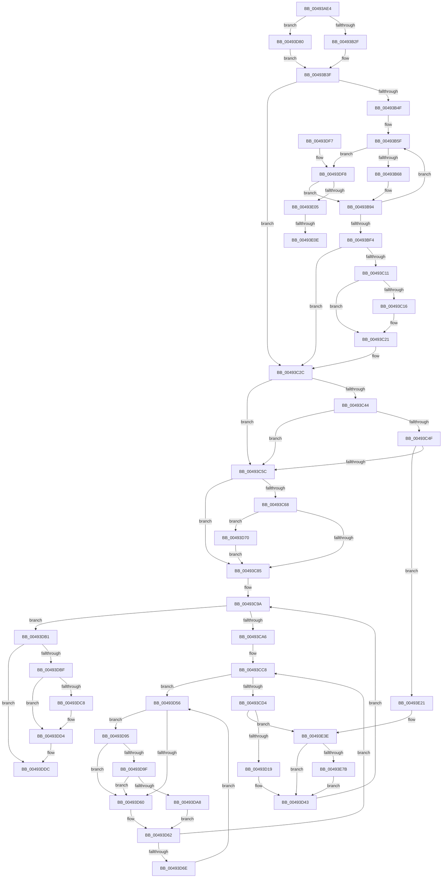

# MiDeleteShadowStackPtes

- RVA: `0x00493AE4`–`0x00493E85` (길이 `929` bytes)
- VA: `0x0000000140493AE4`
- 실행 섹션: `.text`
- PDB 이름 있음: `예`; PDB Function 태그: `예`
- unwind 정보 RVA: `0x000B31E0`
- 디코드: `218`개 명령, `929/929` bytes 표시
- 미해석 바이트: `0` (있으면 어셈블리에 `.byte`로 보존)

> 이 문서는 커널 이미지의 기계어와 PDB 기호를 분석해 생성했습니다. 4번과 5번은 함수 원형과 자료형을 바이너리 사용 방식에서 추정한 C 해석이며 원본 소스 복구 결과는 아닙니다.

## 1. Dependencies

- 직접 호출 지점: **17**; 고유 호출 대상: **16**
- 직접 호출자로 확인된 함수: **1**
- RIP 상대 이미지 참조: **5**

### Outgoing calls
- `0x00493B2F` → [MiLockWorkingSetShared](../27/MiLockWorkingSetShared_function_0027CBF0.md) (function, `0x0027CBF0`)
- `0x00493B8F` → [MiLockNestedPageTable](../23/MiLockNestedPageTable_function_0023E890.md) (function, `0x0023E890`)
- `0x00493BCA` → [MiValidateKernelShadowStackPage](../33/MiValidateKernelShadowStackPage_function_00338D98.md) (function, `0x00338D98`)
- `0x00493C1C` → [MiDecreaseUsedPtes](../37/MiDecreaseUsedPtes_function_00378080.md) (function, `0x00378080`)
- `0x00493C27` → [MiUnlockPageTable](../21/MiUnlockPageTable_function_00216EC0.md) (function, `0x00216EC0`)
- `0x00493C32` → [MiUnlockWorkingSetShared](../27/MiUnlockWorkingSetShared_function_0027D690.md) (function, `0x0027D690`)
- `0x00493C4F` → [VslFreeKernelShadowStack](../../page/A6/VslFreeKernelShadowStack_function_00A6373C.md) (function, `0x00A6373C`)
- `0x00493CAC` → [MiIsPfnFromChargedSlabAllocation](../2A/MiIsPfnFromChargedSlabAllocation_function_002A2968.md) (function, `0x002A2968`)
- `0x00493CD9` → [MiSetPfnIdentity](../2A/MiSetPfnIdentity_function_002A2350.md) (function, `0x002A2350`)
- `0x00493D3E` → [MiInsertPageInFreeOrZeroedList](../33/MiInsertPageInFreeOrZeroedList_function_00334D20.md) (function, `0x00334D20`)
- `0x00493D76` → [KiRaiseIrqlProcessIrqlFlags](../4F/KiRaiseIrqlProcessIrqlFlags_function_004F56FC.md) (function, `0x004F56FC`)
- `0x00493D8B` → [MiLockWorkingSetSharedAtDpc](../23/MiLockWorkingSetSharedAtDpc_function_00239574.md) (function, `0x00239574`)
- `0x00493D9F` → [KiCheckVpBackingLongSpinWaitHypercall](../30/KiCheckVpBackingLongSpinWaitHypercall_function_0030F490.md) (function, `0x0030F490`)
- `0x00493DAA` → [HvlNotifyLongSpinWait](../30/HvlNotifyLongSpinWait_function_0030F460.md) (function, `0x0030F460`)
- `0x00493DCF` → [KiLowerIrqlProcessIrqlFlags](../4F/KiLowerIrqlProcessIrqlFlags_function_004F5698.md) (function, `0x004F5698`)
- `0x00493E14` → [MiDecreaseUsedPtes](../37/MiDecreaseUsedPtes_function_00378080.md) (function, `0x00378080`)
- `0x00493E38` → [KeBugCheckEx](../4F/KeBugCheckEx_function_004FD660.md) (function, `0x004FD660`)

### Direct callers
- [MiDeleteKernelStackPages](../2D/MiDeleteKernelStackPages_function_002D9938.md) at `0x002D9A2D`

### Static image references
- `0x00493BD6` → RVA `0x00010880` (`.rdata`; read)
- `0x00493C44` → RVA `0x00FC6A88` (`ALMOSTRO`; read)
- `0x00493C78` → RVA `0x00FC6D20` (`ALMOSTRO`; read)
- `0x00493D58` → RVA `0x00FC52AC` (`ALMOSTRO`; reference)
- `0x00493D95` → RVA `0x00FC6AB8` (`ALMOSTRO`; read)

## 2. Other-region calls and transfers

- 다른 실행 섹션으로 향하는 call: **1**
  - `0x00493C4F` → [VslFreeKernelShadowStack](../../page/A6/VslFreeKernelShadowStack_function_00A6373C.md) (`.text` → `PAGE`)
- call이 아닌 외부 분기/꼬리 이동: **2**
  - `0x00493E08` → [sub_006F730C](../6F/Unknown_function_006F730C.md) (`tail-transfer`)
  - `0x00493E1C` → [sub_006F730C](../6F/Unknown_function_006F730C.md) (`tail-transfer`)

## 3. Assembly (complete function range)

```asm
00493AE4  48 89 5C 24 10                  mov qword ptr [rsp + 0x10], rbx
00493AE9  4C 89 44 24 18                  mov qword ptr [rsp + 0x18], r8
00493AEE  48 89 4C 24 08                  mov qword ptr [rsp + 8], rcx
00493AF3  55                              push rbp
00493AF4  56                              push rsi
00493AF5  57                              push rdi
00493AF6  41 54                           push r12
00493AF8  41 55                           push r13
00493AFA  41 56                           push r14
00493AFC  41 57                           push r15
00493AFE  48 83 EC 40                     sub rsp, 0x40
00493B02  33 FF                           xor edi, edi
00493B04  45 33 F6                        xor r14d, r14d
00493B07  48 21 7C 24 30                  and qword ptr [rsp + 0x30], rdi
00493B0C  49 8B D9                        mov rbx, r9
00493B0F  48 21 BC 24 98 00 00 00         and qword ptr [rsp + 0x98], rdi
00493B17  4D 8B F8                        mov r15, r8
00493B1A  48 8B EA                        mov rbp, rdx
00493B1D  44 0F 20 C0                     mov rax, cr8
00493B21  8D 4F 02                        lea ecx, [rdi + 2]
00493B24  3A C1                           cmp al, cl
00493B26  48 8B CA                        mov rcx, rdx
00493B29  0F 84 51 02 00 00               je 0x140493d80
00493B2F  E8 BC 90 DE FF                  call 0x14027cbf0
00493B34  40 8A F0                        mov sil, al
00493B37  48 89 B4 24 80 00 00 00         mov qword ptr [rsp + 0x80], rsi
00493B3F  4D 8D 2C DF                     lea r13, [r15 + rbx*8]
00493B43  4D 8B E7                        mov r12, r15
00493B46  4D 3B FD                        cmp r15, r13
00493B49  0F 83 DD 00 00 00               jae 0x140493c2c
00493B4F  48 8B B4 24 98 00 00 00         mov rsi, qword ptr [rsp + 0x98]
00493B57  4C 8B BC 24 A8 00 00 00         mov r15, qword ptr [rsp + 0xa8]
00493B5F  48 85 FF                        test rdi, rdi
00493B62  0F 85 90 02 00 00               jne 0x140493df8
00493B68  49 8B FC                        mov rdi, r12
00493B6B  48 B8 F8 FF FF FF 7F 00 00 00   movabs rax, 0x7ffffffff8
00493B75  48 C1 EF 09                     shr rdi, 9
00493B79  48 23 F8                        and rdi, rax
00493B7C  48 B8 00 00 00 00 80 F6 FF FF   movabs rax, 0xfffff68000000000
00493B86  48 03 F8                        add rdi, rax
00493B89  48 8B CD                        mov rcx, rbp
00493B8C  48 8B D7                        mov rdx, rdi
00493B8F  E8 FC AC DA FF                  call 0x14023e890
00493B94  49 8B 04 24                     mov rax, qword ptr [r12]
00493B98  48 B9 FF FF FF FF FF 00 00 00   movabs rcx, 0xffffffffff
00493BA2  48 C1 E8 0C                     shr rax, 0xc
00493BA6  48 23 C1                        and rax, rcx
00493BA9  48 8D 1C 40                     lea rbx, [rax + rax*2]
00493BAD  48 B8 00 00 00 00 00 DE FF FF   movabs rax, 0xffffde0000000000
00493BB7  48 C1 E3 04                     shl rbx, 4
00493BBB  48 8B C0                        mov rax, rax
00493BBE  49 FF 07                        inc qword ptr [r15]
00493BC1  48 03 D8                        add rbx, rax
00493BC4  48 8B D3                        mov rdx, rbx
00493BC7  49 8B CC                        mov rcx, r12
00493BCA  E8 C9 51 EA FF                  call 0x140338d98
00493BCF  49 FF 47 18                     inc qword ptr [r15 + 0x18]
00493BD3  41 FF C6                        inc r14d
00493BD6  48 8B 05 A3 CC B7 FF            mov rax, qword ptr [rip - 0x48335d]
00493BDD  48 89 33                        mov qword ptr [rbx], rsi
00493BE0  48 8B F3                        mov rsi, rbx
00493BE3  49 89 04 24                     mov qword ptr [r12], rax
00493BE7  49 83 C4 08                     add r12, 8
00493BEB  4D 3B E5                        cmp r12, r13
00493BEE  0F 82 6B FF FF FF               jb 0x140493b5f
00493BF4  48 8B B4 24 80 00 00 00         mov rsi, qword ptr [rsp + 0x80]
00493BFC  4C 8B BC 24 90 00 00 00         mov r15, qword ptr [rsp + 0x90]
00493C04  48 89 9C 24 98 00 00 00         mov qword ptr [rsp + 0x98], rbx
00493C0C  48 85 FF                        test rdi, rdi
00493C0F  74 1B                           je 0x140493c2c
00493C11  45 85 F6                        test r14d, r14d
00493C14  74 0B                           je 0x140493c21
00493C16  45 8B C6                        mov r8d, r14d
00493C19  48 8B D7                        mov rdx, rdi
00493C1C  E8 5F 44 EE FF                  call 0x140378080
00493C21  48 8B D7                        mov rdx, rdi
00493C24  48 8B CD                        mov rcx, rbp
00493C27  E8 94 32 D8 FF                  call 0x140216ec0
00493C2C  40 8A D6                        mov dl, sil
00493C2F  48 8B CD                        mov rcx, rbp
00493C32  E8 59 9A DE FF                  call 0x14027d690
00493C37  48 8B 8C 24 A0 00 00 00         mov rcx, qword ptr [rsp + 0xa0]
00493C3F  48 85 C9                        test rcx, rcx
00493C42  74 18                           je 0x140493c5c
00493C44  48 0F BA 25 3B 2E B3 00 29      bt qword ptr [rip + 0xb32e3b], 0x29
00493C4D  73 0D                           jae 0x140493c5c
00493C4F  E8 E8 FA 5C 00                  call 0x140a6373c
00493C54  85 C0                           test eax, eax
00493C56  0F 88 C5 01 00 00               js 0x140493e21
00493C5C  41 BD 02 00 00 00               mov r13d, 2
00493C62  40 80 FE 11                     cmp sil, 0x11
00493C66  74 1D                           je 0x140493c85
00493C68  44 0F 20 C6                     mov rsi, cr8
00493C6C  48 89 B4 24 80 00 00 00         mov qword ptr [rsp + 0x80], rsi
00493C74  45 0F 22 C5                     mov cr8, r13
00493C78  83 3D A1 30 B3 00 00            cmp dword ptr [rip + 0xb330a1], 0
00493C7F  0F 85 EB 00 00 00               jne 0x140493d70
00493C85  48 8B B4 24 98 00 00 00         mov rsi, qword ptr [rsp + 0x98]
00493C8D  4C 8B 7C 24 30                  mov r15, qword ptr [rsp + 0x30]
00493C92  4C 8B A4 24 A8 00 00 00         mov r12, qword ptr [rsp + 0xa8]
00493C9A  48 8B DE                        mov rbx, rsi
00493C9D  48 85 F6                        test rsi, rsi
00493CA0  0F 84 0B 01 00 00               je 0x140493db1
00493CA6  48 8B 36                        mov rsi, qword ptr [rsi]
00493CA9  48 8B CB                        mov rcx, rbx
00493CAC  E8 B7 EC E0 FF                  call 0x1402a2968
00493CB1  44 8B F0                        mov r14d, eax
00493CB4  48 8D 7B 18                     lea rdi, [rbx + 0x18]
00493CB8  45 85 F6                        test r14d, r14d
00493CBB  49 8D 47 01                     lea rax, [r15 + 1]
00493CBF  49 0F 44 C7                     cmove rax, r15
00493CC3  33 ED                           xor ebp, ebp
00493CC5  4C 8B F8                        mov r15, rax
00493CC8  F0 48 0F BA 2F 3F               lock bts qword ptr [rdi], 0x3f
00493CCE  0F 82 82 00 00 00               jb 0x140493d56
00493CD4  33 D2                           xor edx, edx
00493CD6  48 8B CB                        mov rcx, rbx
00493CD9  E8 72 E6 E0 FF                  call 0x1402a2350
00493CDE  48 8B 07                        mov rax, qword ptr [rdi]
00493CE1  48 B9 00 00 00 00 00 00 00 C0   movabs rcx, 0xc000000000000000
00493CEB  48 23 C1                        and rax, rcx
00493CEE  48 89 43 18                     mov qword ptr [rbx + 0x18], rax
00493CF2  8B 43 20                        mov eax, dword ptr [rbx + 0x20]
00493CF5  89 84 24 90 00 00 00            mov dword ptr [rsp + 0x90], eax
00493CFC  B8 FE FF 00 00                  mov eax, 0xfffe
00493D01  66 01 84 24 90 00 00 00         add word ptr [rsp + 0x90], ax
00493D09  8B 84 24 90 00 00 00            mov eax, dword ptr [rsp + 0x90]
00493D10  89 43 20                        mov dword ptr [rbx + 0x20], eax
00493D13  0F 85 25 01 00 00               jne 0x140493e3e
00493D19  48 B8 00 00 00 00 00 DE FF FF   movabs rax, 0xffffde0000000000
00493D23  48 8B C0                        mov rax, rax
00493D26  48 2B D8                        sub rbx, rax
00493D29  48 B9 AB AA AA AA AA AA AA AA   movabs rcx, 0xaaaaaaaaaaaaaaab
00493D33  48 C1 FB 04                     sar rbx, 4
00493D37  41 8B D5                        mov edx, r13d
00493D3A  48 0F AF CB                     imul rcx, rbx
00493D3E  E8 DD 0F EA FF                  call 0x140334d20
00493D43  48 B8 FF FF FF FF FF FF FF 7F   movabs rax, 0x7fffffffffffffff
00493D4D  F0 48 21 07                     lock and qword ptr [rdi], rax
00493D51  E9 44 FF FF FF                  jmp 0x140493c9a
00493D56  FF C5                           inc ebp
00493D58  85 2D 4E 15 B3 00               test dword ptr [rip + 0xb3154e], ebp
00493D5E  74 35                           je 0x140493d95
00493D60  F3 90                           pause
00493D62  48 8B 07                        mov rax, qword ptr [rdi]
00493D65  48 85 C0                        test rax, rax
00493D68  0F 89 5A FF FF FF               jns 0x140493cc8
00493D6E  EB E6                           jmp 0x140493d56
00493D70  41 8A D5                        mov dl, r13b
00493D73  40 8A CE                        mov cl, sil
00493D76  E8 81 19 06 00                  call 0x1404f56fc
00493D7B  E9 05 FF FF FF                  jmp 0x140493c85
00493D80  40 B6 11                        mov sil, 0x11
00493D83  48 89 B4 24 80 00 00 00         mov qword ptr [rsp + 0x80], rsi
00493D8B  E8 E4 57 DA FF                  call 0x140239574
00493D90  E9 AA FD FF FF                  jmp 0x140493b3f
00493D95  8B 05 1D 2D B3 00               mov eax, dword ptr [rip + 0xb32d1d]
00493D9B  A8 40                           test al, 0x40
00493D9D  74 C1                           je 0x140493d60
00493D9F  E8 EC B6 E7 FF                  call 0x14030f490
00493DA4  84 C0                           test al, al
00493DA6  74 B8                           je 0x140493d60
00493DA8  8B CD                           mov ecx, ebp
00493DAA  E8 B1 B6 E7 FF                  call 0x14030f460
00493DAF  EB B1                           jmp 0x140493d62
00493DB1  48 8B B4 24 80 00 00 00         mov rsi, qword ptr [rsp + 0x80]
00493DB9  40 80 FE 11                     cmp sil, 0x11
00493DBD  74 1D                           je 0x140493ddc
00493DBF  83 3D 5A 2F B3 00 00            cmp dword ptr [rip + 0xb32f5a], 0
00493DC6  74 0C                           je 0x140493dd4
00493DC8  44 0F 20 C1                     mov rcx, cr8
00493DCC  40 8A D6                        mov dl, sil
00493DCF  E8 C4 18 06 00                  call 0x1404f5698
00493DD4  40 0F B6 CE                     movzx ecx, sil
00493DD8  44 0F 22 C1                     mov cr8, rcx
00493DDC  48 8B 9C 24 88 00 00 00         mov rbx, qword ptr [rsp + 0x88]
00493DE4  49 8B C7                        mov rax, r15
00493DE7  48 83 C4 40                     add rsp, 0x40
00493DEB  41 5F                           pop r15
00493DED  41 5E                           pop r14
00493DEF  41 5D                           pop r13
00493DF1  41 5C                           pop r12
00493DF3  5F                              pop rdi
00493DF4  5E                              pop rsi
00493DF5  5D                              pop rbp
00493DF6  C3                              ret
00493DF7  CC                              int3
00493DF8  49 F7 C4 FF 0F 00 00            test r12, 0xfff
00493DFF  0F 85 8F FD FF FF               jne 0x140493b94
00493E05  45 85 F6                        test r14d, r14d
00493E08  0F 84 FE 34 26 00               je 0x1406f730c
00493E0E  45 8B C6                        mov r8d, r14d
00493E11  48 8B D7                        mov rdx, rdi
00493E14  E8 67 42 EE FF                  call 0x140378080
00493E19  45 33 F6                        xor r14d, r14d
00493E1C  E9 EB 34 26 00                  jmp 0x1406f730c
00493E21  48 83 64 24 20 00               and qword ptr [rsp + 0x20], 0
00493E27  4D 8D 47 FF                     lea r8, [r15 - 1]
00493E2B  4C 63 C8                        movsxd r9, eax
00493E2E  BA 41 15 05 00                  mov edx, 0x51541
00493E33  B9 1A 00 00 00                  mov ecx, 0x1a
00493E38  E8 23 98 06 00                  call 0x1404fd660
00493E3D  CC                              int3
00493E3E  8B 43 20                        mov eax, dword ptr [rbx + 0x20]
00493E41  48 B9 00 00 00 00 00 00 00 40   movabs rcx, 0x4000000000000000
00493E4B  89 84 24 90 00 00 00            mov dword ptr [rsp + 0x90], eax
00493E52  C1 E8 10                        shr eax, 0x10
00493E55  0C 07                           or al, 7
00493E57  88 84 24 92 00 00 00            mov byte ptr [rsp + 0x92], al
00493E5E  8B 84 24 90 00 00 00            mov eax, dword ptr [rsp + 0x90]
00493E65  89 43 20                        mov dword ptr [rbx + 0x20], eax
00493E68  48 8B 07                        mov rax, qword ptr [rdi]
00493E6B  48 0B C1                        or rax, rcx
00493E6E  48 89 43 18                     mov qword ptr [rbx + 0x18], rax
00493E72  45 85 F6                        test r14d, r14d
00493E75  0F 85 C8 FE FF FF               jne 0x140493d43
00493E7B  49 FF 44 24 08                  inc qword ptr [r12 + 8]
00493E80  E9 BE FE FF FF                  jmp 0x140493d43
```

## 4. C-style interpretation (structured pseudocode)

```c
__int64 __fastcall MiDeleteShadowStackPtes(__int64 a1, __int64 a2, __int64 a3, __int64 a4, __int64 a5, __int64 a6)
{
    __int64 result;
    __int64 v_r12;
    __int64 v_r14;
    __int64 v_rbp;
    __int64 v_rbx;
    __int64 v_rdi;
    __int64 v_rsp;
    unsigned __int64 v_stack_m48;
    unsigned __int64 v_stack_p10;
    unsigned __int64 v_stack_p18;
    unsigned __int64 v_stack_p20;
    unsigned __int64 v_stack_p8;
    unsigned int v_stack_p90;
    unsigned __int8 v_stack_p92;

    v_stack_p10 = v_rbx;
    v_stack_p18 = a3;
    v_stack_p8 = a1;
    v_rsp = (v_rsp) - (64);
    v_rdi = 0;
    v_r14 = 0;
    if (((unsigned __int8)(v_cr8)) == ((unsigned __int8)(v_rdi + 2))) goto loc_00493D80;
    result = MiLockWorkingSetShared(a2, a2, a3, a4);
    v_stack_p8 = (unsigned __int8)(result);
loc_00493B3F:
    if (a3 >= (a3 + a4 * 8)) goto loc_00493C2C;
loc_00493B5F:
    if (0 != 0) goto loc_00493DF8;
    v_rdi = (a3) >> (9);
    v_rdi = (v_rdi) & (result);
    v_rdi = (v_rdi) + (result);
    result = MiLockNestedPageTable(a2, v_rdi, a3, a4);
loc_00493B94:
    result = (*(unsigned __int64 *)(a3)) >> (12);
    result = (result) & (a2);
    v_rbx = (result + result * 2) << (4);
    v_rbx = (v_rbx) + (result);
    result = MiValidateKernelShadowStackPage(a3, v_rbx, a3, a4);
    v_r14 = (unsigned int)((v_r14) + 1);
    *(unsigned __int64 *)(v_rbx) = v_stack_p20;
    *(unsigned __int64 *)(a3) = *(unsigned __int64 *)(v_rip - 4731741);
    v_r12 = (a3) + (8);
    if (v_r12 < (a3 + a4 * 8)) goto loc_00493B5F;
    v_stack_p20 = v_rbx;
    if (v_rdi == 0) goto loc_00493C2C;
    result = *(unsigned __int64 *)(v_rip - 4731741);
    if ((unsigned int)(v_r14) != 0) {
        a3 = (unsigned int)(v_r14);
        a2 = v_rdi;
        result = MiDecreaseUsedPtes(a3, a2, a3, a4);
    }
    result = MiUnlockPageTable(a2, v_rdi, a3, a4);
loc_00493C2C:
    result = MiUnlockWorkingSetShared(a2, (unsigned __int8)(v_stack_p8), a3, a4);
    if (a5 == 0) goto loc_00493C5C;
    if (condition_is_above_or_equal) goto loc_00493C5C;
    result = VslFreeKernelShadowStack(a5, (unsigned __int8)(v_stack_p8), a3, a4);
    if (sign_flag) goto loc_00493E21;
loc_00493C5C:
    if (((unsigned __int8)(v_stack_p8)) == 17) goto loc_00493C85;
    v_stack_p8 = v_cr8;
    if ((*(unsigned int *)(v_rip + 11743393)) != 0) goto loc_00493D70;
loc_00493C85:
loc_00493C9A:
    if (v_stack_p20 == 0) goto loc_00493DB1;
    result = MiIsPfnFromChargedSlabAllocation(v_stack_p20, (unsigned __int8)(v_stack_p8), a3, a4);
    result = v_stack_m48 + 1;
    if ((unsigned int)((unsigned int)((unsigned int)(result))) == 0) { result = v_stack_m48; }
    v_rbp = 0;
loc_00493CC8:
    if (condition_is_below) goto loc_00493D56;
    a2 = 0;
    result = MiSetPfnIdentity(v_stack_p20, a2, a3, a4);
    result = (*(unsigned __int64 *)(v_stack_p20 + 24)) & (v_stack_p20);
    *(unsigned __int64 *)(v_stack_p20 + 24) = result;
    v_stack_p18 = (unsigned int)((unsigned int)(*(unsigned int *)(v_stack_p20 + 32)));
    *(unsigned int *)(v_stack_p20 + 32) = (unsigned int)((unsigned int)(v_stack_p18));
    if (condition_is_not_equal) goto loc_00493E3E;
    v_rbx = (v_stack_p20) - ((unsigned int)(v_stack_p18));
    v_rbx = (v_rbx) >> (4);
    a1 = (v_stack_p20) * (v_rbx);
    result = MiInsertPageInFreeOrZeroedList(a1, 2, a3, a4);
loc_00493D43:
    goto loc_00493C9A;
loc_00493D56:
    v_rbp = (unsigned int)((v_rbp) + 1);
    if (((*(unsigned int *)(v_rip + 11736398)) & ((unsigned int)(v_rbp))) == 0) goto loc_00493D95;
loc_00493D60:
loc_00493D62:
    if (!sign_flag) goto loc_00493CC8;
    goto loc_00493D56;
loc_00493D70:
    result = KiRaiseIrqlProcessIrqlFlags((unsigned __int8)(*(unsigned __int64 *)(v_stack_p20)), 2, a3, a4);
    goto loc_00493C85;
loc_00493D80:
    v_stack_p8 = 17;
    result = MiLockWorkingSetSharedAtDpc((unsigned __int8)(*(unsigned __int64 *)(v_stack_p20)), 2, a3, a4);
    goto loc_00493B3F;
loc_00493D95:
    if ((((unsigned __int8)((unsigned int)(*(unsigned int *)(v_rip + 11742493)))) & (64)) == 0) goto loc_00493D60;
    result = KiCheckVpBackingLongSpinWaitHypercall((unsigned __int8)(*(unsigned __int64 *)(v_stack_p20)), 2, a3, a4);
    if ((unsigned __int8)(result) == 0) goto loc_00493D60;
    result = HvlNotifyLongSpinWait((unsigned int)((unsigned int)(v_rbp)), 2, a3, a4);
    goto loc_00493D62;
loc_00493DB1:
    if (((unsigned __int8)(v_stack_p8)) == 17) goto loc_00493DDC;
    if ((*(unsigned int *)(v_rip + 11743066)) != 0) {
        a1 = 2;
        a2 = (unsigned __int8)(v_stack_p8);
        result = KiLowerIrqlProcessIrqlFlags(a1, a2, a3, a4);
    }
loc_00493DDC:
    v_rsp = (v_rsp) + (64);
    return result;
loc_00493DF8:
    if (((a6) & (0xFFFULL)) != 0) goto loc_00493B94;
    result = MiDecreaseUsedPtes((unsigned __int8)(v_stack_p8), v_stack_p20 + 24, (unsigned int)((unsigned int)((unsigned int)((unsigned int)(result)))), a4);
    v_r14 = 0;
loc_00493E21:
    result = KeBugCheckEx(26, (unsigned int)(0x51541ULL), result - 1, (int)((unsigned int)(result)));
loc_00493E3E:
    v_stack_p90 = (unsigned int)((unsigned int)(*(unsigned int *)(v_stack_p10 + 32)));
    result = (unsigned int)(((unsigned int)(*(unsigned int *)(v_stack_p10 + 32))) >> (16));
    result = (unsigned __int8)((result) | (7));
    v_stack_p92 = (unsigned __int8)(result);
    *(unsigned int *)(v_stack_p10 + 32) = (unsigned int)((unsigned int)(v_stack_p90));
    result = (*(unsigned __int64 *)(v_stack_p20 + 24)) | (26);
    *(unsigned __int64 *)(v_stack_p10 + 24) = result;
    if (0 != 0) goto loc_00493D43;
    goto loc_00493D43;
}
```

## 5. (Beta) C Style

```c
int64_t MiDeleteShadowStackPtes(int64_t Arg1, int64_t Arg2, void *Arg3, int64_t Arg4, int64_t Arg5, void *Arg6)
{
    uint8_t *arg3 = (uint8_t *)Arg3;
    uint8_t *arg6 = (uint8_t *)Arg6;

    int64_t result;
    int64_t local_r12;
    int64_t local_r14;
    int64_t local_rbp;
    int64_t local_rbx;
    int64_t local_rdi;
    int64_t local_rsp;
    uint64_t v_stack_m48;
    uint64_t v_stack_p10;
    uint64_t v_stack_p18;
    uint64_t v_stack_p20;
    uint64_t v_stack_p8;
    uint32_t v_stack_p90;
    uint8_t v_stack_p92;

    v_stack_p10 = local_rbx;
    v_stack_p18 = Arg3;
    v_stack_p8 = Arg1;
    local_rsp = (local_rsp) - (64);
    local_rdi = 0;
    local_r14 = 0;
    if (((uint8_t)(v_cr8)) == ((uint8_t)(local_rdi + 2))) goto loc_00493D80;
    result = MiLockWorkingSetShared(Arg2, Arg2, Arg3, Arg4);
    v_stack_p8 = (uint8_t)(result);
loc_00493B3F:
    if (Arg3 >= (Arg3 + Arg4 * 8)) goto loc_00493C2C;
loc_00493B5F:
    if (0 != 0) goto loc_00493DF8;
    local_rdi = (Arg3) >> (9);
    local_rdi = (local_rdi) & (result);
    local_rdi = (local_rdi) + (result);
    result = MiLockNestedPageTable(Arg2, local_rdi, Arg3, Arg4);
loc_00493B94:
    result = (*(uint64_t *)(arg3)) >> (12);
    result = (result) & (Arg2);
    local_rbx = (result + result * 2) << (4);
    local_rbx = (local_rbx) + (result);
    result = MiValidateKernelShadowStackPage(Arg3, local_rbx, Arg3, Arg4);
    local_r14 = (uint32_t)((local_r14) + 1);
    *(uint64_t *)(local_rbx) = v_stack_p20;
    *(uint64_t *)(arg3) = *(uint64_t *)(v_rip - 0x48335D);
    local_r12 = (Arg3) + (8);
    if (local_r12 < (Arg3 + Arg4 * 8)) goto loc_00493B5F;
    v_stack_p20 = local_rbx;
    if (local_rdi == 0) goto loc_00493C2C;
    result = *(uint64_t *)(v_rip - 0x48335D);
    if ((uint32_t)(local_r14) != 0) {
        Arg3 = (uint32_t)(local_r14);
        Arg2 = local_rdi;
        result = MiDecreaseUsedPtes(Arg3, Arg2, Arg3, Arg4);
    }
    result = MiUnlockPageTable(Arg2, local_rdi, Arg3, Arg4);
loc_00493C2C:
    result = MiUnlockWorkingSetShared(Arg2, (uint8_t)(v_stack_p8), Arg3, Arg4);
    if (Arg5 == 0) goto loc_00493C5C;
    if (condition_is_above_or_equal) goto loc_00493C5C;
    result = VslFreeKernelShadowStack(Arg5, (uint8_t)(v_stack_p8), Arg3, Arg4);
    if (sign_flag) goto loc_00493E21;
loc_00493C5C:
    if (((uint8_t)(v_stack_p8)) == 17) goto loc_00493C85;
    v_stack_p8 = v_cr8;
    if ((*(uint32_t *)(v_rip + 0xB330A1)) != 0) goto loc_00493D70;
loc_00493C85:
loc_00493C9A:
    if (v_stack_p20 == 0) goto loc_00493DB1;
    result = MiIsPfnFromChargedSlabAllocation(v_stack_p20, (uint8_t)(v_stack_p8), Arg3, Arg4);
    result = v_stack_m48 + 1;
    if ((uint32_t)((uint32_t)((uint32_t)(result))) == 0) { result = v_stack_m48; }
    local_rbp = 0;
loc_00493CC8:
    if (condition_is_below) goto loc_00493D56;
    Arg2 = 0;
    result = MiSetPfnIdentity(v_stack_p20, Arg2, Arg3, Arg4);
    result = (*(uint64_t *)(v_stack_p20 + 0x18)) & (v_stack_p20);
    *(uint64_t *)(v_stack_p20 + 0x18) = result;
    v_stack_p18 = (uint32_t)((uint32_t)(*(uint32_t *)(v_stack_p20 + 0x20)));
    *(uint32_t *)(v_stack_p20 + 0x20) = (uint32_t)((uint32_t)(v_stack_p18));
    if (condition_is_not_equal) goto loc_00493E3E;
    local_rbx = (v_stack_p20) - ((uint32_t)(v_stack_p18));
    local_rbx = (local_rbx) >> (4);
    Arg1 = (v_stack_p20) * (local_rbx);
    result = MiInsertPageInFreeOrZeroedList(Arg1, 2, Arg3, Arg4);
loc_00493D43:
    goto loc_00493C9A;
loc_00493D56:
    local_rbp = (uint32_t)((local_rbp) + 1);
    if (((*(uint32_t *)(v_rip + 0xB3154E)) & ((uint32_t)(local_rbp))) == 0) goto loc_00493D95;
loc_00493D60:
loc_00493D62:
    if (!sign_flag) goto loc_00493CC8;
    goto loc_00493D56;
loc_00493D70:
    result = KiRaiseIrqlProcessIrqlFlags((uint8_t)(*(uint64_t *)(v_stack_p20)), 2, Arg3, Arg4);
    goto loc_00493C85;
loc_00493D80:
    v_stack_p8 = 17;
    result = MiLockWorkingSetSharedAtDpc((uint8_t)(*(uint64_t *)(v_stack_p20)), 2, Arg3, Arg4);
    goto loc_00493B3F;
loc_00493D95:
    if ((((uint8_t)((uint32_t)(*(uint32_t *)(v_rip + 0xB32D1D)))) & (64)) == 0) goto loc_00493D60;
    result = KiCheckVpBackingLongSpinWaitHypercall((uint8_t)(*(uint64_t *)(v_stack_p20)), 2, Arg3, Arg4);
    if ((uint8_t)(result) == 0) goto loc_00493D60;
    result = HvlNotifyLongSpinWait((uint32_t)((uint32_t)(local_rbp)), 2, Arg3, Arg4);
    goto loc_00493D62;
loc_00493DB1:
    if (((uint8_t)(v_stack_p8)) == 17) goto loc_00493DDC;
    if ((*(uint32_t *)(v_rip + 0xB32F5A)) != 0) {
        Arg1 = 2;
        Arg2 = (uint8_t)(v_stack_p8);
        result = KiLowerIrqlProcessIrqlFlags(Arg1, Arg2, Arg3, Arg4);
    }
loc_00493DDC:
    local_rsp = (local_rsp) + (64);
    return result;
loc_00493DF8:
    if (((Arg6) & (0xFFFULL)) != 0) goto loc_00493B94;
    result = MiDecreaseUsedPtes((uint8_t)(v_stack_p8), v_stack_p20 + 24, (uint32_t)((uint32_t)((uint32_t)((uint32_t)(result)))), Arg4);
    local_r14 = 0;
loc_00493E21:
    result = KeBugCheckEx(26, (uint32_t)(0x51541ULL), result - 1, (int32_t)((uint32_t)(result)));
loc_00493E3E:
    v_stack_p90 = (uint32_t)((uint32_t)(*(uint32_t *)(v_stack_p10 + 0x20)));
    result = (uint32_t)(((uint32_t)(*(uint32_t *)(v_stack_p10 + 0x20))) >> (16));
    result = (uint8_t)((result) | (7));
    v_stack_p92 = (uint8_t)(result);
    *(uint32_t *)(v_stack_p10 + 0x20) = (uint32_t)((uint32_t)(v_stack_p90));
    result = (*(uint64_t *)(v_stack_p20 + 0x18)) | (26);
    *(uint64_t *)(v_stack_p10 + 0x18) = result;
    if (0 != 0) goto loc_00493D43;
    goto loc_00493D43;
}
```

### 관측된 메모리 오프셋

구조체 형식이 확인되지 않은 접근은 인자 기준의 오프셋으로만 기록했습니다.

| 기준 인자 | 오프셋 표현 | 폭 (bit) | 접근 |
|---|---:|---:|---|
| `Arg3` | `+ 0x0 + rbx*8` | `64` | `R` |
| `Arg6` | `+ 0x0` | `64` | `R/W` |
| `Arg6` | `+ 0x18` | `64` | `R/W` |

## 6. Execution-region graph

[열기: 2D/3D 그래프와 함수 탐색 컨트롤 패널](../../../control-panel.html?section=text&rva=0x00493AE4&view=graph)

- 2D 그래프는 위에서 아래로 흐르고, 3D 그래프는 빈 공간을 드래그해 회전합니다. Shift+드래그는 이동, 휠은 확대·축소, 함수 노드 선택은 대상 보고서 이동입니다.

### Static fallback


