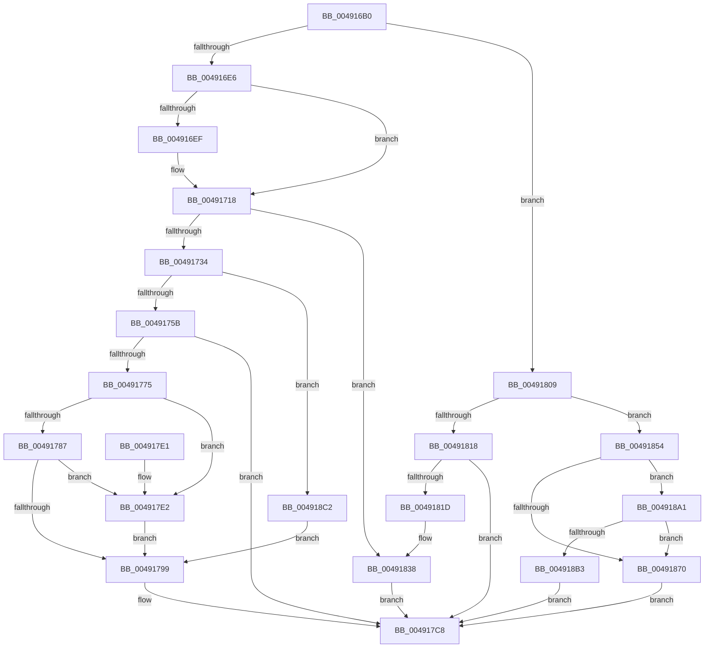

# MiDeleteSystemPageTable

- RVA: `0x004916B0`–`0x004918D1` (길이 `545` bytes)
- VA: `0x00000001404916B0`
- 실행 섹션: `.text`
- PDB 이름 있음: `예`; PDB Function 태그: `아니요`
- unwind 정보 RVA: `0x000B2DD0`
- 디코드: `135`개 명령, `545/545` bytes 표시
- 미해석 바이트: `0` (있으면 어셈블리에 `.byte`로 보존)

> 이 문서는 커널 이미지의 기계어와 PDB 기호를 분석해 생성했습니다. 4번과 5번은 함수 원형과 자료형을 바이너리 사용 방식에서 추정한 C 해석이며 원본 소스 복구 결과는 아닙니다.

## 1. Dependencies

- 직접 호출 지점: **11**; 고유 호출 대상: **10**
- 직접 호출자로 확인된 함수: **0**
- RIP 상대 이미지 참조: **1**

### Outgoing calls
- `0x004916EF` → [MiGetProcessorFlushList](../24/MiGetProcessorFlushList_function_00242C90.md) (function, `0x00242C90`)
- `0x00491713` → [MiInitializeTbFlushList](../29/MiInitializeTbFlushList_function_00294F00.md) (function, `0x00294F00`)
- `0x0049176C` → [MiEvictPageTableLock](../2C/MiEvictPageTableLock_function_002C1FBC.md) (function, `0x002C1FBC`)
- `0x0049179F` → [MiAddSystemPageTableToList](../2A/MiAddSystemPageTableToList_function_002A23A4.md) (function, `0x002A23A4`)
- `0x004917C3` → [MiInsertTbFlushEntry](../29/MiInsertTbFlushEntry_function_00293670.md) (function, `0x00293670`)
- `0x00491802` → [MiDecreaseUsedPtes](../37/MiDecreaseUsedPtes_function_00378080.md) (function, `0x00378080`)
- `0x0049180E` → [MiMakeDemandZeroPte](../33/MiMakeDemandZeroPte_function_00337A00.md) (function, `0x00337A00`)
- `0x00491832` → [KeBugCheckEx](../4F/KeBugCheckEx_function_004FD660.md) (function, `0x004FD660`)
- `0x00491840` → [MiInsertLargeTbFlushEntry](../37/MiInsertLargeTbFlushEntry_function_0037827C.md) (function, `0x0037827C`)
- `0x00491897` → [MiDecreaseUsedPtes](../37/MiDecreaseUsedPtes_function_00378080.md) (function, `0x00378080`)
- `0x004918B8` → [MiReplicatePteChange](../4F/MiReplicatePteChange_function_004F8A24.md) (function, `0x004F8A24`)

### Direct callers
- 이 함수 시작 RVA로 연결되는 직접 call은 확인되지 않았습니다. 간접 호출은 완전히 역산할 수 없습니다.

### Static image references
- `0x0049175B` → RVA `0x00010880` (`.rdata`; read)

## 2. Other-region calls and transfers

- 다른 실행 섹션으로 향하는 call: **0**
- 별도 외부 분기/꼬리 이동을 확인하지 못했습니다.

## 3. Assembly (complete function range)

```asm
004916B0  48 89 5C 24 10                  mov qword ptr [rsp + 0x10], rbx
004916B5  48 89 6C 24 18                  mov qword ptr [rsp + 0x18], rbp
004916BA  56                              push rsi
004916BB  57                              push rdi
004916BC  41 54                           push r12
004916BE  41 56                           push r14
004916C0  41 57                           push r15
004916C2  48 83 EC 30                     sub rsp, 0x30
004916C6  48 8B 1A                        mov rbx, qword ptr [rdx]
004916C9  48 8B FA                        mov rdi, rdx
004916CC  4C 8B B1 B8 00 00 00            mov r14, qword ptr [rcx + 0xb8]
004916D3  4C 8B F9                        mov r15, rcx
004916D6  4C 8B 61 20                     mov r12, qword ptr [rcx + 0x20]
004916DA  49 63 E8                        movsxd rbp, r8d
004916DD  F6 C3 01                        test bl, 1
004916E0  0F 84 23 01 00 00               je 0x140491809
004916E6  49 8B 76 20                     mov rsi, qword ptr [r14 + 0x20]
004916EA  48 85 F6                        test rsi, rsi
004916ED  75 29                           jne 0x140491718
004916EF  E8 9C 15 DB FF                  call 0x140242c90
004916F4  49 89 46 20                     mov qword ptr [r14 + 0x20], rax
004916F8  41 B9 08 00 00 00               mov r9d, 8
004916FE  49 8B D4                        mov rdx, r12
00491701  C7 44 24 20 01 00 00 00         mov dword ptr [rsp + 0x20], 1
00491709  48 8B C8                        mov rcx, rax
0049170C  48 8B F0                        mov rsi, rax
0049170F  44 8B 40 0C                     mov r8d, dword ptr [rax + 0xc]
00491713  E8 E8 37 E0 FF                  call 0x140294f00
00491718  48 8B CB                        mov rcx, rbx
0049171B  48 B8 FF FF FF FF FF 00 00 00   movabs rax, 0xffffffffff
00491725  48 C1 E9 0C                     shr rcx, 0xc
00491729  48 23 C8                        and rcx, rax
0049172C  84 DB                           test bl, bl
0049172E  0F 88 04 01 00 00               js 0x140491838
00491734  4C 8D 34 49                     lea r14, [rcx + rcx*2]
00491738  49 C1 E6 04                     shl r14, 4
0049173C  48 B8 00 00 00 00 00 DE FF FF   movabs rax, 0xffffde0000000000
00491746  4C 03 F0                        add r14, rax
00491749  48 BB 00 00 00 00 80 F6 FF FF   movabs rbx, 0xfffff68000000000
00491753  85 ED                           test ebp, ebp
00491755  0F 84 67 01 00 00               je 0x1404918c2
0049175B  4C 8B 0D 1E F1 B7 FF            mov r9, qword ptr [rip - 0x480ee2]
00491762  44 8B C5                        mov r8d, ebp
00491765  49 8B 4F 20                     mov rcx, qword ptr [r15 + 0x20]
00491769  48 8B D7                        mov rdx, rdi
0049176C  E8 4B 08 E3 FF                  call 0x1402c1fbc
00491771  85 C0                           test eax, eax
00491773  74 53                           je 0x1404917c8
00491775  48 B8 00 D0 BE 7D FB F6 FF FF   movabs rax, 0xfffff6fb7dbed000
0049177F  48 8B C0                        mov rax, rax
00491782  48 3B F8                        cmp rdi, rax
00491785  72 5B                           jb 0x1404917e2
00491787  48 B8 FF DF BE 7D FB F6 FF FF   movabs rax, 0xfffff6fb7dbedfff
00491791  48 8B C0                        mov rax, rax
00491794  48 3B F8                        cmp rdi, rax
00491797  77 49                           ja 0x1404917e2
00491799  49 8B D6                        mov rdx, r14
0049179C  49 8B CF                        mov rcx, r15
0049179F  E8 00 0C E1 FF                  call 0x1402a23a4
004917A4  48 C1 E7 19                     shl rdi, 0x19
004917A8  48 8B C3                        mov rax, rbx
004917AB  48 C1 E0 19                     shl rax, 0x19
004917AF  45 33 C9                        xor r9d, r9d
004917B2  48 2B F8                        sub rdi, rax
004917B5  48 8B CE                        mov rcx, rsi
004917B8  48 C1 FF 10                     sar rdi, 0x10
004917BC  48 8B D7                        mov rdx, rdi
004917BF  45 8D 41 01                     lea r8d, [r9 + 1]
004917C3  E8 A8 1E E0 FF                  call 0x140293670
004917C8  48 8B 5C 24 68                  mov rbx, qword ptr [rsp + 0x68]
004917CD  33 C0                           xor eax, eax
004917CF  48 8B 6C 24 70                  mov rbp, qword ptr [rsp + 0x70]
004917D4  48 83 C4 30                     add rsp, 0x30
004917D8  41 5F                           pop r15
004917DA  41 5E                           pop r14
004917DC  41 5C                           pop r12
004917DE  5F                              pop rdi
004917DF  5E                              pop rsi
004917E0  C3                              ret
004917E1  CC                              int3
004917E2  48 8B D7                        mov rdx, rdi
004917E5  48 B8 F8 FF FF FF 7F 00 00 00   movabs rax, 0x7ffffffff8
004917EF  48 C1 EA 09                     shr rdx, 9
004917F3  48 23 D0                        and rdx, rax
004917F6  48 8B C3                        mov rax, rbx
004917F9  48 03 D0                        add rdx, rax
004917FC  41 B8 01 00 00 00               mov r8d, 1
00491802  E8 79 68 EE FF                  call 0x140378080
00491807  EB 90                           jmp 0x140491799
00491809  B9 10 00 00 00                  mov ecx, 0x10
0049180E  E8 ED 61 EA FF                  call 0x140337a00
00491813  48 3B D8                        cmp rbx, rax
00491816  74 3C                           je 0x140491854
00491818  48 85 DB                        test rbx, rbx
0049181B  74 AB                           je 0x1404917c8
0049181D  4C 8B CB                        mov r9, rbx
00491820  48 89 6C 24 20                  mov qword ptr [rsp + 0x20], rbp
00491825  4C 8B C7                        mov r8, rdi
00491828  BA 40 14 00 00                  mov edx, 0x1440
0049182D  B9 1A 00 00 00                  mov ecx, 0x1a
00491832  E8 29 BE 06 00                  call 0x1404fd660
00491837  CC                              int3
00491838  4C 8B C7                        mov r8, rdi
0049183B  8B D5                           mov edx, ebp
0049183D  48 8B CE                        mov rcx, rsi
00491840  E8 37 6A EE FF                  call 0x14037827c
00491845  48 8B 05 34 F0 B7 FF            mov rax, qword ptr [rip - 0x480fcc]
0049184C  48 89 07                        mov qword ptr [rdi], rax
0049184F  E9 74 FF FF FF                  jmp 0x1404917c8
00491854  48 8B 05 25 F0 B7 FF            mov rax, qword ptr [rip - 0x480fdb]
0049185B  48 89 02                        mov qword ptr [rdx], rax
0049185E  48 B8 00 D0 BE 7D FB F6 FF FF   movabs rax, 0xfffff6fb7dbed000
00491868  48 8B C0                        mov rax, rax
0049186B  48 3B F8                        cmp rdi, rax
0049186E  73 31                           jae 0x1404918a1
00491870  48 C1 EF 09                     shr rdi, 9
00491874  48 BA F8 FF FF FF 7F 00 00 00   movabs rdx, 0x7ffffffff8
0049187E  48 23 D7                        and rdx, rdi
00491881  48 BB 00 00 00 00 80 F6 FF FF   movabs rbx, 0xfffff68000000000
0049188B  48 8B C3                        mov rax, rbx
0049188E  48 03 D0                        add rdx, rax
00491891  41 B8 01 00 00 00               mov r8d, 1
00491897  E8 E4 67 EE FF                  call 0x140378080
0049189C  E9 27 FF FF FF                  jmp 0x1404917c8
004918A1  48 B8 FF DF BE 7D FB F6 FF FF   movabs rax, 0xfffff6fb7dbedfff
004918AB  48 8B C0                        mov rax, rax
004918AE  48 3B F8                        cmp rdi, rax
004918B1  77 BD                           ja 0x140491870
004918B3  33 D2                           xor edx, edx
004918B5  48 8B CF                        mov rcx, rdi
004918B8  E8 67 71 06 00                  call 0x1404f8a24
004918BD  E9 06 FF FF FF                  jmp 0x1404917c8
004918C2  48 8B 05 B7 EF B7 FF            mov rax, qword ptr [rip - 0x481049]
004918C9  48 89 07                        mov qword ptr [rdi], rax
004918CC  E9 C8 FE FF FF                  jmp 0x140491799
```

## 4. C-style interpretation (structured pseudocode)

```c
__int64 __fastcall MiDeleteSystemPageTable(__int64 a1, __int64 a2, int a3)
{
    __int64 result;
    __int64 v_r14;
    __int64 v_rdi;
    __int64 v_rsi;
    __int64 v_rsp;
    unsigned int v_stack_m38;
    unsigned __int64 v_stack_p10;
    unsigned __int64 v_stack_p18;
    unsigned __int64 v_stack_p20;

    v_stack_p10 = v_rbx;
    v_stack_p18 = v_rbp;
    v_rsp = (v_rsp) - (48);
    if ((((unsigned __int8)(*(unsigned __int64 *)(a2))) & (1)) == 0) goto loc_00491809;
    v_rsi = *(unsigned __int64 *)(*(unsigned __int64 *)(a1 + 184) + 32);
    if (*(unsigned __int64 *)(*(unsigned __int64 *)(a1 + 184) + 32) == 0) {
        result = MiGetProcessorFlushList(a1, a2, a3, a4);
        *(unsigned __int64 *)(*(unsigned __int64 *)(a1 + 184) + 32) = result;
        a4 = 8;
        a2 = *(unsigned __int64 *)(a1 + 32);
        v_stack_m38 = 1;
        a1 = result;
        v_rsi = result;
        a3 = *(unsigned int *)(result + 12);
        result = MiInitializeTbFlushList(a1, a2, a3, a4);
    }
    a1 = (*(unsigned __int64 *)(a2)) >> (12);
    a1 = (a1) & (result);
    if (sign_flag) goto loc_00491838;
    v_r14 = (a1 + a1 * 2) << (4);
    v_r14 = (v_r14) + (result);
    if ((unsigned int)((int)(a3)) == 0) goto loc_004918C2;
    result = MiEvictPageTableLock(*(unsigned __int64 *)(a1 + 32), a2, (unsigned int)((unsigned int)((int)(a3))), *(unsigned __int64 *)(v_rip - 4722402));
    if ((unsigned int)(result) == 0) goto loc_004917C8;
    if (a2 < result) goto loc_004917E2;
    if (a2 > result) goto loc_004917E2;
loc_00491799:
    result = MiAddSystemPageTableToList(a1, v_r14, (unsigned int)((unsigned int)((int)(a3))), *(unsigned __int64 *)(v_rip - 4722402));
    v_rdi = (a2) << (25);
    result = (*(unsigned __int64 *)(a2)) << (25);
    a4 = 0;
    v_rdi = (v_rdi) - (result);
    v_rdi = (v_rdi) >> (16);
    result = MiInsertTbFlushEntry(v_rsi, v_rdi, a4 + 1, a4);
loc_004917C8:
    result = 0;
    v_rsp = (v_rsp) + (48);
    return result;
loc_004917E2:
    a2 = (v_rdi) >> (9);
    a2 = (a2) & (0);
    a2 = (a2) + (v_stack_p10);
    result = MiDecreaseUsedPtes(v_rsi, a2, 1, a4);
    goto loc_00491799;
loc_00491809:
    result = MiMakeDemandZeroPte(16, a2, 1, a4);
    if (v_stack_p10 == result) goto loc_00491854;
    if (v_stack_p10 == 0) goto loc_004917C8;
    v_stack_p20 = v_stack_p18;
    result = KeBugCheckEx(26, (unsigned int)(0x1440ULL), v_rdi, v_stack_p10);
loc_00491838:
    result = MiInsertLargeTbFlushEntry(v_rsi, (unsigned int)((unsigned int)(v_stack_p18)), v_rdi, v_stack_p10);
    *(unsigned __int64 *)(v_rdi) = *(unsigned __int64 *)(v_rip - 4722636);
    goto loc_004917C8;
loc_00491854:
    *(unsigned __int64 *)((unsigned int)((unsigned int)(v_stack_p18))) = *(unsigned __int64 *)(v_rip - 4722651);
    if (v_rdi >= (*(unsigned __int64 *)(v_rip - 4722651))) goto loc_004918A1;
loc_00491870:
    v_rdi = (v_rdi) >> (9);
    a2 = ((unsigned int)((unsigned int)(v_stack_p18))) & (v_rdi);
    a2 = (a2) + (v_stack_p10);
    result = MiDecreaseUsedPtes(v_rsi, a2, 1, v_stack_p10);
    goto loc_004917C8;
loc_004918A1:
    if (v_rdi > result) goto loc_00491870;
    a2 = 0;
    result = MiReplicatePteChange(v_rdi, a2, 1, v_stack_p10);
    goto loc_004917C8;
loc_004918C2:
    *(unsigned __int64 *)(v_rdi) = *(unsigned __int64 *)(v_rip - 4722761);
    goto loc_00491799;
}
```

## 5. (Beta) C Style

```c
int64_t MiDeleteSystemPageTable(void *Arg1, void *Arg2, int32_t Arg3)
{
    uint8_t *arg1 = (uint8_t *)Arg1;
    uint8_t *arg2 = (uint8_t *)Arg2;

    int64_t result;
    int64_t local_r14;
    int64_t local_rdi;
    int64_t local_rsi;
    int64_t local_rsp;
    uint32_t v_stack_m38;
    uint64_t v_stack_p10;
    uint64_t v_stack_p18;
    uint64_t v_stack_p20;

    v_stack_p10 = local_rbx;
    v_stack_p18 = local_rbp;
    local_rsp = (local_rsp) - (48);
    if ((((uint8_t)(*(uint64_t *)(arg2))) & (1)) == 0) goto loc_00491809;
    local_rsi = *(uint64_t *)(*(uint64_t *)(arg1 + 0xB8) + 0x20);
    if (*(uint64_t *)(*(uint64_t *)(arg1 + 0xB8) + 0x20) == 0) {
        result = MiGetProcessorFlushList(Arg1, Arg2, Arg3, a4);
        *(uint64_t *)(*(uint64_t *)(arg1 + 0xB8) + 0x20) = result;
        a4 = 8;
        Arg2 = *(uint64_t *)(arg1 + 0x20);
        v_stack_m38 = 1;
        Arg1 = result;
        local_rsi = result;
        Arg3 = *(uint32_t *)(result + 0xC);
        result = MiInitializeTbFlushList(Arg1, Arg2, Arg3, a4);
    }
    Arg1 = (*(uint64_t *)(arg2)) >> (12);
    Arg1 = (Arg1) & (result);
    if (sign_flag) goto loc_00491838;
    local_r14 = (Arg1 + Arg1 * 2) << (4);
    local_r14 = (local_r14) + (result);
    if ((uint32_t)((int32_t)(Arg3)) == 0) goto loc_004918C2;
    result = MiEvictPageTableLock(*(uint64_t *)(arg1 + 0x20), Arg2, (uint32_t)((uint32_t)((int32_t)(Arg3))), *(uint64_t *)(v_rip - 0x480EE2));
    if ((uint32_t)(result) == 0) goto loc_004917C8;
    if (Arg2 < result) goto loc_004917E2;
    if (Arg2 > result) goto loc_004917E2;
loc_00491799:
    result = MiAddSystemPageTableToList(Arg1, local_r14, (uint32_t)((uint32_t)((int32_t)(Arg3))), *(uint64_t *)(v_rip - 0x480EE2));
    local_rdi = (Arg2) << (25);
    result = (*(uint64_t *)(arg2)) << (25);
    a4 = 0;
    local_rdi = (local_rdi) - (result);
    local_rdi = (local_rdi) >> (16);
    result = MiInsertTbFlushEntry(local_rsi, local_rdi, a4 + 1, a4);
loc_004917C8:
    result = 0;
    local_rsp = (local_rsp) + (48);
    return result;
loc_004917E2:
    Arg2 = (local_rdi) >> (9);
    Arg2 = (Arg2) & (0);
    Arg2 = (Arg2) + (v_stack_p10);
    result = MiDecreaseUsedPtes(local_rsi, Arg2, 1, a4);
    goto loc_00491799;
loc_00491809:
    result = MiMakeDemandZeroPte(16, Arg2, 1, a4);
    if (v_stack_p10 == result) goto loc_00491854;
    if (v_stack_p10 == 0) goto loc_004917C8;
    v_stack_p20 = v_stack_p18;
    result = KeBugCheckEx(26, (uint32_t)(0x1440ULL), local_rdi, v_stack_p10);
loc_00491838:
    result = MiInsertLargeTbFlushEntry(local_rsi, (uint32_t)((uint32_t)(v_stack_p18)), local_rdi, v_stack_p10);
    *(uint64_t *)(local_rdi) = *(uint64_t *)(v_rip - 0x480FCC);
    goto loc_004917C8;
loc_00491854:
    *(uint64_t *)((uint32_t)((uint32_t)(v_stack_p18))) = *(uint64_t *)(v_rip - 0x480FDB);
    if (local_rdi >= (*(uint64_t *)(v_rip - 0x480FDB))) goto loc_004918A1;
loc_00491870:
    local_rdi = (local_rdi) >> (9);
    Arg2 = ((uint32_t)((uint32_t)(v_stack_p18))) & (local_rdi);
    Arg2 = (Arg2) + (v_stack_p10);
    result = MiDecreaseUsedPtes(local_rsi, Arg2, 1, v_stack_p10);
    goto loc_004917C8;
loc_004918A1:
    if (local_rdi > result) goto loc_00491870;
    Arg2 = 0;
    result = MiReplicatePteChange(local_rdi, Arg2, 1, v_stack_p10);
    goto loc_004917C8;
loc_004918C2:
    *(uint64_t *)(local_rdi) = *(uint64_t *)(v_rip - 0x481049);
    goto loc_00491799;
}
```

### 관측된 메모리 오프셋

구조체 형식이 확인되지 않은 접근은 인자 기준의 오프셋으로만 기록했습니다.

| 기준 인자 | 오프셋 표현 | 폭 (bit) | 접근 |
|---|---:|---:|---|
| `Arg1` | `+ 0x20` | `64` | `R` |
| `Arg1` | `+ 0xB8` | `64` | `R` |
| `Arg2` | `+ 0x0` | `64` | `R` |
| `Arg2` | `+ 0x0` | `64` | `W` |

## 6. Execution-region graph

[열기: 2D/3D 그래프와 함수 탐색 컨트롤 패널](../../../control-panel.html?section=text&rva=0x004916B0&view=graph)

- 2D 그래프는 위에서 아래로 흐르고, 3D 그래프는 빈 공간을 드래그해 회전합니다. Shift+드래그는 이동, 휠은 확대·축소, 함수 노드 선택은 대상 보고서 이동입니다.

### Static fallback


