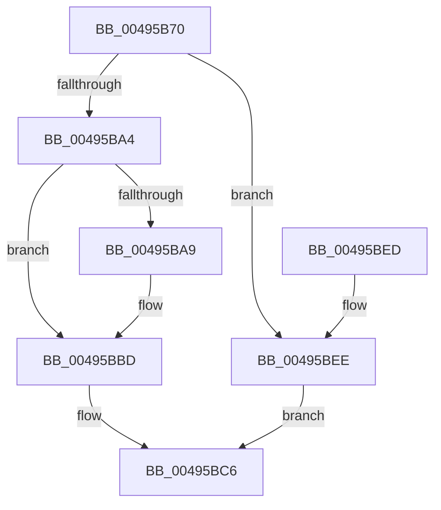

# MiFlushAcquire

- RVA: `0x00495B70`–`0x00495BF2` (길이 `130` bytes)
- VA: `0x0000000140495B70`
- 실행 섹션: `.text`
- PDB 이름 있음: `예`; PDB Function 태그: `아니요`
- unwind 정보 RVA: `0x00098958`
- 디코드: `40`개 명령, `130/130` bytes 표시
- 미해석 바이트: `0` (있으면 어셈블리에 `.byte`로 보존)

> 이 문서는 커널 이미지의 기계어와 PDB 기호를 분석해 생성했습니다. 4번과 5번은 함수 원형과 자료형을 바이너리 사용 방식에서 추정한 C 해석이며 원본 소스 복구 결과는 아닙니다.

## 1. Dependencies

- 직접 호출 지점: **4**; 고유 호출 대상: **3**
- 직접 호출자로 확인된 함수: **2**
- RIP 상대 이미지 참조: **0**

### Outgoing calls
- `0x00495B95` → [ExAcquireSpinLockExclusive](../24/ExAcquireSpinLockExclusive_function_00248690.md) (function, `0x00248690`)
- `0x00495BAE` → [MiReferenceSubsection](../24/MiReferenceSubsection_function_00249200.md) (function, `0x00249200`)
- `0x00495BB8` → [MiReferenceSubsection](../24/MiReferenceSubsection_function_00249200.md) (function, `0x00249200`)
- `0x00495BCD` → [MiReleaseSpinLockExclusive](../24/MiReleaseSpinLockExclusive_function_002482C0.md) (function, `0x002482C0`)

### Direct callers
- [MiCommitFileBackedSection](../../page/88/MiCommitFileBackedSection_function_00882238.md) at `0x008822D5`
- [MmFlushVirtualMemory](../../page/9D/MmFlushVirtualMemory_function_009D6F5C.md) at `0x009D710F`

### Static image references
- 디코드된 RIP-relative 메모리 참조가 없습니다.

## 2. Other-region calls and transfers

- 다른 실행 섹션으로 향하는 call: **0**
- 별도 외부 분기/꼬리 이동을 확인하지 못했습니다.

## 3. Assembly (complete function range)

```asm
00495B70  48 89 5C 24 08                  mov qword ptr [rsp + 8], rbx
00495B75  48 89 6C 24 10                  mov qword ptr [rsp + 0x10], rbp
00495B7A  48 89 74 24 18                  mov qword ptr [rsp + 0x18], rsi
00495B7F  57                              push rdi
00495B80  41 56                           push r14
00495B82  41 57                           push r15
00495B84  48 83 EC 20                     sub rsp, 0x20
00495B88  48 8B F9                        mov rdi, rcx
00495B8B  4D 8B F8                        mov r15, r8
00495B8E  48 83 C1 48                     add rcx, 0x48
00495B92  48 8B F2                        mov rsi, rdx
00495B95  E8 F6 2A DB FF                  call 0x140248690
00495B9A  48 83 7F 28 FF                  cmp qword ptr [rdi + 0x28], -1
00495B9F  44 8A F0                        mov r14b, al
00495BA2  74 4A                           je 0x140495bee
00495BA4  48 85 F6                        test rsi, rsi
00495BA7  74 14                           je 0x140495bbd
00495BA9  33 D2                           xor edx, edx
00495BAB  48 8B CE                        mov rcx, rsi
00495BAE  E8 4D 36 DB FF                  call 0x140249200
00495BB3  33 D2                           xor edx, edx
00495BB5  49 8B CF                        mov rcx, r15
00495BB8  E8 43 36 DB FF                  call 0x140249200
00495BBD  48 FF 47 28                     inc qword ptr [rdi + 0x28]
00495BC1  BB 01 00 00 00                  mov ebx, 1
00495BC6  41 8A D6                        mov dl, r14b
00495BC9  48 8D 4F 48                     lea rcx, [rdi + 0x48]
00495BCD  E8 EE 26 DB FF                  call 0x1402482c0
00495BD2  48 8B 6C 24 48                  mov rbp, qword ptr [rsp + 0x48]
00495BD7  8B C3                           mov eax, ebx
00495BD9  48 8B 5C 24 40                  mov rbx, qword ptr [rsp + 0x40]
00495BDE  48 8B 74 24 50                  mov rsi, qword ptr [rsp + 0x50]
00495BE3  48 83 C4 20                     add rsp, 0x20
00495BE7  41 5F                           pop r15
00495BE9  41 5E                           pop r14
00495BEB  5F                              pop rdi
00495BEC  C3                              ret
00495BED  CC                              int3
00495BEE  33 DB                           xor ebx, ebx
00495BF0  EB D4                           jmp 0x140495bc6
```

## 4. C-style interpretation (structured pseudocode)

```c
__int64 __fastcall MiFlushAcquire(__int64 a1, __int64 a2, __int64 a3)
{
    __int64 result;
    __int64 v_rbx;
    __int64 v_rsp;
    unsigned __int64 v_stack_p10;
    unsigned __int64 v_stack_p18;
    unsigned __int64 v_stack_p8;

    v_stack_p8 = v_rbx;
    v_stack_p10 = v_rbp;
    v_stack_p18 = v_rsi;
    v_rsp = (v_rsp) - (32);
    a1 = (a1) + (72);
    result = ExAcquireSpinLockExclusive(a1, a2, a3, a4);
    if ((*(unsigned __int64 *)(a1 + 40)) == -1) goto loc_00495BEE;
    if (a2 != 0) {
        a2 = 0;
        a1 = 0;
        result = MiReferenceSubsection(a1, a2, a3, a4);
        a2 = 0;
        a1 = a3;
        result = MiReferenceSubsection(a1, a2, a3, a4);
    }
loc_00495BC6:
    result = MiReleaseSpinLockExclusive(a1 + 72, (unsigned __int8)((unsigned __int8)(result)), a3, a4);
    v_rsp = (v_rsp) + (32);
    return 1;
loc_00495BEE:
    v_rbx = 0;
    goto loc_00495BC6;
}
```

## 5. (Beta) C Style

```c
int64_t MiFlushAcquire(void *Arg1, int64_t Arg2, int64_t Arg3)
{
    uint8_t *arg1 = (uint8_t *)Arg1;

    int64_t result;
    int64_t local_rbx;
    int64_t local_rsp;
    uint64_t v_stack_p10;
    uint64_t v_stack_p18;
    uint64_t v_stack_p8;

    v_stack_p8 = local_rbx;
    v_stack_p10 = local_rbp;
    v_stack_p18 = local_rsi;
    local_rsp = (local_rsp) - (32);
    Arg1 = (Arg1) + (72);
    result = ExAcquireSpinLockExclusive(Arg1, Arg2, Arg3, a4);
    if ((*(uint64_t *)(arg1 + 0x28)) == -1) goto loc_00495BEE;
    if (Arg2 != 0) {
        Arg2 = 0;
        Arg1 = 0;
        result = MiReferenceSubsection(Arg1, Arg2, Arg3, a4);
        Arg2 = 0;
        Arg1 = Arg3;
        result = MiReferenceSubsection(Arg1, Arg2, Arg3, a4);
    }
loc_00495BC6:
    result = MiReleaseSpinLockExclusive(Arg1 + 72, (uint8_t)((uint8_t)(result)), Arg3, a4);
    local_rsp = (local_rsp) + (32);
    return 1;
loc_00495BEE:
    local_rbx = 0;
    goto loc_00495BC6;
}
```

### 관측된 메모리 오프셋

구조체 형식이 확인되지 않은 접근은 인자 기준의 오프셋으로만 기록했습니다.

| 기준 인자 | 오프셋 표현 | 폭 (bit) | 접근 |
|---|---:|---:|---|
| `Arg1` | `+ 0x28` | `64` | `R` |
| `Arg1` | `+ 0x28` | `64` | `R/W` |
| `Arg1` | `+ 0x48` | `64` | `R` |

## 6. Execution-region graph

[열기: 2D/3D 그래프와 함수 탐색 컨트롤 패널](../../../control-panel.html?section=text&rva=0x00495B70&view=graph)

- 2D 그래프는 위에서 아래로 흐르고, 3D 그래프는 빈 공간을 드래그해 회전합니다. Shift+드래그는 이동, 휠은 확대·축소, 함수 노드 선택은 대상 보고서 이동입니다.

### Static fallback


