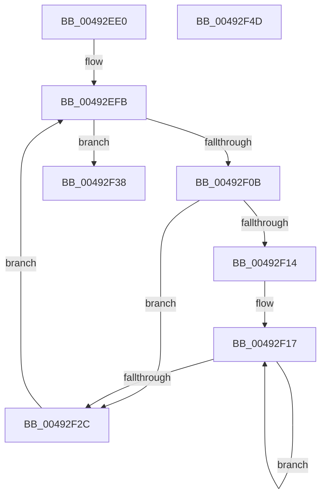

# MiFreeClonePool

- RVA: `0x00492EE0`–`0x00492F4E` (길이 `110` bytes)
- VA: `0x0000000140492EE0`
- 실행 섹션: `.text`
- PDB 이름 있음: `예`; PDB Function 태그: `아니요`
- unwind 정보 RVA: `0x0005C954`
- 디코드: `31`개 명령, `110/110` bytes 표시
- 미해석 바이트: `0` (있으면 어셈블리에 `.byte`로 보존)

> 이 문서는 커널 이미지의 기계어와 PDB 기호를 분석해 생성했습니다. 4번과 5번은 함수 원형과 자료형을 바이너리 사용 방식에서 추정한 C 해석이며 원본 소스 복구 결과는 아닙니다.

## 1. Dependencies

- 직접 호출 지점: **3**; 고유 호출 대상: **3**
- 직접 호출자로 확인된 함수: **3**
- RIP 상대 이미지 참조: **0**

### Outgoing calls
- `0x00492EFE` → [ExpInterlockedPopEntrySList](../6B/ExpInterlockedPopEntrySList_function_006BA570.md) (function, `0x006BA570`)
- `0x00492F1A` → [MiUnlockPagedAddress](MiUnlockPagedAddress_function_00492FC4.md) (function, `0x00492FC4`)
- `0x00492F31` → [ExFreePoolWithTag](../../poolcode/B8/ExFreePoolWithTag_function_00B82870.md) (function, `0x00B82870`)

### Direct callers
- [MiSegmentDereferenceWorker](../46/MiSegmentDereferenceWorker_function_00464D40.md) at `0x00464D61`
- [MiDeleteMoreUnusedSegments](../67/MiDeleteMoreUnusedSegments_function_00677DDC.md) at `0x00677E24`
- [MiDeletePartitionResources](../../page/80/MiDeletePartitionResources_function_0080D074.md) at `0x0080D108`

### Static image references
- 디코드된 RIP-relative 메모리 참조가 없습니다.

## 2. Other-region calls and transfers

- 다른 실행 섹션으로 향하는 call: **1**
  - `0x00492F31` → [ExFreePoolWithTag](../../poolcode/B8/ExFreePoolWithTag_function_00B82870.md) (`.text` → `POOLCODE`)
- 별도 외부 분기/꼬리 이동을 확인하지 못했습니다.

## 3. Assembly (complete function range)

```asm
00492EE0  48 89 5C 24 08                  mov qword ptr [rsp + 8], rbx
00492EE5  48 89 6C 24 10                  mov qword ptr [rsp + 0x10], rbp
00492EEA  48 89 74 24 18                  mov qword ptr [rsp + 0x18], rsi
00492EEF  57                              push rdi
00492EF0  48 83 EC 20                     sub rsp, 0x20
00492EF4  48 8D A9 60 09 00 00            lea rbp, [rcx + 0x960]
00492EFB  48 8B CD                        mov rcx, rbp
00492EFE  E8 6D 76 22 00                  call 0x1406ba570
00492F03  48 8B D8                        mov rbx, rax
00492F06  48 85 C0                        test rax, rax
00492F09  74 2D                           je 0x140492f38
00492F0B  48 8B 78 18                     mov rdi, qword ptr [rax + 0x18]
00492F0F  48 85 FF                        test rdi, rdi
00492F12  74 18                           je 0x140492f2c
00492F14  48 8B F0                        mov rsi, rax
00492F17  48 8B CE                        mov rcx, rsi
00492F1A  E8 A5 00 00 00                  call 0x140492fc4
00492F1F  48 81 C6 00 10 00 00            add rsi, 0x1000
00492F26  48 83 EF 01                     sub rdi, 1
00492F2A  75 EB                           jne 0x140492f17
00492F2C  33 D2                           xor edx, edx
00492F2E  48 8B CB                        mov rcx, rbx
00492F31  E8 3A F9 6E 00                  call 0x140b82870
00492F36  EB C3                           jmp 0x140492efb
00492F38  48 8B 5C 24 30                  mov rbx, qword ptr [rsp + 0x30]
00492F3D  48 8B 6C 24 38                  mov rbp, qword ptr [rsp + 0x38]
00492F42  48 8B 74 24 40                  mov rsi, qword ptr [rsp + 0x40]
00492F47  48 83 C4 20                     add rsp, 0x20
00492F4B  5F                              pop rdi
00492F4C  C3                              ret
00492F4D  CC                              int3
```

## 4. C-style interpretation (structured pseudocode)

```c
__int64 __fastcall MiFreeClonePool(__int64 a1, int a2)
{
    __int64 result;
    __int64 v_rdi;
    __int64 v_rsi;
    __int64 v_rsp;
    unsigned __int64 v_stack_p10;
    unsigned __int64 v_stack_p18;
    unsigned __int64 v_stack_p8;

    v_stack_p8 = v_rbx;
    v_stack_p10 = v_rbp;
    v_stack_p18 = v_rsi;
    v_rsp = (v_rsp) - (32);
loc_00492EFB:
    result = ExpInterlockedPopEntrySList(a1 + 2400, a2, a3, a4);
    if (result == 0) goto loc_00492F38;
    if (*(unsigned __int64 *)(result + 24) == 0) goto loc_00492F2C;
loc_00492F17:
    result = MiUnlockPagedAddress(result, a2, a3, a4);
    v_rsi = (result) + (0x1000ULL);
    v_rdi = (*(unsigned __int64 *)(result + 24)) - (1);
    if (condition_is_not_equal) goto loc_00492F17;
loc_00492F2C:
    a2 = 0;
    result = ExFreePoolWithTag(result, a2, a3, a4);
    goto loc_00492EFB;
loc_00492F38:
    v_rsp = (v_rsp) + (32);
    return result;
}
```

## 5. (Beta) C Style

```c
int64_t MiFreeClonePool(void *Arg1, int32_t Arg2)
{
    uint8_t *arg1 = (uint8_t *)Arg1;

    int64_t result;
    int64_t local_rdi;
    int64_t local_rsi;
    int64_t local_rsp;
    uint64_t v_stack_p10;
    uint64_t v_stack_p18;
    uint64_t v_stack_p8;

    v_stack_p8 = local_rbx;
    v_stack_p10 = local_rbp;
    v_stack_p18 = local_rsi;
    local_rsp = (local_rsp) - (32);
loc_00492EFB:
    result = ExpInterlockedPopEntrySList(Arg1 + 2400, Arg2, a3, a4);
    if (result == 0) goto loc_00492F38;
    if (*(uint64_t *)(result + 0x18) == 0) goto loc_00492F2C;
loc_00492F17:
    result = MiUnlockPagedAddress(result, Arg2, a3, a4);
    local_rsi = (result) + (0x1000ULL);
    local_rdi = (*(uint64_t *)(result + 0x18)) - (1);
    if (condition_is_not_equal) goto loc_00492F17;
loc_00492F2C:
    Arg2 = 0;
    result = ExFreePoolWithTag(result, Arg2, a3, a4);
    goto loc_00492EFB;
loc_00492F38:
    local_rsp = (local_rsp) + (32);
    return result;
}
```

### 관측된 메모리 오프셋

구조체 형식이 확인되지 않은 접근은 인자 기준의 오프셋으로만 기록했습니다.

| 기준 인자 | 오프셋 표현 | 폭 (bit) | 접근 |
|---|---:|---:|---|
| `Arg1` | `+ 0x960` | `64` | `R` |

## 6. Execution-region graph

[열기: 2D/3D 그래프와 함수 탐색 컨트롤 패널](../../../control-panel.html?section=text&rva=0x00492EE0&view=graph)

- 2D 그래프는 위에서 아래로 흐르고, 3D 그래프는 빈 공간을 드래그해 회전합니다. Shift+드래그는 이동, 휠은 확대·축소, 함수 노드 선택은 대상 보고서 이동입니다.

### Static fallback


