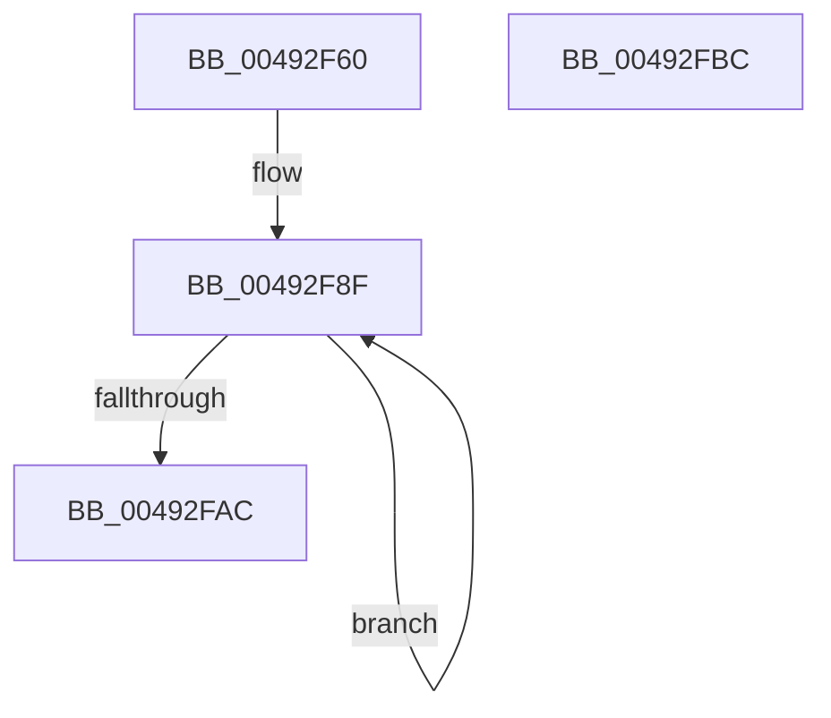

# MiFreeCombinePool

- RVA: `0x00492F60`–`0x00492FBD` (길이 `93` bytes)
- VA: `0x0000000140492F60`
- 실행 섹션: `.text`
- PDB 이름 있음: `예`; PDB Function 태그: `아니요`
- unwind 정보 RVA: `0x00060BC4`
- 디코드: `27`개 명령, `93/93` bytes 표시
- 미해석 바이트: `0` (있으면 어셈블리에 `.byte`로 보존)

> 이 문서는 커널 이미지의 기계어와 PDB 기호를 분석해 생성했습니다. 4번과 5번은 함수 원형과 자료형을 바이너리 사용 방식에서 추정한 C 해석이며 원본 소스 복구 결과는 아닙니다.

## 1. Dependencies

- 직접 호출 지점: **4**; 고유 호출 대상: **4**
- 직접 호출자로 확인된 함수: **0**
- RIP 상대 이미지 참조: **0**

### Outgoing calls
- `0x00492F76` → [ExAcquireSpinLockExclusive](../24/ExAcquireSpinLockExclusive_function_00248690.md) (function, `0x00248690`)
- `0x00492F8A` → [MiReleaseSpinLockExclusive](../24/MiReleaseSpinLockExclusive_function_002482C0.md) (function, `0x002482C0`)
- `0x00492F95` → [MiUnlockPagedAddress](MiUnlockPagedAddress_function_00492FC4.md) (function, `0x00492FC4`)
- `0x00492F9F` → [ExFreePoolWithTag](../../poolcode/B8/ExFreePoolWithTag_function_00B82870.md) (function, `0x00B82870`)

### Direct callers
- 이 함수 시작 RVA로 연결되는 직접 call은 확인되지 않았습니다. 간접 호출은 완전히 역산할 수 없습니다.

### Static image references
- 디코드된 RIP-relative 메모리 참조가 없습니다.

## 2. Other-region calls and transfers

- 다른 실행 섹션으로 향하는 call: **1**
  - `0x00492F9F` → [ExFreePoolWithTag](../../poolcode/B8/ExFreePoolWithTag_function_00B82870.md) (`.text` → `POOLCODE`)
- 별도 외부 분기/꼬리 이동을 확인하지 못했습니다.

## 3. Assembly (complete function range)

```asm
00492F60  48 89 5C 24 08                  mov qword ptr [rsp + 8], rbx
00492F65  48 89 74 24 10                  mov qword ptr [rsp + 0x10], rsi
00492F6A  57                              push rdi
00492F6B  48 83 EC 20                     sub rsp, 0x20
00492F6F  48 8B D9                        mov rbx, rcx
00492F72  48 83 C1 58                     add rcx, 0x58
00492F76  E8 15 57 DB FF                  call 0x140248690
00492F7B  48 8B 73 18                     mov rsi, qword ptr [rbx + 0x18]
00492F7F  48 8D 4B 58                     lea rcx, [rbx + 0x58]
00492F83  48 83 63 18 00                  and qword ptr [rbx + 0x18], 0
00492F88  8A D0                           mov dl, al
00492F8A  E8 31 53 DB FF                  call 0x1402482c0
00492F8F  48 8B 1E                        mov rbx, qword ptr [rsi]
00492F92  48 8B CE                        mov rcx, rsi
00492F95  E8 2A 00 00 00                  call 0x140492fc4
00492F9A  33 D2                           xor edx, edx
00492F9C  48 8B CE                        mov rcx, rsi
00492F9F  E8 CC F8 6E 00                  call 0x140b82870
00492FA4  48 8B F3                        mov rsi, rbx
00492FA7  48 85 DB                        test rbx, rbx
00492FAA  75 E3                           jne 0x140492f8f
00492FAC  48 8B 5C 24 30                  mov rbx, qword ptr [rsp + 0x30]
00492FB1  48 8B 74 24 38                  mov rsi, qword ptr [rsp + 0x38]
00492FB6  48 83 C4 20                     add rsp, 0x20
00492FBA  5F                              pop rdi
00492FBB  C3                              ret
00492FBC  CC                              int3
```

## 4. C-style interpretation (structured pseudocode)

```c
__int64 __fastcall MiFreeCombinePool(__int64 a1)
{
    __int64 result;
    __int64 v_rsp;
    unsigned __int64 v_stack_p10;
    unsigned __int64 v_stack_p8;

    v_stack_p8 = v_rbx;
    v_stack_p10 = v_rsi;
    v_rsp = (v_rsp) - (32);
    a1 = (a1) + (88);
    result = ExAcquireSpinLockExclusive(a1, a2, a3, a4);
    result = MiReleaseSpinLockExclusive(a1 + 88, (unsigned __int8)(result), a3, a4);
loc_00492F8F:
    result = MiUnlockPagedAddress(*(unsigned __int64 *)(a1 + 24), (unsigned __int8)(result), a3, a4);
    a2 = 0;
    result = ExFreePoolWithTag(*(unsigned __int64 *)(a1 + 24), a2, a3, a4);
    if (*(unsigned __int64 *)(*(unsigned __int64 *)(a1 + 24)) != 0) goto loc_00492F8F;
    v_rsp = (v_rsp) + (32);
    return result;
}
```

## 5. (Beta) C Style

```c
int64_t MiFreeCombinePool(void *Arg1)
{
    uint8_t *arg1 = (uint8_t *)Arg1;

    int64_t result;
    int64_t local_rsp;
    uint64_t v_stack_p10;
    uint64_t v_stack_p8;

    v_stack_p8 = local_rbx;
    v_stack_p10 = local_rsi;
    local_rsp = (local_rsp) - (32);
    Arg1 = (Arg1) + (88);
    result = ExAcquireSpinLockExclusive(Arg1, a2, a3, a4);
    result = MiReleaseSpinLockExclusive(Arg1 + 88, (uint8_t)(result), a3, a4);
loc_00492F8F:
    result = MiUnlockPagedAddress(*(uint64_t *)(arg1 + 0x18), (uint8_t)(result), a3, a4);
    a2 = 0;
    result = ExFreePoolWithTag(*(uint64_t *)(arg1 + 0x18), a2, a3, a4);
    if (*(uint64_t *)(*(uint64_t *)(arg1 + 0x18)) != 0) goto loc_00492F8F;
    local_rsp = (local_rsp) + (32);
    return result;
}
```

### 관측된 메모리 오프셋

구조체 형식이 확인되지 않은 접근은 인자 기준의 오프셋으로만 기록했습니다.

| 기준 인자 | 오프셋 표현 | 폭 (bit) | 접근 |
|---|---:|---:|---|
| `Arg1` | `+ 0x18` | `64` | `R` |
| `Arg1` | `+ 0x18` | `64` | `R/W` |
| `Arg1` | `+ 0x58` | `64` | `R` |

## 6. Execution-region graph

[열기: 2D/3D 그래프와 함수 탐색 컨트롤 패널](../../../control-panel.html?section=text&rva=0x00492F60&view=graph)

- 2D 그래프는 위에서 아래로 흐르고, 3D 그래프는 빈 공간을 드래그해 회전합니다. Shift+드래그는 이동, 휠은 확대·축소, 함수 노드 선택은 대상 보고서 이동입니다.

### Static fallback


