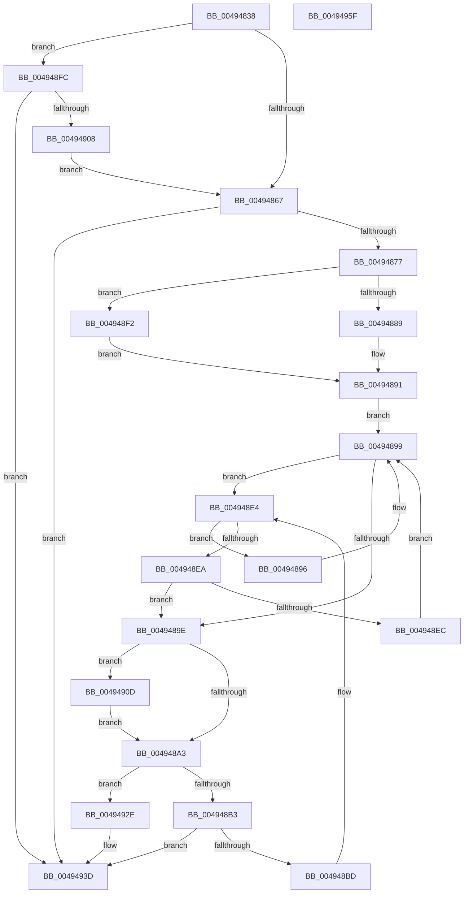

# MiFreeMdlTracker

- RVA: `0x00494838`–`0x00494960` (길이 `296` bytes)
- VA: `0x0000000140494838`
- 실행 섹션: `.text`
- PDB 이름 있음: `예`; PDB Function 태그: `아니요`
- unwind 정보 RVA: `0x0008C20C`
- 디코드: `85`개 명령, `296/296` bytes 표시
- 미해석 바이트: `0` (있으면 어셈블리에 `.byte`로 보존)

> 이 문서는 커널 이미지의 기계어와 PDB 기호를 분석해 생성했습니다. 4번과 5번은 함수 원형과 자료형을 바이너리 사용 방식에서 추정한 C 해석이며 원본 소스 복구 결과는 아닙니다.

## 1. Dependencies

- 직접 호출 지점: **8**; 고유 호출 대상: **8**
- 직접 호출자로 확인된 함수: **1**
- RIP 상대 이미지 참조: **2**

### Outgoing calls
- `0x0049488C` → [ExAcquireSpinLockExclusiveAtDpcLevel](../24/ExAcquireSpinLockExclusiveAtDpcLevel_function_00248E80.md) (function, `0x00248E80`)
- `0x004948A9` → [MiReleaseSpinLockExclusive](../24/MiReleaseSpinLockExclusive_function_002482C0.md) (function, `0x002482C0`)
- `0x004948C0` → [MiReadProcessNumberOfLockedPages](MiReadProcessNumberOfLockedPages_function_00494968.md) (function, `0x00494968`)
- `0x004948DE` → [KeBugCheckEx](../4F/KeBugCheckEx_function_004FD660.md) (function, `0x004FD660`)
- `0x004948F2` → [ExAcquireSpinLockExclusive](../24/ExAcquireSpinLockExclusive_function_00248690.md) (function, `0x00248690`)
- `0x00494915` → [MiValidateMdlTracker](../4B/MiValidateMdlTracker_function_004B894C.md) (function, `0x004B894C`)
- `0x00494920` → [RtlAvlRemoveNode](../29/RtlAvlRemoveNode_function_00296650.md) (function, `0x00296650`)
- `0x00494938` → [ExFreeToNPagedLookasideList](../38/ExFreeToNPagedLookasideList_function_0038D9D0.md) (function, `0x0038D9D0`)

### Direct callers
- [MmUnlockPages](../29/MmUnlockPages_function_0029EEE0.md) at `0x0029F0AB`

### Static image references
- `0x004948FC` → RVA `0x00FC6AB0` (`ALMOSTRO`; read)
- `0x00494931` → RVA `0x00E35D80` (`.data`; read)

## 2. Other-region calls and transfers

- 다른 실행 섹션으로 향하는 call: **0**
- 별도 외부 분기/꼬리 이동을 확인하지 못했습니다.

## 3. Assembly (complete function range)

```asm
00494838  48 89 5C 24 08                  mov qword ptr [rsp + 8], rbx
0049483D  48 89 6C 24 10                  mov qword ptr [rsp + 0x10], rbp
00494842  48 89 74 24 18                  mov qword ptr [rsp + 0x18], rsi
00494847  57                              push rdi
00494848  41 54                           push r12
0049484A  41 55                           push r13
0049484C  41 56                           push r14
0049484E  41 57                           push r15
00494850  48 83 EC 30                     sub rsp, 0x30
00494854  48 8B 79 10                     mov rdi, qword ptr [rcx + 0x10]
00494858  4C 8B EA                        mov r13, rdx
0049485B  48 8B E9                        mov rbp, rcx
0049485E  48 85 FF                        test rdi, rdi
00494861  0F 84 95 00 00 00               je 0x1404948fc
00494867  48 8B B7 98 03 00 00            mov rsi, qword ptr [rdi + 0x398]
0049486E  48 85 F6                        test rsi, rsi
00494871  0F 84 C6 00 00 00               je 0x14049493d
00494877  45 33 F6                        xor r14d, r14d
0049487A  44 0F 20 C0                     mov rax, cr8
0049487E  4C 8D 7E 18                     lea r15, [rsi + 0x18]
00494882  49 8B CF                        mov rcx, r15
00494885  3C 02                           cmp al, 2
00494887  75 69                           jne 0x1404948f2
00494889  41 B4 11                        mov r12b, 0x11
0049488C  E8 EF 45 DB FF                  call 0x140248e80
00494891  48 8B 1E                        mov rbx, qword ptr [rsi]
00494894  EB 03                           jmp 0x140494899
00494896  48 8B 1B                        mov rbx, qword ptr [rbx]
00494899  48 85 DB                        test rbx, rbx
0049489C  75 46                           jne 0x1404948e4
0049489E  48 85 DB                        test rbx, rbx
004948A1  75 6A                           jne 0x14049490d
004948A3  41 8A D4                        mov dl, r12b
004948A6  49 8B CF                        mov rcx, r15
004948A9  E8 12 3A DB FF                  call 0x1402482c0
004948AE  4D 85 F6                        test r14, r14
004948B1  75 7B                           jne 0x14049492e
004948B3  44 39 76 1C                     cmp dword ptr [rsi + 0x1c], r14d
004948B7  0F 84 80 00 00 00               je 0x14049493d
004948BD  48 8B CF                        mov rcx, rdi
004948C0  E8 A3 00 00 00                  call 0x140494968
004948C5  4C 8B C8                        mov r9, rax
004948C8  41 8D 56 01                     lea edx, [r14 + 1]
004948CC  48 8B 87 98 03 00 00            mov rax, qword ptr [rdi + 0x398]
004948D3  4C 8B C5                        mov r8, rbp
004948D6  48 89 44 24 20                  mov qword ptr [rsp + 0x20], rax
004948DB  8D 4A 75                        lea ecx, [rdx + 0x75]
004948DE  E8 7D 8D 06 00                  call 0x1404fd660
004948E3  CC                              int3
004948E4  48 3B 6B 18                     cmp rbp, qword ptr [rbx + 0x18]
004948E8  72 AC                           jb 0x140494896
004948EA  76 B2                           jbe 0x14049489e
004948EC  48 8B 5B 08                     mov rbx, qword ptr [rbx + 8]
004948F0  EB A7                           jmp 0x140494899
004948F2  E8 99 3D DB FF                  call 0x140248690
004948F7  44 8A E0                        mov r12b, al
004948FA  EB 95                           jmp 0x140494891
004948FC  48 8B 3D AD 21 B3 00            mov rdi, qword ptr [rip + 0xb321ad]
00494903  48 85 FF                        test rdi, rdi
00494906  74 35                           je 0x14049493d
00494908  E9 5A FF FF FF                  jmp 0x140494867
0049490D  33 D2                           xor edx, edx
0049490F  48 8B CB                        mov rcx, rbx
00494912  4C 8B F3                        mov r14, rbx
00494915  E8 32 40 02 00                  call 0x1404b894c
0049491A  48 8B D3                        mov rdx, rbx
0049491D  48 8B CE                        mov rcx, rsi
00494920  E8 2B 1D E0 FF                  call 0x140296650
00494925  4C 29 6E 10                     sub qword ptr [rsi + 0x10], r13
00494929  E9 75 FF FF FF                  jmp 0x1404948a3
0049492E  49 8B D6                        mov rdx, r14
00494931  48 8D 0D 48 14 9A 00            lea rcx, [rip + 0x9a1448]
00494938  E8 93 90 EF FF                  call 0x14038d9d0
0049493D  48 8B 5C 24 60                  mov rbx, qword ptr [rsp + 0x60]
00494942  B8 01 00 00 00                  mov eax, 1
00494947  48 8B 6C 24 68                  mov rbp, qword ptr [rsp + 0x68]
0049494C  48 8B 74 24 70                  mov rsi, qword ptr [rsp + 0x70]
00494951  48 83 C4 30                     add rsp, 0x30
00494955  41 5F                           pop r15
00494957  41 5E                           pop r14
00494959  41 5D                           pop r13
0049495B  41 5C                           pop r12
0049495D  5F                              pop rdi
0049495E  C3                              ret
0049495F  CC                              int3
```

## 4. C-style interpretation (structured pseudocode)

```c
__int64 __fastcall MiFreeMdlTracker(__int64 a1, __int64 a2)
{
    __int64 result;
    __int64 v_r14;
    __int64 v_rsp;
    unsigned __int64 v_stack_m38;
    unsigned __int64 v_stack_p10;
    unsigned __int64 v_stack_p18;
    unsigned __int64 v_stack_p8;

    v_stack_p8 = v_rbx;
    v_stack_p10 = v_rbp;
    v_stack_p18 = v_rsi;
    v_rsp = (v_rsp) - (48);
    if (*(unsigned __int64 *)(a1 + 16) == 0) goto loc_004948FC;
loc_00494867:
    if (*(unsigned __int64 *)(*(unsigned __int64 *)(a1 + 16) + 920) == 0) goto loc_0049493D;
    v_r14 = 0;
    if (((unsigned __int8)(v_cr8)) != 2) goto loc_004948F2;
    result = ExAcquireSpinLockExclusiveAtDpcLevel(*(unsigned __int64 *)(*(unsigned __int64 *)(a1 + 16) + 920) + 24, a2, a3, a4);
loc_00494891:
    goto loc_00494899;
loc_00494896:
loc_00494899:
    if (*(unsigned __int64 *)(*(unsigned __int64 *)(*(unsigned __int64 *)(*(unsigned __int64 *)(a1 + 16) + 920))) != 0) goto loc_004948E4;
loc_0049489E:
    if (*(unsigned __int64 *)(*(unsigned __int64 *)(*(unsigned __int64 *)(*(unsigned __int64 *)(a1 + 16) + 920))) != 0) goto loc_0049490D;
loc_004948A3:
    result = MiReleaseSpinLockExclusive(*(unsigned __int64 *)(*(unsigned __int64 *)(a1 + 16) + 920) + 24, 17, a3, a4);
    if (0 != 0) goto loc_0049492E;
    if ((*(unsigned int *)(*(unsigned __int64 *)(*(unsigned __int64 *)(a1 + 16) + 920) + 28)) == 0) goto loc_0049493D;
    result = MiReadProcessNumberOfLockedPages(*(unsigned __int64 *)(a1 + 16), 17, a3, a4);
    v_stack_m38 = *(unsigned __int64 *)(*(unsigned __int64 *)(a1 + 16) + 920);
    result = KeBugCheckEx(v_r14 + 1 + 117, v_r14 + 1, a1, result);
loc_004948E4:
    if (a1 < (*(unsigned __int64 *)(*(unsigned __int64 *)(*(unsigned __int64 *)(*(unsigned __int64 *)(*(unsigned __int64 *)(a1 + 16) + 920))) + 24))) goto loc_00494896;
    if (a1 <= (*(unsigned __int64 *)(*(unsigned __int64 *)(*(unsigned __int64 *)(*(unsigned __int64 *)(*(unsigned __int64 *)(a1 + 16) + 920))) + 24))) goto loc_0049489E;
    goto loc_00494899;
loc_004948F2:
    result = ExAcquireSpinLockExclusive(v_r14 + 1 + 117, v_r14 + 1, a1, result);
    goto loc_00494891;
loc_004948FC:
    if (*(unsigned __int64 *)(v_rip + 11739565) == 0) goto loc_0049493D;
    goto loc_00494867;
loc_0049490D:
    a2 = 0;
    result = MiValidateMdlTracker(*(unsigned __int64 *)(*(unsigned __int64 *)(*(unsigned __int64 *)(*(unsigned __int64 *)(*(unsigned __int64 *)(a1 + 16) + 920))) + 8), a2, a1, result);
    result = RtlAvlRemoveNode(*(unsigned __int64 *)(*(unsigned __int64 *)(a1 + 16) + 920), *(unsigned __int64 *)(*(unsigned __int64 *)(*(unsigned __int64 *)(*(unsigned __int64 *)(*(unsigned __int64 *)(a1 + 16) + 920))) + 8), a1, result);
    goto loc_004948A3;
loc_0049492E:
    result = ExFreeToNPagedLookasideList(v_rip + 10097736, *(unsigned __int64 *)(*(unsigned __int64 *)(*(unsigned __int64 *)(*(unsigned __int64 *)(*(unsigned __int64 *)(a1 + 16) + 920))) + 8), a1, result);
loc_0049493D:
    v_rsp = (v_rsp) + (48);
    return 1;
}
```

## 5. (Beta) C Style

```c
int64_t MiFreeMdlTracker(void *Arg1, int64_t Arg2)
{
    uint8_t *arg1 = (uint8_t *)Arg1;

    int64_t result;
    int64_t local_r14;
    int64_t local_rsp;
    uint64_t v_stack_m38;
    uint64_t v_stack_p10;
    uint64_t v_stack_p18;
    uint64_t v_stack_p8;

    v_stack_p8 = local_rbx;
    v_stack_p10 = local_rbp;
    v_stack_p18 = local_rsi;
    local_rsp = (local_rsp) - (48);
    if (*(uint64_t *)(arg1 + 0x10) == 0) goto loc_004948FC;
loc_00494867:
    if (*(uint64_t *)(*(uint64_t *)(arg1 + 0x10) + 0x398) == 0) goto loc_0049493D;
    local_r14 = 0;
    if (((uint8_t)(v_cr8)) != 2) goto loc_004948F2;
    result = ExAcquireSpinLockExclusiveAtDpcLevel(*(uint64_t *)(*(uint64_t *)(arg1 + 0x10) + 0x398) + 24, Arg2, a3, a4);
loc_00494891:
    goto loc_00494899;
loc_00494896:
loc_00494899:
    if (*(uint64_t *)(*(uint64_t *)(*(uint64_t *)(*(uint64_t *)(arg1 + 0x10) + 0x398))) != 0) goto loc_004948E4;
loc_0049489E:
    if (*(uint64_t *)(*(uint64_t *)(*(uint64_t *)(*(uint64_t *)(arg1 + 0x10) + 0x398))) != 0) goto loc_0049490D;
loc_004948A3:
    result = MiReleaseSpinLockExclusive(*(uint64_t *)(*(uint64_t *)(arg1 + 0x10) + 0x398) + 24, 17, a3, a4);
    if (0 != 0) goto loc_0049492E;
    if ((*(uint32_t *)(*(uint64_t *)(*(uint64_t *)(arg1 + 0x10) + 0x398) + 0x1C)) == 0) goto loc_0049493D;
    result = MiReadProcessNumberOfLockedPages(*(uint64_t *)(arg1 + 0x10), 17, a3, a4);
    v_stack_m38 = *(uint64_t *)(*(uint64_t *)(arg1 + 0x10) + 0x398);
    result = KeBugCheckEx(local_r14 + 1 + 117, local_r14 + 1, Arg1, result);
loc_004948E4:
    if (Arg1 < (*(uint64_t *)(*(uint64_t *)(*(uint64_t *)(*(uint64_t *)(*(uint64_t *)(arg1 + 0x10) + 0x398))) + 0x18))) goto loc_00494896;
    if (Arg1 <= (*(uint64_t *)(*(uint64_t *)(*(uint64_t *)(*(uint64_t *)(*(uint64_t *)(arg1 + 0x10) + 0x398))) + 0x18))) goto loc_0049489E;
    goto loc_00494899;
loc_004948F2:
    result = ExAcquireSpinLockExclusive(local_r14 + 1 + 117, local_r14 + 1, Arg1, result);
    goto loc_00494891;
loc_004948FC:
    if (*(uint64_t *)(v_rip + 0xB321AD) == 0) goto loc_0049493D;
    goto loc_00494867;
loc_0049490D:
    Arg2 = 0;
    result = MiValidateMdlTracker(*(uint64_t *)(*(uint64_t *)(*(uint64_t *)(*(uint64_t *)(*(uint64_t *)(arg1 + 0x10) + 0x398))) + 0x8), Arg2, Arg1, result);
    result = RtlAvlRemoveNode(*(uint64_t *)(*(uint64_t *)(arg1 + 0x10) + 0x398), *(uint64_t *)(*(uint64_t *)(*(uint64_t *)(*(uint64_t *)(*(uint64_t *)(arg1 + 0x10) + 0x398))) + 0x8), Arg1, result);
    goto loc_004948A3;
loc_0049492E:
    result = ExFreeToNPagedLookasideList(v_rip + 10097736, *(uint64_t *)(*(uint64_t *)(*(uint64_t *)(*(uint64_t *)(*(uint64_t *)(arg1 + 0x10) + 0x398))) + 0x8), Arg1, result);
loc_0049493D:
    local_rsp = (local_rsp) + (48);
    return 1;
}
```

### 관측된 메모리 오프셋

구조체 형식이 확인되지 않은 접근은 인자 기준의 오프셋으로만 기록했습니다.

| 기준 인자 | 오프셋 표현 | 폭 (bit) | 접근 |
|---|---:|---:|---|
| `Arg1` | `+ 0x10` | `64` | `R` |

## 6. Execution-region graph

[열기: 2D/3D 그래프와 함수 탐색 컨트롤 패널](../../../control-panel.html?section=text&rva=0x00494838&view=graph)

- 2D 그래프는 위에서 아래로 흐르고, 3D 그래프는 빈 공간을 드래그해 회전합니다. Shift+드래그는 이동, 휠은 확대·축소, 함수 노드 선택은 대상 보고서 이동입니다.

### Static fallback


