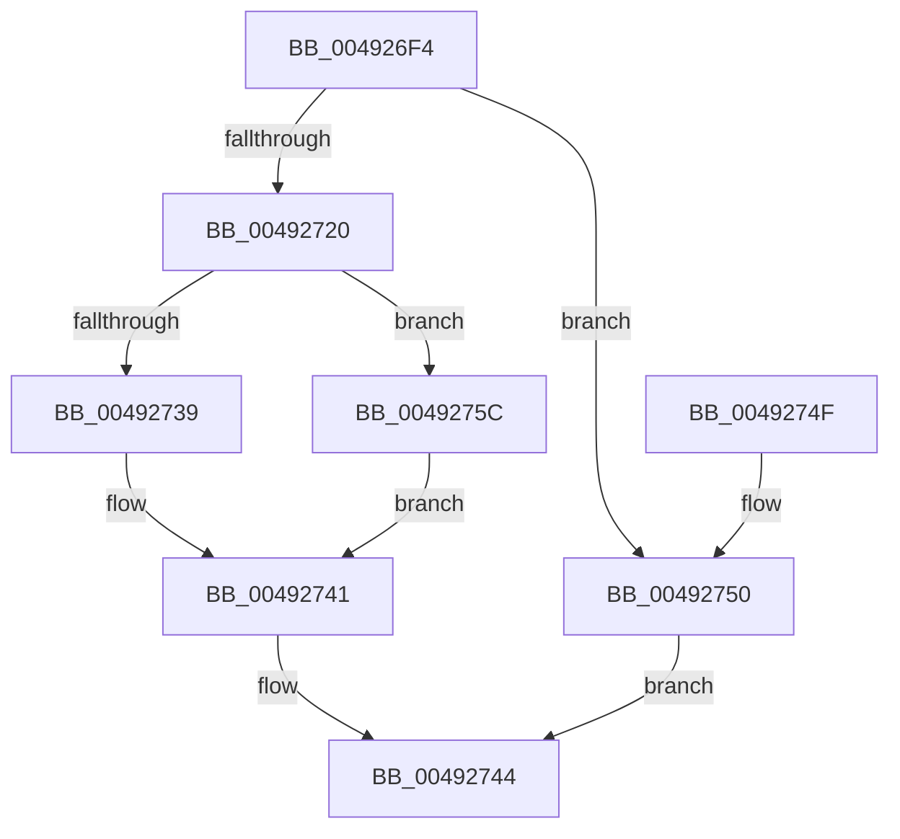

# MiGetFileHashPage

- RVA: `0x004926F4`–`0x00492771` (길이 `125` bytes)
- VA: `0x00000001404926F4`
- 실행 섹션: `.text`
- PDB 이름 있음: `예`; PDB Function 태그: `아니요`
- unwind 정보 RVA: `0x00088DA0`
- 디코드: `34`개 명령, `125/125` bytes 표시
- 미해석 바이트: `0` (있으면 어셈블리에 `.byte`로 보존)

> 이 문서는 커널 이미지의 기계어와 PDB 기호를 분석해 생성했습니다. 4번과 5번은 함수 원형과 자료형을 바이너리 사용 방식에서 추정한 C 해석이며 원본 소스 복구 결과는 아닙니다.

## 1. Dependencies

- 직접 호출 지점: **3**; 고유 호출 대상: **3**
- 직접 호출자로 확인된 함수: **1**
- RIP 상대 이미지 참조: **2**

### Outgoing calls
- `0x00492717` → [MiAcquireNonPagedResources](../28/MiAcquireNonPagedResources_function_00286C60.md) (function, `0x00286C60`)
- `0x0049272B` → [MiGetPage](../28/MiGetPage_function_002884C0.md) (function, `0x002884C0`)
- `0x0049276A` → [MiReleaseNonPagedResources](../32/MiReleaseNonPagedResources_function_0032299C.md) (function, `0x0032299C`)

### Direct callers
- [MiMapPageFileHash](MiMapPageFileHash_function_004921E0.md) at `0x0049240E`

### Static image references
- `0x00492739` → RVA `0x00E388E8` (`.data`; read/write)
- `0x00492750` → RVA `0x00E30264` (`.data`; read/write)

## 2. Other-region calls and transfers

- 다른 실행 섹션으로 향하는 call: **0**
- 별도 외부 분기/꼬리 이동을 확인하지 못했습니다.

## 3. Assembly (complete function range)

```asm
004926F4  48 89 5C 24 08                  mov qword ptr [rsp + 8], rbx
004926F9  57                              push rdi
004926FA  48 83 EC 20                     sub rsp, 0x20
004926FE  48 8B B9 D8 00 00 00            mov rdi, qword ptr [rcx + 0xd8]
00492705  8B DA                           mov ebx, edx
00492707  BA 01 00 00 00                  mov edx, 1
0049270C  48 8B CF                        mov rcx, rdi
0049270F  44 8D 4A 01                     lea r9d, [rdx + 1]
00492713  44 8D 42 7F                     lea r8d, [rdx + 0x7f]
00492717  E8 44 45 DF FF                  call 0x140286c60
0049271C  85 C0                           test eax, eax
0049271E  78 30                           js 0x140492750
00492720  41 B8 30 00 00 00               mov r8d, 0x30
00492726  8B D3                           mov edx, ebx
00492728  48 8B CF                        mov rcx, rdi
0049272B  E8 90 5D DF FF                  call 0x1402884c0
00492730  48 8B D8                        mov rbx, rax
00492733  48 83 F8 FF                     cmp rax, -1
00492737  74 23                           je 0x14049275c
00492739  F0 48 FF 05 A7 61 9A 00         lock inc qword ptr [rip + 0x9a61a7]
00492741  48 8B C3                        mov rax, rbx
00492744  48 8B 5C 24 30                  mov rbx, qword ptr [rsp + 0x30]
00492749  48 83 C4 20                     add rsp, 0x20
0049274D  5F                              pop rdi
0049274E  C3                              ret
0049274F  CC                              int3
00492750  FF 05 0E DB 99 00               inc dword ptr [rip + 0x99db0e]
00492756  48 83 C8 FF                     or rax, 0xffffffffffffffff
0049275A  EB E8                           jmp 0x140492744
0049275C  FF 05 02 DB 99 00               inc dword ptr [rip + 0x99db02]
00492762  BA 01 00 00 00                  mov edx, 1
00492767  48 8B CF                        mov rcx, rdi
0049276A  E8 2D 02 E9 FF                  call 0x14032299c
0049276F  EB D0                           jmp 0x140492741
```

## 4. C-style interpretation (structured pseudocode)

```c
__int64 __fastcall MiGetFileHashPage(__int64 a1, int a2)
{
    __int64 result;
    __int64 v_rsp;
    unsigned __int64 v_stack_p8;

    v_stack_p8 = v_rbx;
    v_rsp = (v_rsp) - (32);
    result = MiAcquireNonPagedResources(*(unsigned __int64 *)(a1 + 216), 1, 1 + 127, 1 + 1);
    if (sign_flag) goto loc_00492750;
    result = MiGetPage(*(unsigned __int64 *)(a1 + 216), (unsigned int)((unsigned int)((unsigned int)(a2))), 48, 1 + 1);
    if (result == -1) goto loc_0049275C;
loc_00492741:
loc_00492744:
    v_rsp = (v_rsp) + (32);
    return result;
loc_00492750:
    result = (result) | (-1);
    goto loc_00492744;
loc_0049275C:
    result = MiReleaseNonPagedResources(*(unsigned __int64 *)(a1 + 216), 1, 48, 1 + 1);
    goto loc_00492741;
}
```

## 5. (Beta) C Style

```c
int64_t MiGetFileHashPage(void *Arg1, int32_t Arg2)
{
    uint8_t *arg1 = (uint8_t *)Arg1;

    int64_t result;
    int64_t local_rsp;
    uint64_t v_stack_p8;

    v_stack_p8 = local_rbx;
    local_rsp = (local_rsp) - (32);
    result = MiAcquireNonPagedResources(*(uint64_t *)(arg1 + 0xD8), 1, 1 + 127, 1 + 1);
    if (sign_flag) goto loc_00492750;
    result = MiGetPage(*(uint64_t *)(arg1 + 0xD8), (uint32_t)((uint32_t)((uint32_t)(Arg2))), 48, 1 + 1);
    if (result == -1) goto loc_0049275C;
loc_00492741:
loc_00492744:
    local_rsp = (local_rsp) + (32);
    return result;
loc_00492750:
    result = (result) | (-1);
    goto loc_00492744;
loc_0049275C:
    result = MiReleaseNonPagedResources(*(uint64_t *)(arg1 + 0xD8), 1, 48, 1 + 1);
    goto loc_00492741;
}
```

### 관측된 메모리 오프셋

구조체 형식이 확인되지 않은 접근은 인자 기준의 오프셋으로만 기록했습니다.

| 기준 인자 | 오프셋 표현 | 폭 (bit) | 접근 |
|---|---:|---:|---|
| `Arg1` | `+ 0xD8` | `64` | `R` |

## 6. Execution-region graph

[열기: 2D/3D 그래프와 함수 탐색 컨트롤 패널](../../../control-panel.html?section=text&rva=0x004926F4&view=graph)

- 2D 그래프는 위에서 아래로 흐르고, 3D 그래프는 빈 공간을 드래그해 회전합니다. Shift+드래그는 이동, 휠은 확대·축소, 함수 노드 선택은 대상 보고서 이동입니다.

### Static fallback


