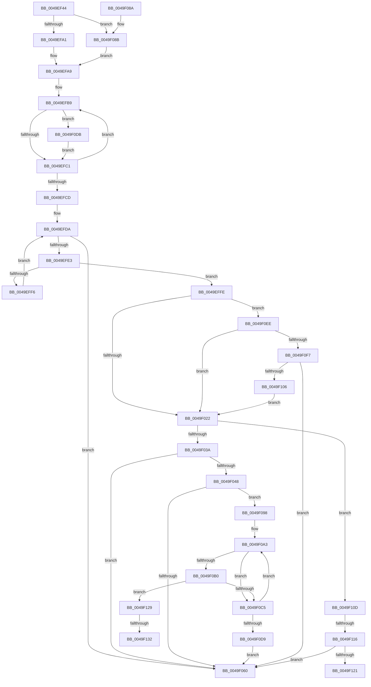

# MiGetOptimalEngineMix

- RVA: `0x0049EF44`–`0x0049F146` (길이 `514` bytes)
- VA: `0x000000014049EF44`
- 실행 섹션: `.text`
- PDB 이름 있음: `예`; PDB Function 태그: `예`
- unwind 정보 RVA: `0x000B5348`
- 디코드: `132`개 명령, `514/514` bytes 표시
- 미해석 바이트: `0` (있으면 어셈블리에 `.byte`로 보존)

> 이 문서는 커널 이미지의 기계어와 PDB 기호를 분석해 생성했습니다. 4번과 5번은 함수 원형과 자료형을 바이너리 사용 방식에서 추정한 C 해석이며 원본 소스 복구 결과는 아닙니다.

## 1. Dependencies

- 직접 호출 지점: **3**; 고유 호출 대상: **3**
- 직접 호출자로 확인된 함수: **1**
- RIP 상대 이미지 참조: **1**

### Outgoing calls
- `0x0049EFA1` → [ExAcquireSpinLockShared](../24/ExAcquireSpinLockShared_function_0024DCE0.md) (function, `0x0024DCE0`)
- `0x0049F066` → [MiReleaseSpinLockShared](../34/MiReleaseSpinLockShared_function_00348BF0.md) (function, `0x00348BF0`)
- `0x0049F08E` → [ExAcquireSpinLockSharedAtDpcLevel](../24/ExAcquireSpinLockSharedAtDpcLevel_function_00248E30.md) (function, `0x00248E30`)

### Direct callers
- [MiCreatePageChains](MiCreatePageChains_function_0049ECD0.md) at `0x0049EEA6`

### Static image references
- `0x0049EF7B` → RVA `0x00E2DBF8` (`.data`; read)

## 2. Other-region calls and transfers

- 다른 실행 섹션으로 향하는 call: **0**
- call이 아닌 외부 분기/꼬리 이동: **4**
  - `0x0049F110` → [sub_006F838A](../6F/Unknown_function_006F838A.md) (`tail-transfer`)
  - `0x0049F124` → [sub_006F838A + 0x17](../6F/Unknown_function_006F838A.md) (`tail-transfer`)
  - `0x0049F12C` → [sub_006F838A + 0x27](../6F/Unknown_function_006F838A.md) (`tail-transfer`)
  - `0x0049F141` → [sub_006F838A + 0x27](../6F/Unknown_function_006F838A.md) (`tail-transfer`)

## 3. Assembly (complete function range)

```asm
0049EF44  48 8B C4                        mov rax, rsp
0049EF47  48 89 58 08                     mov qword ptr [rax + 8], rbx
0049EF4B  48 89 68 18                     mov qword ptr [rax + 0x18], rbp
0049EF4F  48 89 70 20                     mov qword ptr [rax + 0x20], rsi
0049EF53  57                              push rdi
0049EF54  41 54                           push r12
0049EF56  41 55                           push r13
0049EF58  41 56                           push r14
0049EF5A  41 57                           push r15
0049EF5C  48 83 EC 20                     sub rsp, 0x20
0049EF60  33 DB                           xor ebx, ebx
0049EF62  4D 8B F0                        mov r14, r8
0049EF65  66 89 58 10                     mov word ptr [rax + 0x10], bx
0049EF69  44 8B E3                        mov r12d, ebx
0049EF6C  33 C0                           xor eax, eax
0049EF6E  49 89 00                        mov qword ptr [r8], rax
0049EF71  41 89 40 08                     mov dword ptr [r8 + 8], eax
0049EF75  8B C2                           mov eax, edx
0049EF77  48 8D 2C 40                     lea rbp, [rax + rax*2]
0049EF7B  48 8B 05 76 EC 98 00            mov rax, qword ptr [rip + 0x98ec76]
0049EF82  48 C1 E5 07                     shl rbp, 7
0049EF86  48 8B BC 28 78 01 00 00         mov rdi, qword ptr [rax + rbp + 0x178]
0049EF8E  44 0F 20 C0                     mov rax, cr8
0049EF92  48 8D 77 40                     lea rsi, [rdi + 0x40]
0049EF96  48 8B CE                        mov rcx, rsi
0049EF99  3C 02                           cmp al, 2
0049EF9B  0F 84 EA 00 00 00               je 0x14049f08b
0049EFA1  E8 3A ED DA FF                  call 0x14024dce0
0049EFA6  44 8A F8                        mov r15b, al
0049EFA9  48 8B CB                        mov rcx, rbx
0049EFAC  48 8D 97 87 00 00 00            lea rdx, [rdi + 0x87]
0049EFB3  41 B8 A8 00 00 00               mov r8d, 0xa8
0049EFB9  38 1A                           cmp byte ptr [rdx], bl
0049EFBB  0F 85 1A 01 00 00               jne 0x14049f0db
0049EFC1  48 FF C1                        inc rcx
0049EFC4  49 03 D0                        add rdx, r8
0049EFC7  48 83 F9 03                     cmp rcx, 3
0049EFCB  7C EC                           jl 0x14049efb9
0049EFCD  4C 8B 2D 24 EC 98 00            mov r13, qword ptr [rip + 0x98ec24]
0049EFD4  44 8B CB                        mov r9d, ebx
0049EFD7  48 8B CB                        mov rcx, rbx
0049EFDA  48 81 F9 F8 01 00 00            cmp rcx, 0x1f8
0049EFE1  7D 7D                           jge 0x14049f060
0049EFE3  49 8B 84 2D 78 01 00 00         mov rax, qword ptr [r13 + rbp + 0x178]
0049EFEB  8B 94 01 AC 00 00 00            mov edx, dword ptr [rcx + rax + 0xac]
0049EFF2  85 D2                           test edx, edx
0049EFF4  75 08                           jne 0x14049effe
0049EFF6  41 FF C1                        inc r9d
0049EFF9  49 03 C8                        add rcx, r8
0049EFFC  EB DC                           jmp 0x14049efda
0049EFFE  49 63 C1                        movsxd rax, r9d
0049F001  4C 8B C2                        mov r8, rdx
0049F004  41 89 14 86                     mov dword ptr [r14 + rax*4], edx
0049F008  48 69 C0 A8 00 00 00            imul rax, rax, 0xa8
0049F00F  4C 0F AF 84 38 98 00 00 00      imul r8, qword ptr [rax + rdi + 0x98]
0049F018  38 5C 24 58                     cmp byte ptr [rsp + 0x58], bl
0049F01C  0F 85 CC 00 00 00               jne 0x14049f0ee
0049F022  48 8B 8F 58 02 00 00            mov rcx, qword ptr [rdi + 0x258]
0049F029  4C 8B 97 50 02 00 00            mov r10, qword ptr [rdi + 0x250]
0049F030  38 5C 24 59                     cmp byte ptr [rsp + 0x59], bl
0049F034  0F 85 D3 00 00 00               jne 0x14049f10d
0049F03A  49 3B CA                        cmp rcx, r10
0049F03D  8B DA                           mov ebx, edx
0049F03F  49 0F 42 CA                     cmovb rcx, r10
0049F043  49 3B C8                        cmp rcx, r8
0049F046  76 18                           jbe 0x14049f060
0049F048  41 BC 01 00 00 00               mov r12d, 1
0049F04E  49 2B C8                        sub rcx, r8
0049F051  41 8D 41 01                     lea eax, [r9 + 1]
0049F055  8B DA                           mov ebx, edx
0049F057  4C 63 C0                        movsxd r8, eax
0049F05A  49 83 F8 03                     cmp r8, 3
0049F05E  7C 38                           jl 0x14049f098
0049F060  41 8A D7                        mov dl, r15b
0049F063  48 8B CE                        mov rcx, rsi
0049F066  E8 85 9B EA FF                  call 0x140348bf0
0049F06B  48 8B 6C 24 60                  mov rbp, qword ptr [rsp + 0x60]
0049F070  8B C3                           mov eax, ebx
0049F072  48 8B 5C 24 50                  mov rbx, qword ptr [rsp + 0x50]
0049F077  48 8B 74 24 68                  mov rsi, qword ptr [rsp + 0x68]
0049F07C  48 83 C4 20                     add rsp, 0x20
0049F080  41 5F                           pop r15
0049F082  41 5E                           pop r14
0049F084  41 5D                           pop r13
0049F086  41 5C                           pop r12
0049F088  5F                              pop rdi
0049F089  C3                              ret
0049F08A  CC                              int3
0049F08B  41 B7 11                        mov r15b, 0x11
0049F08E  E8 9D 9D DA FF                  call 0x140248e30
0049F093  E9 11 FF FF FF                  jmp 0x14049efa9
0049F098  4D 69 C8 A8 00 00 00            imul r9, r8, 0xa8
0049F09F  4F 8D 1C 86                     lea r11, [r14 + r8*4]
0049F0A3  4E 8B 94 0F 98 00 00 00         mov r10, qword ptr [rdi + r9 + 0x98]
0049F0AB  49 3B CA                        cmp rcx, r10
0049F0AE  72 15                           jb 0x14049f0c5
0049F0B0  49 8B 84 2D 78 01 00 00         mov rax, qword ptr [r13 + rbp + 0x178]
0049F0B8  45 8B 84 01 AC 00 00 00         mov r8d, dword ptr [r9 + rax + 0xac]
0049F0C0  45 85 C0                        test r8d, r8d
0049F0C3  75 64                           jne 0x14049f129
0049F0C5  49 81 C1 A8 00 00 00            add r9, 0xa8
0049F0CC  49 83 C3 04                     add r11, 4
0049F0D0  49 81 F9 F8 01 00 00            cmp r9, 0x1f8
0049F0D7  7C CA                           jl 0x14049f0a3
0049F0D9  EB 85                           jmp 0x14049f060
0049F0DB  48 8B C3                        mov rax, rbx
0049F0DE  48 85 C9                        test rcx, rcx
0049F0E1  0F 95 C0                        setne al
0049F0E4  C6 44 04 58 01                  mov byte ptr [rsp + rax + 0x58], 1
0049F0E9  E9 D3 FE FF FF                  jmp 0x14049efc1
0049F0EE  45 85 C9                        test r9d, r9d
0049F0F1  0F 85 2B FF FF FF               jne 0x14049f022
0049F0F7  8B DA                           mov ebx, edx
0049F0F9  4C 3B 87 50 02 00 00            cmp r8, qword ptr [rdi + 0x250]
0049F100  0F 83 5A FF FF FF               jae 0x14049f060
0049F106  33 DB                           xor ebx, ebx
0049F108  E9 15 FF FF FF                  jmp 0x14049f022
0049F10D  49 3B CA                        cmp rcx, r10
0049F110  0F 82 74 92 25 00               jb 0x1406f838a
0049F116  8B DA                           mov ebx, edx
0049F118  49 3B C8                        cmp rcx, r8
0049F11B  0F 86 3F FF FF FF               jbe 0x14049f060
0049F121  49 2B C8                        sub rcx, r8
0049F124  E9 78 92 25 00                  jmp 0x1406f83a1
0049F129  4D 85 D2                        test r10, r10
0049F12C  0F 84 7F 92 25 00               je 0x1406f83b1
0049F132  33 D2                           xor edx, edx
0049F134  48 8B C1                        mov rax, rcx
0049F137  49 F7 F2                        div r10
0049F13A  44 3B C0                        cmp r8d, eax
0049F13D  44 0F 47 C0                     cmova r8d, eax
0049F141  E9 6B 92 25 00                  jmp 0x1406f83b1
```

## 4. C-style interpretation (structured pseudocode)

```c
__int64 __fastcall MiGetOptimalEngineMix(__int64 a1, int a2, __int64 a3)
{
    __int64 result;
    __int64 v_r11;
    __int64 v_rbp;
    __int64 v_rbx;
    __int64 v_rsp;
    unsigned __int8 v_stack_p10;
    unsigned __int8 v_stack_p11;
    unsigned __int64 v_stack_p18;
    unsigned __int64 v_stack_p20;
    unsigned __int64 v_stack_p8;

    *(unsigned __int64 *)(v_rsp + 8) = v_rbx;
    *(unsigned __int64 *)(v_rsp + 24) = v_rbp;
    *(unsigned __int64 *)(v_rsp + 32) = v_rsi;
    v_rsp = (v_rsp) - (32);
    v_rbx = 0;
    *(unsigned __int16 *)(v_rsp + 16) = 0;
    result = 0;
    *(unsigned __int64 *)(a3) = 0;
    *(unsigned int *)(a3 + 8) = 0;
    v_rbp = ((unsigned int)(a2) + (unsigned int)(a2) * 2) << (7);
    if (((unsigned __int8)(v_cr8)) == 2) goto loc_0049F08B;
    result = ExAcquireSpinLockShared(*(unsigned __int64 *)(*(unsigned __int64 *)(v_rip + 10022006) + v_rbp * 1 + 376) + 64, a2, a3, a4);
loc_0049EFA9:
loc_0049EFB9:
    if ((*(unsigned __int8 *)(*(unsigned __int64 *)(*(unsigned __int64 *)(v_rip + 10022006) + v_rbp * 1 + 376) + 135)) != 0) goto loc_0049F0DB;
loc_0049EFC1:
    a1 = (0) + 1;
    a2 = (*(unsigned __int64 *)(*(unsigned __int64 *)(v_rip + 10022006) + v_rbp * 1 + 376) + 135) + (168);
    if (a1 < 3) goto loc_0049EFB9;
loc_0049EFDA:
    if (0 >= 504) goto loc_0049F060;
    if ((unsigned int)((unsigned int)(*(unsigned int *)(0 + *(unsigned __int64 *)(*(unsigned __int64 *)(v_rip + 10021924) + v_rbp * 1 + 376) * 1 + 172))) != 0) goto loc_0049EFFE;
    a4 = (unsigned int)((0) + 1);
    a1 = (0) + (168);
    goto loc_0049EFDA;
loc_0049EFFE:
    *(unsigned int *)(a3 + (int)((unsigned int)(a4)) * 4) = (unsigned int)((unsigned int)(*(unsigned int *)(0 + *(unsigned __int64 *)(*(unsigned __int64 *)(v_rip + 10021924) + v_rbp * 1 + 376) * 1 + 172)));
    result = ((int)((unsigned int)(a4))) * ((int)((unsigned int)(a4)));
    a3 = ((unsigned int)(*(unsigned int *)(0 + *(unsigned __int64 *)(*(unsigned __int64 *)(v_rip + 10021924) + v_rbp * 1 + 376) * 1 + 172))) * (*(unsigned __int64 *)(result + *(unsigned __int64 *)(*(unsigned __int64 *)(v_rip + 10022006) + v_rbp * 1 + 376) * 1 + 152));
    if (v_stack_p10 != 0) goto loc_0049F0EE;
loc_0049F022:
    if (v_stack_p11 != 0) goto loc_0049F10D;
    a1 = *(unsigned __int64 *)(*(unsigned __int64 *)(*(unsigned __int64 *)(v_rip + 10022006) + v_rbp * 1 + 376) + 600);
    if ((*(unsigned __int64 *)(*(unsigned __int64 *)(*(unsigned __int64 *)(v_rip + 10022006) + v_rbp * 1 + 376) + 600)) < (*(unsigned __int64 *)(*(unsigned __int64 *)(*(unsigned __int64 *)(v_rip + 10022006) + v_rbp * 1 + 376) + 592))) { a1 = *(unsigned __int64 *)(*(unsigned __int64 *)(*(unsigned __int64 *)(v_rip + 10022006) + v_rbp * 1 + 376) + 592); }
    if (a1 <= a3) goto loc_0049F060;
    a1 = (a1) - (a3);
    if (((int)((unsigned int)(a4 + 1))) < 3) goto loc_0049F098;
loc_0049F060:
    result = MiReleaseSpinLockShared(*(unsigned __int64 *)(*(unsigned __int64 *)(v_rip + 10022006) + v_rbp * 1 + 376) + 64, (unsigned __int8)((unsigned __int8)(result)), (int)((unsigned int)(a4 + 1)), a4);
    v_rsp = (v_rsp) + (32);
    return (unsigned int)((unsigned int)((unsigned int)((unsigned int)((unsigned int)(*(unsigned int *)(0 + *(unsigned __int64 *)(*(unsigned __int64 *)(v_rip + 10021924) + v_rbp * 1 + 376) * 1 + 172))))));
loc_0049F08B:
    result = ExAcquireSpinLockSharedAtDpcLevel(*(unsigned __int64 *)(*(unsigned __int64 *)(v_rip + 10022006) + v_rbp * 1 + 376) + 64, (unsigned __int8)((unsigned __int8)(result)), (int)((unsigned int)(a4 + 1)), a4);
    goto loc_0049EFA9;
loc_0049F098:
    a4 = (a4) * ((int)((unsigned int)(a4 + 1)));
loc_0049F0A3:
    if ((*(unsigned __int64 *)(*(unsigned __int64 *)(v_rip + 10022006) + v_rbp * 1 + 376) + 64) < (*(unsigned __int64 *)(*(unsigned __int64 *)(*(unsigned __int64 *)(v_rip + 10022006) + v_rbp * 1 + 376) + a4 * 1 + 152))) goto loc_0049F0C5;
    if ((unsigned int)((unsigned int)(*(unsigned int *)(a4 + *(unsigned __int64 *)(*(unsigned __int64 *)(v_rip + 10021924) + v_stack_p18 * 1 + 376) * 1 + 172))) != 0) goto loc_0049F129;
loc_0049F0C5:
    a4 = (a4) + (168);
    v_r11 = (a3 + (int)((unsigned int)(a4 + 1)) * 4) + (4);
    if (a4 < 504) goto loc_0049F0A3;
    goto loc_0049F060;
loc_0049F0DB:
    result = (*(unsigned __int64 *)(*(unsigned __int64 *)(v_rip + 10022006) + v_rbp * 1 + 376) + 64 != 0) ? 1 : 0;
    *(unsigned __int8 *)(v_rsp + result * 1 + 88) = 1;
    goto loc_0049EFC1;
loc_0049F0EE:
    if ((unsigned int)(a4) != 0) goto loc_0049F022;
    if (((unsigned int)(*(unsigned int *)(a4 + *(unsigned __int64 *)(*(unsigned __int64 *)(v_rip + 10021924) + v_stack_p18 * 1 + 376) * 1 + 172))) >= (*(unsigned __int64 *)(*(unsigned __int64 *)(*(unsigned __int64 *)(v_rip + 10022006) + v_rbp * 1 + 376) + 592))) goto loc_0049F060;
    v_rbx = 0;
    goto loc_0049F022;
loc_0049F10D:
    if ((*(unsigned __int64 *)(*(unsigned __int64 *)(v_rip + 10022006) + v_rbp * 1 + 376) + 64) <= ((unsigned int)(*(unsigned int *)(a4 + *(unsigned __int64 *)(*(unsigned __int64 *)(v_rip + 10021924) + v_stack_p18 * 1 + 376) * 1 + 172)))) goto loc_0049F060;
    a1 = (*(unsigned __int64 *)(*(unsigned __int64 *)(v_rip + 10022006) + v_rbp * 1 + 376) + 64) - ((unsigned int)(*(unsigned int *)(a4 + *(unsigned __int64 *)(*(unsigned __int64 *)(v_rip + 10021924) + v_stack_p18 * 1 + 376) * 1 + 172)));
loc_0049F129:
    a2 = 0;
    a3 = (unsigned int)(*(unsigned int *)(a4 + *(unsigned __int64 *)(*(unsigned __int64 *)(v_rip + 10021924) + v_stack_p18 * 1 + 376) * 1 + 172));
    if (((unsigned int)((unsigned int)(*(unsigned int *)(a4 + *(unsigned __int64 *)(*(unsigned __int64 *)(v_rip + 10021924) + v_stack_p18 * 1 + 376) * 1 + 172)))) > ((unsigned int)(a1))) { a3 = (unsigned int)(a1); }
}
```

## 5. (Beta) C Style

```c
int64_t MiGetOptimalEngineMix(int64_t Arg1, void *Arg2, void *Arg3)
{
    uint8_t *arg2 = (uint8_t *)Arg2;
    uint8_t *arg3 = (uint8_t *)Arg3;

    int64_t result;
    int64_t local_r11;
    int64_t local_rbp;
    int64_t local_rbx;
    int64_t local_rsp;
    uint8_t v_stack_p10;
    uint8_t v_stack_p11;
    uint64_t v_stack_p18;
    uint64_t v_stack_p20;
    uint64_t v_stack_p8;

    *(uint64_t *)(local_rsp + 0x8) = local_rbx;
    *(uint64_t *)(local_rsp + 0x18) = local_rbp;
    *(uint64_t *)(local_rsp + 0x20) = local_rsi;
    local_rsp = (local_rsp) - (32);
    local_rbx = 0;
    *(uint16_t *)(local_rsp + 0x10) = 0;
    result = 0;
    *(uint64_t *)(arg3) = 0;
    *(uint32_t *)(arg3 + 0x8) = 0;
    local_rbp = ((uint32_t)(Arg2) + (uint32_t)(Arg2) * 2) << (7);
    if (((uint8_t)(v_cr8)) == 2) goto loc_0049F08B;
    result = ExAcquireSpinLockShared(*(uint64_t *)(*(uint64_t *)(v_rip + 0x98EC76) + local_rbp * 1 + 0x178) + 64, Arg2, Arg3, a4);
loc_0049EFA9:
loc_0049EFB9:
    if ((*(uint8_t *)(*(uint64_t *)(*(uint64_t *)(v_rip + 0x98EC76) + local_rbp * 1 + 0x178) + 0x87)) != 0) goto loc_0049F0DB;
loc_0049EFC1:
    Arg1 = (0) + 1;
    Arg2 = (*(uint64_t *)(*(uint64_t *)(v_rip + 0x98EC76) + local_rbp * 1 + 0x178) + 135) + (168);
    if (Arg1 < 3) goto loc_0049EFB9;
loc_0049EFDA:
    if (0 >= 504) goto loc_0049F060;
    if ((uint32_t)((uint32_t)(*(uint32_t *)(0 + *(uint64_t *)(*(uint64_t *)(v_rip + 0x98EC24) + local_rbp * 1 + 0x178) * 1 + 0xAC))) != 0) goto loc_0049EFFE;
    a4 = (uint32_t)((0) + 1);
    Arg1 = (0) + (168);
    goto loc_0049EFDA;
loc_0049EFFE:
    *(uint32_t *)(arg3 + (int32_t)((uint32_t)(a4)) * 4) = (uint32_t)((uint32_t)(*(uint32_t *)(0 + *(uint64_t *)(*(uint64_t *)(v_rip + 0x98EC24) + local_rbp * 1 + 0x178) * 1 + 0xAC)));
    result = ((int32_t)((uint32_t)(a4))) * ((int32_t)((uint32_t)(a4)));
    Arg3 = ((uint32_t)(*(uint32_t *)(0 + *(uint64_t *)(*(uint64_t *)(v_rip + 0x98EC24) + local_rbp * 1 + 0x178) * 1 + 0xAC))) * (*(uint64_t *)(result + *(uint64_t *)(*(uint64_t *)(v_rip + 0x98EC76) + local_rbp * 1 + 0x178) * 1 + 0x98));
    if (v_stack_p10 != 0) goto loc_0049F0EE;
loc_0049F022:
    if (v_stack_p11 != 0) goto loc_0049F10D;
    Arg1 = *(uint64_t *)(*(uint64_t *)(*(uint64_t *)(v_rip + 0x98EC76) + local_rbp * 1 + 0x178) + 0x258);
    if ((*(uint64_t *)(*(uint64_t *)(*(uint64_t *)(v_rip + 0x98EC76) + local_rbp * 1 + 0x178) + 0x258)) < (*(uint64_t *)(*(uint64_t *)(*(uint64_t *)(v_rip + 0x98EC76) + local_rbp * 1 + 0x178) + 0x250))) { Arg1 = *(uint64_t *)(*(uint64_t *)(*(uint64_t *)(v_rip + 0x98EC76) + local_rbp * 1 + 0x178) + 0x250); }
    if (Arg1 <= Arg3) goto loc_0049F060;
    Arg1 = (Arg1) - (Arg3);
    if (((int32_t)((uint32_t)(a4 + 1))) < 3) goto loc_0049F098;
loc_0049F060:
    result = MiReleaseSpinLockShared(*(uint64_t *)(*(uint64_t *)(v_rip + 0x98EC76) + local_rbp * 1 + 0x178) + 64, (uint8_t)((uint8_t)(result)), (int32_t)((uint32_t)(a4 + 1)), a4);
    local_rsp = (local_rsp) + (32);
    return (uint32_t)((uint32_t)((uint32_t)((uint32_t)((uint32_t)(*(uint32_t *)(0 + *(uint64_t *)(*(uint64_t *)(v_rip + 0x98EC24) + local_rbp * 1 + 0x178) * 1 + 0xAC))))));
loc_0049F08B:
    result = ExAcquireSpinLockSharedAtDpcLevel(*(uint64_t *)(*(uint64_t *)(v_rip + 0x98EC76) + local_rbp * 1 + 0x178) + 64, (uint8_t)((uint8_t)(result)), (int32_t)((uint32_t)(a4 + 1)), a4);
    goto loc_0049EFA9;
loc_0049F098:
    a4 = (a4) * ((int32_t)((uint32_t)(a4 + 1)));
loc_0049F0A3:
    if ((*(uint64_t *)(*(uint64_t *)(v_rip + 0x98EC76) + local_rbp * 1 + 0x178) + 64) < (*(uint64_t *)(*(uint64_t *)(*(uint64_t *)(v_rip + 0x98EC76) + local_rbp * 1 + 0x178) + a4 * 1 + 0x98))) goto loc_0049F0C5;
    if ((uint32_t)((uint32_t)(*(uint32_t *)(a4 + *(uint64_t *)(*(uint64_t *)(v_rip + 0x98EC24) + v_stack_p18 * 1 + 0x178) * 1 + 0xAC))) != 0) goto loc_0049F129;
loc_0049F0C5:
    a4 = (a4) + (168);
    local_r11 = (Arg3 + (int32_t)((uint32_t)(a4 + 1)) * 4) + (4);
    if (a4 < 504) goto loc_0049F0A3;
    goto loc_0049F060;
loc_0049F0DB:
    result = (*(uint64_t *)(*(uint64_t *)(v_rip + 0x98EC76) + local_rbp * 1 + 0x178) + 64 != 0) ? 1 : 0;
    *(uint8_t *)(local_rsp + result * 1 + 0x58) = 1;
    goto loc_0049EFC1;
loc_0049F0EE:
    if ((uint32_t)(a4) != 0) goto loc_0049F022;
    if (((uint32_t)(*(uint32_t *)(a4 + *(uint64_t *)(*(uint64_t *)(v_rip + 0x98EC24) + v_stack_p18 * 1 + 0x178) * 1 + 0xAC))) >= (*(uint64_t *)(*(uint64_t *)(*(uint64_t *)(v_rip + 0x98EC76) + local_rbp * 1 + 0x178) + 0x250))) goto loc_0049F060;
    local_rbx = 0;
    goto loc_0049F022;
loc_0049F10D:
    if ((*(uint64_t *)(*(uint64_t *)(v_rip + 0x98EC76) + local_rbp * 1 + 0x178) + 64) <= ((uint32_t)(*(uint32_t *)(a4 + *(uint64_t *)(*(uint64_t *)(v_rip + 0x98EC24) + v_stack_p18 * 1 + 0x178) * 1 + 0xAC)))) goto loc_0049F060;
    Arg1 = (*(uint64_t *)(*(uint64_t *)(v_rip + 0x98EC76) + local_rbp * 1 + 0x178) + 64) - ((uint32_t)(*(uint32_t *)(a4 + *(uint64_t *)(*(uint64_t *)(v_rip + 0x98EC24) + v_stack_p18 * 1 + 0x178) * 1 + 0xAC)));
loc_0049F129:
    Arg2 = 0;
    Arg3 = (uint32_t)(*(uint32_t *)(a4 + *(uint64_t *)(*(uint64_t *)(v_rip + 0x98EC24) + v_stack_p18 * 1 + 0x178) * 1 + 0xAC));
    if (((uint32_t)((uint32_t)(*(uint32_t *)(a4 + *(uint64_t *)(*(uint64_t *)(v_rip + 0x98EC24) + v_stack_p18 * 1 + 0x178) * 1 + 0xAC)))) > ((uint32_t)(Arg1))) { Arg3 = (uint32_t)(Arg1); }
}
```

### 관측된 메모리 오프셋

구조체 형식이 확인되지 않은 접근은 인자 기준의 오프셋으로만 기록했습니다.

| 기준 인자 | 오프셋 표현 | 폭 (bit) | 접근 |
|---|---:|---:|---|
| `Arg2` | `+ 0x0 + rax*2` | `64` | `R` |
| `Arg3` | `+ 0x0` | `64` | `W` |
| `Arg3` | `+ 0x0 + r8*4` | `64` | `R` |
| `Arg3` | `+ 0x0 + rax*4` | `32` | `W` |
| `Arg3` | `+ 0x8` | `32` | `W` |

## 6. Execution-region graph

[열기: 2D/3D 그래프와 함수 탐색 컨트롤 패널](../../../control-panel.html?section=text&rva=0x0049EF44&view=graph)

- 2D 그래프는 위에서 아래로 흐르고, 3D 그래프는 빈 공간을 드래그해 회전합니다. Shift+드래그는 이동, 휠은 확대·축소, 함수 노드 선택은 대상 보고서 이동입니다.

### Static fallback


