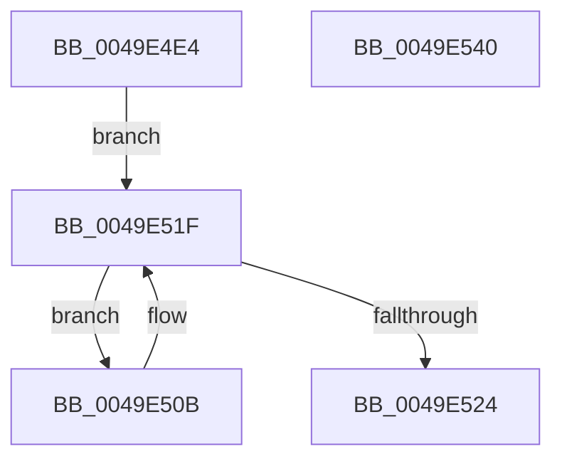

# MiGetPrivatePageCount

- RVA: `0x0049E4E4`–`0x0049E541` (길이 `93` bytes)
- VA: `0x000000014049E4E4`
- 실행 섹션: `.text`
- PDB 이름 있음: `예`; PDB Function 태그: `아니요`
- unwind 정보 RVA: `0x0005CAAC`
- 디코드: `27`개 명령, `93/93` bytes 표시
- 미해석 바이트: `0` (있으면 어셈블리에 `.byte`로 보존)

> 이 문서는 커널 이미지의 기계어와 PDB 기호를 분석해 생성했습니다. 4번과 5번은 함수 원형과 자료형을 바이너리 사용 방식에서 추정한 C 해석이며 원본 소스 복구 결과는 아닙니다.

## 1. Dependencies

- 직접 호출 지점: **2**; 고유 호출 대상: **2**
- 직접 호출자로 확인된 함수: **1**
- RIP 상대 이미지 참조: **1**

### Outgoing calls
- `0x0049E4FA` → [ExAcquireSpinLockShared](../24/ExAcquireSpinLockShared_function_0024DCE0.md) (function, `0x0024DCE0`)
- `0x0049E52D` → [MiReleaseSpinLockShared](../34/MiReleaseSpinLockShared_function_00348BF0.md) (function, `0x00348BF0`)

### Direct callers
- [MiAllocateCrcList](../../page/9F/MiAllocateCrcList_function_009F7564.md) at `0x009F75A3`

### Static image references
- `0x0049E4F3` → RVA `0x00E374C0` (`.data`; read)

## 2. Other-region calls and transfers

- 다른 실행 섹션으로 향하는 call: **0**
- 별도 외부 분기/꼬리 이동을 확인하지 못했습니다.

## 3. Assembly (complete function range)

```asm
0049E4E4  48 89 5C 24 08                  mov qword ptr [rsp + 8], rbx
0049E4E9  57                              push rdi
0049E4EA  48 83 EC 20                     sub rsp, 0x20
0049E4EE  48 8B D9                        mov rbx, rcx
0049E4F1  33 FF                           xor edi, edi
0049E4F3  48 8D 0D C6 8F 99 00            lea rcx, [rip + 0x998fc6]
0049E4FA  E8 E1 F7 DA FF                  call 0x14024dce0
0049E4FF  48 81 C3 C8 44 00 00            add rbx, 0x44c8
0049E506  4C 8B 03                        mov r8, qword ptr [rbx]
0049E509  EB 14                           jmp 0x14049e51f
0049E50B  49 8B 50 70                     mov rdx, qword ptr [r8 + 0x70]
0049E50F  4D 8B 00                        mov r8, qword ptr [r8]
0049E512  48 03 D7                        add rdx, rdi
0049E515  48 3B D7                        cmp rdx, rdi
0049E518  48 0F 46 D7                     cmovbe rdx, rdi
0049E51C  48 8B FA                        mov rdi, rdx
0049E51F  4C 3B C3                        cmp r8, rbx
0049E522  75 E7                           jne 0x14049e50b
0049E524  8A D0                           mov dl, al
0049E526  48 8D 0D 93 8F 99 00            lea rcx, [rip + 0x998f93]
0049E52D  E8 BE A6 EA FF                  call 0x140348bf0
0049E532  48 8B 5C 24 30                  mov rbx, qword ptr [rsp + 0x30]
0049E537  48 8B C7                        mov rax, rdi
0049E53A  48 83 C4 20                     add rsp, 0x20
0049E53E  5F                              pop rdi
0049E53F  C3                              ret
0049E540  CC                              int3
```

## 4. C-style interpretation (structured pseudocode)

```c
__int64 __fastcall MiGetPrivatePageCount(__int64 a1)
{
    __int64 result;
    __int64 v_rbx;
    __int64 v_rdi;
    __int64 v_rsp;
    unsigned __int64 v_stack_p8;

    v_stack_p8 = v_rbx;
    v_rsp = (v_rsp) - (32);
    v_rdi = 0;
    result = ExAcquireSpinLockShared(v_rip + 10063814, a2, a3, a4);
    v_rbx = (a1) + (0x44C8ULL);
    goto loc_0049E51F;
loc_0049E50B:
    a2 = (*(unsigned __int64 *)(*(unsigned __int64 *)(v_rbx) + 112)) + (0);
    if (a2 <= 0) { a2 = 0; }
loc_0049E51F:
    if ((*(unsigned __int64 *)(*(unsigned __int64 *)(v_rbx))) != v_rbx) goto loc_0049E50B;
    result = MiReleaseSpinLockShared(v_rip + 10063763, (unsigned __int8)(result), *(unsigned __int64 *)(*(unsigned __int64 *)(v_rbx)), a4);
    v_rsp = (v_rsp) + (32);
    return a2;
}
```

## 5. (Beta) C Style

```c
int64_t MiGetPrivatePageCount(void *Arg1)
{
    uint8_t *arg1 = (uint8_t *)Arg1;

    int64_t result;
    int64_t local_rbx;
    int64_t local_rdi;
    int64_t local_rsp;
    uint64_t v_stack_p8;

    v_stack_p8 = local_rbx;
    local_rsp = (local_rsp) - (32);
    local_rdi = 0;
    result = ExAcquireSpinLockShared(v_rip + 10063814, a2, a3, a4);
    local_rbx = (Arg1) + (0x44C8ULL);
    goto loc_0049E51F;
loc_0049E50B:
    a2 = (*(uint64_t *)(*(uint64_t *)(local_rbx) + 0x70)) + (0);
    if (a2 <= 0) { a2 = 0; }
loc_0049E51F:
    if ((*(uint64_t *)(*(uint64_t *)(local_rbx))) != local_rbx) goto loc_0049E50B;
    result = MiReleaseSpinLockShared(v_rip + 10063763, (uint8_t)(result), *(uint64_t *)(*(uint64_t *)(local_rbx)), a4);
    local_rsp = (local_rsp) + (32);
    return a2;
}
```

### 관측된 메모리 오프셋

구조체 형식이 확인되지 않은 접근은 인자 기준의 오프셋으로만 기록했습니다.

| 기준 인자 | 오프셋 표현 | 폭 (bit) | 접근 |
|---|---:|---:|---|
| `Arg1` | `+ 0x0` | `64` | `R` |

## 6. Execution-region graph

[열기: 2D/3D 그래프와 함수 탐색 컨트롤 패널](../../../control-panel.html?section=text&rva=0x0049E4E4&view=graph)

- 2D 그래프는 위에서 아래로 흐르고, 3D 그래프는 빈 공간을 드래그해 회전합니다. Shift+드래그는 이동, 휠은 확대·축소, 함수 노드 선택은 대상 보고서 이동입니다.

### Static fallback


