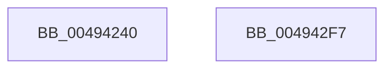

# MiGetWsAndMakePageTablesNx

- RVA: `0x00494240`–`0x004942F8` (길이 `184` bytes)
- VA: `0x0000000140494240`
- 실행 섹션: `.text`
- PDB 이름 있음: `예`; PDB Function 태그: `아니요`
- unwind 정보 RVA: `0x0005C954`
- 디코드: `43`개 명령, `184/184` bytes 표시
- 미해석 바이트: `0` (있으면 어셈블리에 `.byte`로 보존)

> 이 문서는 커널 이미지의 기계어와 PDB 기호를 분석해 생성했습니다. 4번과 5번은 함수 원형과 자료형을 바이너리 사용 방식에서 추정한 C 해석이며 원본 소스 복구 결과는 아닙니다.

## 1. Dependencies

- 직접 호출 지점: **6**; 고유 호출 대상: **6**
- 직접 호출자로 확인된 함수: **1**
- RIP 상대 이미지 참조: **0**

### Outgoing calls
- `0x00494299` → [MiLockWorkingSetShared](../27/MiLockWorkingSetShared_function_0027CBF0.md) (function, `0x0027CBF0`)
- `0x004942A6` → [MiLockNestedPageTable](../23/MiLockNestedPageTable_function_0023E890.md) (function, `0x0023E890`)
- `0x004942BD` → [MiPerformSafePdeWrite](MiPerformSafePdeWrite_function_00494300.md) (function, `0x00494300`)
- `0x004942C8` → [MiUnlockPageTable](../21/MiUnlockPageTable_function_00216EC0.md) (function, `0x00216EC0`)
- `0x004942D2` → [MiUnlockWorkingSetShared](../27/MiUnlockWorkingSetShared_function_0027D690.md) (function, `0x0027D690`)
- `0x004942DD` → [MI_FLUSH_ENTIRE_TB](../31/MI_FLUSH_ENTIRE_TB_function_00314110.md) (function, `0x00314110`)

### Direct callers
- [MmInitializeHandBuiltProcess2](../../page/AC/MmInitializeHandBuiltProcess2_function_00AC1138.md) at `0x00AC1166`

### Static image references
- 디코드된 RIP-relative 메모리 참조가 없습니다.

## 2. Other-region calls and transfers

- 다른 실행 섹션으로 향하는 call: **0**
- 별도 외부 분기/꼬리 이동을 확인하지 못했습니다.

## 3. Assembly (complete function range)

```asm
00494240  48 89 5C 24 08                  mov qword ptr [rsp + 8], rbx
00494245  48 89 6C 24 10                  mov qword ptr [rsp + 0x10], rbp
0049424A  48 89 74 24 18                  mov qword ptr [rsp + 0x18], rsi
0049424F  57                              push rdi
00494250  48 83 EC 20                     sub rsp, 0x20
00494254  65 48 8B 04 25 88 01 00 00      mov rax, qword ptr gs:[0x188]
0049425D  48 BD 68 DF BE 7D FB F6 FF FF   movabs rbp, 0xfffff6fb7dbedf68
00494267  48 8B B0 B8 00 00 00            mov rsi, qword ptr [rax + 0xb8]
0049426E  48 81 C6 00 04 00 00            add rsi, 0x400
00494275  48 8B FD                        mov rdi, rbp
00494278  48 C1 EF 09                     shr rdi, 9
0049427C  48 B8 F8 FF FF FF 7F 00 00 00   movabs rax, 0x7ffffffff8
00494286  48 23 F8                        and rdi, rax
00494289  48 B8 00 00 00 00 80 F6 FF FF   movabs rax, 0xfffff68000000000
00494293  48 8B CE                        mov rcx, rsi
00494296  48 03 F8                        add rdi, rax
00494299  E8 52 89 DE FF                  call 0x14027cbf0
0049429E  48 8B D7                        mov rdx, rdi
004942A1  48 8B CE                        mov rcx, rsi
004942A4  8A D8                           mov bl, al
004942A6  E8 E5 A5 DA FF                  call 0x14023e890
004942AB  4C 8B C5                        mov r8, rbp
004942AE  4D 8B 00                        mov r8, qword ptr [r8]
004942B1  48 8B D5                        mov rdx, rbp
004942B4  41 B9 02 00 00 00               mov r9d, 2
004942BA  48 8B CE                        mov rcx, rsi
004942BD  E8 3E 00 00 00                  call 0x140494300
004942C2  48 8B D7                        mov rdx, rdi
004942C5  48 8B CE                        mov rcx, rsi
004942C8  E8 F3 2B D8 FF                  call 0x140216ec0
004942CD  8A D3                           mov dl, bl
004942CF  48 8B CE                        mov rcx, rsi
004942D2  E8 B9 93 DE FF                  call 0x14027d690
004942D7  83 CA FF                        or edx, 0xffffffff
004942DA  8D 4A 02                        lea ecx, [rdx + 2]
004942DD  E8 2E FE E7 FF                  call 0x140314110
004942E2  48 8B 5C 24 30                  mov rbx, qword ptr [rsp + 0x30]
004942E7  48 8B 6C 24 38                  mov rbp, qword ptr [rsp + 0x38]
004942EC  48 8B 74 24 40                  mov rsi, qword ptr [rsp + 0x40]
004942F1  48 83 C4 20                     add rsp, 0x20
004942F5  5F                              pop rdi
004942F6  C3                              ret
004942F7  CC                              int3
```

## 4. C-style interpretation (structured pseudocode)

```c
__int64 __fastcall MiGetWsAndMakePageTablesNx(void)
{
    __int64 result;
    __int64 v_rdi;
    __int64 v_rsi;
    __int64 v_rsp;
    unsigned __int64 v_stack_p10;
    unsigned __int64 v_stack_p18;
    unsigned __int64 v_stack_p8;

    v_stack_p8 = v_rbx;
    v_stack_p10 = v_rbp;
    v_stack_p18 = v_rsi;
    v_rsp = (v_rsp) - (32);
    v_rsi = (*(unsigned __int64 *)(*(unsigned __int64 *)(gs_base + (0 + 392)) + 184)) + (0x400ULL);
    v_rdi = (v_rbp) >> (9);
    v_rdi = (v_rdi) & (*(unsigned __int64 *)(gs_base + (0 + 392)));
    v_rdi = (v_rdi) + (*(unsigned __int64 *)(gs_base + (0 + 392)));
    result = MiLockWorkingSetShared(v_rsi, a2, a3, a4);
    result = MiLockNestedPageTable(v_rsi, v_rdi, a3, a4);
    result = MiPerformSafePdeWrite(v_rsi, v_rbp, *(unsigned __int64 *)(v_rbp), 2);
    result = MiUnlockPageTable(v_rsi, v_rdi, *(unsigned __int64 *)(v_rbp), 2);
    result = MiUnlockWorkingSetShared(v_rsi, (unsigned __int8)((unsigned __int8)(result)), *(unsigned __int64 *)(v_rbp), 2);
    a2 = (unsigned int)(((unsigned __int8)((unsigned __int8)(result))) | (0xFFFFFFFFULL));
    result = MI_FLUSH_ENTIRE_TB(a2 + 2, a2, *(unsigned __int64 *)(v_rbp), 2);
    v_rsp = (v_rsp) + (32);
    return result;
}
```

## 5. (Beta) C Style

```c
void MiGetWsAndMakePageTablesNx(void)
{
    int64_t result;
    int64_t local_rdi;
    int64_t local_rsi;
    int64_t local_rsp;
    uint64_t v_stack_p10;
    uint64_t v_stack_p18;
    uint64_t v_stack_p8;

    v_stack_p8 = local_rbx;
    v_stack_p10 = local_rbp;
    v_stack_p18 = local_rsi;
    local_rsp = (local_rsp) - (32);
    local_rsi = (*(uint64_t *)(*(uint64_t *)(gs_base + (0 + 0x188)) + 0xB8)) + (0x400ULL);
    local_rdi = (local_rbp) >> (9);
    local_rdi = (local_rdi) & (*(uint64_t *)(gs_base + (0 + 0x188)));
    local_rdi = (local_rdi) + (*(uint64_t *)(gs_base + (0 + 0x188)));
    result = MiLockWorkingSetShared(local_rsi, a2, a3, a4);
    result = MiLockNestedPageTable(local_rsi, local_rdi, a3, a4);
    result = MiPerformSafePdeWrite(local_rsi, local_rbp, *(uint64_t *)(local_rbp), 2);
    result = MiUnlockPageTable(local_rsi, local_rdi, *(uint64_t *)(local_rbp), 2);
    result = MiUnlockWorkingSetShared(local_rsi, (uint8_t)((uint8_t)(result)), *(uint64_t *)(local_rbp), 2);
    a2 = (uint32_t)(((uint8_t)((uint8_t)(result))) | (0xFFFFFFFFULL));
    result = MI_FLUSH_ENTIRE_TB(a2 + 2, a2, *(uint64_t *)(local_rbp), 2);
    local_rsp = (local_rsp) + (32);
    return result;
}
```

## 6. Execution-region graph

[열기: 2D/3D 그래프와 함수 탐색 컨트롤 패널](../../../control-panel.html?section=text&rva=0x00494240&view=graph)

- 2D 그래프는 위에서 아래로 흐르고, 3D 그래프는 빈 공간을 드래그해 회전합니다. Shift+드래그는 이동, 휠은 확대·축소, 함수 노드 선택은 대상 보고서 이동입니다.

### Static fallback


