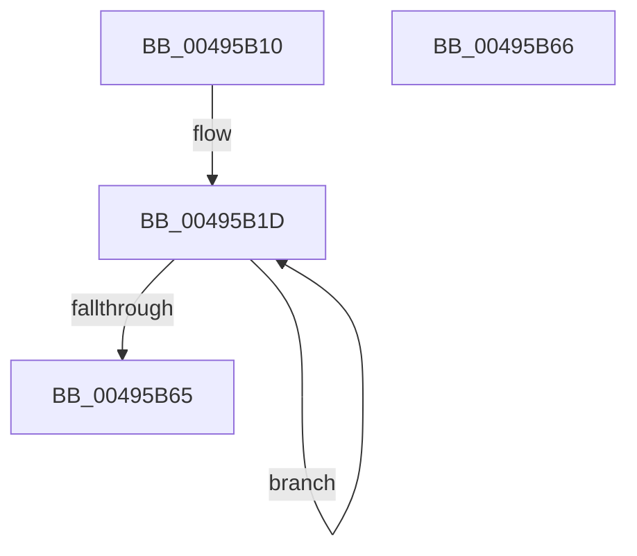

# MiInitializeIoPageNodeArray

- RVA: `0x00495B10`–`0x00495B67` (길이 `87` bytes)
- VA: `0x0000000140495B10`
- 실행 섹션: `.text`
- PDB 이름 있음: `예`; PDB Function 태그: `아니요`
- unwind 정보 RVA: `0x000DB714`
- 디코드: `27`개 명령, `87/87` bytes 표시
- 미해석 바이트: `0` (있으면 어셈블리에 `.byte`로 보존)

> 이 문서는 커널 이미지의 기계어와 PDB 기호를 분석해 생성했습니다. 4번과 5번은 함수 원형과 자료형을 바이너리 사용 방식에서 추정한 C 해석이며 원본 소스 복구 결과는 아닙니다.

## 1. Dependencies

- 직접 호출 지점: **0**; 고유 호출 대상: **0**
- 직접 호출자로 확인된 함수: **1**
- RIP 상대 이미지 참조: **1**

### Outgoing calls
- 직접 디코드된 call 명령이 없습니다.

### Direct callers
- [MiReferenceIoPages](../23/MiReferenceIoPages_function_0023C804.md) at `0x0023CF83`

### Static image references
- `0x00495B1D` → RVA `0x00E2DC38` (`.data`; read)

## 2. Other-region calls and transfers

- 다른 실행 섹션으로 향하는 call: **0**
- 별도 외부 분기/꼬리 이동을 확인하지 못했습니다.

## 3. Assembly (complete function range)

```asm
00495B10  4C 8B 51 18                     mov r10, qword ptr [rcx + 0x18]
00495B14  4C 8B C9                        mov r9, rcx
00495B17  41 BB 00 02 00 00               mov r11d, 0x200
00495B1D  8A 0D 15 81 99 00               mov cl, byte ptr [rip + 0x998115]
00495B23  B8 01 00 00 00                  mov eax, 1
00495B28  80 C1 F4                        add cl, 0xf4
00495B2B  BA 03 00 00 00                  mov edx, 3
00495B30  48 D3 E0                        shl rax, cl
00495B33  FF C8                           dec eax
00495B35  41 23 C2                        and eax, r10d
00495B38  49 FF C2                        inc r10
00495B3B  41 2B 41 18                     sub eax, dword ptr [r9 + 0x18]
00495B3F  03 C0                           add eax, eax
00495B41  8B C8                           mov ecx, eax
00495B43  44 8B C0                        mov r8d, eax
00495B46  83 E1 1F                        and ecx, 0x1f
00495B49  D3 E2                           shl edx, cl
00495B4B  49 C1 E8 05                     shr r8, 5
00495B4F  8B C2                           mov eax, edx
00495B51  F7 D0                           not eax
00495B53  43 23 44 81 2C                  and eax, dword ptr [r9 + r8*4 + 0x2c]
00495B58  0B C2                           or eax, edx
00495B5A  43 89 44 81 2C                  mov dword ptr [r9 + r8*4 + 0x2c], eax
00495B5F  49 83 EB 01                     sub r11, 1
00495B63  75 B8                           jne 0x140495b1d
00495B65  C3                              ret
00495B66  CC                              int3
```

## 4. C-style interpretation (structured pseudocode)

```c
__int64 __fastcall MiInitializeIoPageNodeArray(__int64 a1)
{
    __int64 result;
    __int64 v_r10;
    __int64 v_r11;

loc_00495B1D:
    a1 = (unsigned __int8)((*(unsigned __int8 *)(v_rip + 10060053)) + (244));
    result = (1) << ((unsigned __int8)(a1));
    result = (unsigned int)((result) - 1);
    result = (unsigned int)((result) & ((unsigned int)(*(unsigned __int64 *)(a1 + 24))));
    v_r10 = (*(unsigned __int64 *)(a1 + 24)) + 1;
    result = (unsigned int)((result) - (*(unsigned int *)(a1 + 24)));
    result = (unsigned int)((result) + ((unsigned int)(result)));
    a1 = (unsigned int)(((unsigned int)((unsigned int)(result))) & (31));
    a2 = (unsigned int)((3) << ((unsigned __int8)(a1)));
    a3 = ((unsigned int)((unsigned int)(result))) >> (5);
    result = (unsigned int)(~((unsigned int)((unsigned int)(a2))));
    result = (unsigned int)((result) & (*(unsigned int *)(a1 + a3 * 4 + 44)));
    result = (unsigned int)((result) | ((unsigned int)(a2)));
    *(unsigned int *)(a1 + a3 * 4 + 44) = (unsigned int)(result);
    v_r11 = (512) - (1);
    if (condition_is_not_equal) goto loc_00495B1D;
    return result;
}
```

## 5. (Beta) C Style

```c
int64_t MiInitializeIoPageNodeArray(void *Arg1)
{
    uint8_t *arg1 = (uint8_t *)Arg1;

    int64_t result;
    int64_t local_r10;
    int64_t local_r11;

loc_00495B1D:
    Arg1 = (uint8_t)((*(uint8_t *)(v_rip + 0x998115)) + (244));
    result = (1) << ((uint8_t)(Arg1));
    result = (uint32_t)((result) - 1);
    result = (uint32_t)((result) & ((uint32_t)(*(uint64_t *)(arg1 + 0x18))));
    local_r10 = (*(uint64_t *)(arg1 + 0x18)) + 1;
    result = (uint32_t)((result) - (*(uint32_t *)(arg1 + 0x18)));
    result = (uint32_t)((result) + ((uint32_t)(result)));
    Arg1 = (uint32_t)(((uint32_t)((uint32_t)(result))) & (31));
    a2 = (uint32_t)((3) << ((uint8_t)(Arg1)));
    a3 = ((uint32_t)((uint32_t)(result))) >> (5);
    result = (uint32_t)(~((uint32_t)((uint32_t)(a2))));
    result = (uint32_t)((result) & (*(uint32_t *)(arg1 + a3 * 4 + 0x2C)));
    result = (uint32_t)((result) | ((uint32_t)(a2)));
    *(uint32_t *)(arg1 + a3 * 4 + 0x2C) = (uint32_t)(result);
    local_r11 = (512) - (1);
    if (condition_is_not_equal) goto loc_00495B1D;
    return result;
}
```

### 관측된 메모리 오프셋

구조체 형식이 확인되지 않은 접근은 인자 기준의 오프셋으로만 기록했습니다.

| 기준 인자 | 오프셋 표현 | 폭 (bit) | 접근 |
|---|---:|---:|---|
| `Arg1` | `+ 0x18` | `32` | `R` |
| `Arg1` | `+ 0x18` | `64` | `R` |
| `Arg1` | `+ 0x2C + r8*4` | `32` | `R` |
| `Arg1` | `+ 0x2C + r8*4` | `32` | `W` |

## 6. Execution-region graph

[열기: 2D/3D 그래프와 함수 탐색 컨트롤 패널](../../../control-panel.html?section=text&rva=0x00495B10&view=graph)

- 2D 그래프는 위에서 아래로 흐르고, 3D 그래프는 빈 공간을 드래그해 회전합니다. Shift+드래그는 이동, 휠은 확대·축소, 함수 노드 선택은 대상 보고서 이동입니다.

### Static fallback


