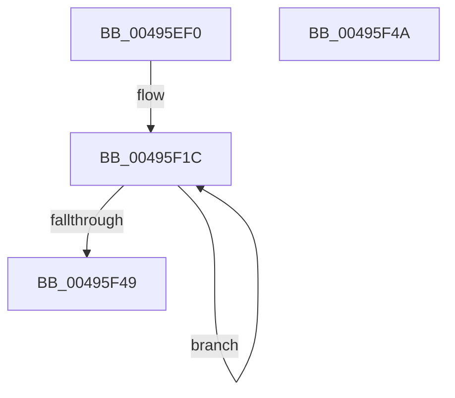

# MiInitializeProcessPageTableCommitmentBitMaps

- RVA: `0x00495EF0`–`0x00495F4B` (길이 `91` bytes)
- VA: `0x0000000140495EF0`
- 실행 섹션: `.text`
- PDB 이름 있음: `예`; PDB Function 태그: `아니요`
- unwind 정보 RVA: `0x000DB714`
- 디코드: `20`개 명령, `91/91` bytes 표시
- 미해석 바이트: `0` (있으면 어셈블리에 `.byte`로 보존)

> 이 문서는 커널 이미지의 기계어와 PDB 기호를 분석해 생성했습니다. 4번과 5번은 함수 원형과 자료형을 바이너리 사용 방식에서 추정한 C 해석이며 원본 소스 복구 결과는 아닙니다.

## 1. Dependencies

- 직접 호출 지점: **0**; 고유 호출 대상: **0**
- 직접 호출자로 확인된 함수: **1**
- RIP 상대 이미지 참조: **2**

### Outgoing calls
- 직접 디코드된 call 명령이 없습니다.

### Direct callers
- [MmInitializeProcessAddressSpace](../../page/8C/MmInitializeProcessAddressSpace_function_008CF6B0.md) at `0x008CF7C2`

### Static image references
- `0x00495F1C` → RVA `0x00E2F388` (`.data`; read)
- `0x00495F23` → RVA `0x00E2F3A8` (`.data`; read)

## 2. Other-region calls and transfers

- 다른 실행 섹션으로 향하는 call: **0**
- 별도 외부 분기/꼬리 이동을 확인하지 못했습니다.

## 3. Assembly (complete function range)

```asm
00495EF0  48 8B 91 10 04 00 00            mov rdx, qword ptr [rcx + 0x410]
00495EF7  41 B8 00 01 00 00               mov r8d, 0x100
00495EFD  45 33 C9                        xor r9d, r9d
00495F00  48 8D 82 E0 04 00 00            lea rax, [rdx + 0x4e0]
00495F07  4C 89 82 20 05 00 00            mov qword ptr [rdx + 0x520], r8
00495F0E  48 89 82 28 05 00 00            mov qword ptr [rdx + 0x528], rax
00495F15  4C 8D 92 30 05 00 00            lea r10, [rdx + 0x530]
00495F1C  48 8B 15 65 94 99 00            mov rdx, qword ptr [rip + 0x999465]
00495F23  48 8D 0D 7E 94 99 00            lea rcx, [rip + 0x99947e]
00495F2A  4A 03 14 C9                     add rdx, qword ptr [rcx + r9*8]
00495F2E  41 FF C1                        inc r9d
00495F31  49 C1 E0 09                     shl r8, 9
00495F35  4D 89 02                        mov qword ptr [r10], r8
00495F38  49 89 52 08                     mov qword ptr [r10 + 8], rdx
00495F3C  4D 8D 52 10                     lea r10, [r10 + 0x10]
00495F40  41 8D 41 01                     lea eax, [r9 + 1]
00495F44  83 F8 03                        cmp eax, 3
00495F47  72 D3                           jb 0x140495f1c
00495F49  C3                              ret
00495F4A  CC                              int3
```

## 4. C-style interpretation (structured pseudocode)

```c
__int64 __fastcall MiInitializeProcessPageTableCommitmentBitMaps(__int64 a1, __int64 a2, __int64 a3, int a4)
{
    a4 = 0;
    *(unsigned __int64 *)(*(unsigned __int64 *)(a1 + 1040) + 1312) = 256;
    *(unsigned __int64 *)(*(unsigned __int64 *)(a1 + 1040) + 1320) = *(unsigned __int64 *)(a1 + 1040) + 1248;
loc_00495F1C:
    a2 = (*(unsigned __int64 *)(v_rip + 10064997)) + (*(unsigned __int64 *)(v_rip + 10065022 + a4 * 8));
    a4 = (unsigned int)((a4) + 1);
    a3 = (256) << (9);
    *(unsigned __int64 *)(*(unsigned __int64 *)(a1 + 1040) + 1328) = a3;
    *(unsigned __int64 *)(*(unsigned __int64 *)(a1 + 1040) + 1328 + 8) = a2;
    if (((unsigned int)(a4 + 1)) < 3) goto loc_00495F1C;
    return a4 + 1;
}
```

## 5. (Beta) C Style

```c
int64_t MiInitializeProcessPageTableCommitmentBitMaps(void *Arg1, int64_t Arg2, int64_t Arg3, int32_t Arg4)
{
    uint8_t *arg1 = (uint8_t *)Arg1;

    Arg4 = 0;
    *(uint64_t *)(*(uint64_t *)(arg1 + 0x410) + 0x520) = 256;
    *(uint64_t *)(*(uint64_t *)(arg1 + 0x410) + 0x528) = *(uint64_t *)(arg1 + 0x410) + 1248;
loc_00495F1C:
    Arg2 = (*(uint64_t *)(v_rip + 0x999465)) + (*(uint64_t *)(v_rip + 0x99947E + Arg4 * 8));
    Arg4 = (uint32_t)((Arg4) + 1);
    Arg3 = (256) << (9);
    *(uint64_t *)(*(uint64_t *)(arg1 + 0x410) + 0x530) = Arg3;
    *(uint64_t *)(*(uint64_t *)(arg1 + 0x410) + 0x530 + 0x8) = Arg2;
    if (((uint32_t)(Arg4 + 1)) < 3) goto loc_00495F1C;
    return Arg4 + 1;
}
```

### 관측된 메모리 오프셋

구조체 형식이 확인되지 않은 접근은 인자 기준의 오프셋으로만 기록했습니다.

| 기준 인자 | 오프셋 표현 | 폭 (bit) | 접근 |
|---|---:|---:|---|
| `Arg1` | `+ 0x410` | `64` | `R` |

## 6. Execution-region graph

[열기: 2D/3D 그래프와 함수 탐색 컨트롤 패널](../../../control-panel.html?section=text&rva=0x00495EF0&view=graph)

- 2D 그래프는 위에서 아래로 흐르고, 3D 그래프는 빈 공간을 드래그해 회전합니다. Shift+드래그는 이동, 휠은 확대·축소, 함수 노드 선택은 대상 보고서 이동입니다.

### Static fallback


