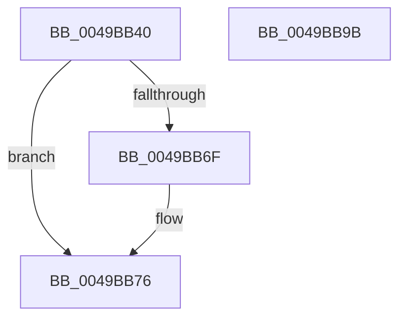

# MiInsertNewProcess

- RVA: `0x0049BB40`–`0x0049BB9C` (길이 `92` bytes)
- VA: `0x000000014049BB40`
- 실행 섹션: `.text`
- PDB 이름 있음: `예`; PDB Function 태그: `아니요`
- unwind 정보 RVA: `0x0005CF00`
- 디코드: `23`개 명령, `92/92` bytes 표시
- 미해석 바이트: `0` (있으면 어셈블리에 `.byte`로 보존)

> 이 문서는 커널 이미지의 기계어와 PDB 기호를 분석해 생성했습니다. 4번과 5번은 함수 원형과 자료형을 바이너리 사용 방식에서 추정한 C 해석이며 원본 소스 복구 결과는 아닙니다.

## 1. Dependencies

- 직접 호출 지점: **2**; 고유 호출 대상: **2**
- 직접 호출자로 확인된 함수: **1**
- RIP 상대 이미지 참조: **4**

### Outgoing calls
- `0x0049BB50` → [ExAcquireSpinLockExclusive](../24/ExAcquireSpinLockExclusive_function_00248690.md) (function, `0x00248690`)
- `0x0049BB90` → [MiReleaseSpinLockExclusive](../24/MiReleaseSpinLockExclusive_function_002482C0.md) (function, `0x002482C0`)

### Direct callers
- [MmInitializeHandBuiltProcess](../../page/7F/MmInitializeHandBuiltProcess_function_007F83EC.md) at `0x007F84FA`

### Static image references
- `0x0049BB49` → RVA `0x00E374C0` (`.data`; read)
- `0x0049BB55` → RVA `0x00E2DB60` (`.data`; read)
- `0x0049BB5C` → RVA `0x00E2DB58` (`.data`; read)
- `0x0049BB89` → RVA `0x00E2DB60` (`.data`; write)

## 2. Other-region calls and transfers

- 다른 실행 섹션으로 향하는 call: **0**
- 별도 외부 분기/꼬리 이동을 확인하지 못했습니다.

## 3. Assembly (complete function range)

```asm
0049BB40  40 53                           push rbx
0049BB42  48 83 EC 20                     sub rsp, 0x20
0049BB46  48 8B D9                        mov rbx, rcx
0049BB49  48 8D 0D 70 B9 99 00            lea rcx, [rip + 0x99b970]
0049BB50  E8 3B CB DA FF                  call 0x140248690
0049BB55  48 8B 0D 04 20 99 00            mov rcx, qword ptr [rip + 0x992004]
0049BB5C  48 8D 15 F5 1F 99 00            lea rdx, [rip + 0x991ff5]
0049BB63  48 81 C3 40 05 00 00            add rbx, 0x540
0049BB6A  48 39 11                        cmp qword ptr [rcx], rdx
0049BB6D  74 07                           je 0x14049bb76
0049BB6F  B9 03 00 00 00                  mov ecx, 3
0049BB74  CD 29                           int 0x29
0049BB76  48 89 13                        mov qword ptr [rbx], rdx
0049BB79  8A D0                           mov dl, al
0049BB7B  48 89 4B 08                     mov qword ptr [rbx + 8], rcx
0049BB7F  48 89 19                        mov qword ptr [rcx], rbx
0049BB82  48 8D 0D 37 B9 99 00            lea rcx, [rip + 0x99b937]
0049BB89  48 89 1D D0 1F 99 00            mov qword ptr [rip + 0x991fd0], rbx
0049BB90  E8 2B C7 DA FF                  call 0x1402482c0
0049BB95  48 83 C4 20                     add rsp, 0x20
0049BB99  5B                              pop rbx
0049BB9A  C3                              ret
0049BB9B  CC                              int3
```

## 4. C-style interpretation (structured pseudocode)

```c
__int64 __fastcall MiInsertNewProcess(__int64 a1)
{
    __int64 result;
    __int64 v_rbx;
    __int64 v_rsp;

    v_rsp = (v_rsp) - (32);
    result = ExAcquireSpinLockExclusive(v_rip + 10074480, a2, a3, a4);
    v_rbx = (a1) + (0x540ULL);
    if ((*(unsigned __int64 *)(*(unsigned __int64 *)(v_rip + 10035204))) != (v_rip + 10035189)) {
        a1 = 3;
    }
    *(unsigned __int64 *)(v_rbx) = v_rip + 10035189;
    *(unsigned __int64 *)(v_rbx + 8) = a1;
    *(unsigned __int64 *)(a1) = v_rbx;
    *(unsigned __int64 *)(v_rip + 10035152) = v_rbx;
    result = MiReleaseSpinLockExclusive(v_rip + 10074423, (unsigned __int8)(result), a3, a4);
    v_rsp = (v_rsp) + (32);
    return result;
}
```

## 5. (Beta) C Style

```c
int64_t MiInsertNewProcess(void *Arg1)
{
    uint8_t *arg1 = (uint8_t *)Arg1;

    int64_t result;
    int64_t local_rbx;
    int64_t local_rsp;

    local_rsp = (local_rsp) - (32);
    result = ExAcquireSpinLockExclusive(v_rip + 10074480, a2, a3, a4);
    local_rbx = (Arg1) + (0x540ULL);
    if ((*(uint64_t *)(*(uint64_t *)(v_rip + 0x992004))) != (v_rip + 10035189)) {
        Arg1 = 3;
    }
    *(uint64_t *)(local_rbx) = v_rip + 10035189;
    *(void **)(local_rbx + 0x8) = Arg1;
    *(uint64_t *)(arg1) = local_rbx;
    *(uint64_t *)(v_rip + 0x991FD0) = local_rbx;
    result = MiReleaseSpinLockExclusive(v_rip + 10074423, (uint8_t)(result), a3, a4);
    local_rsp = (local_rsp) + (32);
    return result;
}
```

### 관측된 메모리 오프셋

구조체 형식이 확인되지 않은 접근은 인자 기준의 오프셋으로만 기록했습니다.

| 기준 인자 | 오프셋 표현 | 폭 (bit) | 접근 |
|---|---:|---:|---|
| `Arg1` | `+ 0x0` | `64` | `W` |
| `Arg1` | `+ 0x8` | `64` | `W` |

## 6. Execution-region graph

[열기: 2D/3D 그래프와 함수 탐색 컨트롤 패널](../../../control-panel.html?section=text&rva=0x0049BB40&view=graph)

- 2D 그래프는 위에서 아래로 흐르고, 3D 그래프는 빈 공간을 드래그해 회전합니다. Shift+드래그는 이동, 휠은 확대·축소, 함수 노드 선택은 대상 보고서 이동입니다.

### Static fallback


