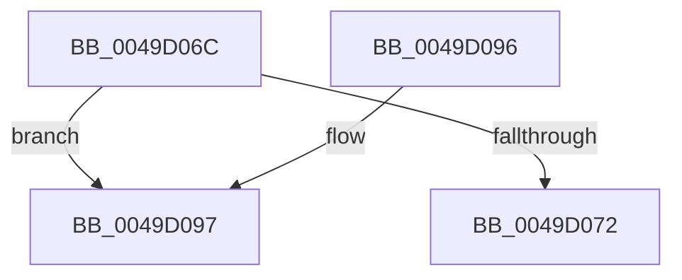

# MiIoPfnTreeLockContended

- RVA: `0x0049D06C`–`0x0049D0AA` (길이 `62` bytes)
- VA: `0x000000014049D06C`
- 실행 섹션: `.text`
- PDB 이름 있음: `예`; PDB Function 태그: `예`
- unwind 정보 RVA: `0x000DB714`
- 디코드: `14`개 명령, `62/62` bytes 표시
- 미해석 바이트: `0` (있으면 어셈블리에 `.byte`로 보존)

> 이 문서는 커널 이미지의 기계어와 PDB 기호를 분석해 생성했습니다. 4번과 5번은 함수 원형과 자료형을 바이너리 사용 방식에서 추정한 C 해석이며 원본 소스 복구 결과는 아닙니다.

## 1. Dependencies

- 직접 호출 지점: **0**; 고유 호출 대상: **0**
- 직접 호출자로 확인된 함수: **2**
- RIP 상대 이미지 참조: **1**

### Outgoing calls
- 직접 디코드된 call 명령이 없습니다.

### Direct callers
- [MiDeleteStaleCacheMaps](../67/MiDeleteStaleCacheMaps_function_0067B780.md) at `0x0067B91B`
- [MiDeleteStaleCacheMaps](../67/MiDeleteStaleCacheMaps_function_0067B780.md) at `0x0067BA4B`
- [MiMarkHugeRangeIoPfnDeleted](../67/MiMarkHugeRangeIoPfnDeleted_function_0067C770.md) at `0x0067C824`

### Static image references
- `0x0049D097` → RVA `0x00E2DBF8` (`.data`; read)

## 2. Other-region calls and transfers

- 다른 실행 섹션으로 향하는 call: **0**
- call이 아닌 외부 분기/꼬리 이동: **1**
  - `0x0049D0A5` → `0x006F8058` (`tail-transfer`)

## 3. Assembly (complete function range)

```asm
0049D06C  33 C0                           xor eax, eax
0049D06E  84 C9                           test cl, cl
0049D070  75 25                           jne 0x14049d097
0049D072  65 48 8B 04 25 20 00 00 00      mov rax, qword ptr gs:[0x20]
0049D07B  48 8B 88 38 88 00 00            mov rcx, qword ptr [rax + 0x8838]
0049D082  48 8B 81 48 01 00 00            mov rax, qword ptr [rcx + 0x148]
0049D089  8B 80 80 02 00 00               mov eax, dword ptr [rax + 0x280]
0049D08F  C1 E8 1E                        shr eax, 0x1e
0049D092  83 E0 01                        and eax, 1
0049D095  C3                              ret
0049D096  CC                              int3
0049D097  48 8B 15 5A 0B 99 00            mov rdx, qword ptr [rip + 0x990b5a]
0049D09E  48 81 C2 78 01 00 00            add rdx, 0x178
0049D0A5  E9 AE AF 25 00                  jmp 0x1406f8058
```

## 4. C-style interpretation (structured pseudocode)

```c
__int64 __fastcall MiIoPfnTreeLockContended(unsigned __int8 a1)
{
    __int64 result;

    result = 0;
    if (a1 != 0) goto loc_0049D097;
    result = (unsigned int)(((unsigned int)(*(unsigned int *)(*(unsigned __int64 *)(*(unsigned __int64 *)(*(unsigned __int64 *)(gs_base + (0 + 32)) + 34872) + 328) + 640))) >> (30));
    result = (unsigned int)((result) & (1));
    return result;
loc_0049D097:
    a2 = (*(unsigned __int64 *)(v_rip + 10029914)) + (376);
}
```

## 5. (Beta) C Style

```c
int64_t MiIoPfnTreeLockContended(uint8_t Arg1)
{
    int64_t result;

    result = 0;
    if (Arg1 != 0) goto loc_0049D097;
    result = (uint32_t)(((uint32_t)(*(uint32_t *)(*(uint64_t *)(*(uint64_t *)(*(uint64_t *)(gs_base + (0 + 0x20)) + 0x8838) + 0x148) + 0x280))) >> (30));
    result = (uint32_t)((result) & (1));
    return result;
loc_0049D097:
    a2 = (*(uint64_t *)(v_rip + 0x990B5A)) + (376);
}
```

## 6. Execution-region graph

[열기: 2D/3D 그래프와 함수 탐색 컨트롤 패널](../../../control-panel.html?section=text&rva=0x0049D06C&view=graph)

- 2D 그래프는 위에서 아래로 흐르고, 3D 그래프는 빈 공간을 드래그해 회전합니다. Shift+드래그는 이동, 휠은 확대·축소, 함수 노드 선택은 대상 보고서 이동입니다.

### Static fallback


