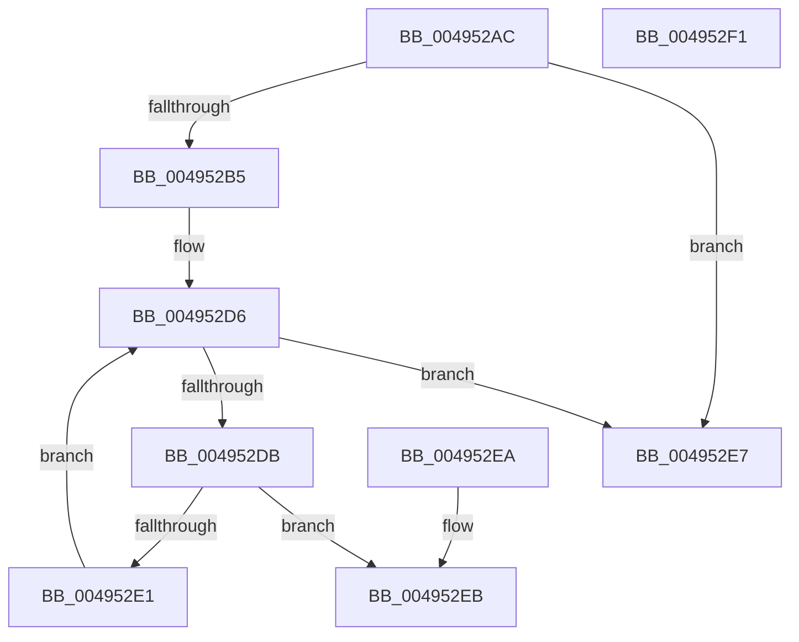

# MiIsPfnRangeFromSlabAllocation

- RVA: `0x004952AC`–`0x004952F2` (길이 `70` bytes)
- VA: `0x00000001404952AC`
- 실행 섹션: `.text`
- PDB 이름 있음: `예`; PDB Function 태그: `아니요`
- unwind 정보 RVA: `0x000DB714`
- 디코드: `22`개 명령, `70/70` bytes 표시
- 미해석 바이트: `0` (있으면 어셈블리에 `.byte`로 보존)

> 이 문서는 커널 이미지의 기계어와 PDB 기호를 분석해 생성했습니다. 4번과 5번은 함수 원형과 자료형을 바이너리 사용 방식에서 추정한 C 해석이며 원본 소스 복구 결과는 아닙니다.

## 1. Dependencies

- 직접 호출 지점: **0**; 고유 호출 대상: **0**
- 직접 호출자로 확인된 함수: **2**
- RIP 상대 이미지 참조: **2**

### Outgoing calls
- 직접 디코드된 call 명령이 없습니다.

### Direct callers
- [MiFreeMdlPageRun](../37/MiFreeMdlPageRun_function_00375A4C.md) at `0x00375C0A`
- [MiCreateBootSlabEntries](../../init/C6/MiCreateBootSlabEntries_function_00C69A50.md) at `0x00C69BC8`

### Static image references
- `0x004952AC` → RVA `0x00E3CBE6` (`.data`; read)
- `0x004952B5` → RVA `0x00E3D240` (`.data`; read)

## 2. Other-region calls and transfers

- 다른 실행 섹션으로 향하는 call: **0**
- 별도 외부 분기/꼬리 이동을 확인하지 못했습니다.

## 3. Assembly (complete function range)

```asm
004952AC  80 3D 33 79 9A 00 00            cmp byte ptr [rip + 0x9a7933], 0
004952B3  74 32                           je 0x1404952e7
004952B5  4C 8B 05 84 7F 9A 00            mov r8, qword ptr [rip + 0x9a7f84]
004952BC  48 8B C1                        mov rax, rcx
004952BF  48 C1 E8 09                     shr rax, 9
004952C3  4D 8D 0C 40                     lea r9, [r8 + rax*2]
004952C7  48 8D 41 FF                     lea rax, [rcx - 1]
004952CB  48 03 C2                        add rax, rdx
004952CE  48 C1 E8 09                     shr rax, 9
004952D2  49 8D 0C 40                     lea rcx, [r8 + rax*2]
004952D6  4C 3B C9                        cmp r9, rcx
004952D9  77 0C                           ja 0x1404952e7
004952DB  41 80 39 00                     cmp byte ptr [r9], 0
004952DF  75 0A                           jne 0x1404952eb
004952E1  49 83 C1 02                     add r9, 2
004952E5  EB EF                           jmp 0x1404952d6
004952E7  33 C0                           xor eax, eax
004952E9  C3                              ret
004952EA  CC                              int3
004952EB  B8 01 00 00 00                  mov eax, 1
004952F0  C3                              ret
004952F1  CC                              int3
```

## 4. C-style interpretation (structured pseudocode)

```c
__int64 __fastcall MiIsPfnRangeFromSlabAllocation(__int64 a1, __int64 a2)
{
    __int64 result;

    if ((*(unsigned __int8 *)(v_rip + 10123571)) == 0) goto loc_004952E7;
    result = (a1) >> (9);
    result = (a1 - 1) + (a2);
    result = (result) >> (9);
loc_004952D6:
    if ((*(unsigned __int64 *)(v_rip + 10125188) + result * 2) > (*(unsigned __int64 *)(v_rip + 10125188) + result * 2)) goto loc_004952E7;
    if ((*(unsigned __int8 *)(*(unsigned __int64 *)(v_rip + 10125188) + result * 2)) != 0) goto loc_004952EB;
    a4 = (*(unsigned __int64 *)(v_rip + 10125188) + result * 2) + (2);
    goto loc_004952D6;
loc_004952E7:
    result = 0;
    return result;
loc_004952EB:
    return 1;
}
```

## 5. (Beta) C Style

```c
int64_t MiIsPfnRangeFromSlabAllocation(void *Arg1, int64_t Arg2)
{
    uint8_t *arg1 = (uint8_t *)Arg1;

    int64_t result;

    if ((*(uint8_t *)(v_rip + 0x9A7933)) == 0) goto loc_004952E7;
    result = (Arg1) >> (9);
    result = (Arg1 - 1) + (Arg2);
    result = (result) >> (9);
loc_004952D6:
    if ((*(uint64_t *)(v_rip + 0x9A7F84) + result * 2) > (*(uint64_t *)(v_rip + 0x9A7F84) + result * 2)) goto loc_004952E7;
    if ((*(uint8_t *)(*(uint64_t *)(v_rip + 0x9A7F84) + result * 2)) != 0) goto loc_004952EB;
    a4 = (*(uint64_t *)(v_rip + 0x9A7F84) + result * 2) + (2);
    goto loc_004952D6;
loc_004952E7:
    result = 0;
    return result;
loc_004952EB:
    return 1;
}
```

### 관측된 메모리 오프셋

구조체 형식이 확인되지 않은 접근은 인자 기준의 오프셋으로만 기록했습니다.

| 기준 인자 | 오프셋 표현 | 폭 (bit) | 접근 |
|---|---:|---:|---|
| `Arg1` | `- 0x1` | `64` | `R` |

## 6. Execution-region graph

[열기: 2D/3D 그래프와 함수 탐색 컨트롤 패널](../../../control-panel.html?section=text&rva=0x004952AC&view=graph)

- 2D 그래프는 위에서 아래로 흐르고, 3D 그래프는 빈 공간을 드래그해 회전합니다. Shift+드래그는 이동, 휠은 확대·축소, 함수 노드 선택은 대상 보고서 이동입니다.

### Static fallback


