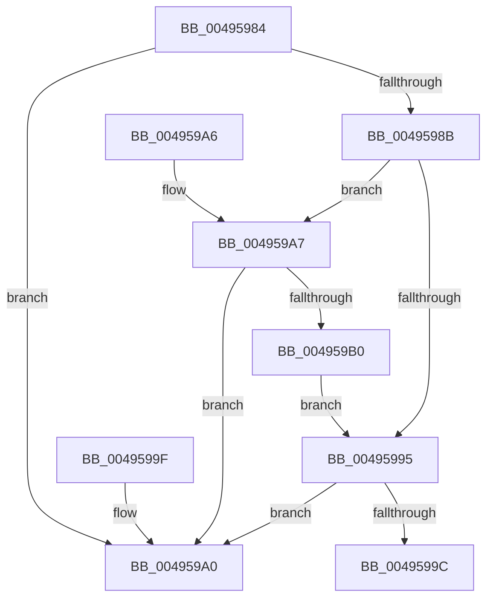

# MiIsSectionActive

- RVA: `0x00495984`–`0x004959B2` (길이 `46` bytes)
- VA: `0x0000000140495984`
- 실행 섹션: `.text`
- PDB 이름 있음: `예`; PDB Function 태그: `아니요`
- unwind 정보 RVA: `0x000DB714`
- 디코드: `19`개 명령, `46/46` bytes 표시
- 미해석 바이트: `0` (있으면 어셈블리에 `.byte`로 보존)

> 이 문서는 커널 이미지의 기계어와 PDB 기호를 분석해 생성했습니다. 4번과 5번은 함수 원형과 자료형을 바이너리 사용 방식에서 추정한 C 해석이며 원본 소스 복구 결과는 아닙니다.

## 1. Dependencies

- 직접 호출 지점: **0**; 고유 호출 대상: **0**
- 직접 호출자로 확인된 함수: **1**
- RIP 상대 이미지 참조: **0**

### Outgoing calls
- 직접 디코드된 call 명령이 없습니다.

### Direct callers
- [MmIsFileSectionActive](MmIsFileSectionActive_function_004958C0.md) at `0x00495945`
- [MmIsFileSectionActive](MmIsFileSectionActive_function_004958C0.md) at `0x00495962`

### Static image references
- 디코드된 RIP-relative 메모리 참조가 없습니다.

## 2. Other-region calls and transfers

- 다른 실행 섹션으로 향하는 call: **0**
- 별도 외부 분기/꼬리 이동을 확인하지 못했습니다.

## 3. Assembly (complete function range)

```asm
00495984  8B 41 38                        mov eax, dword ptr [rcx + 0x38]
00495987  A8 03                           test al, 3
00495989  75 15                           jne 0x1404959a0
0049598B  48 8B 41 70                     mov rax, qword ptr [rcx + 0x70]
0049598F  48 83 F8 01                     cmp rax, 1
00495993  77 12                           ja 0x1404959a7
00495995  48 83 79 30 00                  cmp qword ptr [rcx + 0x30], 0
0049599A  77 04                           ja 0x1404959a0
0049599C  33 C0                           xor eax, eax
0049599E  C3                              ret
0049599F  CC                              int3
004959A0  B8 01 00 00 00                  mov eax, 1
004959A5  C3                              ret
004959A6  CC                              int3
004959A7  8B 41 38                        mov eax, dword ptr [rcx + 0x38]
004959AA  24 28                           and al, 0x28
004959AC  3C 08                           cmp al, 8
004959AE  75 F0                           jne 0x1404959a0
004959B0  EB E3                           jmp 0x140495995
```

## 4. C-style interpretation (structured pseudocode)

```c
__int64 __fastcall MiIsSectionActive(__int64 a1)
{
    __int64 result;

    if ((((unsigned __int8)((unsigned int)(*(unsigned int *)(a1 + 56)))) & (3)) != 0) goto loc_004959A0;
    if ((*(unsigned __int64 *)(a1 + 112)) > 1) goto loc_004959A7;
loc_00495995:
    if ((*(unsigned __int64 *)(a1 + 48)) > 0) goto loc_004959A0;
    result = 0;
    return result;
loc_004959A0:
    return 1;
loc_004959A7:
    result = (unsigned __int8)(((unsigned int)(*(unsigned int *)(a1 + 56))) & (40));
    if (((unsigned __int8)(result)) != 8) goto loc_004959A0;
    goto loc_00495995;
}
```

## 5. (Beta) C Style

```c
int64_t MiIsSectionActive(void *Arg1)
{
    uint8_t *arg1 = (uint8_t *)Arg1;

    int64_t result;

    if ((((uint8_t)((uint32_t)(*(uint32_t *)(arg1 + 0x38)))) & (3)) != 0) goto loc_004959A0;
    if ((*(uint64_t *)(arg1 + 0x70)) > 1) goto loc_004959A7;
loc_00495995:
    if ((*(uint64_t *)(arg1 + 0x30)) > 0) goto loc_004959A0;
    result = 0;
    return result;
loc_004959A0:
    return 1;
loc_004959A7:
    result = (uint8_t)(((uint32_t)(*(uint32_t *)(arg1 + 0x38))) & (40));
    if (((uint8_t)(result)) != 8) goto loc_004959A0;
    goto loc_00495995;
}
```

### 관측된 메모리 오프셋

구조체 형식이 확인되지 않은 접근은 인자 기준의 오프셋으로만 기록했습니다.

| 기준 인자 | 오프셋 표현 | 폭 (bit) | 접근 |
|---|---:|---:|---|
| `Arg1` | `+ 0x30` | `64` | `R` |
| `Arg1` | `+ 0x38` | `32` | `R` |
| `Arg1` | `+ 0x70` | `64` | `R` |

## 6. Execution-region graph

[열기: 2D/3D 그래프와 함수 탐색 컨트롤 패널](../../../control-panel.html?section=text&rva=0x00495984&view=graph)

- 2D 그래프는 위에서 아래로 흐르고, 3D 그래프는 빈 공간을 드래그해 회전합니다. Shift+드래그는 이동, 휠은 확대·축소, 함수 노드 선택은 대상 보고서 이동입니다.

### Static fallback


