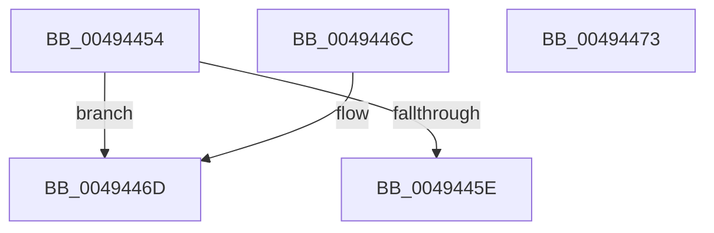

# MiLegacyImageArchitecture

- RVA: `0x00494454`–`0x00494474` (길이 `32` bytes)
- VA: `0x0000000140494454`
- 실행 섹션: `.text`
- PDB 이름 있음: `예`; PDB Function 태그: `아니요`
- unwind 정보 RVA: `0x000DB714`
- 디코드: `12`개 명령, `32/32` bytes 표시
- 미해석 바이트: `0` (있으면 어셈블리에 `.byte`로 보존)

> 이 문서는 커널 이미지의 기계어와 PDB 기호를 분석해 생성했습니다. 4번과 5번은 함수 원형과 자료형을 바이너리 사용 방식에서 추정한 C 해석이며 원본 소스 복구 결과는 아닙니다.

## 1. Dependencies

- 직접 호출 지점: **0**; 고유 호출 대상: **0**
- 직접 호출자로 확인된 함수: **3**
- RIP 상대 이미지 참조: **0**

### Outgoing calls
- 직접 디코드된 call 명령이 없습니다.

### Direct callers
- [MiVerifyImageHeader](../../page/98/MiVerifyImageHeader_function_009870DC.md) at `0x00987343`
- [MiRelocateImage](../../page/98/MiRelocateImage_function_00988E14.md) at `0x00988EA2`
- [sub_00B2B0A8](../../page/B2/Unknown_function_00B2B0A8.md) at `0x00B2B33D`

### Static image references
- 디코드된 RIP-relative 메모리 참조가 없습니다.

## 2. Other-region calls and transfers

- 다른 실행 섹션으로 향하는 call: **0**
- 별도 외부 분기/꼬리 이동을 확인하지 못했습니다.

## 3. Assembly (complete function range)

```asm
00494454  B8 4C 01 00 00                  mov eax, 0x14c
00494459  66 3B C8                        cmp cx, ax
0049445C  74 0F                           je 0x14049446d
0049445E  33 C0                           xor eax, eax
00494460  BA 64 86 00 00                  mov edx, 0x8664
00494465  66 3B CA                        cmp cx, dx
00494468  0F 94 C0                        sete al
0049446B  C3                              ret
0049446C  CC                              int3
0049446D  B8 01 00 00 00                  mov eax, 1
00494472  C3                              ret
00494473  CC                              int3
```

## 4. C-style interpretation (structured pseudocode)

```c
__int64 __fastcall MiLegacyImageArchitecture(unsigned __int16 a1)
{
    __int64 result;

    if (a1 == 332) goto loc_0049446D;
    result = 0;
    result = (a1 == ((unsigned __int16)((unsigned int)(0x8664ULL)))) ? 1 : 0;
    return result;
loc_0049446D:
    return 1;
}
```

## 5. (Beta) C Style

```c
int64_t MiLegacyImageArchitecture(uint16_t Arg1)
{
    int64_t result;

    if (Arg1 == 332) goto loc_0049446D;
    result = 0;
    result = (Arg1 == ((uint16_t)((uint32_t)(0x8664ULL)))) ? 1 : 0;
    return result;
loc_0049446D:
    return 1;
}
```

## 6. Execution-region graph

[열기: 2D/3D 그래프와 함수 탐색 컨트롤 패널](../../../control-panel.html?section=text&rva=0x00494454&view=graph)

- 2D 그래프는 위에서 아래로 흐르고, 3D 그래프는 빈 공간을 드래그해 회전합니다. Shift+드래그는 이동, 휠은 확대·축소, 함수 노드 선택은 대상 보고서 이동입니다.

### Static fallback


