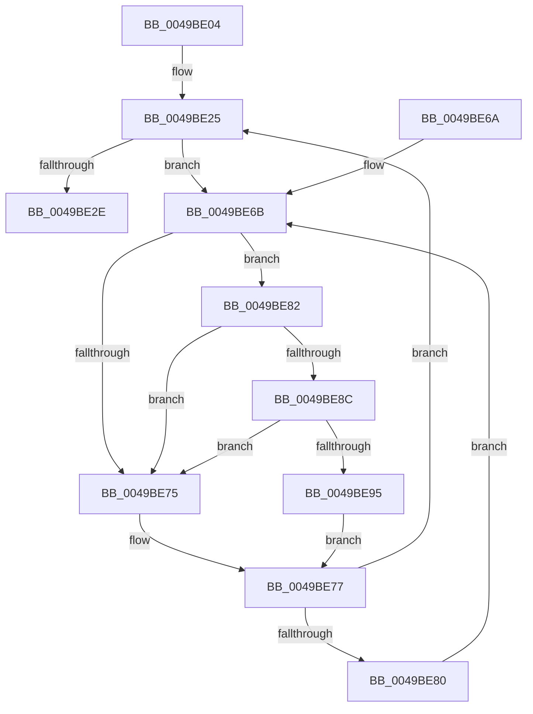

# MiLockAndIncrementShareCount

- RVA: `0x0049BE04`–`0x0049BE9E` (길이 `154` bytes)
- VA: `0x000000014049BE04`
- 실행 섹션: `.text`
- PDB 이름 있음: `예`; PDB Function 태그: `아니요`
- unwind 정보 RVA: `0x00070720`
- 디코드: `42`개 명령, `154/154` bytes 표시
- 미해석 바이트: `0` (있으면 어셈블리에 `.byte`로 보존)

> 이 문서는 커널 이미지의 기계어와 PDB 기호를 분석해 생성했습니다. 4번과 5번은 함수 원형과 자료형을 바이너리 사용 방식에서 추정한 C 해석이며 원본 소스 복구 결과는 아닙니다.

## 1. Dependencies

- 직접 호출 지점: **2**; 고유 호출 대상: **2**
- 직접 호출자로 확인된 함수: **2**
- RIP 상대 이미지 참조: **2**

### Outgoing calls
- `0x0049BE8C` → [KiCheckVpBackingLongSpinWaitHypercall](../30/KiCheckVpBackingLongSpinWaitHypercall_function_0030F490.md) (function, `0x0030F490`)
- `0x0049BE97` → [HvlNotifyLongSpinWait](../30/HvlNotifyLongSpinWait_function_0030F460.md) (function, `0x0030F460`)

### Direct callers
- [MiLinkPoolCommitChain](../31/MiLinkPoolCommitChain_function_00313D20.md) at `0x0031401D`
- [MiMapKernelScp](../4D/MiMapKernelScp_function_004DCAD4.md) at `0x004DCC27`

### Static image references
- `0x0049BE6D` → RVA `0x00FC52AC` (`ALMOSTRO`; reference)
- `0x0049BE82` → RVA `0x00FC6AB8` (`ALMOSTRO`; read)

## 2. Other-region calls and transfers

- 다른 실행 섹션으로 향하는 call: **0**
- 별도 외부 분기/꼬리 이동을 확인하지 못했습니다.

## 3. Assembly (complete function range)

```asm
0049BE04  48 89 5C 24 08                  mov qword ptr [rsp + 8], rbx
0049BE09  57                              push rdi
0049BE0A  48 83 EC 20                     sub rsp, 0x20
0049BE0E  48 8D 1C 49                     lea rbx, [rcx + rcx*2]
0049BE12  48 C1 E3 04                     shl rbx, 4
0049BE16  48 B8 00 00 00 00 00 DE FF FF   movabs rax, 0xffffde0000000000
0049BE20  48 03 D8                        add rbx, rax
0049BE23  33 FF                           xor edi, edi
0049BE25  F0 48 0F BA 6B 18 3F            lock bts qword ptr [rbx + 0x18], 0x3f
0049BE2C  72 3D                           jb 0x14049be6b
0049BE2E  48 8B 43 18                     mov rax, qword ptr [rbx + 0x18]
0049BE32  48 8D 48 01                     lea rcx, [rax + 1]
0049BE36  48 8B D1                        mov rdx, rcx
0049BE39  48 33 D0                        xor rdx, rax
0049BE3C  48 B8 00 00 00 00 00 00 00 C0   movabs rax, 0xc000000000000000
0049BE46  48 23 D0                        and rdx, rax
0049BE49  48 B8 FF FF FF FF FF FF FF 7F   movabs rax, 0x7fffffffffffffff
0049BE53  48 33 D1                        xor rdx, rcx
0049BE56  48 89 53 18                     mov qword ptr [rbx + 0x18], rdx
0049BE5A  F0 48 21 43 18                  lock and qword ptr [rbx + 0x18], rax
0049BE5F  48 8B 5C 24 30                  mov rbx, qword ptr [rsp + 0x30]
0049BE64  48 83 C4 20                     add rsp, 0x20
0049BE68  5F                              pop rdi
0049BE69  C3                              ret
0049BE6A  CC                              int3
0049BE6B  FF C7                           inc edi
0049BE6D  85 3D 39 94 B2 00               test dword ptr [rip + 0xb29439], edi
0049BE73  74 0D                           je 0x14049be82
0049BE75  F3 90                           pause
0049BE77  48 8B 43 18                     mov rax, qword ptr [rbx + 0x18]
0049BE7B  48 85 C0                        test rax, rax
0049BE7E  79 A5                           jns 0x14049be25
0049BE80  EB E9                           jmp 0x14049be6b
0049BE82  8B 05 30 AC B2 00               mov eax, dword ptr [rip + 0xb2ac30]
0049BE88  A8 40                           test al, 0x40
0049BE8A  74 E9                           je 0x14049be75
0049BE8C  E8 FF 35 E7 FF                  call 0x14030f490
0049BE91  84 C0                           test al, al
0049BE93  74 E0                           je 0x14049be75
0049BE95  8B CF                           mov ecx, edi
0049BE97  E8 C4 35 E7 FF                  call 0x14030f460
0049BE9C  EB D9                           jmp 0x14049be77
```

## 4. C-style interpretation (structured pseudocode)

```c
__int64 __fastcall MiLockAndIncrementShareCount(__int64 a1)
{
    __int64 result;
    __int64 v_rbx;
    __int64 v_rdi;
    __int64 v_rsp;
    unsigned __int64 v_stack_p8;

    v_stack_p8 = v_rbx;
    v_rsp = (v_rsp) - (32);
    v_rbx = (a1 + a1 * 2) << (4);
    v_rbx = (v_rbx) + (result);
    v_rdi = 0;
loc_0049BE25:
    if (condition_is_below) goto loc_0049BE6B;
    a2 = (*(unsigned __int64 *)(v_rbx + 24) + 1) ^ (*(unsigned __int64 *)(v_rbx + 24));
    a2 = (a2) & (*(unsigned __int64 *)(v_rbx + 24));
    a2 = (a2) ^ (*(unsigned __int64 *)(v_rbx + 24) + 1);
    *(unsigned __int64 *)(v_rbx + 24) = a2;
    v_rsp = (v_rsp) + (32);
    return *(unsigned __int64 *)(v_rbx + 24);
loc_0049BE6B:
    v_rdi = (unsigned int)((v_rdi) + 1);
    if (((*(unsigned int *)(v_rip + 11703353)) & ((unsigned int)(v_rdi))) == 0) goto loc_0049BE82;
loc_0049BE75:
loc_0049BE77:
    if (!sign_flag) goto loc_0049BE25;
    goto loc_0049BE6B;
loc_0049BE82:
    if ((((unsigned __int8)((unsigned int)(*(unsigned int *)(v_rip + 11709488)))) & (64)) == 0) goto loc_0049BE75;
    result = KiCheckVpBackingLongSpinWaitHypercall(*(unsigned __int64 *)(v_rbx + 24) + 1, a2, a3, a4);
    if ((unsigned __int8)(result) == 0) goto loc_0049BE75;
    result = HvlNotifyLongSpinWait((unsigned int)((unsigned int)(v_rdi)), a2, a3, a4);
    goto loc_0049BE77;
}
```

## 5. (Beta) C Style

```c
int64_t MiLockAndIncrementShareCount(void *Arg1)
{
    uint8_t *arg1 = (uint8_t *)Arg1;

    int64_t result;
    int64_t local_rbx;
    int64_t local_rdi;
    int64_t local_rsp;
    uint64_t v_stack_p8;

    v_stack_p8 = local_rbx;
    local_rsp = (local_rsp) - (32);
    local_rbx = (Arg1 + Arg1 * 2) << (4);
    local_rbx = (local_rbx) + (result);
    local_rdi = 0;
loc_0049BE25:
    if (condition_is_below) goto loc_0049BE6B;
    a2 = (*(uint64_t *)(local_rbx + 0x18) + 1) ^ (*(uint64_t *)(local_rbx + 0x18));
    a2 = (a2) & (*(uint64_t *)(local_rbx + 0x18));
    a2 = (a2) ^ (*(uint64_t *)(local_rbx + 0x18) + 1);
    *(uint64_t *)(local_rbx + 0x18) = a2;
    local_rsp = (local_rsp) + (32);
    return *(uint64_t *)(local_rbx + 0x18);
loc_0049BE6B:
    local_rdi = (uint32_t)((local_rdi) + 1);
    if (((*(uint32_t *)(v_rip + 0xB29439)) & ((uint32_t)(local_rdi))) == 0) goto loc_0049BE82;
loc_0049BE75:
loc_0049BE77:
    if (!sign_flag) goto loc_0049BE25;
    goto loc_0049BE6B;
loc_0049BE82:
    if ((((uint8_t)((uint32_t)(*(uint32_t *)(v_rip + 0xB2AC30)))) & (64)) == 0) goto loc_0049BE75;
    result = KiCheckVpBackingLongSpinWaitHypercall(*(uint64_t *)(local_rbx + 0x18) + 1, a2, a3, a4);
    if ((uint8_t)(result) == 0) goto loc_0049BE75;
    result = HvlNotifyLongSpinWait((uint32_t)((uint32_t)(local_rdi)), a2, a3, a4);
    goto loc_0049BE77;
}
```

### 관측된 메모리 오프셋

구조체 형식이 확인되지 않은 접근은 인자 기준의 오프셋으로만 기록했습니다.

| 기준 인자 | 오프셋 표현 | 폭 (bit) | 접근 |
|---|---:|---:|---|
| `Arg1` | `+ 0x0 + rcx*2` | `64` | `R` |

## 6. Execution-region graph

[열기: 2D/3D 그래프와 함수 탐색 컨트롤 패널](../../../control-panel.html?section=text&rva=0x0049BE04&view=graph)

- 2D 그래프는 위에서 아래로 흐르고, 3D 그래프는 빈 공간을 드래그해 회전합니다. Shift+드래그는 이동, 휠은 확대·축소, 함수 노드 선택은 대상 보고서 이동입니다.

### Static fallback


