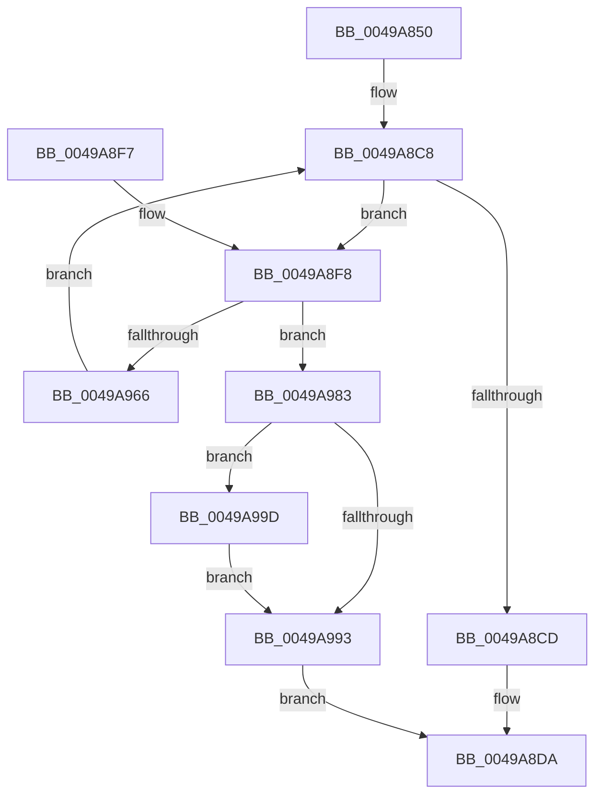

# MiLockPageTableRange

- RVA: `0x0049A850`–`0x0049A9C7` (길이 `375` bytes)
- VA: `0x000000014049A850`
- 실행 섹션: `.text`
- PDB 이름 있음: `예`; PDB Function 태그: `아니요`
- unwind 정보 RVA: `0x000B47DC`
- 디코드: `94`개 명령, `375/375` bytes 표시
- 미해석 바이트: `0` (있으면 어셈블리에 `.byte`로 보존)

> 이 문서는 커널 이미지의 기계어와 PDB 기호를 분석해 생성했습니다. 4번과 5번은 함수 원형과 자료형을 바이너리 사용 방식에서 추정한 C 해석이며 원본 소스 복구 결과는 아닙니다.

## 1. Dependencies

- 직접 호출 지점: **7**; 고유 호출 대상: **6**
- 직접 호출자로 확인된 함수: **1**
- RIP 상대 이미지 참조: **0**

### Outgoing calls
- `0x0049A8C0` → [MiLockWorkingSetShared](../27/MiLockWorkingSetShared_function_0027CBF0.md) (function, `0x0027CBF0`)
- `0x0049A8D3` → [MiUnlockWorkingSetShared](../27/MiUnlockWorkingSetShared_function_0027D690.md) (function, `0x0027D690`)
- `0x0049A91D` → [MiMakeSystemAddressValid](../27/MiMakeSystemAddressValid_function_0027FF70.md) (function, `0x0027FF70`)
- `0x0049A950` → [MiLockPageTablePage](../23/MiLockPageTablePage_function_0023E120.md) (function, `0x0023E120`)
- `0x0049A95D` → [MiUnlockPageTable](../21/MiUnlockPageTable_function_00216EC0.md) (function, `0x00216EC0`)
- `0x0049A989` → [MiUnlockWorkingSetShared](../27/MiUnlockWorkingSetShared_function_0027D690.md) (function, `0x0027D690`)
- `0x0049A9C0` → [MiUnlockPageTableRange](../40/MiUnlockPageTableRange_function_00407E44.md) (function, `0x00407E44`)

### Direct callers
- [MmStoreAllocateVirtualMemory](../../page/A6/MmStoreAllocateVirtualMemory_function_00A68238.md) at `0x00A683A3`

### Static image references
- 디코드된 RIP-relative 메모리 참조가 없습니다.

## 2. Other-region calls and transfers

- 다른 실행 섹션으로 향하는 call: **0**
- 별도 외부 분기/꼬리 이동을 확인하지 못했습니다.

## 3. Assembly (complete function range)

```asm
0049A850  48 89 5C 24 08                  mov qword ptr [rsp + 8], rbx
0049A855  48 89 6C 24 10                  mov qword ptr [rsp + 0x10], rbp
0049A85A  48 89 74 24 18                  mov qword ptr [rsp + 0x18], rsi
0049A85F  57                              push rdi
0049A860  41 54                           push r12
0049A862  41 55                           push r13
0049A864  41 56                           push r14
0049A866  41 57                           push r15
0049A868  48 83 EC 20                     sub rsp, 0x20
0049A86C  65 48 8B 04 25 88 01 00 00      mov rax, qword ptr gs:[0x188]
0049A875  4C 8B E1                        mov r12, rcx
0049A878  4C 8B E9                        mov r13, rcx
0049A87B  49 C1 EC 09                     shr r12, 9
0049A87F  48 B9 F8 FF FF FF 7F 00 00 00   movabs rcx, 0x7ffffffff8
0049A889  48 BB 00 00 00 00 80 F6 FF FF   movabs rbx, 0xfffff68000000000
0049A893  4C 8B F2                        mov r14, rdx
0049A896  4C 23 E1                        and r12, rcx
0049A899  48 8B A8 B8 00 00 00            mov rbp, qword ptr [rax + 0xb8]
0049A8A0  48 81 C5 00 04 00 00            add rbp, 0x400
0049A8A7  48 8B C3                        mov rax, rbx
0049A8AA  4C 03 E0                        add r12, rax
0049A8AD  49 C1 EE 09                     shr r14, 9
0049A8B1  49 8B F4                        mov rsi, r12
0049A8B4  4C 23 F1                        and r14, rcx
0049A8B7  48 8B C3                        mov rax, rbx
0049A8BA  4C 03 F0                        add r14, rax
0049A8BD  48 8B CD                        mov rcx, rbp
0049A8C0  E8 2B 23 DE FF                  call 0x14027cbf0
0049A8C5  44 8A F8                        mov r15b, al
0049A8C8  49 3B F6                        cmp rsi, r14
0049A8CB  76 2B                           jbe 0x14049a8f8
0049A8CD  41 8A D7                        mov dl, r15b
0049A8D0  48 8B CD                        mov rcx, rbp
0049A8D3  E8 B8 2D DE FF                  call 0x14027d690
0049A8D8  33 C0                           xor eax, eax
0049A8DA  48 8B 5C 24 50                  mov rbx, qword ptr [rsp + 0x50]
0049A8DF  48 8B 6C 24 58                  mov rbp, qword ptr [rsp + 0x58]
0049A8E4  48 8B 74 24 60                  mov rsi, qword ptr [rsp + 0x60]
0049A8E9  48 83 C4 20                     add rsp, 0x20
0049A8ED  41 5F                           pop r15
0049A8EF  41 5E                           pop r14
0049A8F1  41 5D                           pop r13
0049A8F3  41 5C                           pop r12
0049A8F5  5F                              pop rdi
0049A8F6  C3                              ret
0049A8F7  CC                              int3
0049A8F8  48 8B FE                        mov rdi, rsi
0049A8FB  48 B8 F8 FF FF FF 7F 00 00 00   movabs rax, 0x7ffffffff8
0049A905  48 C1 EF 09                     shr rdi, 9
0049A909  48 23 F8                        and rdi, rax
0049A90C  48 8B CB                        mov rcx, rbx
0049A90F  48 03 F9                        add rdi, rcx
0049A912  45 33 C9                        xor r9d, r9d
0049A915  48 8B CE                        mov rcx, rsi
0049A918  45 8A C7                        mov r8b, r15b
0049A91B  33 D2                           xor edx, edx
0049A91D  E8 4E 56 DE FF                  call 0x14027ff70
0049A922  48 8B 07                        mov rax, qword ptr [rdi]
0049A925  48 B9 FF FF FF FF FF 00 00 00   movabs rcx, 0xffffffffff
0049A92F  48 C1 E8 0C                     shr rax, 0xc
0049A933  48 23 C1                        and rax, rcx
0049A936  48 8D 0C 40                     lea rcx, [rax + rax*2]
0049A93A  48 C1 E1 04                     shl rcx, 4
0049A93E  48 B8 00 00 00 00 00 DE FF FF   movabs rax, 0xffffde0000000000
0049A948  48 03 C8                        add rcx, rax
0049A94B  BA 02 00 00 00                  mov edx, 2
0049A950  E8 CB 37 DA FF                  call 0x14023e120
0049A955  48 8B D7                        mov rdx, rdi
0049A958  48 8B CD                        mov rcx, rbp
0049A95B  8B D8                           mov ebx, eax
0049A95D  E8 5E C5 D7 FF                  call 0x140216ec0
0049A962  85 DB                           test ebx, ebx
0049A964  74 1D                           je 0x14049a983
0049A966  48 81 E6 00 F0 FF FF            and rsi, 0xfffffffffffff000
0049A96D  48 BB 00 00 00 00 80 F6 FF FF   movabs rbx, 0xfffff68000000000
0049A977  48 81 C6 00 10 00 00            add rsi, 0x1000
0049A97E  E9 45 FF FF FF                  jmp 0x14049a8c8
0049A983  41 8A D7                        mov dl, r15b
0049A986  48 8B CD                        mov rcx, rbp
0049A989  E8 02 2D DE FF                  call 0x14027d690
0049A98E  49 3B F4                        cmp rsi, r12
0049A991  75 0A                           jne 0x14049a99d
0049A993  B8 9A 00 00 C0                  mov eax, 0xc000009a
0049A998  E9 3D FF FF FF                  jmp 0x14049a8da
0049A99D  48 8D 56 F8                     lea rdx, [rsi - 8]
0049A9A1  48 B8 00 00 00 00 80 F6 FF FF   movabs rax, 0xfffff68000000000
0049A9AB  48 C1 E2 19                     shl rdx, 0x19
0049A9AF  48 8B C0                        mov rax, rax
0049A9B2  48 C1 E0 19                     shl rax, 0x19
0049A9B6  49 8B CD                        mov rcx, r13
0049A9B9  48 2B D0                        sub rdx, rax
0049A9BC  48 C1 FA 10                     sar rdx, 0x10
0049A9C0  E8 7F D4 F6 FF                  call 0x140407e44
0049A9C5  EB CC                           jmp 0x14049a993
```

## 4. C-style interpretation (structured pseudocode)

```c
__int64 __fastcall MiLockPageTableRange(__int64 a1, __int64 a2, __int64 a3, int a4)
{
    __int64 result;
    __int64 v_r12;
    __int64 v_r14;
    __int64 v_rbp;
    __int64 v_rdi;
    __int64 v_rsi;
    __int64 v_rsp;
    unsigned __int64 v_stack_p10;
    unsigned __int64 v_stack_p18;
    unsigned __int64 v_stack_p8;

    v_stack_p8 = v_rbx;
    v_stack_p10 = v_rbp;
    v_stack_p18 = v_rsi;
    v_rsp = (v_rsp) - (32);
    v_r12 = (a1) >> (9);
    v_r12 = (v_r12) & (a1);
    v_rbp = (*(unsigned __int64 *)(*(unsigned __int64 *)(gs_base + (0 + 392)) + 184)) + (0x400ULL);
    v_r12 = (v_r12) + (v_rbx);
    v_r14 = (a2) >> (9);
    v_r14 = (v_r14) & (a1);
    v_r14 = (v_r14) + (v_rbx);
    result = MiLockWorkingSetShared(v_rbp, a2, a3, a4);
loc_0049A8C8:
    if (v_r12 <= v_r14) goto loc_0049A8F8;
    result = MiUnlockWorkingSetShared(v_rbp, (unsigned __int8)((unsigned __int8)(result)), a3, a4);
    result = 0;
loc_0049A8DA:
    v_rsp = (v_rsp) + (32);
    return result;
loc_0049A8F8:
    v_rdi = (v_stack_p18) >> (9);
    v_rdi = (v_rdi) & (0);
    v_rdi = (v_rdi) + (v_stack_p8);
    a4 = 0;
    a2 = 0;
    result = MiMakeSystemAddressValid(v_stack_p18, a2, (unsigned __int8)((unsigned __int8)(result)), a4);
    result = (*(unsigned __int64 *)(v_rdi)) >> (12);
    result = (result) & (v_stack_p18);
    a1 = (result + result * 2) << (4);
    a1 = (a1) + (result);
    result = MiLockPageTablePage(a1, 2, (unsigned __int8)((unsigned __int8)(result)), a4);
    result = MiUnlockPageTable(v_stack_p10, v_rdi, (unsigned __int8)((unsigned __int8)(result)), a4);
    if ((unsigned int)((unsigned int)((unsigned int)(result))) == 0) goto loc_0049A983;
    v_rsi = (v_stack_p18) & (0xFFFFFFFFFFFFF000ULL);
    v_rsi = (v_rsi) + (0x1000ULL);
    goto loc_0049A8C8;
loc_0049A983:
    result = MiUnlockWorkingSetShared(v_stack_p10, (unsigned __int8)((unsigned __int8)(result)), (unsigned __int8)((unsigned __int8)(result)), a4);
    if (v_rsi != v_r12) goto loc_0049A99D;
loc_0049A993:
    goto loc_0049A8DA;
loc_0049A99D:
    a2 = (v_rsi - 8) << (25);
    result = ((unsigned int)(0xC000009AULL)) << (25);
    a2 = (a2) - (result);
    a2 = (a2) >> (16);
    result = MiUnlockPageTableRange(a1, a2, (unsigned __int8)((unsigned __int8)(result)), a4);
    goto loc_0049A993;
}
```

## 5. (Beta) C Style

```c
int64_t MiLockPageTableRange(int64_t Arg1, int64_t Arg2, int64_t Arg3, int32_t Arg4)
{
    int64_t result;
    int64_t local_r12;
    int64_t local_r14;
    int64_t local_rbp;
    int64_t local_rdi;
    int64_t local_rsi;
    int64_t local_rsp;
    uint64_t v_stack_p10;
    uint64_t v_stack_p18;
    uint64_t v_stack_p8;

    v_stack_p8 = local_rbx;
    v_stack_p10 = local_rbp;
    v_stack_p18 = local_rsi;
    local_rsp = (local_rsp) - (32);
    local_r12 = (Arg1) >> (9);
    local_r12 = (local_r12) & (Arg1);
    local_rbp = (*(uint64_t *)(*(uint64_t *)(gs_base + (0 + 0x188)) + 0xB8)) + (0x400ULL);
    local_r12 = (local_r12) + (local_rbx);
    local_r14 = (Arg2) >> (9);
    local_r14 = (local_r14) & (Arg1);
    local_r14 = (local_r14) + (local_rbx);
    result = MiLockWorkingSetShared(local_rbp, Arg2, Arg3, Arg4);
loc_0049A8C8:
    if (local_r12 <= local_r14) goto loc_0049A8F8;
    result = MiUnlockWorkingSetShared(local_rbp, (uint8_t)((uint8_t)(result)), Arg3, Arg4);
    result = 0;
loc_0049A8DA:
    local_rsp = (local_rsp) + (32);
    return result;
loc_0049A8F8:
    local_rdi = (v_stack_p18) >> (9);
    local_rdi = (local_rdi) & (0);
    local_rdi = (local_rdi) + (v_stack_p8);
    Arg4 = 0;
    Arg2 = 0;
    result = MiMakeSystemAddressValid(v_stack_p18, Arg2, (uint8_t)((uint8_t)(result)), Arg4);
    result = (*(uint64_t *)(local_rdi)) >> (12);
    result = (result) & (v_stack_p18);
    Arg1 = (result + result * 2) << (4);
    Arg1 = (Arg1) + (result);
    result = MiLockPageTablePage(Arg1, 2, (uint8_t)((uint8_t)(result)), Arg4);
    result = MiUnlockPageTable(v_stack_p10, local_rdi, (uint8_t)((uint8_t)(result)), Arg4);
    if ((uint32_t)((uint32_t)((uint32_t)(result))) == 0) goto loc_0049A983;
    local_rsi = (v_stack_p18) & (0xFFFFFFFFFFFFF000ULL);
    local_rsi = (local_rsi) + (0x1000ULL);
    goto loc_0049A8C8;
loc_0049A983:
    result = MiUnlockWorkingSetShared(v_stack_p10, (uint8_t)((uint8_t)(result)), (uint8_t)((uint8_t)(result)), Arg4);
    if (local_rsi != local_r12) goto loc_0049A99D;
loc_0049A993:
    goto loc_0049A8DA;
loc_0049A99D:
    Arg2 = (local_rsi - 8) << (25);
    result = ((uint32_t)(0xC000009AULL)) << (25);
    Arg2 = (Arg2) - (result);
    Arg2 = (Arg2) >> (16);
    result = MiUnlockPageTableRange(Arg1, Arg2, (uint8_t)((uint8_t)(result)), Arg4);
    goto loc_0049A993;
}
```

## 6. Execution-region graph

[열기: 2D/3D 그래프와 함수 탐색 컨트롤 패널](../../../control-panel.html?section=text&rva=0x0049A850&view=graph)

- 2D 그래프는 위에서 아래로 흐르고, 3D 그래프는 빈 공간을 드래그해 회전합니다. Shift+드래그는 이동, 휠은 확대·축소, 함수 노드 선택은 대상 보고서 이동입니다.

### Static fallback


