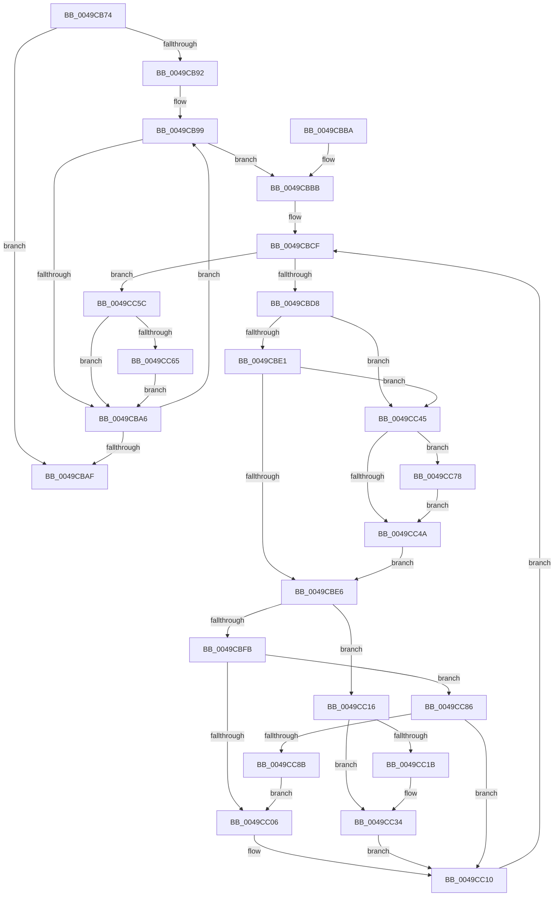

# MiMakeImageReadOnly

- RVA: `0x0049CB74`–`0x0049CC90` (길이 `284` bytes)
- VA: `0x000000014049CB74`
- 실행 섹션: `.text`
- PDB 이름 있음: `예`; PDB Function 태그: `아니요`
- unwind 정보 RVA: `0x000B4CF4`
- 디코드: `87`개 명령, `284/284` bytes 표시
- 미해석 바이트: `0` (있으면 어셈블리에 `.byte`로 보존)

> 이 문서는 커널 이미지의 기계어와 PDB 기호를 분석해 생성했습니다. 4번과 5번은 함수 원형과 자료형을 바이너리 사용 방식에서 추정한 C 해석이며 원본 소스 복구 결과는 아닙니다.

## 1. Dependencies

- 직접 호출 지점: **4**; 고유 호출 대상: **3**
- 직접 호출자로 확인된 함수: **2**
- RIP 상대 이미지 참조: **0**

### Outgoing calls
- `0x0049CBEB` → [MiLockLeafPage](../36/MiLockLeafPage_function_003658C0.md) (function, `0x003658C0`)
- `0x0049CC52` → [MiLockProtoPoolPageForce](../32/MiLockProtoPoolPageForce_function_00320E10.md) (function, `0x00320E10`)
- `0x0049CC6C` → [MiUnlockProtoPoolPage](../24/MiUnlockProtoPoolPage_function_00246090.md) (function, `0x00246090`)
- `0x0049CC7F` → [MiUnlockProtoPoolPage](../24/MiUnlockProtoPoolPage_function_00246090.md) (function, `0x00246090`)

### Direct callers
- [MiCreateNewSection](../../page/98/MiCreateNewSection_function_00985DB0.md) at `0x00986466`
- [sub_00B2AF8E](../../page/B2/Unknown_function_00B2AF8E.md) at `0x00B2B015`

### Static image references
- 디코드된 RIP-relative 메모리 참조가 없습니다.

## 2. Other-region calls and transfers

- 다른 실행 섹션으로 향하는 call: **0**
- 별도 외부 분기/꼬리 이동을 확인하지 못했습니다.

## 3. Assembly (complete function range)

```asm
0049CB74  40 53                           push rbx
0049CB76  55                              push rbp
0049CB77  56                              push rsi
0049CB78  57                              push rdi
0049CB79  41 56                           push r14
0049CB7B  48 83 EC 20                     sub rsp, 0x20
0049CB7F  33 F6                           xor esi, esi
0049CB81  C6 44 24 50 11                  mov byte ptr [rsp + 0x50], 0x11
0049CB86  48 8D B9 80 00 00 00            lea rdi, [rcx + 0x80]
0049CB8D  48 85 FF                        test rdi, rdi
0049CB90  74 1D                           je 0x14049cbaf
0049CB92  49 C7 C6 3F FC FF FF            mov r14, 0xfffffffffffffc3f
0049CB99  8B 47 20                        mov eax, dword ptr [rdi + 0x20]
0049CB9C  8B C8                           mov ecx, eax
0049CB9E  80 E1 3E                        and cl, 0x3e
0049CBA1  80 F9 02                        cmp cl, 2
0049CBA4  75 15                           jne 0x14049cbbb
0049CBA6  48 8B 7F 10                     mov rdi, qword ptr [rdi + 0x10]
0049CBAA  48 85 FF                        test rdi, rdi
0049CBAD  75 EA                           jne 0x14049cb99
0049CBAF  48 83 C4 20                     add rsp, 0x20
0049CBB3  41 5E                           pop r14
0049CBB5  5F                              pop rdi
0049CBB6  5E                              pop rsi
0049CBB7  5D                              pop rbp
0049CBB8  5B                              pop rbx
0049CBB9  C3                              ret
0049CBBA  CC                              int3
0049CBBB  83 E0 C3                        and eax, 0xffffffc3
0049CBBE  83 C8 02                        or eax, 2
0049CBC1  89 47 20                        mov dword ptr [rdi + 0x20], eax
0049CBC4  48 8B 5F 08                     mov rbx, qword ptr [rdi + 8]
0049CBC8  8B 47 2C                        mov eax, dword ptr [rdi + 0x2c]
0049CBCB  48 8D 2C C3                     lea rbp, [rbx + rax*8]
0049CBCF  48 3B DD                        cmp rbx, rbp
0049CBD2  0F 83 84 00 00 00               jae 0x14049cc5c
0049CBD8  48 F7 C3 FF 0F 00 00            test rbx, 0xfff
0049CBDF  74 64                           je 0x14049cc45
0049CBE1  48 85 F6                        test rsi, rsi
0049CBE4  74 5F                           je 0x14049cc45
0049CBE6  33 D2                           xor edx, edx
0049CBE8  48 8B CB                        mov rcx, rbx
0049CBEB  E8 D0 8C EC FF                  call 0x1403658c0
0049CBF0  48 8B 0B                        mov rcx, qword ptr [rbx]
0049CBF3  48 8B D0                        mov rdx, rax
0049CBF6  48 85 C0                        test rax, rax
0049CBF9  75 1B                           jne 0x14049cc16
0049CBFB  48 0F BA E1 0A                  bt rcx, 0xa
0049CC00  0F 83 80 00 00 00               jae 0x14049cc86
0049CC06  49 23 CE                        and rcx, r14
0049CC09  48 83 C9 20                     or rcx, 0x20
0049CC0D  48 89 0B                        mov qword ptr [rbx], rcx
0049CC10  48 83 C3 08                     add rbx, 8
0049CC14  EB B9                           jmp 0x14049cbcf
0049CC16  F6 C1 01                        test cl, 1
0049CC19  75 19                           jne 0x14049cc34
0049CC1B  49 23 CE                        and rcx, r14
0049CC1E  48 83 C9 20                     or rcx, 0x20
0049CC22  48 89 0B                        mov qword ptr [rbx], rcx
0049CC25  48 8B 40 10                     mov rax, qword ptr [rax + 0x10]
0049CC29  49 23 C6                        and rax, r14
0049CC2C  48 83 C8 20                     or rax, 0x20
0049CC30  48 89 42 10                     mov qword ptr [rdx + 0x10], rax
0049CC34  48 B8 FF FF FF FF FF FF FF 7F   movabs rax, 0x7fffffffffffffff
0049CC3E  F0 48 21 42 18                  lock and qword ptr [rdx + 0x18], rax
0049CC43  EB CB                           jmp 0x14049cc10
0049CC45  48 85 F6                        test rsi, rsi
0049CC48  75 2E                           jne 0x14049cc78
0049CC4A  48 8D 54 24 50                  lea rdx, [rsp + 0x50]
0049CC4F  48 8B CB                        mov rcx, rbx
0049CC52  E8 B9 41 E8 FF                  call 0x140320e10
0049CC57  48 8B F0                        mov rsi, rax
0049CC5A  EB 8A                           jmp 0x14049cbe6
0049CC5C  48 85 F6                        test rsi, rsi
0049CC5F  0F 84 41 FF FF FF               je 0x14049cba6
0049CC65  8A 54 24 50                     mov dl, byte ptr [rsp + 0x50]
0049CC69  48 8B CE                        mov rcx, rsi
0049CC6C  E8 1F 94 DA FF                  call 0x140246090
0049CC71  33 F6                           xor esi, esi
0049CC73  E9 2E FF FF FF                  jmp 0x14049cba6
0049CC78  8A 54 24 50                     mov dl, byte ptr [rsp + 0x50]
0049CC7C  48 8B CE                        mov rcx, rsi
0049CC7F  E8 0C 94 DA FF                  call 0x140246090
0049CC84  EB C4                           jmp 0x14049cc4a
0049CC86  48 85 C9                        test rcx, rcx
0049CC89  74 85                           je 0x14049cc10
0049CC8B  E9 76 FF FF FF                  jmp 0x14049cc06
```

## 4. C-style interpretation (structured pseudocode)

```c
__int64 __fastcall MiMakeImageReadOnly(__int64 a1, int a2)
{
    __int64 result;
    __int64 v_rbx;
    __int64 v_rsi;
    __int64 v_rsp;
    unsigned __int64 v_stack_p50;
    unsigned __int8 v_stack_p8;

    v_rsp = (v_rsp) - (32);
    v_rsi = 0;
    v_stack_p8 = 17;
    if (a1 + 128 == 0) goto loc_0049CBAF;
loc_0049CB99:
    a1 = (unsigned __int8)(((unsigned int)((unsigned int)((unsigned int)(*(unsigned int *)(a1 + 128 + 32))))) & (62));
    if (((unsigned __int8)(a1)) != 2) goto loc_0049CBBB;
loc_0049CBA6:
    if (*(unsigned __int64 *)(a1 + 128 + 16) != 0) goto loc_0049CB99;
loc_0049CBAF:
    v_rsp = (v_rsp) + (32);
    return (unsigned int)(*(unsigned int *)(a1 + 128 + 32));
loc_0049CBBB:
    result = (unsigned int)(((unsigned int)(*(unsigned int *)(a1 + 128 + 32))) & (0xFFFFFFC3ULL));
    result = (unsigned int)((result) | (2));
    *(unsigned int *)(*(unsigned __int64 *)(a1 + 128 + 16) + 32) = (unsigned int)(result);
loc_0049CBCF:
    if ((*(unsigned __int64 *)(*(unsigned __int64 *)(a1 + 128 + 16) + 8)) >= (*(unsigned __int64 *)(*(unsigned __int64 *)(a1 + 128 + 16) + 8) + (unsigned int)(*(unsigned int *)(*(unsigned __int64 *)(a1 + 128 + 16) + 44)) * 8)) goto loc_0049CC5C;
    if (((*(unsigned __int64 *)(*(unsigned __int64 *)(a1 + 128 + 16) + 8)) & (0xFFFULL)) == 0) goto loc_0049CC45;
    if (0 == 0) goto loc_0049CC45;
loc_0049CBE6:
    a2 = 0;
    result = MiLockLeafPage(*(unsigned __int64 *)(*(unsigned __int64 *)(a1 + 128 + 16) + 8), a2, a3, a4);
    if (result != 0) goto loc_0049CC16;
    if (condition_is_above_or_equal) goto loc_0049CC86;
loc_0049CC06:
    a1 = (*(unsigned __int64 *)(*(unsigned __int64 *)(*(unsigned __int64 *)(a1 + 128 + 16) + 8))) & (-961);
    a1 = (a1) | (32);
    *(unsigned __int64 *)(*(unsigned __int64 *)(*(unsigned __int64 *)(a1 + 128 + 16) + 8)) = a1;
loc_0049CC10:
    v_rbx = (*(unsigned __int64 *)(*(unsigned __int64 *)(a1 + 128 + 16) + 8)) + (8);
    goto loc_0049CBCF;
loc_0049CC16:
    if ((((unsigned __int8)(a1)) & (1)) == 0) {
        a1 = (a1) & (-961);
        a1 = (a1) | (32);
        *(unsigned __int64 *)(v_rbx) = a1;
        result = *(unsigned __int64 *)(result + 16);
        result = (result) & (-961);
        result = (result) | (32);
        *(unsigned __int64 *)(result + 16) = result;
    }
    goto loc_0049CC10;
loc_0049CC45:
    if (0 != 0) goto loc_0049CC78;
loc_0049CC4A:
    result = MiLockProtoPoolPageForce(v_rbx, v_stack_p50, a3, a4);
    goto loc_0049CBE6;
loc_0049CC5C:
    if (result == 0) goto loc_0049CBA6;
    result = MiUnlockProtoPoolPage(result, v_stack_p50, a3, a4);
    v_rsi = 0;
    goto loc_0049CBA6;
loc_0049CC78:
    result = MiUnlockProtoPoolPage(0, v_stack_p50, a3, a4);
    goto loc_0049CC4A;
loc_0049CC86:
    if (0 == 0) goto loc_0049CC10;
    goto loc_0049CC06;
}
```

## 5. (Beta) C Style

```c
int64_t MiMakeImageReadOnly(void *Arg1, int32_t Arg2)
{
    uint8_t *arg1 = (uint8_t *)Arg1;

    int64_t result;
    int64_t local_rbx;
    int64_t local_rsi;
    int64_t local_rsp;
    uint64_t v_stack_p50;
    uint8_t v_stack_p8;

    local_rsp = (local_rsp) - (32);
    local_rsi = 0;
    v_stack_p8 = 17;
    if (Arg1 + 128 == 0) goto loc_0049CBAF;
loc_0049CB99:
    Arg1 = (uint8_t)(((uint32_t)((uint32_t)((uint32_t)(*(uint32_t *)(arg1 + 0x80 + 0x20))))) & (62));
    if (((uint8_t)(Arg1)) != 2) goto loc_0049CBBB;
loc_0049CBA6:
    if (*(uint64_t *)(arg1 + 0x80 + 0x10) != 0) goto loc_0049CB99;
loc_0049CBAF:
    local_rsp = (local_rsp) + (32);
    return (uint32_t)(*(uint32_t *)(arg1 + 0x80 + 0x20));
loc_0049CBBB:
    result = (uint32_t)(((uint32_t)(*(uint32_t *)(arg1 + 0x80 + 0x20))) & (0xFFFFFFC3ULL));
    result = (uint32_t)((result) | (2));
    *(uint32_t *)(*(uint64_t *)(arg1 + 0x80 + 0x10) + 0x20) = (uint32_t)(result);
loc_0049CBCF:
    if ((*(uint64_t *)(*(uint64_t *)(arg1 + 0x80 + 0x10) + 0x8)) >= (*(uint64_t *)(*(uint64_t *)(arg1 + 0x80 + 0x10) + 0x8) + (uint32_t)(*(uint32_t *)(*(uint64_t *)(arg1 + 0x80 + 0x10) + 0x2C)) * 8)) goto loc_0049CC5C;
    if (((*(uint64_t *)(*(uint64_t *)(arg1 + 0x80 + 0x10) + 0x8)) & (0xFFFULL)) == 0) goto loc_0049CC45;
    if (0 == 0) goto loc_0049CC45;
loc_0049CBE6:
    Arg2 = 0;
    result = MiLockLeafPage(*(uint64_t *)(*(uint64_t *)(arg1 + 0x80 + 0x10) + 0x8), Arg2, a3, a4);
    if (result != 0) goto loc_0049CC16;
    if (condition_is_above_or_equal) goto loc_0049CC86;
loc_0049CC06:
    Arg1 = (*(uint64_t *)(*(uint64_t *)(*(uint64_t *)(arg1 + 0x80 + 0x10) + 0x8))) & (-961);
    Arg1 = (Arg1) | (32);
    *(void **)(*(uint64_t *)(*(uint64_t *)(arg1 + 0x80 + 0x10) + 0x8)) = Arg1;
loc_0049CC10:
    local_rbx = (*(uint64_t *)(*(uint64_t *)(arg1 + 0x80 + 0x10) + 0x8)) + (8);
    goto loc_0049CBCF;
loc_0049CC16:
    if ((((uint8_t)(Arg1)) & (1)) == 0) {
        Arg1 = (Arg1) & (-961);
        Arg1 = (Arg1) | (32);
        *(void **)(local_rbx) = Arg1;
        result = *(uint64_t *)(result + 0x10);
        result = (result) & (-961);
        result = (result) | (32);
        *(uint64_t *)(result + 0x10) = result;
    }
    goto loc_0049CC10;
loc_0049CC45:
    if (0 != 0) goto loc_0049CC78;
loc_0049CC4A:
    result = MiLockProtoPoolPageForce(local_rbx, v_stack_p50, a3, a4);
    goto loc_0049CBE6;
loc_0049CC5C:
    if (result == 0) goto loc_0049CBA6;
    result = MiUnlockProtoPoolPage(result, v_stack_p50, a3, a4);
    local_rsi = 0;
    goto loc_0049CBA6;
loc_0049CC78:
    result = MiUnlockProtoPoolPage(0, v_stack_p50, a3, a4);
    goto loc_0049CC4A;
loc_0049CC86:
    if (0 == 0) goto loc_0049CC10;
    goto loc_0049CC06;
}
```

### 관측된 메모리 오프셋

구조체 형식이 확인되지 않은 접근은 인자 기준의 오프셋으로만 기록했습니다.

| 기준 인자 | 오프셋 표현 | 폭 (bit) | 접근 |
|---|---:|---:|---|
| `Arg1` | `+ 0x80` | `64` | `R` |

## 6. Execution-region graph

[열기: 2D/3D 그래프와 함수 탐색 컨트롤 패널](../../../control-panel.html?section=text&rva=0x0049CB74&view=graph)

- 2D 그래프는 위에서 아래로 흐르고, 3D 그래프는 빈 공간을 드래그해 회전합니다. Shift+드래그는 이동, 휠은 확대·축소, 함수 노드 선택은 대상 보고서 이동입니다.

### Static fallback


