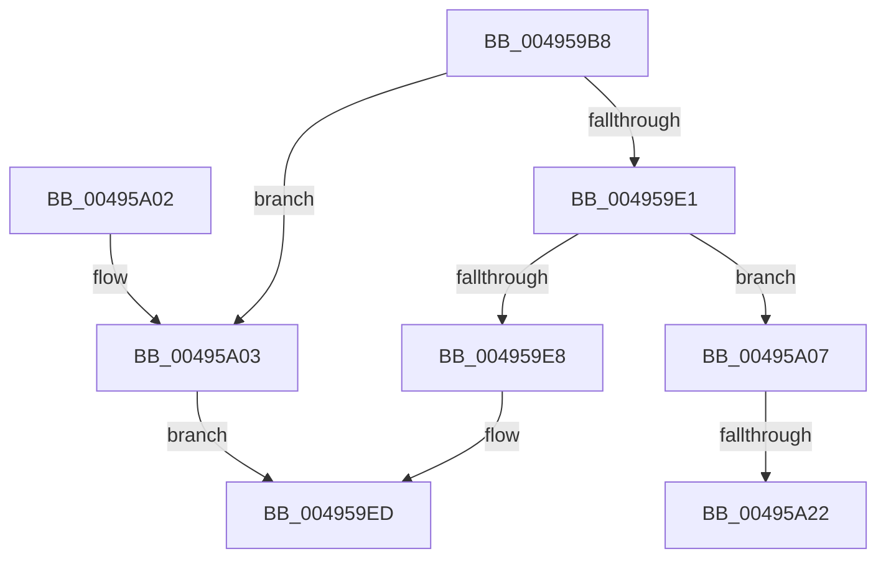

# MiMakePartitionActive

- RVA: `0x004959B8`–`0x00495A2C` (길이 `116` bytes)
- VA: `0x00000001404959B8`
- 실행 섹션: `.text`
- PDB 이름 있음: `예`; PDB Function 태그: `예`
- unwind 정보 RVA: `0x000814C4`
- 디코드: `32`개 명령, `116/116` bytes 표시
- 미해석 바이트: `0` (있으면 어셈블리에 `.byte`로 보존)

> 이 문서는 커널 이미지의 기계어와 PDB 기호를 분석해 생성했습니다. 4번과 5번은 함수 원형과 자료형을 바이너리 사용 방식에서 추정한 C 해석이며 원본 소스 복구 결과는 아닙니다.

## 1. Dependencies

- 직접 호출 지점: **2**; 고유 호출 대상: **2**
- 직접 호출자로 확인된 함수: **3**
- RIP 상대 이미지 참조: **1**

### Outgoing calls
- `0x004959D6` → [SmCreatePartition](../../page/A4/SmCreatePartition_function_00A4BC90.md) (function, `0x00A4BC90`)
- `0x00495A0E` → [ExAcquireSpinLockExclusive](../24/ExAcquireSpinLockExclusive_function_00248690.md) (function, `0x00248690`)

### Direct callers
- [MiInsertPageFileInList](../../page/7F/MiInsertPageFileInList_function_007FFF80.md) at `0x0080009F`
- [MiCreateNewSection](../../page/98/MiCreateNewSection_function_00985DB0.md) at `0x00985E65`
- [MmCreateProcessAddressSpace](../../page/A5/MmCreateProcessAddressSpace_function_00A5EE5C.md) at `0x00A5EEB7`

### Static image references
- `0x00495A07` → RVA `0x00E30040` (`.data`; read)

## 2. Other-region calls and transfers

- 다른 실행 섹션으로 향하는 call: **1**
  - `0x004959D6` → [SmCreatePartition](../../page/A4/SmCreatePartition_function_00A4BC90.md) (`.text` → `PAGE`)
- call이 아닌 외부 분기/꼬리 이동: **2**
  - `0x00495A1C` → [sub_006F7544](../6F/Unknown_function_006F7544.md) (`tail-transfer`)
  - `0x00495A27` → [sub_006F7544 + 0x59](../6F/Unknown_function_006F7544.md) (`tail-transfer`)

## 3. Assembly (complete function range)

```asm
004959B8  48 89 5C 24 08                  mov qword ptr [rsp + 8], rbx
004959BD  48 89 6C 24 10                  mov qword ptr [rsp + 0x10], rbp
004959C2  48 89 74 24 18                  mov qword ptr [rsp + 0x18], rsi
004959C7  57                              push rdi
004959C8  48 83 EC 20                     sub rsp, 0x20
004959CC  48 8B D9                        mov rbx, rcx
004959CF  48 8B 89 B8 00 00 00            mov rcx, qword ptr [rcx + 0xb8]
004959D6  E8 B5 62 5B 00                  call 0x140a4bc90
004959DB  33 FF                           xor edi, edi
004959DD  85 C0                           test eax, eax
004959DF  78 22                           js 0x140495a03
004959E1  8B 43 04                        mov eax, dword ptr [rbx + 4]
004959E4  A8 10                           test al, 0x10
004959E6  75 1F                           jne 0x140495a07
004959E8  B8 01 00 00 00                  mov eax, 1
004959ED  48 8B 5C 24 30                  mov rbx, qword ptr [rsp + 0x30]
004959F2  48 8B 6C 24 38                  mov rbp, qword ptr [rsp + 0x38]
004959F7  48 8B 74 24 40                  mov rsi, qword ptr [rsp + 0x40]
004959FC  48 83 C4 20                     add rsp, 0x20
00495A00  5F                              pop rdi
00495A01  C3                              ret
00495A02  CC                              int3
00495A03  33 C0                           xor eax, eax
00495A05  EB E6                           jmp 0x1404959ed
00495A07  48 8D 0D 32 A6 99 00            lea rcx, [rip + 0x99a632]
00495A0E  E8 7D 2C DB FF                  call 0x140248690
00495A13  8B 4B 04                        mov ecx, dword ptr [rbx + 4]
00495A16  40 8A F0                        mov sil, al
00495A19  F6 C1 10                        test cl, 0x10
00495A1C  0F 85 22 1B 26 00               jne 0x1406f7544
00495A22  BF 01 00 00 00                  mov edi, 1
00495A27  E9 71 1B 26 00                  jmp 0x1406f759d
```

## 4. C-style interpretation (structured pseudocode)

```c
__int64 __fastcall MiMakePartitionActive(__int64 a1)
{
    __int64 result;
    __int64 v_rdi;
    __int64 v_rsp;
    unsigned __int64 v_stack_p10;
    unsigned __int64 v_stack_p18;
    unsigned __int64 v_stack_p8;

    v_stack_p8 = v_rbx;
    v_stack_p10 = v_rbp;
    v_stack_p18 = v_rsi;
    v_rsp = (v_rsp) - (32);
    result = SmCreatePartition(*(unsigned __int64 *)(a1 + 184), a2, a3, a4);
    v_rdi = 0;
    if (sign_flag) goto loc_00495A03;
    if ((((unsigned __int8)((unsigned int)(*(unsigned int *)(a1 + 4)))) & (16)) != 0) goto loc_00495A07;
loc_004959ED:
    v_rsp = (v_rsp) + (32);
    return 1;
loc_00495A03:
    result = 0;
    goto loc_004959ED;
loc_00495A07:
    result = ExAcquireSpinLockExclusive(v_rip + 10069554, a2, a3, a4);
}
```

## 5. (Beta) C Style

```c
int64_t MiMakePartitionActive(void *Arg1)
{
    uint8_t *arg1 = (uint8_t *)Arg1;

    int64_t result;
    int64_t local_rdi;
    int64_t local_rsp;
    uint64_t v_stack_p10;
    uint64_t v_stack_p18;
    uint64_t v_stack_p8;

    v_stack_p8 = local_rbx;
    v_stack_p10 = local_rbp;
    v_stack_p18 = local_rsi;
    local_rsp = (local_rsp) - (32);
    result = SmCreatePartition(*(uint64_t *)(arg1 + 0xB8), a2, a3, a4);
    local_rdi = 0;
    if (sign_flag) goto loc_00495A03;
    if ((((uint8_t)((uint32_t)(*(uint32_t *)(arg1 + 0x4)))) & (16)) != 0) goto loc_00495A07;
loc_004959ED:
    local_rsp = (local_rsp) + (32);
    return 1;
loc_00495A03:
    result = 0;
    goto loc_004959ED;
loc_00495A07:
    result = ExAcquireSpinLockExclusive(v_rip + 10069554, a2, a3, a4);
}
```

### 관측된 메모리 오프셋

구조체 형식이 확인되지 않은 접근은 인자 기준의 오프셋으로만 기록했습니다.

| 기준 인자 | 오프셋 표현 | 폭 (bit) | 접근 |
|---|---:|---:|---|
| `Arg1` | `+ 0x4` | `32` | `R` |
| `Arg1` | `+ 0xB8` | `64` | `R` |

## 6. Execution-region graph

[열기: 2D/3D 그래프와 함수 탐색 컨트롤 패널](../../../control-panel.html?section=text&rva=0x004959B8&view=graph)

- 2D 그래프는 위에서 아래로 흐르고, 3D 그래프는 빈 공간을 드래그해 회전합니다. Shift+드래그는 이동, 휠은 확대·축소, 함수 노드 선택은 대상 보고서 이동입니다.

### Static fallback


