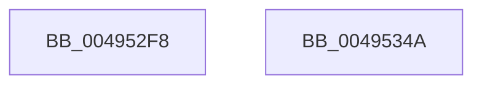

# MiMakeProtoReadOnly

- RVA: `0x004952F8`–`0x0049534B` (길이 `83` bytes)
- VA: `0x00000001404952F8`
- 실행 섹션: `.text`
- PDB 이름 있음: `예`; PDB Function 태그: `아니요`
- unwind 정보 RVA: `0x00068D5C`
- 디코드: `25`개 명령, `83/83` bytes 표시
- 미해석 바이트: `0` (있으면 어셈블리에 `.byte`로 보존)

> 이 문서는 커널 이미지의 기계어와 PDB 기호를 분석해 생성했습니다. 4번과 5번은 함수 원형과 자료형을 바이너리 사용 방식에서 추정한 C 해석이며 원본 소스 복구 결과는 아닙니다.

## 1. Dependencies

- 직접 호출 지점: **2**; 고유 호출 대상: **2**
- 직접 호출자로 확인된 함수: **1**
- RIP 상대 이미지 참조: **0**

### Outgoing calls
- `0x00495308` → [MI_READ_PTE_LOCK_FREE](../28/MI_READ_PTE_LOCK_FREE_function_002828A0.md) (function, `0x002828A0`)
- `0x00495321` → [MiUpdateProtectionMask](../28/MiUpdateProtectionMask_function_002845DC.md) (function, `0x002845DC`)

### Direct callers
- [MiMakeFaultPfnActive](../36/MiMakeFaultPfnActive_function_00361D00.md) at `0x00361E75`

### Static image references
- 디코드된 RIP-relative 메모리 참조가 없습니다.

## 2. Other-region calls and transfers

- 다른 실행 섹션으로 향하는 call: **0**
- 별도 외부 분기/꼬리 이동을 확인하지 못했습니다.

## 3. Assembly (complete function range)

```asm
004952F8  48 89 5C 24 10                  mov qword ptr [rsp + 0x10], rbx
004952FD  57                              push rdi
004952FE  48 83 EC 20                     sub rsp, 0x20
00495302  48 8B DA                        mov rbx, rdx
00495305  48 8B F9                        mov rdi, rcx
00495308  E8 93 D5 DE FF                  call 0x1402828a0
0049530D  4C 8B C0                        mov r8, rax
00495310  B9 01 00 00 00                  mov ecx, 1
00495315  8B 43 20                        mov eax, dword ptr [rbx + 0x20]
00495318  C1 E8 10                        shr eax, 0x10
0049531B  0F B6 D0                        movzx edx, al
0049531E  C1 EA 06                        shr edx, 6
00495321  E8 B6 F2 DE FF                  call 0x1402845dc
00495326  48 8B 5C 24 38                  mov rbx, qword ptr [rsp + 0x38]
0049532B  8B D0                           mov edx, eax
0049532D  48 C1 E2 05                     shl rdx, 5
00495331  48 8B CA                        mov rcx, rdx
00495334  49 33 C8                        xor rcx, r8
00495337  48 81 E1 1F FC FF FF            and rcx, 0xfffffffffffffc1f
0049533E  48 33 CA                        xor rcx, rdx
00495341  48 89 0F                        mov qword ptr [rdi], rcx
00495344  48 83 C4 20                     add rsp, 0x20
00495348  5F                              pop rdi
00495349  C3                              ret
0049534A  CC                              int3
```

## 4. C-style interpretation (structured pseudocode)

```c
__int64 __fastcall MiMakeProtoReadOnly(__int64 a1, __int64 a2)
{
    __int64 result;
    __int64 v_rsp;
    unsigned __int64 v_stack_p10;

    v_stack_p10 = v_rbx;
    v_rsp = (v_rsp) - (32);
    result = MI_READ_PTE_LOCK_FREE(a1, a2, a3, a4);
    result = (unsigned int)(((unsigned int)(*(unsigned int *)(a2 + 32))) >> (16));
    a2 = (unsigned int)(((unsigned __int8)(result)) >> (6));
    result = MiUpdateProtectionMask(1, a2, result, a4);
    a2 = ((unsigned int)((unsigned int)(result))) << (5);
    a1 = (a2) ^ (result);
    a1 = (a1) & (-993);
    a1 = (a1) ^ (a2);
    *(unsigned __int64 *)(a1) = a1;
    v_rsp = (v_rsp) + (32);
    return result;
}
```

## 5. (Beta) C Style

```c
int64_t MiMakeProtoReadOnly(void *Arg1, void *Arg2)
{
    uint8_t *arg1 = (uint8_t *)Arg1;
    uint8_t *arg2 = (uint8_t *)Arg2;

    int64_t result;
    int64_t local_rsp;
    uint64_t v_stack_p10;

    v_stack_p10 = local_rbx;
    local_rsp = (local_rsp) - (32);
    result = MI_READ_PTE_LOCK_FREE(Arg1, Arg2, a3, a4);
    result = (uint32_t)(((uint32_t)(*(uint32_t *)(arg2 + 0x20))) >> (16));
    Arg2 = (uint32_t)(((uint8_t)(result)) >> (6));
    result = MiUpdateProtectionMask(1, Arg2, result, a4);
    Arg2 = ((uint32_t)((uint32_t)(result))) << (5);
    Arg1 = (Arg2) ^ (result);
    Arg1 = (Arg1) & (-993);
    Arg1 = (Arg1) ^ (Arg2);
    *(void **)(arg1) = Arg1;
    local_rsp = (local_rsp) + (32);
    return result;
}
```

### 관측된 메모리 오프셋

구조체 형식이 확인되지 않은 접근은 인자 기준의 오프셋으로만 기록했습니다.

| 기준 인자 | 오프셋 표현 | 폭 (bit) | 접근 |
|---|---:|---:|---|
| `Arg1` | `+ 0x0` | `64` | `W` |
| `Arg2` | `+ 0x20` | `32` | `R` |

## 6. Execution-region graph

[열기: 2D/3D 그래프와 함수 탐색 컨트롤 패널](../../../control-panel.html?section=text&rva=0x004952F8&view=graph)

- 2D 그래프는 위에서 아래로 흐르고, 3D 그래프는 빈 공간을 드래그해 회전합니다. Shift+드래그는 이동, 휠은 확대·축소, 함수 노드 선택은 대상 보고서 이동입니다.

### Static fallback


