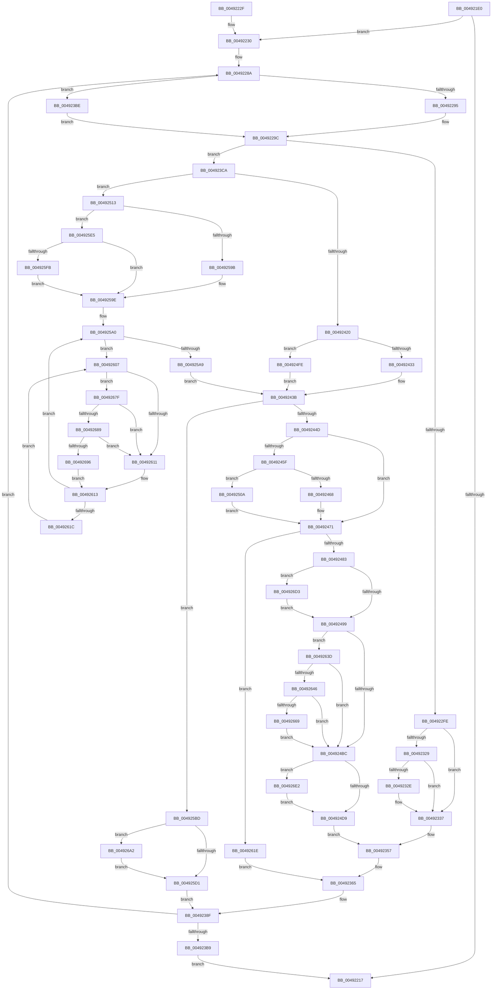

# MiMapPageFileHash

- RVA: `0x004921E0`–`0x004926ED` (길이 `1,293` bytes)
- VA: `0x00000001404921E0`
- 실행 섹션: `.text`
- PDB 이름 있음: `예`; PDB Function 태그: `아니요`
- unwind 정보 RVA: `0x000B2F20`
- 디코드: `302`개 명령, `1,293/1,293` bytes 표시
- 미해석 바이트: `0` (있으면 어셈블리에 `.byte`로 보존)

> 이 문서는 커널 이미지의 기계어와 PDB 기호를 분석해 생성했습니다. 4번과 5번은 함수 원형과 자료형을 바이너리 사용 방식에서 추정한 C 해석이며 원본 소스 복구 결과는 아닙니다.

## 1. Dependencies

- 직접 호출 지점: **28**; 고유 호출 대상: **19**
- 직접 호출자로 확인된 함수: **2**
- RIP 상대 이미지 참조: **10**

### Outgoing calls
- `0x00492243` → [MiInitializePageColorBase](../32/MiInitializePageColorBase_function_00320410.md) (function, `0x00320410`)
- `0x00492295` → [ExAcquireSpinLockExclusive](../24/ExAcquireSpinLockExclusive_function_00248690.md) (function, `0x00248690`)
- `0x00492341` → [MiUpdatePageFileHighInPte](../36/MiUpdatePageFileHighInPte_function_0036D840.md) (function, `0x0036D840`)
- `0x0049234F` → [MiReleaseSpinLockExclusive](../24/MiReleaseSpinLockExclusive_function_002482C0.md) (function, `0x002482C0`)
- `0x00492360` → [MiWritePageFileHash](../38/MiWritePageFileHash_function_00381DC8.md) (function, `0x00381DC8`)
- `0x004923C0` → [ExAcquireSpinLockExclusiveAtDpcLevel](../24/ExAcquireSpinLockExclusiveAtDpcLevel_function_00248E80.md) (function, `0x00248E80`)
- `0x004923CF` → [MiReleaseSpinLockExclusive](../24/MiReleaseSpinLockExclusive_function_002482C0.md) (function, `0x002482C0`)
- `0x0049240E` → [MiGetFileHashPage](MiGetFileHashPage_function_004926F4.md) (function, `0x004926F4`)
- `0x00492436` → [ExAcquireSpinLockExclusiveAtDpcLevel](../24/ExAcquireSpinLockExclusiveAtDpcLevel_function_00248E80.md) (function, `0x00248E80`)
- `0x00492487` → [MiUpdatePageFileHighInPte](../36/MiUpdatePageFileHighInPte_function_0036D840.md) (function, `0x0036D840`)
- `0x004924A5` → [MiMakeValidPte](../2C/MiMakeValidPte_function_002C5590.md) (function, `0x002C5590`)
- `0x004924DC` → [ExReleaseSpinLockExclusiveFromDpcLevel](../24/ExReleaseSpinLockExclusiveFromDpcLevel_function_002497E0.md) (function, `0x002497E0`)
- `0x004924E7` → [MiUnlockPage](../31/MiUnlockPage_function_0031A3E0.md) (function, `0x0031A3E0`)
- `0x004924FE` → [ExAcquireSpinLockExclusive](../24/ExAcquireSpinLockExclusive_function_00248690.md) (function, `0x00248690`)
- `0x00492540` → [MiSetPfnTbFlushStamp](../2B/MiSetPfnTbFlushStamp_function_002B7A70.md) (function, `0x002B7A70`)
- `0x00492587` → [MiInitializePfnForOtherProcess](../38/MiInitializePfnForOtherProcess_function_00382A20.md) (function, `0x00382A20`)
- `0x004925AC` → [ExAcquireSpinLockExclusiveAtDpcLevel](../24/ExAcquireSpinLockExclusiveAtDpcLevel_function_00248E80.md) (function, `0x00248E80`)
- `0x004925C2` → [MiReleaseSpinLockExclusive](../24/MiReleaseSpinLockExclusive_function_002482C0.md) (function, `0x002482C0`)
- `0x00492600` → [KiRaiseIrqlProcessIrqlFlags](../4F/KiRaiseIrqlProcessIrqlFlags_function_004F56FC.md) (function, `0x004F56FC`)
- `0x0049261E` → [MiUpdatePageFileHighInPte](../36/MiUpdatePageFileHighInPte_function_0036D840.md) (function, `0x0036D840`)
- `0x0049262B` → [MiReleaseSpinLockExclusive](../24/MiReleaseSpinLockExclusive_function_002482C0.md) (function, `0x002482C0`)
- `0x00492675` → [MiCheckLinearProtectedPteAccessedBit](../29/MiCheckLinearProtectedPteAccessedBit_function_00292D80.md) (function, `0x00292D80`)
- `0x00492689` → [KiCheckVpBackingLongSpinWaitHypercall](../30/KiCheckVpBackingLongSpinWaitHypercall_function_0030F490.md) (function, `0x0030F490`)
- `0x00492698` → [HvlNotifyLongSpinWait](../30/HvlNotifyLongSpinWait_function_0030F460.md) (function, `0x0030F460`)
- `0x004926A5` → [MiFreePageFileHashPfn](../4B/MiFreePageFileHashPfn_function_004B2A78.md) (function, `0x004B2A78`)
- `0x004926B0` → [MiUnlockPage](../31/MiUnlockPage_function_0031A3E0.md) (function, `0x0031A3E0`)
- `0x004926C1` → [MiReleaseNonPagedResources](../32/MiReleaseNonPagedResources_function_0032299C.md) (function, `0x0032299C`)
- `0x004926D8` → [MiSetPfnModified](../36/MiSetPfnModified_function_00362960.md) (function, `0x00362960`)

### Direct callers
- [MiGatherPagefilePages](../37/MiGatherPagefilePages_function_00372B08.md) at `0x00373088`
- [MiStoreUpdatePagefileHash](MiStoreUpdatePagefileHash_function_004920AC.md) at `0x0049216D`
- [MiStoreUpdatePagefileHash](MiStoreUpdatePagefileHash_function_004920AC.md) at `0x004921B5`

### Static image references
- `0x00492238` → RVA `0x00E38200` (`.data`; read)
- `0x004922A6` → RVA `0x00E3738C` (`.data`; read)
- `0x00492316` → RVA `0x00E2DC80` (`.data`; read)
- `0x004923E7` → RVA `0x00E2CB40` (`.data`; read)
- `0x004924AA` → RVA `0x00FC6A88` (`ALMOSTRO`; read)
- `0x00492534` → RVA `0x00FCF080` (`CACHEALI`; read)
- `0x004925F2` → RVA `0x00FC6D20` (`ALMOSTRO`; read)
- `0x00492609` → RVA `0x00FC52AC` (`ALMOSTRO`; reference)
- `0x0049267F` → RVA `0x00FC6AB8` (`ALMOSTRO`; read)
- `0x004926C6` → RVA `0x00E388E8` (`.data`; read/write)

## 2. Other-region calls and transfers

- 다른 실행 섹션으로 향하는 call: **0**
- 별도 외부 분기/꼬리 이동을 확인하지 못했습니다.

## 3. Assembly (complete function range)

```asm
004921E0  48 89 5C 24 10                  mov qword ptr [rsp + 0x10], rbx
004921E5  44 89 4C 24 20                  mov dword ptr [rsp + 0x20], r9d
004921EA  55                              push rbp
004921EB  56                              push rsi
004921EC  57                              push rdi
004921ED  41 54                           push r12
004921EF  41 55                           push r13
004921F1  41 56                           push r14
004921F3  41 57                           push r15
004921F5  48 83 EC 60                     sub rsp, 0x60
004921F9  48 83 B9 B8 00 00 00 00         cmp qword ptr [rcx + 0xb8], 0
00492201  0F 57 C0                        xorps xmm0, xmm0
00492204  0F 11 44 24 50                  movups xmmword ptr [rsp + 0x50], xmm0
00492209  45 8B F9                        mov r15d, r9d
0049220C  49 8B D8                        mov rbx, r8
0049220F  48 8B F2                        mov rsi, rdx
00492212  48 8B F9                        mov rdi, rcx
00492215  75 19                           jne 0x140492230
00492217  48 8B 9C 24 A8 00 00 00         mov rbx, qword ptr [rsp + 0xa8]
0049221F  48 83 C4 60                     add rsp, 0x60
00492223  41 5F                           pop r15
00492225  41 5E                           pop r14
00492227  41 5D                           pop r13
00492229  41 5C                           pop r12
0049222B  5F                              pop rdi
0049222C  5E                              pop rsi
0049222D  5D                              pop rbp
0049222E  C3                              ret
0049222F  CC                              int3
00492230  45 33 C0                        xor r8d, r8d
00492233  4C 8D 4C 24 50                  lea r9, [rsp + 0x50]
00492238  48 8D 0D C1 5F 9A 00            lea rcx, [rip + 0x9a5fc1]
0049223F  41 8D 50 03                     lea edx, [r8 + 3]
00492243  E8 C8 E1 E8 FF                  call 0x140320410
00492248  48 8D 34 DE                     lea rsi, [rsi + rbx*8]
0049224C  48 83 C6 30                     add rsi, 0x30
00492250  48 89 74 24 28                  mov qword ptr [rsp + 0x28], rsi
00492255  44 0F 20 C0                     mov rax, cr8
00492259  BA 11 00 00 00                  mov edx, 0x11
0049225E  0F B6 C8                        movzx ecx, al
00492261  48 8D AF C8 00 00 00            lea rbp, [rdi + 0xc8]
00492268  49 BC 00 00 00 00 80 F6 FF FF   movabs r12, 0xfffff68000000000
00492272  49 BD FF FF FF FF FF 00 00 00   movabs r13, 0xffffffffff
0049227C  44 8D 42 F1                     lea r8d, [rdx - 0xf]
00492280  41 3A C0                        cmp al, r8b
00492283  0F 44 CA                        cmove ecx, edx
00492286  89 4C 24 20                     mov dword ptr [rsp + 0x20], ecx
0049228A  3A CA                           cmp cl, dl
0049228C  48 8B CD                        mov rcx, rbp
0049228F  0F 84 29 01 00 00               je 0x1404923be
00492295  E8 F6 63 DB FF                  call 0x140248690
0049229A  8A D8                           mov bl, al
0049229C  48 8B 87 B8 00 00 00            mov rax, qword ptr [rdi + 0xb8]
004922A3  41 8B D7                        mov edx, r15d
004922A6  0F AF 15 DF 50 9A 00            imul edx, dword ptr [rip + 0x9a50df]
004922AD  48 89 44 24 30                  mov qword ptr [rsp + 0x30], rax
004922B2  48 03 D0                        add rdx, rax
004922B5  48 B8 F8 FF FF FF 7F 00 00 00   movabs rax, 0x7ffffffff8
004922BF  4C 8B F2                        mov r14, rdx
004922C2  49 C1 EE 09                     shr r14, 9
004922C6  4C 23 F0                        and r14, rax
004922C9  49 8B C4                        mov rax, r12
004922CC  44 8B A4 24 C0 00 00 00         mov r12d, dword ptr [rsp + 0xc0]
004922D4  4C 03 F0                        add r14, rax
004922D7  81 E2 FF 0F 00 00               and edx, 0xfff
004922DD  B8 00 10 00 00                  mov eax, 0x1000
004922E2  2B C2                           sub eax, edx
004922E4  33 D2                           xor edx, edx
004922E6  F7 35 A0 50 9A 00               div dword ptr [rip + 0x9a50a0]
004922EC  41 3B C4                        cmp eax, r12d
004922EF  44 0F 46 E0                     cmovbe r12d, eax
004922F3  49 8B 06                        mov rax, qword ptr [r14]
004922F6  A8 01                           test al, 1
004922F8  0F 84 CC 00 00 00               je 0x1404923ca
004922FE  48 C1 E8 0C                     shr rax, 0xc
00492302  49 23 C5                        and rax, r13
00492305  4C 8D 04 40                     lea r8, [rax + rax*2]
00492309  4D 03 C0                        add r8, r8
0049230C  49 B9 10 00 00 00 00 DE FF FF   movabs r9, 0xffffde0000000010
00492316  48 8B 05 63 B9 99 00            mov rax, qword ptr [rip + 0x99b963]
0049231D  4B 8B 0C C1                     mov rcx, qword ptr [r9 + r8*8]
00492321  48 8B D1                        mov rdx, rcx
00492324  48 85 C0                        test rax, rax
00492327  74 0E                           je 0x140492337
00492329  F6 C1 10                        test cl, 0x10
0049232C  75 09                           jne 0x140492337
0049232E  48 8B D0                        mov rdx, rax
00492331  48 F7 D2                        not rdx
00492334  48 23 D1                        and rdx, rcx
00492337  48 C1 EA 20                     shr rdx, 0x20
0049233B  41 8B C4                        mov eax, r12d
0049233E  48 03 D0                        add rdx, rax
00492341  E8 FA B4 ED FF                  call 0x14036d840
00492346  8A D3                           mov dl, bl
00492348  4B 89 04 C1                     mov qword ptr [r9 + r8*8], rax
0049234C  48 8B CD                        mov rcx, rbp
0049234F  E8 6C 5F DB FF                  call 0x1402482c0
00492354  48 8B D6                        mov rdx, rsi
00492357  45 8B CC                        mov r9d, r12d
0049235A  45 8B C7                        mov r8d, r15d
0049235D  48 8B CF                        mov rcx, rdi
00492360  E8 63 FA EE FF                  call 0x140381dc8
00492365  48 8B 54 24 28                  mov rdx, qword ptr [rsp + 0x28]
0049236A  45 03 FC                        add r15d, r12d
0049236D  8B 84 24 C0 00 00 00            mov eax, dword ptr [rsp + 0xc0]
00492374  41 2B C4                        sub eax, r12d
00492377  44 89 BC 24 B8 00 00 00         mov dword ptr [rsp + 0xb8], r15d
0049237F  89 84 24 C0 00 00 00            mov dword ptr [rsp + 0xc0], eax
00492386  4A 8D 14 E2                     lea rdx, [rdx + r12*8]
0049238A  48 89 54 24 28                  mov qword ptr [rsp + 0x28], rdx
0049238F  8B 4C 24 20                     mov ecx, dword ptr [rsp + 0x20]
00492393  BA 11 00 00 00                  mov edx, 0x11
00492398  48 8B 74 24 28                  mov rsi, qword ptr [rsp + 0x28]
0049239D  49 BD FF FF FF FF FF 00 00 00   movabs r13, 0xffffffffff
004923A7  49 BC 00 00 00 00 80 F6 FF FF   movabs r12, 0xfffff68000000000
004923B1  85 C0                           test eax, eax
004923B3  0F 85 D1 FE FF FF               jne 0x14049228a
004923B9  E9 59 FE FF FF                  jmp 0x140492217
004923BE  8A DA                           mov bl, dl
004923C0  E8 BB 6A DB FF                  call 0x140248e80
004923C5  E9 D2 FE FF FF                  jmp 0x14049229c
004923CA  8A D3                           mov dl, bl
004923CC  48 8B CD                        mov rcx, rbp
004923CF  E8 EC 5E DB FF                  call 0x1402482c0
004923D4  48 8B 4C 24 50                  mov rcx, qword ptr [rsp + 0x50]
004923D9  B8 01 00 00 00                  mov eax, 1
004923DE  F0 0F C1 01                     lock xadd dword ptr [rcx], eax
004923E2  4C 8B 44 24 58                  mov r8, qword ptr [rsp + 0x58]
004923E7  4C 8D 0D 52 A7 99 00            lea r9, [rip + 0x99a752]
004923EE  33 D2                           xor edx, edx
004923F0  49 8B C8                        mov rcx, r8
004923F3  48 C1 E9 10                     shr rcx, 0x10
004923F7  83 E1 03                        and ecx, 3
004923FA  41 F7 B4 89 80 11 00 00         div dword ptr [r9 + rcx*4 + 0x1180]
00492402  48 8B CF                        mov rcx, rdi
00492405  41 33 D0                        xor edx, r8d
00492408  0F B6 D2                        movzx edx, dl
0049240B  41 33 D0                        xor edx, r8d
0049240E  E8 E1 02 00 00                  call 0x1404926f4
00492413  4C 8B E8                        mov r13, rax
00492416  48 83 F8 FF                     cmp rax, -1
0049241A  0F 85 F3 00 00 00               jne 0x140492513
00492420  33 F6                           xor esi, esi
00492422  41 B7 11                        mov r15b, 0x11
00492425  48 8B CD                        mov rcx, rbp
00492428  44 38 7C 24 20                  cmp byte ptr [rsp + 0x20], r15b
0049242D  0F 85 CB 00 00 00               jne 0x1404924fe
00492433  41 8A DF                        mov bl, r15b
00492436  E8 45 6A DB FF                  call 0x140248e80
0049243B  48 8B 44 24 30                  mov rax, qword ptr [rsp + 0x30]
00492440  48 3B 87 B8 00 00 00            cmp rax, qword ptr [rdi + 0xb8]
00492447  0F 85 70 01 00 00               jne 0x1404925bd
0049244D  49 8B 0E                        mov rcx, qword ptr [r14]
00492450  48 8B 05 29 B8 99 00            mov rax, qword ptr [rip + 0x99b829]
00492457  4C 8B C1                        mov r8, rcx
0049245A  48 85 C0                        test rax, rax
0049245D  74 12                           je 0x140492471
0049245F  F6 C1 10                        test cl, 0x10
00492462  0F 85 A2 00 00 00               jne 0x14049250a
00492468  4C 8B C0                        mov r8, rax
0049246B  49 F7 D0                        not r8
0049246E  4C 23 C1                        and r8, rcx
00492471  49 C1 E8 20                     shr r8, 0x20
00492475  43 8D 14 04                     lea edx, [r12 + r8]
00492479  49 83 FD FF                     cmp r13, -1
0049247D  0F 84 9B 01 00 00               je 0x14049261e
00492483  48 8B 4E 10                     mov rcx, qword ptr [rsi + 0x10]
00492487  E8 B4 B3 ED FF                  call 0x14036d840
0049248C  48 89 46 10                     mov qword ptr [rsi + 0x10], rax
00492490  45 85 C0                        test r8d, r8d
00492493  0F 85 3A 02 00 00               jne 0x1404926d3
00492499  41 B8 04 00 00 A0               mov r8d, 0xa0000004
0049249F  49 8B D5                        mov rdx, r13
004924A2  49 8B CE                        mov rcx, r14
004924A5  E8 E6 30 E3 FF                  call 0x1402c5590
004924AA  48 0F BA 25 D5 45 B3 00 24      bt qword ptr [rip + 0xb345d5], 0x24
004924B3  48 8B D8                        mov rbx, rax
004924B6  0F 82 81 01 00 00               jb 0x14049263d
004924BC  49 89 1E                        mov qword ptr [r14], rbx
004924BF  8B 87 B0 00 00 00               mov eax, dword ptr [rdi + 0xb0]
004924C5  FF C0                           inc eax
004924C7  89 87 B0 00 00 00               mov dword ptr [rdi + 0xb0], eax
004924CD  3B 87 B4 00 00 00               cmp eax, dword ptr [rdi + 0xb4]
004924D3  0F 87 09 02 00 00               ja 0x1404926e2
004924D9  48 8B CD                        mov rcx, rbp
004924DC  E8 FF 72 DB FF                  call 0x1402497e0
004924E1  41 8A D7                        mov dl, r15b
004924E4  48 8B CE                        mov rcx, rsi
004924E7  E8 F4 7E E8 FF                  call 0x14031a3e0
004924EC  48 8B 54 24 28                  mov rdx, qword ptr [rsp + 0x28]
004924F1  44 8B BC 24 B8 00 00 00         mov r15d, dword ptr [rsp + 0xb8]
004924F9  E9 59 FE FF FF                  jmp 0x140492357
004924FE  E8 8D 61 DB FF                  call 0x140248690
00492503  8A D8                           mov bl, al
00492505  E9 31 FF FF FF                  jmp 0x14049243b
0049250A  49 83 E0 EF                     and r8, 0xffffffffffffffef
0049250E  E9 5E FF FF FF                  jmp 0x140492471
00492513  48 8D 34 45 00 00 00 00         lea rsi, [rax*2]
0049251B  49 03 F5                        add rsi, r13
0049251E  48 C1 E6 04                     shl rsi, 4
00492522  48 B8 00 00 00 00 00 DE FF FF   movabs rax, 0xffffde0000000000
0049252C  48 03 F0                        add rsi, rax
0049252F  F0 83 0C 24 00                  lock or dword ptr [rsp], 0
00492534  8B 15 46 CB B3 00               mov edx, dword ptr [rip + 0xb3cb46]
0049253A  45 33 C0                        xor r8d, r8d
0049253D  48 8B CE                        mov rcx, rsi
00492540  E8 2B 55 E2 FF                  call 0x1402b7a70
00492545  48 B8 F8 FF FF FF 7F 00 00 00   movabs rax, 0x7ffffffff8
0049254F  4D 8B C6                        mov r8, r14
00492552  49 C1 E8 09                     shr r8, 9
00492556  4C 23 C0                        and r8, rax
00492559  48 B8 00 00 00 00 80 F6 FF FF   movabs rax, 0xfffff68000000000
00492563  48 8B C0                        mov rax, rax
00492566  4D 8B 04 00                     mov r8, qword ptr [r8 + rax]
0049256A  41 B9 00 0A 00 00               mov r9d, 0xa00
00492570  49 C1 E8 0C                     shr r8, 0xc
00492574  48 B8 FF FF FF FF FF 00 00 00   movabs rax, 0xffffffffff
0049257E  4C 23 C0                        and r8, rax
00492581  49 8B D6                        mov rdx, r14
00492584  49 8B CD                        mov rcx, r13
00492587  E8 94 04 EF FF                  call 0x140382a20
0049258C  80 7C 24 20 11                  cmp byte ptr [rsp + 0x20], 0x11
00492591  C6 84 24 A0 00 00 00 11         mov byte ptr [rsp + 0xa0], 0x11
00492599  75 4A                           jne 0x1404925e5
0049259B  41 B7 11                        mov r15b, 0x11
0049259E  33 DB                           xor ebx, ebx
004925A0  F0 48 0F BA 6E 18 3F            lock bts qword ptr [rsi + 0x18], 0x3f
004925A7  72 5E                           jb 0x140492607
004925A9  48 8B CD                        mov rcx, rbp
004925AC  E8 CF 68 DB FF                  call 0x140248e80
004925B1  8A 9C 24 A0 00 00 00            mov bl, byte ptr [rsp + 0xa0]
004925B8  E9 7E FE FF FF                  jmp 0x14049243b
004925BD  8A D3                           mov dl, bl
004925BF  48 8B CD                        mov rcx, rbp
004925C2  E8 F9 5C DB FF                  call 0x1402482c0
004925C7  49 83 FD FF                     cmp r13, -1
004925CB  0F 85 D1 00 00 00               jne 0x1404926a2
004925D1  8B 84 24 C0 00 00 00            mov eax, dword ptr [rsp + 0xc0]
004925D8  44 8B BC 24 B8 00 00 00         mov r15d, dword ptr [rsp + 0xb8]
004925E0  E9 AA FD FF FF                  jmp 0x14049238f
004925E5  45 0F 20 C7                     mov r15, cr8
004925E9  B8 02 00 00 00                  mov eax, 2
004925EE  44 0F 22 C0                     mov cr8, rax
004925F2  83 3D 27 47 B3 00 00            cmp dword ptr [rip + 0xb34727], 0
004925F9  74 A3                           je 0x14049259e
004925FB  8A D0                           mov dl, al
004925FD  41 8A CF                        mov cl, r15b
00492600  E8 F7 30 06 00                  call 0x1404f56fc
00492605  EB 97                           jmp 0x14049259e
00492607  FF C3                           inc ebx
00492609  85 1D 9D 2C B3 00               test dword ptr [rip + 0xb32c9d], ebx
0049260F  74 6E                           je 0x14049267f
00492611  F3 90                           pause
00492613  48 8B 46 18                     mov rax, qword ptr [rsi + 0x18]
00492617  48 85 C0                        test rax, rax
0049261A  79 84                           jns 0x1404925a0
0049261C  EB E9                           jmp 0x140492607
0049261E  E8 1D B2 ED FF                  call 0x14036d840
00492623  8A D3                           mov dl, bl
00492625  49 89 06                        mov qword ptr [r14], rax
00492628  48 8B CD                        mov rcx, rbp
0049262B  E8 90 5C DB FF                  call 0x1402482c0
00492630  44 8B BC 24 B8 00 00 00         mov r15d, dword ptr [rsp + 0xb8]
00492638  E9 28 FD FF FF                  jmp 0x140492365
0049263D  F6 C3 20                        test bl, 0x20
00492640  0F 85 76 FE FF FF               jne 0x1404924bc
00492646  48 B8 00 00 00 00 80 F6 FF FF   movabs rax, 0xfffff68000000000
00492650  48 8B C0                        mov rax, rax
00492653  48 B9 00 00 00 00 40 00 00 00   movabs rcx, 0x4000000000
0049265D  48 03 C1                        add rax, rcx
00492660  4C 3B F0                        cmp r14, rax
00492663  0F 82 53 FE FF FF               jb 0x1404924bc
00492669  41 B8 80 00 00 00               mov r8d, 0x80
0049266F  48 8B D3                        mov rdx, rbx
00492672  49 8B CE                        mov rcx, r14
00492675  E8 06 07 E0 FF                  call 0x140292d80
0049267A  E9 3D FE FF FF                  jmp 0x1404924bc
0049267F  8B 05 33 44 B3 00               mov eax, dword ptr [rip + 0xb34433]
00492685  A8 40                           test al, 0x40
00492687  74 88                           je 0x140492611
00492689  E8 02 CE E7 FF                  call 0x14030f490
0049268E  84 C0                           test al, al
00492690  0F 84 7B FF FF FF               je 0x140492611
00492696  8B CB                           mov ecx, ebx
00492698  E8 C3 CD E7 FF                  call 0x14030f460
0049269D  E9 71 FF FF FF                  jmp 0x140492613
004926A2  49 8B CD                        mov rcx, r13
004926A5  E8 CE 03 02 00                  call 0x1404b2a78
004926AA  41 8A D7                        mov dl, r15b
004926AD  48 8B CE                        mov rcx, rsi
004926B0  E8 2B 7D E8 FF                  call 0x14031a3e0
004926B5  48 8B 8F D8 00 00 00            mov rcx, qword ptr [rdi + 0xd8]
004926BC  BA 01 00 00 00                  mov edx, 1
004926C1  E8 D6 02 E9 FF                  call 0x14032299c
004926C6  F0 48 FF 0D 1A 62 9A 00         lock dec qword ptr [rip + 0x9a621a]
004926CE  E9 FE FE FF FF                  jmp 0x1404925d1
004926D3  33 D2                           xor edx, edx
004926D5  48 8B CE                        mov rcx, rsi
004926D8  E8 83 02 ED FF                  call 0x140362960
004926DD  E9 B7 FD FF FF                  jmp 0x140492499
004926E2  89 87 B4 00 00 00               mov dword ptr [rdi + 0xb4], eax
004926E8  E9 EC FD FF FF                  jmp 0x1404924d9
```

## 4. C-style interpretation (structured pseudocode)

```c
__int64 __fastcall MiMapPageFileHash(__int64 a1, __int64 a2, __int64 a3, int a4, unsigned int a5)
{
    __int64 result;
    __int64 v_r12;
    __int64 v_r14;
    __int64 v_r15;
    __int64 v_rbx;
    __int64 v_rsi;
    __int64 v_rsp;
    unsigned __int64 v_stack_m48;
    unsigned int v_stack_p0;
    unsigned __int64 v_stack_p10;
    unsigned int v_stack_p20;
    unsigned __int64 v_stack_p28;
    unsigned __int64 v_stack_p30;
    unsigned __int64 v_stack_p50;
    unsigned __int64 v_stack_p58;
    unsigned __int8 v_stack_pA0;
    unsigned int v_stack_pB8;
    unsigned int v_stack_pC0;

    v_stack_p10 = v_rbx;
    v_stack_p20 = a4;
    v_rsp = (v_rsp) - (96);
    v_stack_m48 = v_xmm0;
    if ((*(unsigned __int64 *)(a1 + 184)) != 0) goto loc_00492230;
loc_00492217:
    v_rsp = (v_rsp) + (96);
    return result;
loc_00492230:
    a3 = 0;
    result = MiInitializePageColorBase(v_rip + 10117057, a3 + 3, a3, v_stack_p50);
    v_rsi = (a2 + v_stack_p10 * 8) + (48);
    v_stack_p28 = v_rsi;
    a1 = (unsigned __int8)(v_cr8);
    if (((unsigned __int8)(v_cr8)) == ((unsigned __int8)(17 - 15))) { a1 = 17; }
    v_stack_p20 = (unsigned int)(a1);
loc_0049228A:
    if (((unsigned __int8)(a1)) == 17) goto loc_004923BE;
    result = ExAcquireSpinLockExclusive(a1 + 200, 17, 17 - 15, v_stack_p50);
loc_0049229C:
    a2 = (unsigned int)(((unsigned int)((unsigned int)((unsigned int)(a4)))) * (*(unsigned int *)(v_rip + 10113247)));
    v_stack_p30 = *(unsigned __int64 *)(a1 + 184);
    a2 = (a2) + (*(unsigned __int64 *)(a1 + 184));
    v_r14 = (a2) >> (9);
    v_r14 = (v_r14) & (*(unsigned __int64 *)(a1 + 184));
    v_r14 = (v_r14) + (v_r12);
    a2 = (unsigned int)((a2) & (0xFFFULL));
    result = (unsigned int)(((unsigned int)(0x1000ULL)) - ((unsigned int)(a2)));
    a2 = 0;
    v_r12 = (unsigned int)(a5);
    if (((unsigned int)(result)) <= ((unsigned int)((unsigned int)(a5)))) { v_r12 = (unsigned int)(result); }
    if ((((unsigned __int8)(*(unsigned __int64 *)(v_r14))) & (1)) == 0) goto loc_004923CA;
    result = (*(unsigned __int64 *)(v_r14)) >> (12);
    result = (result) & (v_r13);
    a3 = (result + result * 2) + (result + result * 2);
    if (*(unsigned __int64 *)(v_rip + 10074467) == 0) goto loc_00492337;
    if ((((unsigned __int8)(*(unsigned __int64 *)(v_stack_p50 + a3 * 8))) & (16)) == 0) {
        a2 = *(unsigned __int64 *)(v_rip + 10074467);
        a2 = ~(a2);
        a2 = (a2) & (*(unsigned __int64 *)(v_stack_p50 + a3 * 8));
    }
    a2 = (a2) >> (32);
    a2 = (a2) + ((unsigned int)((unsigned int)(v_r12)));
    result = MiUpdatePageFileHighInPte(*(unsigned __int64 *)(v_stack_p50 + a3 * 8), a2, a3, v_stack_p50);
    *(unsigned __int64 *)(v_stack_p50 + a3 * 8) = result;
    result = MiReleaseSpinLockExclusive(a1 + 200, (unsigned __int8)((unsigned __int8)(result)), a3, v_stack_p50);
loc_00492357:
    result = MiWritePageFileHash(a1, v_rsi, (unsigned int)((unsigned int)((unsigned int)(a4))), (unsigned int)((unsigned int)(v_r12)));
loc_00492365:
    v_r15 = (unsigned int)(((unsigned int)(a4)) + ((unsigned int)(v_r12)));
    result = (unsigned int)(((unsigned int)(a5)) - ((unsigned int)(v_r12)));
    v_stack_pB8 = (unsigned int)(v_r15);
    v_stack_pC0 = (unsigned int)(result);
    v_stack_p28 = v_stack_p28 + v_r12 * 8;
loc_0049238F:
    if ((unsigned int)(result) != 0) goto loc_0049228A;
    goto loc_00492217;
loc_004923BE:
    result = ExAcquireSpinLockExclusiveAtDpcLevel((unsigned int)(v_stack_p20), 17, (unsigned int)((unsigned int)((unsigned int)(a4))), (unsigned int)((unsigned int)(v_r12)));
    goto loc_0049229C;
loc_004923CA:
    result = MiReleaseSpinLockExclusive(a1 + 200, 17, (unsigned int)((unsigned int)((unsigned int)(a4))), (unsigned int)((unsigned int)(v_r12)));
    a2 = 0;
    a1 = (v_stack_p58) >> (16);
    a1 = (unsigned int)((a1) & (3));
    a2 = (unsigned int)((a2) ^ ((unsigned int)(v_stack_p58)));
    a2 = (unsigned int)(((unsigned __int8)(a2)) ^ ((unsigned int)(v_stack_p58)));
    result = MiGetFileHashPage(a1, a2, v_stack_p58, v_rip + 10069842);
    if (result != -1) goto loc_00492513;
    v_rsi = 0;
    if (v_stack_p20 != 17) goto loc_004924FE;
    result = ExAcquireSpinLockExclusiveAtDpcLevel(a1 + 200, a2, v_stack_p58, v_rip + 10069842);
loc_0049243B:
    if (v_stack_p30 != (*(unsigned __int64 *)(a1 + 184))) goto loc_004925BD;
    if (*(unsigned __int64 *)(v_rip + 10074153) == 0) goto loc_00492471;
    if ((((unsigned __int8)(*(unsigned __int64 *)(v_r14))) & (16)) != 0) goto loc_0049250A;
    a3 = ~(*(unsigned __int64 *)(v_rip + 10074153));
    a3 = (a3) & (*(unsigned __int64 *)(v_r14));
loc_00492471:
    a3 = (a3) >> (32);
    if (result == -1) goto loc_0049261E;
    result = MiUpdatePageFileHighInPte(*(unsigned __int64 *)(v_rsi + 16), v_r12 + a3 * 1, a3, v_rip + 10069842);
    *(unsigned __int64 *)(v_rsi + 16) = result;
    if ((unsigned int)(a3) != 0) goto loc_004926D3;
loc_00492499:
    result = MiMakeValidPte(v_r14, result, (unsigned int)(0xA0000004ULL), v_rip + 10069842);
    if (condition_is_below) goto loc_0049263D;
loc_004924BC:
    *(unsigned __int64 *)(v_r14) = result;
    result = (unsigned int)(((unsigned int)(*(unsigned int *)(a1 + 176))) + 1);
    *(unsigned int *)(a1 + 176) = (unsigned int)(result);
    if (((unsigned int)(result)) > (*(unsigned int *)(a1 + 180))) goto loc_004926E2;
loc_004924D9:
    result = ExReleaseSpinLockExclusiveFromDpcLevel(a1 + 200, result, (unsigned int)(0xA0000004ULL), v_rip + 10069842);
    result = MiUnlockPage(0, 17, (unsigned int)(0xA0000004ULL), v_rip + 10069842);
    goto loc_00492357;
loc_004924FE:
    result = ExAcquireSpinLockExclusive(0, v_stack_p28, (unsigned int)(0xA0000004ULL), v_rip + 10069842);
    goto loc_0049243B;
loc_0049250A:
    a3 = ((unsigned int)(0xA0000004ULL)) & (-17);
    goto loc_00492471;
loc_00492513:
    v_rsi = (result * 2) + (result);
    v_rsi = (v_rsi) << (4);
    v_rsi = (v_rsi) + (result);
    a3 = 0;
    result = MiSetPfnTbFlushStamp(v_rsi, (unsigned int)(*(unsigned int *)(v_rip + 11782982)), a3, v_rip + 10069842);
    a3 = (v_r14) >> (9);
    a3 = (a3) & (result);
    a3 = (*(unsigned __int64 *)(a3 + result * 1)) >> (12);
    a3 = (a3) & (result);
    result = MiInitializePfnForOtherProcess(result, v_r14, a3, (unsigned int)(0xA00ULL));
    v_stack_pA0 = 17;
    if (v_stack_p20 != 17) goto loc_004925E5;
loc_0049259E:
    v_rbx = 0;
loc_004925A0:
    if (condition_is_below) goto loc_00492607;
    result = ExAcquireSpinLockExclusiveAtDpcLevel(a1 + 200, v_r14, a3, (unsigned int)(0xA00ULL));
    goto loc_0049243B;
loc_004925BD:
    result = MiReleaseSpinLockExclusive(a1 + 200, (unsigned __int8)(v_stack_pA0), a3, (unsigned int)(0xA00ULL));
    if (result != -1) goto loc_004926A2;
loc_004925D1:
    goto loc_0049238F;
loc_004925E5:
    if ((*(unsigned int *)(v_rip + 11749159)) == 0) goto loc_0049259E;
    result = KiRaiseIrqlProcessIrqlFlags((unsigned __int8)(v_cr8), 2, a3, (unsigned int)(0xA00ULL));
    goto loc_0049259E;
loc_00492607:
    v_rbx = (unsigned int)((v_stack_pA0) + 1);
    if (((*(unsigned int *)(v_rip + 11742365)) & ((unsigned int)(v_rbx))) == 0) goto loc_0049267F;
loc_00492611:
loc_00492613:
    if (!sign_flag) goto loc_004925A0;
    goto loc_00492607;
loc_0049261E:
    result = MiUpdatePageFileHighInPte((unsigned __int8)(v_cr8), 2, a3, (unsigned int)(0xA00ULL));
    *(unsigned __int64 *)(v_r14) = result;
    result = MiReleaseSpinLockExclusive(a1 + 200, (unsigned __int8)(v_rbx), a3, (unsigned int)(0xA00ULL));
    goto loc_00492365;
loc_0049263D:
    if ((((unsigned __int8)(v_rbx)) & (32)) != 0) goto loc_004924BC;
    result = (result) + (a1 + 200);
    if (v_r14 < result) goto loc_004924BC;
    result = MiCheckLinearProtectedPteAccessedBit(v_r14, v_rbx, 128, (unsigned int)(0xA00ULL));
    goto loc_004924BC;
loc_0049267F:
    if ((((unsigned __int8)((unsigned int)(*(unsigned int *)(v_rip + 11748403)))) & (64)) == 0) goto loc_00492611;
    result = KiCheckVpBackingLongSpinWaitHypercall(v_r14, v_rbx, 128, (unsigned int)(0xA00ULL));
    if ((unsigned __int8)(result) == 0) goto loc_00492611;
    result = HvlNotifyLongSpinWait((unsigned int)((unsigned int)(v_rbx)), v_rbx, 128, (unsigned int)(0xA00ULL));
    goto loc_00492613;
loc_004926A2:
    result = MiFreePageFileHashPfn(result, v_rbx, 128, (unsigned int)(0xA00ULL));
    result = MiUnlockPage(v_rsi, (unsigned __int8)((unsigned int)(v_stack_pB8)), 128, (unsigned int)(0xA00ULL));
    result = MiReleaseNonPagedResources(*(unsigned __int64 *)(a1 + 216), 1, 128, (unsigned int)(0xA00ULL));
    goto loc_004925D1;
loc_004926D3:
    a2 = 0;
    result = MiSetPfnModified(v_rsi, a2, 128, (unsigned int)(0xA00ULL));
    goto loc_00492499;
loc_004926E2:
    *(unsigned int *)(a1 + 180) = (unsigned int)(result);
    goto loc_004924D9;
}
```

## 5. (Beta) C Style

```c
int64_t MiMapPageFileHash(void *Arg1, void *Arg2, int64_t Arg3, int32_t Arg4, uint32_t Arg5)
{
    uint8_t *arg1 = (uint8_t *)Arg1;
    uint8_t *arg2 = (uint8_t *)Arg2;

    int64_t result;
    int64_t local_r12;
    int64_t local_r14;
    int64_t local_r15;
    int64_t local_rbx;
    int64_t local_rsi;
    int64_t local_rsp;
    uint64_t v_stack_m48;
    uint32_t v_stack_p0;
    uint64_t v_stack_p10;
    uint32_t v_stack_p20;
    uint64_t v_stack_p28;
    uint64_t v_stack_p30;
    uint64_t v_stack_p50;
    uint64_t v_stack_p58;
    uint8_t v_stack_pA0;
    uint32_t v_stack_pB8;
    uint32_t v_stack_pC0;

    v_stack_p10 = local_rbx;
    v_stack_p20 = Arg4;
    local_rsp = (local_rsp) - (96);
    v_stack_m48 = v_xmm0;
    if ((*(uint64_t *)(arg1 + 0xB8)) != 0) goto loc_00492230;
loc_00492217:
    local_rsp = (local_rsp) + (96);
    return result;
loc_00492230:
    Arg3 = 0;
    result = MiInitializePageColorBase(v_rip + 10117057, Arg3 + 3, Arg3, v_stack_p50);
    local_rsi = (Arg2 + v_stack_p10 * 8) + (48);
    v_stack_p28 = local_rsi;
    Arg1 = (uint8_t)(v_cr8);
    if (((uint8_t)(v_cr8)) == ((uint8_t)(17 - 15))) { Arg1 = 17; }
    v_stack_p20 = (uint32_t)(Arg1);
loc_0049228A:
    if (((uint8_t)(Arg1)) == 17) goto loc_004923BE;
    result = ExAcquireSpinLockExclusive(Arg1 + 200, 17, 17 - 15, v_stack_p50);
loc_0049229C:
    Arg2 = (uint32_t)(((uint32_t)((uint32_t)((uint32_t)(Arg4)))) * (*(uint32_t *)(v_rip + 0x9A50DF)));
    v_stack_p30 = *(uint64_t *)(arg1 + 0xB8);
    Arg2 = (Arg2) + (*(uint64_t *)(arg1 + 0xB8));
    local_r14 = (Arg2) >> (9);
    local_r14 = (local_r14) & (*(uint64_t *)(arg1 + 0xB8));
    local_r14 = (local_r14) + (local_r12);
    Arg2 = (uint32_t)((Arg2) & (0xFFFULL));
    result = (uint32_t)(((uint32_t)(0x1000ULL)) - ((uint32_t)(Arg2)));
    Arg2 = 0;
    local_r12 = (uint32_t)(Arg5);
    if (((uint32_t)(result)) <= ((uint32_t)((uint32_t)(Arg5)))) { local_r12 = (uint32_t)(result); }
    if ((((uint8_t)(*(uint64_t *)(local_r14))) & (1)) == 0) goto loc_004923CA;
    result = (*(uint64_t *)(local_r14)) >> (12);
    result = (result) & (local_r13);
    Arg3 = (result + result * 2) + (result + result * 2);
    if (*(uint64_t *)(v_rip + 0x99B963) == 0) goto loc_00492337;
    if ((((uint8_t)(*(uint64_t *)(v_stack_p50 + Arg3 * 8))) & (16)) == 0) {
        Arg2 = *(uint64_t *)(v_rip + 0x99B963);
        Arg2 = ~(Arg2);
        Arg2 = (Arg2) & (*(uint64_t *)(v_stack_p50 + Arg3 * 8));
    }
    Arg2 = (Arg2) >> (32);
    Arg2 = (Arg2) + ((uint32_t)((uint32_t)(local_r12)));
    result = MiUpdatePageFileHighInPte(*(uint64_t *)(v_stack_p50 + Arg3 * 8), Arg2, Arg3, v_stack_p50);
    *(uint64_t *)(v_stack_p50 + Arg3 * 8) = result;
    result = MiReleaseSpinLockExclusive(Arg1 + 200, (uint8_t)((uint8_t)(result)), Arg3, v_stack_p50);
loc_00492357:
    result = MiWritePageFileHash(Arg1, local_rsi, (uint32_t)((uint32_t)((uint32_t)(Arg4))), (uint32_t)((uint32_t)(local_r12)));
loc_00492365:
    local_r15 = (uint32_t)(((uint32_t)(Arg4)) + ((uint32_t)(local_r12)));
    result = (uint32_t)(((uint32_t)(Arg5)) - ((uint32_t)(local_r12)));
    v_stack_pB8 = (uint32_t)(local_r15);
    v_stack_pC0 = (uint32_t)(result);
    v_stack_p28 = v_stack_p28 + local_r12 * 8;
loc_0049238F:
    if ((uint32_t)(result) != 0) goto loc_0049228A;
    goto loc_00492217;
loc_004923BE:
    result = ExAcquireSpinLockExclusiveAtDpcLevel((uint32_t)(v_stack_p20), 17, (uint32_t)((uint32_t)((uint32_t)(Arg4))), (uint32_t)((uint32_t)(local_r12)));
    goto loc_0049229C;
loc_004923CA:
    result = MiReleaseSpinLockExclusive(Arg1 + 200, 17, (uint32_t)((uint32_t)((uint32_t)(Arg4))), (uint32_t)((uint32_t)(local_r12)));
    Arg2 = 0;
    Arg1 = (v_stack_p58) >> (16);
    Arg1 = (uint32_t)((Arg1) & (3));
    Arg2 = (uint32_t)((Arg2) ^ ((uint32_t)(v_stack_p58)));
    Arg2 = (uint32_t)(((uint8_t)(Arg2)) ^ ((uint32_t)(v_stack_p58)));
    result = MiGetFileHashPage(Arg1, Arg2, v_stack_p58, v_rip + 10069842);
    if (result != -1) goto loc_00492513;
    local_rsi = 0;
    if (v_stack_p20 != 17) goto loc_004924FE;
    result = ExAcquireSpinLockExclusiveAtDpcLevel(Arg1 + 200, Arg2, v_stack_p58, v_rip + 10069842);
loc_0049243B:
    if (v_stack_p30 != (*(uint64_t *)(arg1 + 0xB8))) goto loc_004925BD;
    if (*(uint64_t *)(v_rip + 0x99B829) == 0) goto loc_00492471;
    if ((((uint8_t)(*(uint64_t *)(local_r14))) & (16)) != 0) goto loc_0049250A;
    Arg3 = ~(*(uint64_t *)(v_rip + 0x99B829));
    Arg3 = (Arg3) & (*(uint64_t *)(local_r14));
loc_00492471:
    Arg3 = (Arg3) >> (32);
    if (result == -1) goto loc_0049261E;
    result = MiUpdatePageFileHighInPte(*(uint64_t *)(local_rsi + 0x10), local_r12 + Arg3 * 1, Arg3, v_rip + 10069842);
    *(uint64_t *)(local_rsi + 0x10) = result;
    if ((uint32_t)(Arg3) != 0) goto loc_004926D3;
loc_00492499:
    result = MiMakeValidPte(local_r14, result, (uint32_t)(0xA0000004ULL), v_rip + 10069842);
    if (condition_is_below) goto loc_0049263D;
loc_004924BC:
    *(uint64_t *)(local_r14) = result;
    result = (uint32_t)(((uint32_t)(*(uint32_t *)(arg1 + 0xB0))) + 1);
    *(uint32_t *)(arg1 + 0xB0) = (uint32_t)(result);
    if (((uint32_t)(result)) > (*(uint32_t *)(arg1 + 0xB4))) goto loc_004926E2;
loc_004924D9:
    result = ExReleaseSpinLockExclusiveFromDpcLevel(Arg1 + 200, result, (uint32_t)(0xA0000004ULL), v_rip + 10069842);
    result = MiUnlockPage(0, 17, (uint32_t)(0xA0000004ULL), v_rip + 10069842);
    goto loc_00492357;
loc_004924FE:
    result = ExAcquireSpinLockExclusive(0, v_stack_p28, (uint32_t)(0xA0000004ULL), v_rip + 10069842);
    goto loc_0049243B;
loc_0049250A:
    Arg3 = ((uint32_t)(0xA0000004ULL)) & (-17);
    goto loc_00492471;
loc_00492513:
    local_rsi = (result * 2) + (result);
    local_rsi = (local_rsi) << (4);
    local_rsi = (local_rsi) + (result);
    Arg3 = 0;
    result = MiSetPfnTbFlushStamp(local_rsi, (uint32_t)(*(uint32_t *)(v_rip + 0xB3CB46)), Arg3, v_rip + 10069842);
    Arg3 = (local_r14) >> (9);
    Arg3 = (Arg3) & (result);
    Arg3 = (*(uint64_t *)(Arg3 + result * 1)) >> (12);
    Arg3 = (Arg3) & (result);
    result = MiInitializePfnForOtherProcess(result, local_r14, Arg3, (uint32_t)(0xA00ULL));
    v_stack_pA0 = 17;
    if (v_stack_p20 != 17) goto loc_004925E5;
loc_0049259E:
    local_rbx = 0;
loc_004925A0:
    if (condition_is_below) goto loc_00492607;
    result = ExAcquireSpinLockExclusiveAtDpcLevel(Arg1 + 200, local_r14, Arg3, (uint32_t)(0xA00ULL));
    goto loc_0049243B;
loc_004925BD:
    result = MiReleaseSpinLockExclusive(Arg1 + 200, (uint8_t)(v_stack_pA0), Arg3, (uint32_t)(0xA00ULL));
    if (result != -1) goto loc_004926A2;
loc_004925D1:
    goto loc_0049238F;
loc_004925E5:
    if ((*(uint32_t *)(v_rip + 0xB34727)) == 0) goto loc_0049259E;
    result = KiRaiseIrqlProcessIrqlFlags((uint8_t)(v_cr8), 2, Arg3, (uint32_t)(0xA00ULL));
    goto loc_0049259E;
loc_00492607:
    local_rbx = (uint32_t)((v_stack_pA0) + 1);
    if (((*(uint32_t *)(v_rip + 0xB32C9D)) & ((uint32_t)(local_rbx))) == 0) goto loc_0049267F;
loc_00492611:
loc_00492613:
    if (!sign_flag) goto loc_004925A0;
    goto loc_00492607;
loc_0049261E:
    result = MiUpdatePageFileHighInPte((uint8_t)(v_cr8), 2, Arg3, (uint32_t)(0xA00ULL));
    *(uint64_t *)(local_r14) = result;
    result = MiReleaseSpinLockExclusive(Arg1 + 200, (uint8_t)(local_rbx), Arg3, (uint32_t)(0xA00ULL));
    goto loc_00492365;
loc_0049263D:
    if ((((uint8_t)(local_rbx)) & (32)) != 0) goto loc_004924BC;
    result = (result) + (Arg1 + 200);
    if (local_r14 < result) goto loc_004924BC;
    result = MiCheckLinearProtectedPteAccessedBit(local_r14, local_rbx, 128, (uint32_t)(0xA00ULL));
    goto loc_004924BC;
loc_0049267F:
    if ((((uint8_t)((uint32_t)(*(uint32_t *)(v_rip + 0xB34433)))) & (64)) == 0) goto loc_00492611;
    result = KiCheckVpBackingLongSpinWaitHypercall(local_r14, local_rbx, 128, (uint32_t)(0xA00ULL));
    if ((uint8_t)(result) == 0) goto loc_00492611;
    result = HvlNotifyLongSpinWait((uint32_t)((uint32_t)(local_rbx)), local_rbx, 128, (uint32_t)(0xA00ULL));
    goto loc_00492613;
loc_004926A2:
    result = MiFreePageFileHashPfn(result, local_rbx, 128, (uint32_t)(0xA00ULL));
    result = MiUnlockPage(local_rsi, (uint8_t)((uint32_t)(v_stack_pB8)), 128, (uint32_t)(0xA00ULL));
    result = MiReleaseNonPagedResources(*(uint64_t *)(arg1 + 0xD8), 1, 128, (uint32_t)(0xA00ULL));
    goto loc_004925D1;
loc_004926D3:
    Arg2 = 0;
    result = MiSetPfnModified(local_rsi, Arg2, 128, (uint32_t)(0xA00ULL));
    goto loc_00492499;
loc_004926E2:
    *(uint32_t *)(arg1 + 0xB4) = (uint32_t)(result);
    goto loc_004924D9;
}
```

### 관측된 메모리 오프셋

구조체 형식이 확인되지 않은 접근은 인자 기준의 오프셋으로만 기록했습니다.

| 기준 인자 | 오프셋 표현 | 폭 (bit) | 접근 |
|---|---:|---:|---|
| `Arg1` | `+ 0xB0` | `32` | `R` |
| `Arg1` | `+ 0xB0` | `32` | `W` |
| `Arg1` | `+ 0xB4` | `32` | `R` |
| `Arg1` | `+ 0xB4` | `32` | `W` |
| `Arg1` | `+ 0xB8` | `64` | `R` |
| `Arg1` | `+ 0xC8` | `64` | `R` |
| `Arg1` | `+ 0xD8` | `64` | `R` |
| `Arg2` | `+ 0x0 + rbx*8` | `64` | `R` |

## 6. Execution-region graph

[열기: 2D/3D 그래프와 함수 탐색 컨트롤 패널](../../../control-panel.html?section=text&rva=0x004921E0&view=graph)

- 2D 그래프는 위에서 아래로 흐르고, 3D 그래프는 빈 공간을 드래그해 회전합니다. Shift+드래그는 이동, 휠은 확대·축소, 함수 노드 선택은 대상 보고서 이동입니다.

### Static fallback


