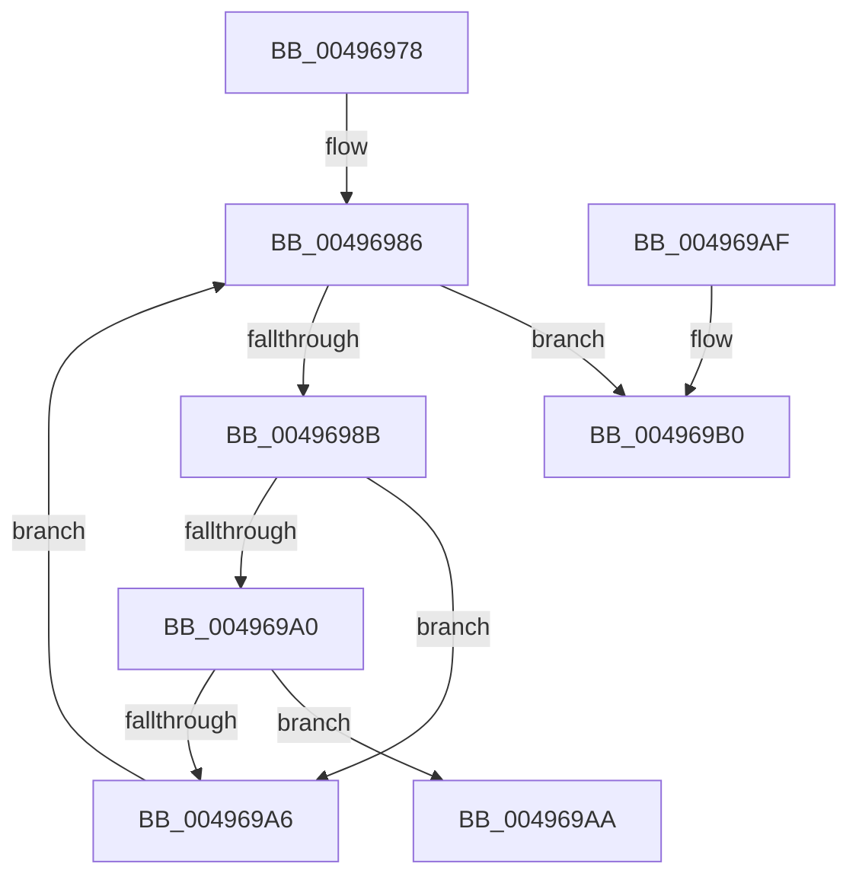

# MiNonPagedPoolToNode

- RVA: `0x00496978`–`0x004969CB` (길이 `83` bytes)
- VA: `0x0000000140496978`
- 실행 섹션: `.text`
- PDB 이름 있음: `예`; PDB Function 태그: `아니요`
- unwind 정보 RVA: `0x00082188`
- 디코드: `24`개 명령, `83/83` bytes 표시
- 미해석 바이트: `0` (있으면 어셈블리에 `.byte`로 보존)

> 이 문서는 커널 이미지의 기계어와 PDB 기호를 분석해 생성했습니다. 4번과 5번은 함수 원형과 자료형을 바이너리 사용 방식에서 추정한 C 해석이며 원본 소스 복구 결과는 아닙니다.

## 1. Dependencies

- 직접 호출 지점: **1**; 고유 호출 대상: **1**
- 직접 호출자로 확인된 함수: **1**
- RIP 상대 이미지 참조: **2**

### Outgoing calls
- `0x004969C5` → [KeBugCheckEx](../4F/KeBugCheckEx_function_004FD660.md) (function, `0x004FD660`)

### Direct callers
- [MiMakeSystemRangeAvailable](../4E/MiMakeSystemRangeAvailable_function_004EE174.md) at `0x004EE1AC`

### Static image references
- `0x0049697C` → RVA `0x00FC5000` (`ALMOSTRO`; read)
- `0x00496993` → RVA `0x00E2DBF8` (`.data`; read)

## 2. Other-region calls and transfers

- 다른 실행 섹션으로 향하는 call: **0**
- 별도 외부 분기/꼬리 이동을 확인하지 못했습니다.

## 3. Assembly (complete function range)

```asm
00496978  48 83 EC 38                     sub rsp, 0x38
0049697C  44 0F B7 0D 7C E6 B2 00         movzx r9d, word ptr [rip + 0xb2e67c]
00496984  33 C0                           xor eax, eax
00496986  41 3B C1                        cmp eax, r9d
00496989  73 25                           jae 0x1404969b0
0049698B  4C 8D 04 40                     lea r8, [rax + rax*2]
0049698F  49 C1 E0 07                     shl r8, 7
00496993  4C 03 05 5E 72 99 00            add r8, qword ptr [rip + 0x99725e]
0049699A  49 3B 48 68                     cmp rcx, qword ptr [r8 + 0x68]
0049699E  72 06                           jb 0x1404969a6
004969A0  49 3B 48 70                     cmp rcx, qword ptr [r8 + 0x70]
004969A4  72 04                           jb 0x1404969aa
004969A6  FF C0                           inc eax
004969A8  EB DC                           jmp 0x140496986
004969AA  48 83 C4 38                     add rsp, 0x38
004969AE  C3                              ret
004969AF  CC                              int3
004969B0  48 83 64 24 20 00               and qword ptr [rsp + 0x20], 0
004969B6  45 33 C9                        xor r9d, r9d
004969B9  4C 8B C1                        mov r8, rcx
004969BC  BA 09 53 00 00                  mov edx, 0x5309
004969C1  41 8D 49 1A                     lea ecx, [r9 + 0x1a]
004969C5  E8 96 6C 06 00                  call 0x1404fd660
004969CA  CC                              int3
```

## 4. C-style interpretation (structured pseudocode)

```c
__int64 __fastcall MiNonPagedPoolToNode(__int64 a1)
{
    __int64 result;
    __int64 v_rsp;
    unsigned __int64 v_stack_p20;

    v_rsp = (v_rsp) - (56);
    result = 0;
loc_00496986:
    if (0 >= ((unsigned int)(*(unsigned __int16 *)(v_rip + 11724412)))) goto loc_004969B0;
    a3 = (result + result * 2) << (7);
    a3 = (a3) + (*(unsigned __int64 *)(v_rip + 10056286));
    if (a1 < (*(unsigned __int64 *)(a3 + 104))) goto loc_004969A6;
    if (a1 < (*(unsigned __int64 *)(a3 + 112))) goto loc_004969AA;
loc_004969A6:
    result = (unsigned int)((result) + 1);
    goto loc_00496986;
loc_004969AA:
    v_rsp = (v_rsp) + (56);
    return result;
loc_004969B0:
    a4 = 0;
    result = KeBugCheckEx(a4 + 26, (unsigned int)(0x5309ULL), a1, a4);
    return result;
}
```

## 5. (Beta) C Style

```c
int64_t MiNonPagedPoolToNode(int64_t Arg1)
{
    int64_t result;
    int64_t local_rsp;
    uint64_t v_stack_p20;

    local_rsp = (local_rsp) - (56);
    result = 0;
loc_00496986:
    if (0 >= ((uint32_t)(*(uint16_t *)(v_rip + 0xB2E67C)))) goto loc_004969B0;
    a3 = (result + result * 2) << (7);
    a3 = (a3) + (*(uint64_t *)(v_rip + 0x99725E));
    if (Arg1 < (*(uint64_t *)(a3 + 0x68))) goto loc_004969A6;
    if (Arg1 < (*(uint64_t *)(a3 + 0x70))) goto loc_004969AA;
loc_004969A6:
    result = (uint32_t)((result) + 1);
    goto loc_00496986;
loc_004969AA:
    local_rsp = (local_rsp) + (56);
    return result;
loc_004969B0:
    a4 = 0;
    result = KeBugCheckEx(a4 + 26, (uint32_t)(0x5309ULL), Arg1, a4);
    return result;
}
```

## 6. Execution-region graph

[열기: 2D/3D 그래프와 함수 탐색 컨트롤 패널](../../../control-panel.html?section=text&rva=0x00496978&view=graph)

- 2D 그래프는 위에서 아래로 흐르고, 3D 그래프는 빈 공간을 드래그해 회전합니다. Shift+드래그는 이동, 휠은 확대·축소, 함수 노드 선택은 대상 보고서 이동입니다.

### Static fallback


