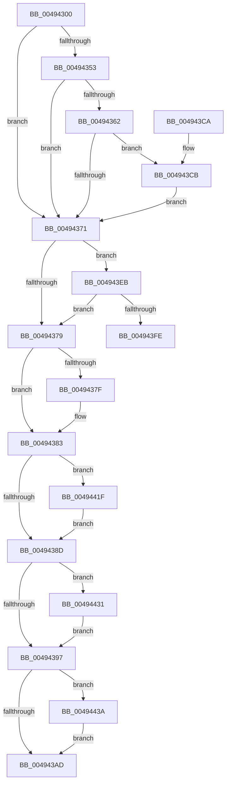

# MiPerformSafePdeWrite

- RVA: `0x00494300`–`0x0049444B` (길이 `331` bytes)
- VA: `0x0000000140494300`
- 실행 섹션: `.text`
- PDB 이름 있음: `예`; PDB Function 태그: `예`
- unwind 정보 RVA: `0x000B33C8`
- 디코드: `78`개 명령, `331/331` bytes 표시
- 미해석 바이트: `0` (있으면 어셈블리에 `.byte`로 보존)

> 이 문서는 커널 이미지의 기계어와 PDB 기호를 분석해 생성했습니다. 4번과 5번은 함수 원형과 자료형을 바이너리 사용 방식에서 추정한 C 해석이며 원본 소스 복구 결과는 아닙니다.

## 1. Dependencies

- 직접 호출 지점: **3**; 고유 호출 대상: **3**
- 직접 호출자로 확인된 함수: **2**
- RIP 상대 이미지 참조: **1**

### Outgoing calls
- `0x0049439D` → [MiWriteValidPteNewProtection](../28/MiWriteValidPteNewProtection_function_00281810.md) (function, `0x00281810`)
- `0x004943DA` → [ExAcquireSpinLockExclusiveAtDpcLevel](../24/ExAcquireSpinLockExclusiveAtDpcLevel_function_00248E80.md) (function, `0x00248E80`)
- `0x00494441` → [ExReleaseSpinLockExclusiveFromDpcLevel](../24/ExReleaseSpinLockExclusiveFromDpcLevel_function_002497E0.md) (function, `0x002497E0`)

### Direct callers
- [MiValidVirtualizationFault](../46/MiValidVirtualizationFault_function_00466EC0.md) at `0x00467043`
- [MiGetWsAndMakePageTablesNx](MiGetWsAndMakePageTablesNx_function_00494240.md) at `0x004942BD`

### Static image references
- `0x004943CB` → RVA `0x00E374C0` (`.data`; read)

## 2. Other-region calls and transfers

- 다른 실행 섹션으로 향하는 call: **0**
- call이 아닌 외부 분기/꼬리 이동: **1**
  - `0x0049441A` → [sub_006F7396](../6F/Unknown_function_006F7396.md) (`tail-transfer`)

## 3. Assembly (complete function range)

```asm
00494300  48 89 5C 24 08                  mov qword ptr [rsp + 8], rbx
00494305  48 89 6C 24 10                  mov qword ptr [rsp + 0x10], rbp
0049430A  48 89 74 24 18                  mov qword ptr [rsp + 0x18], rsi
0049430F  57                              push rdi
00494310  41 54                           push r12
00494312  41 55                           push r13
00494314  41 56                           push r14
00494316  41 57                           push r15
00494318  48 83 EC 20                     sub rsp, 0x20
0049431C  83 64 24 68 00                  and dword ptr [rsp + 0x68], 0
00494321  48 8B FA                        mov rdi, rdx
00494324  48 8B EA                        mov rbp, rdx
00494327  48 C1 E7 19                     shl rdi, 0x19
0049432B  45 8B F1                        mov r14d, r9d
0049432E  48 BA 00 00 00 00 80 F6 FF FF   movabs rdx, 0xfffff68000000000
00494338  49 8B D8                        mov rbx, r8
0049433B  48 8B C2                        mov rax, rdx
0049433E  48 C1 E0 19                     shl rax, 0x19
00494342  48 2B F8                        sub rdi, rax
00494345  8B 81 B8 00 00 00               mov eax, dword ptr [rcx + 0xb8]
0049434B  48 C1 FF 10                     sar rdi, 0x10
0049434F  A8 0F                           test al, 0xf
00494351  74 1E                           je 0x140494371
00494353  48 B8 00 D0 BE 7D FB F6 FF FF   movabs rax, 0xfffff6fb7dbed000
0049435D  48 3B E8                        cmp rbp, rax
00494360  72 0F                           jb 0x140494371
00494362  48 B8 FF DF BE 7D FB F6 FF FF   movabs rax, 0xfffff6fb7dbedfff
0049436C  48 3B E8                        cmp rbp, rax
0049436F  76 5A                           jbe 0x1404943cb
00494371  48 8B C2                        mov rax, rdx
00494374  48 3B F8                        cmp rdi, rax
00494377  73 72                           jae 0x1404943eb
00494379  41 F6 C6 01                     test r14b, 1
0049437D  74 04                           je 0x140494383
0049437F  48 83 CB 20                     or rbx, 0x20
00494383  41 F6 C6 02                     test r14b, 2
00494387  0F 85 92 00 00 00               jne 0x14049441f
0049438D  41 F6 C6 04                     test r14b, 4
00494391  0F 85 9A 00 00 00               jne 0x140494431
00494397  48 8B D3                        mov rdx, rbx
0049439A  48 8B CD                        mov rcx, rbp
0049439D  E8 6E D4 DE FF                  call 0x140281810
004943A2  83 7C 24 68 00                  cmp dword ptr [rsp + 0x68], 0
004943A7  0F 85 8D 00 00 00               jne 0x14049443a
004943AD  48 8B 5C 24 50                  mov rbx, qword ptr [rsp + 0x50]
004943B2  48 8B 6C 24 58                  mov rbp, qword ptr [rsp + 0x58]
004943B7  48 8B 74 24 60                  mov rsi, qword ptr [rsp + 0x60]
004943BC  48 83 C4 20                     add rsp, 0x20
004943C0  41 5F                           pop r15
004943C2  41 5E                           pop r14
004943C4  41 5D                           pop r13
004943C6  41 5C                           pop r12
004943C8  5F                              pop rdi
004943C9  C3                              ret
004943CA  CC                              int3
004943CB  48 8D 0D EE 30 9A 00            lea rcx, [rip + 0x9a30ee]
004943D2  C7 44 24 68 01 00 00 00         mov dword ptr [rsp + 0x68], 1
004943DA  E8 A1 4A DB FF                  call 0x140248e80
004943DF  48 BA 00 00 00 00 80 F6 FF FF   movabs rdx, 0xfffff68000000000
004943E9  EB 86                           jmp 0x140494371
004943EB  48 B8 FF FF FF FF FF F6 FF FF   movabs rax, 0xfffff6ffffffffff
004943F5  48 3B F8                        cmp rdi, rax
004943F8  0F 87 7B FF FF FF               ja 0x140494379
004943FE  45 8B E6                        mov r12d, r14d
00494401  45 8B EE                        mov r13d, r14d
00494404  41 83 E4 01                     and r12d, 1
00494408  41 83 E5 02                     and r13d, 2
0049440C  41 83 E6 04                     and r14d, 4
00494410  49 BF 00 00 00 00 00 00 00 80   movabs r15, 0x8000000000000000
0049441A  E9 77 2F 26 00                  jmp 0x1406f7396
0049441F  49 BF 00 00 00 00 00 00 00 80   movabs r15, 0x8000000000000000
00494429  49 0B DF                        or rbx, r15
0049442C  E9 5C FF FF FF                  jmp 0x14049438d
00494431  48 83 CB 04                     or rbx, 4
00494435  E9 5D FF FF FF                  jmp 0x140494397
0049443A  48 8D 0D 7F 30 9A 00            lea rcx, [rip + 0x9a307f]
00494441  E8 9A 53 DB FF                  call 0x1402497e0
00494446  E9 62 FF FF FF                  jmp 0x1404943ad
```

## 4. C-style interpretation (structured pseudocode)

```c
__int64 __fastcall MiPerformSafePdeWrite(__int64 a1, __int64 a2, __int64 a3, int a4)
{
    __int64 result;
    __int64 v_r12;
    __int64 v_r13;
    __int64 v_r14;
    __int64 v_rbx;
    __int64 v_rdi;
    __int64 v_rsp;
    unsigned __int64 v_stack_p10;
    unsigned __int64 v_stack_p18;
    unsigned int v_stack_p20;
    unsigned int v_stack_p68;
    unsigned __int64 v_stack_p8;

    v_stack_p8 = v_rbx;
    v_stack_p10 = v_rbp;
    v_stack_p18 = v_rsi;
    v_rsp = (v_rsp) - (32);
    v_rdi = (a2) << (25);
    result = (a2) << (25);
    v_rdi = (v_rdi) - (result);
    v_rdi = (v_rdi) >> (16);
    if ((((unsigned __int8)((unsigned int)(*(unsigned int *)(a1 + 184)))) & (15)) == 0) goto loc_00494371;
    if (a2 < ((unsigned int)(*(unsigned int *)(a1 + 184)))) goto loc_00494371;
    if (a2 <= ((unsigned int)(*(unsigned int *)(a1 + 184)))) goto loc_004943CB;
loc_00494371:
    if (v_rdi >= a2) goto loc_004943EB;
loc_00494379:
    v_rbx = a3;
    if ((((unsigned __int8)((unsigned int)(a4))) & (1)) != 0) {
        v_rbx = (a3) | (32);
    }
    if ((((unsigned __int8)((unsigned int)(a4))) & (2)) != 0) goto loc_0049441F;
loc_0049438D:
    if ((((unsigned __int8)((unsigned int)(a4))) & (4)) != 0) goto loc_00494431;
loc_00494397:
    result = MiWriteValidPteNewProtection(a2, v_rbx, a3, a4);
    if (v_stack_p20 != 0) goto loc_0049443A;
loc_004943AD:
    v_rsp = (v_rsp) + (32);
    return result;
loc_004943CB:
    v_stack_p68 = 1;
    result = ExAcquireSpinLockExclusiveAtDpcLevel(v_rip + 10105070, v_rbx, a3, a4);
    goto loc_00494371;
loc_004943EB:
    if (v_rdi > result) goto loc_00494379;
    v_r12 = (unsigned int)(((unsigned int)((unsigned int)((unsigned int)(a4)))) & (1));
    v_r13 = (unsigned int)(((unsigned int)((unsigned int)((unsigned int)(a4)))) & (2));
    v_r14 = (unsigned int)(((unsigned int)(a4)) & (4));
loc_0049441F:
    v_rbx = (v_stack_p8) | (v_r15);
    goto loc_0049438D;
loc_00494431:
    v_rbx = (v_rbx) | (4);
    goto loc_00494397;
loc_0049443A:
    result = ExReleaseSpinLockExclusiveFromDpcLevel(v_rip + 10104959, v_rbx, a3, a4);
    goto loc_004943AD;
}
```

## 5. (Beta) C Style

```c
int64_t MiPerformSafePdeWrite(void *Arg1, int64_t Arg2, int64_t Arg3, int32_t Arg4)
{
    uint8_t *arg1 = (uint8_t *)Arg1;

    int64_t result;
    int64_t local_r12;
    int64_t local_r13;
    int64_t local_r14;
    int64_t local_rbx;
    int64_t local_rdi;
    int64_t local_rsp;
    uint64_t v_stack_p10;
    uint64_t v_stack_p18;
    uint32_t v_stack_p20;
    uint32_t v_stack_p68;
    uint64_t v_stack_p8;

    v_stack_p8 = local_rbx;
    v_stack_p10 = local_rbp;
    v_stack_p18 = local_rsi;
    local_rsp = (local_rsp) - (32);
    local_rdi = (Arg2) << (25);
    result = (Arg2) << (25);
    local_rdi = (local_rdi) - (result);
    local_rdi = (local_rdi) >> (16);
    if ((((uint8_t)((uint32_t)(*(uint32_t *)(arg1 + 0xB8)))) & (15)) == 0) goto loc_00494371;
    if (Arg2 < ((uint32_t)(*(uint32_t *)(arg1 + 0xB8)))) goto loc_00494371;
    if (Arg2 <= ((uint32_t)(*(uint32_t *)(arg1 + 0xB8)))) goto loc_004943CB;
loc_00494371:
    if (local_rdi >= Arg2) goto loc_004943EB;
loc_00494379:
    local_rbx = Arg3;
    if ((((uint8_t)((uint32_t)(Arg4))) & (1)) != 0) {
        local_rbx = (Arg3) | (32);
    }
    if ((((uint8_t)((uint32_t)(Arg4))) & (2)) != 0) goto loc_0049441F;
loc_0049438D:
    if ((((uint8_t)((uint32_t)(Arg4))) & (4)) != 0) goto loc_00494431;
loc_00494397:
    result = MiWriteValidPteNewProtection(Arg2, local_rbx, Arg3, Arg4);
    if (v_stack_p20 != 0) goto loc_0049443A;
loc_004943AD:
    local_rsp = (local_rsp) + (32);
    return result;
loc_004943CB:
    v_stack_p68 = 1;
    result = ExAcquireSpinLockExclusiveAtDpcLevel(v_rip + 10105070, local_rbx, Arg3, Arg4);
    goto loc_00494371;
loc_004943EB:
    if (local_rdi > result) goto loc_00494379;
    local_r12 = (uint32_t)(((uint32_t)((uint32_t)((uint32_t)(Arg4)))) & (1));
    local_r13 = (uint32_t)(((uint32_t)((uint32_t)((uint32_t)(Arg4)))) & (2));
    local_r14 = (uint32_t)(((uint32_t)(Arg4)) & (4));
loc_0049441F:
    local_rbx = (v_stack_p8) | (local_r15);
    goto loc_0049438D;
loc_00494431:
    local_rbx = (local_rbx) | (4);
    goto loc_00494397;
loc_0049443A:
    result = ExReleaseSpinLockExclusiveFromDpcLevel(v_rip + 10104959, local_rbx, Arg3, Arg4);
    goto loc_004943AD;
}
```

### 관측된 메모리 오프셋

구조체 형식이 확인되지 않은 접근은 인자 기준의 오프셋으로만 기록했습니다.

| 기준 인자 | 오프셋 표현 | 폭 (bit) | 접근 |
|---|---:|---:|---|
| `Arg1` | `+ 0xB8` | `32` | `R` |

## 6. Execution-region graph

[열기: 2D/3D 그래프와 함수 탐색 컨트롤 패널](../../../control-panel.html?section=text&rva=0x00494300&view=graph)

- 2D 그래프는 위에서 아래로 흐르고, 3D 그래프는 빈 공간을 드래그해 회전합니다. Shift+드래그는 이동, 휠은 확대·축소, 함수 노드 선택은 대상 보고서 이동입니다.

### Static fallback


