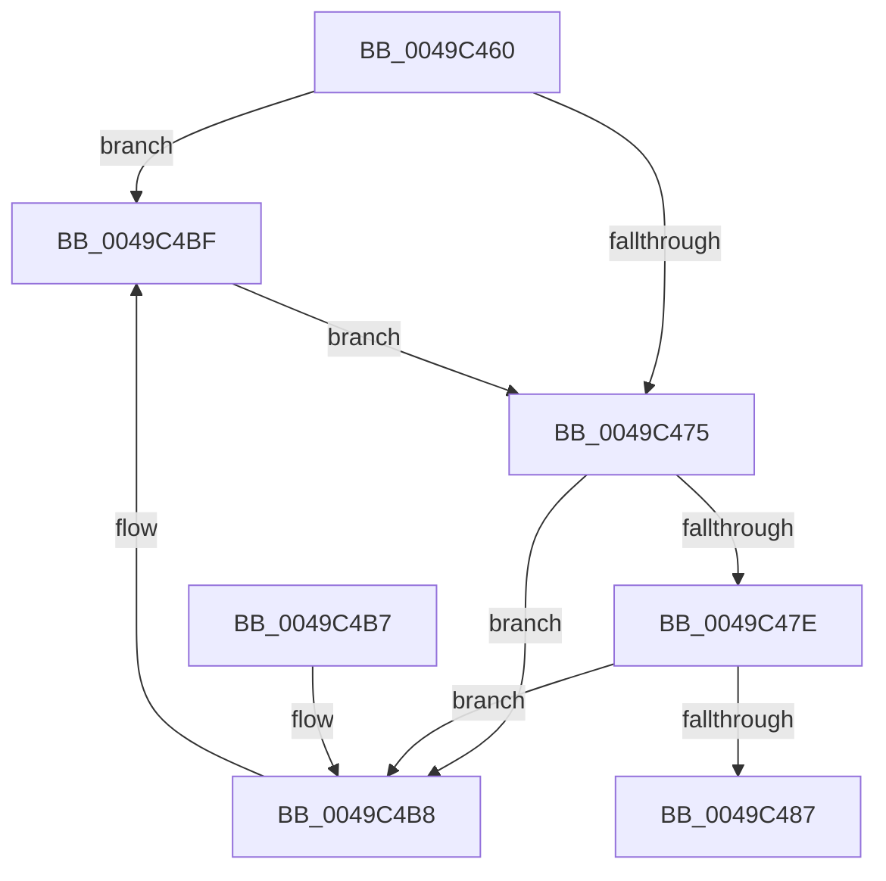

# MiPopLargePfnList

- RVA: `0x0049C460`–`0x0049C4C6` (길이 `102` bytes)
- VA: `0x000000014049C460`
- 실행 섹션: `.text`
- PDB 이름 있음: `예`; PDB Function 태그: `아니요`
- unwind 정보 RVA: `0x000704F4`
- 디코드: `29`개 명령, `102/102` bytes 표시
- 미해석 바이트: `0` (있으면 어셈블리에 `.byte`로 보존)

> 이 문서는 커널 이미지의 기계어와 PDB 기호를 분석해 생성했습니다. 4번과 5번은 함수 원형과 자료형을 바이너리 사용 방식에서 추정한 C 해석이며 원본 소스 복구 결과는 아닙니다.

## 1. Dependencies

- 직접 호출 지점: **1**; 고유 호출 대상: **1**
- 직접 호출자로 확인된 함수: **3**
- RIP 상대 이미지 참조: **0**

### Outgoing calls
- `0x0049C4BF` → [MiDemotePfnListChain](../69/MiDemotePfnListChain_function_00698B5C.md) (function, `0x00698B5C`)

### Direct callers
- [MiCommitExistingVad](../32/MiCommitExistingVad_function_0032A860.md) at `0x0032B1E6`
- [MiCreateSlabEntry](../37/MiCreateSlabEntry_function_00374DEC.md) at `0x00374FF8`
- [MiAllocateLargeProcessPagesFromCache](../69/MiAllocateLargeProcessPagesFromCache_function_0069818C.md) at `0x00698625`

### Static image references
- 디코드된 RIP-relative 메모리 참조가 없습니다.

## 2. Other-region calls and transfers

- 다른 실행 섹션으로 향하는 call: **0**
- 별도 외부 분기/꼬리 이동을 확인하지 못했습니다.

## 3. Assembly (complete function range)

```asm
0049C460  40 53                           push rbx
0049C462  48 83 EC 20                     sub rsp, 0x20
0049C466  8B C2                           mov eax, edx
0049C468  4C 8D 04 40                     lea r8, [rax + rax*2]
0049C46C  4A 8D 1C C1                     lea rbx, [rcx + r8*8]
0049C470  48 39 1B                        cmp qword ptr [rbx], rbx
0049C473  74 4A                           je 0x14049c4bf
0049C475  48 8B 03                        mov rax, qword ptr [rbx]
0049C478  48 39 58 08                     cmp qword ptr [rax + 8], rbx
0049C47C  75 3A                           jne 0x14049c4b8
0049C47E  48 8B 08                        mov rcx, qword ptr [rax]
0049C481  48 39 41 08                     cmp qword ptr [rcx + 8], rax
0049C485  75 31                           jne 0x14049c4b8
0049C487  48 89 0B                        mov qword ptr [rbx], rcx
0049C48A  48 89 59 08                     mov qword ptr [rcx + 8], rbx
0049C48E  48 FF 4B 10                     dec qword ptr [rbx + 0x10]
0049C492  48 B9 00 00 00 00 00 DE FF FF   movabs rcx, 0xffffde0000000000
0049C49C  48 2B C1                        sub rax, rcx
0049C49F  48 B9 AB AA AA AA AA AA AA AA   movabs rcx, 0xaaaaaaaaaaaaaaab
0049C4A9  48 C1 F8 04                     sar rax, 4
0049C4AD  48 0F AF C1                     imul rax, rcx
0049C4B1  48 83 C4 20                     add rsp, 0x20
0049C4B5  5B                              pop rbx
0049C4B6  C3                              ret
0049C4B7  CC                              int3
0049C4B8  B9 03 00 00 00                  mov ecx, 3
0049C4BD  CD 29                           int 0x29
0049C4BF  E8 98 C6 1F 00                  call 0x140698b5c
0049C4C4  EB AF                           jmp 0x14049c475
```

## 4. C-style interpretation (structured pseudocode)

```c
__int64 __fastcall MiPopLargePfnList(__int64 a1, int a2)
{
    __int64 result;
    __int64 v_rsp;

    v_rsp = (v_rsp) - (32);
    if ((*(unsigned __int64 *)(a1 + (unsigned int)(a2) + (unsigned int)(a2) * 2 * 8)) == (a1 + (unsigned int)(a2) + (unsigned int)(a2) * 2 * 8)) goto loc_0049C4BF;
loc_0049C475:
    if ((*(unsigned __int64 *)(*(unsigned __int64 *)(a1 + (unsigned int)(a2) + (unsigned int)(a2) * 2 * 8) + 8)) != (a1 + (unsigned int)(a2) + (unsigned int)(a2) * 2 * 8)) goto loc_0049C4B8;
    if ((*(unsigned __int64 *)(*(unsigned __int64 *)(*(unsigned __int64 *)(a1 + (unsigned int)(a2) + (unsigned int)(a2) * 2 * 8)) + 8)) != (*(unsigned __int64 *)(a1 + (unsigned int)(a2) + (unsigned int)(a2) * 2 * 8))) goto loc_0049C4B8;
    *(unsigned __int64 *)(a1 + (unsigned int)(a2) + (unsigned int)(a2) * 2 * 8) = *(unsigned __int64 *)(*(unsigned __int64 *)(a1 + (unsigned int)(a2) + (unsigned int)(a2) * 2 * 8));
    *(unsigned __int64 *)(*(unsigned __int64 *)(*(unsigned __int64 *)(a1 + (unsigned int)(a2) + (unsigned int)(a2) * 2 * 8)) + 8) = a1 + (unsigned int)(a2) + (unsigned int)(a2) * 2 * 8;
    result = (*(unsigned __int64 *)(a1 + (unsigned int)(a2) + (unsigned int)(a2) * 2 * 8)) - (*(unsigned __int64 *)(*(unsigned __int64 *)(a1 + (unsigned int)(a2) + (unsigned int)(a2) * 2 * 8)));
    result = (result) >> (4);
    result = (result) * (*(unsigned __int64 *)(*(unsigned __int64 *)(a1 + (unsigned int)(a2) + (unsigned int)(a2) * 2 * 8)));
    v_rsp = (v_rsp) + (32);
    return result;
loc_0049C4B8:
loc_0049C4BF:
    result = MiDemotePfnListChain(3, a2, (unsigned int)(a2) + (unsigned int)(a2) * 2, a4);
    goto loc_0049C475;
}
```

## 5. (Beta) C Style

```c
int64_t MiPopLargePfnList(void *Arg1, void *Arg2)
{
    uint8_t *arg1 = (uint8_t *)Arg1;
    uint8_t *arg2 = (uint8_t *)Arg2;

    int64_t result;
    int64_t local_rsp;

    local_rsp = (local_rsp) - (32);
    if ((*(uint64_t *)(arg1 + (uint32_t)(arg2) + (uint32_t)(arg2) * 2 * 8)) == (Arg1 + (uint32_t)(Arg2) + (uint32_t)(Arg2) * 2 * 8)) goto loc_0049C4BF;
loc_0049C475:
    if ((*(uint64_t *)(*(uint64_t *)(arg1 + (uint32_t)(arg2) + (uint32_t)(arg2) * 2 * 8) + 0x8)) != (Arg1 + (uint32_t)(Arg2) + (uint32_t)(Arg2) * 2 * 8)) goto loc_0049C4B8;
    if ((*(uint64_t *)(*(uint64_t *)(*(uint64_t *)(arg1 + (uint32_t)(arg2) + (uint32_t)(arg2) * 2 * 8)) + 0x8)) != (*(uint64_t *)(arg1 + (uint32_t)(arg2) + (uint32_t)(arg2) * 2 * 8))) goto loc_0049C4B8;
    *(uint64_t *)(arg1 + (uint32_t)(arg2) + (uint32_t)(arg2) * 2 * 8) = *(uint64_t *)(*(uint64_t *)(arg1 + (uint32_t)(arg2) + (uint32_t)(arg2) * 2 * 8));
    *(void **)(*(uint64_t *)(*(uint64_t *)(arg1 + (uint32_t)(arg2) + (uint32_t)(arg2) * 2 * 8)) + 0x8) = Arg1 + (uint32_t)(Arg2) + (uint32_t)(Arg2) * 2 * 8;
    result = (*(uint64_t *)(arg1 + (uint32_t)(arg2) + (uint32_t)(arg2) * 2 * 8)) - (*(uint64_t *)(*(uint64_t *)(arg1 + (uint32_t)(arg2) + (uint32_t)(arg2) * 2 * 8)));
    result = (result) >> (4);
    result = (result) * (*(uint64_t *)(*(uint64_t *)(arg1 + (uint32_t)(arg2) + (uint32_t)(arg2) * 2 * 8)));
    local_rsp = (local_rsp) + (32);
    return result;
loc_0049C4B8:
loc_0049C4BF:
    result = MiDemotePfnListChain(3, Arg2, (uint32_t)(Arg2) + (uint32_t)(Arg2) * 2, a4);
    goto loc_0049C475;
}
```

### 관측된 메모리 오프셋

구조체 형식이 확인되지 않은 접근은 인자 기준의 오프셋으로만 기록했습니다.

| 기준 인자 | 오프셋 표현 | 폭 (bit) | 접근 |
|---|---:|---:|---|
| `Arg1` | `+ 0x0` | `64` | `R` |
| `Arg1` | `+ 0x0` | `64` | `W` |
| `Arg1` | `+ 0x0 + r8*8` | `64` | `R` |
| `Arg1` | `+ 0x10` | `64` | `R/W` |
| `Arg2` | `+ 0x0 + rax*2` | `64` | `R` |

## 6. Execution-region graph

[열기: 2D/3D 그래프와 함수 탐색 컨트롤 패널](../../../control-panel.html?section=text&rva=0x0049C460&view=graph)

- 2D 그래프는 위에서 아래로 흐르고, 3D 그래프는 빈 공간을 드래그해 회전합니다. Shift+드래그는 이동, 휠은 확대·축소, 함수 노드 선택은 대상 보고서 이동입니다.

### Static fallback


