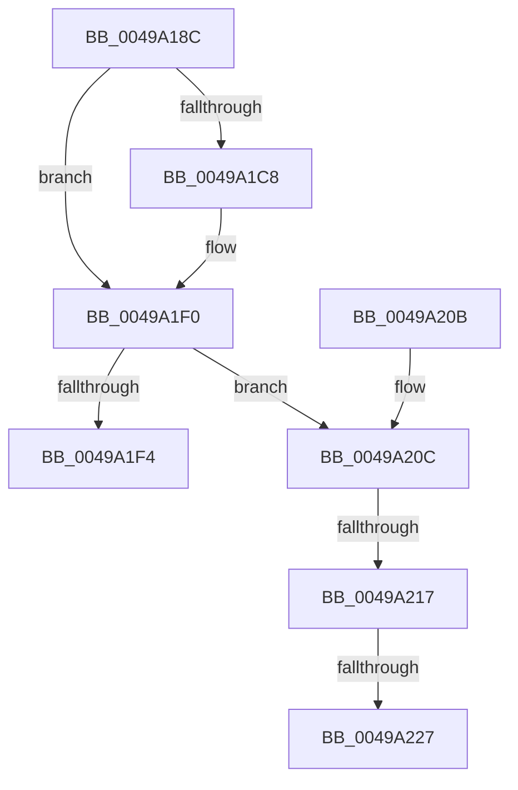

# MiProbeAndLockComplete

- RVA: `0x0049A18C`–`0x0049A239` (길이 `173` bytes)
- VA: `0x000000014049A18C`
- 실행 섹션: `.text`
- PDB 이름 있음: `예`; PDB Function 태그: `예`
- unwind 정보 RVA: `0x00098D4C`
- 디코드: `48`개 명령, `173/173` bytes 표시
- 미해석 바이트: `0` (있으면 어셈블리에 `.byte`로 보존)

> 이 문서는 커널 이미지의 기계어와 PDB 기호를 분석해 생성했습니다. 4번과 5번은 함수 원형과 자료형을 바이너리 사용 방식에서 추정한 C 해석이며 원본 소스 복구 결과는 아닙니다.

## 1. Dependencies

- 직접 호출 지점: **3**; 고유 호출 대상: **3**
- 직접 호출자로 확인된 함수: **2**
- RIP 상대 이미지 참조: **1**

### Outgoing calls
- `0x0049A1A8` → [MiUnlockProbePacketWorkingSet](../23/MiUnlockProbePacketWorkingSet_function_0023B800.md) (function, `0x0023B800`)
- `0x0049A1EB` → [MiAddMdlTracker](MiAddMdlTracker_function_0049A240.md) (function, `0x0049A240`)
- `0x0049A22E` → [MmUnlockPhysicalPagesByVa](../../page/7F/MmUnlockPhysicalPagesByVa_function_007FBA3C.md) (function, `0x007FBA3C`)

### Direct callers
- [sub_0023F815](../23/Unknown_function_0023F815.md) at `0x0023F9B3`
- [MmLockPhysicalPagesByVa](../../page/7F/MmLockPhysicalPagesByVa_function_007FB930.md) at `0x007FBA10`

### Static image references
- `0x0049A1B9` → RVA `0x00FC6BBC` (`ALMOSTRO`; read)

## 2. Other-region calls and transfers

- 다른 실행 섹션으로 향하는 call: **1**
  - `0x0049A22E` → [MmUnlockPhysicalPagesByVa](../../page/7F/MmUnlockPhysicalPagesByVa_function_007FBA3C.md) (`.text` → `PAGE`)
- call이 아닌 외부 분기/꼬리 이동: **3**
  - `0x0049A211` → [sub_006F793C + 0x36](../6F/Unknown_function_006F793C.md) (`tail-transfer`)
  - `0x0049A221` → [sub_006F793C](../6F/Unknown_function_006F793C.md) (`tail-transfer`)
  - `0x0049A234` → [sub_006F793C](../6F/Unknown_function_006F793C.md) (`tail-transfer`)

## 3. Assembly (complete function range)

```asm
0049A18C  48 89 5C 24 08                  mov qword ptr [rsp + 8], rbx
0049A191  48 89 6C 24 10                  mov qword ptr [rsp + 0x10], rbp
0049A196  48 89 74 24 18                  mov qword ptr [rsp + 0x18], rsi
0049A19B  57                              push rdi
0049A19C  48 83 EC 20                     sub rsp, 0x20
0049A1A0  41 8B E8                        mov ebp, r8d
0049A1A3  8B F2                           mov esi, edx
0049A1A5  48 8B D9                        mov rbx, rcx
0049A1A8  E8 53 16 DA FF                  call 0x14023b800
0049A1AD  F6 43 48 40                     test byte ptr [rbx + 0x48], 0x40
0049A1B1  48 8B 7B 40                     mov rdi, qword ptr [rbx + 0x40]
0049A1B5  41 0F 94 C1                     sete r9b
0049A1B9  F6 05 FC C9 B2 00 01            test byte ptr [rip + 0xb2c9fc], 1
0049A1C0  0F 95 C0                        setne al
0049A1C3  44 84 C8                        test al, r9b
0049A1C6  74 28                           je 0x14049a1f0
0049A1C8  8B 4F 2C                        mov ecx, dword ptr [rdi + 0x2c]
0049A1CB  44 8B C5                        mov r8d, ebp
0049A1CE  03 4F 20                        add ecx, dword ptr [rdi + 0x20]
0049A1D1  8B 57 28                        mov edx, dword ptr [rdi + 0x28]
0049A1D4  81 E1 FF 0F 00 00               and ecx, 0xfff
0049A1DA  48 81 C2 FF 0F 00 00            add rdx, 0xfff
0049A1E1  48 03 D1                        add rdx, rcx
0049A1E4  48 8B CF                        mov rcx, rdi
0049A1E7  48 C1 EA 0C                     shr rdx, 0xc
0049A1EB  E8 50 00 00 00                  call 0x14049a240
0049A1F0  85 F6                           test esi, esi
0049A1F2  78 18                           js 0x14049a20c
0049A1F4  48 8B 5C 24 30                  mov rbx, qword ptr [rsp + 0x30]
0049A1F9  8B C6                           mov eax, esi
0049A1FB  48 8B 74 24 40                  mov rsi, qword ptr [rsp + 0x40]
0049A200  48 8B 6C 24 38                  mov rbp, qword ptr [rsp + 0x38]
0049A205  48 83 C4 20                     add rsp, 0x20
0049A209  5F                              pop rdi
0049A20A  C3                              ret
0049A20B  CC                              int3
0049A20C  8B 43 48                        mov eax, dword ptr [rbx + 0x48]
0049A20F  A8 40                           test al, 0x40
0049A211  0F 84 5B D7 25 00               je 0x1406f7972
0049A217  48 8B 53 08                     mov rdx, qword ptr [rbx + 8]
0049A21B  48 8B 0B                        mov rcx, qword ptr [rbx]
0049A21E  48 3B D1                        cmp rdx, rcx
0049A221  0F 86 15 D7 25 00               jbe 0x1406f793c
0049A227  44 8B 4B 60                     mov r9d, dword ptr [rbx + 0x60]
0049A22B  48 2B D1                        sub rdx, rcx
0049A22E  E8 09 18 36 00                  call 0x1407fba3c
0049A233  90                              nop
0049A234  E9 03 D7 25 00                  jmp 0x1406f793c
```

## 4. C-style interpretation (structured pseudocode)

```c
__int64 __fastcall MiProbeAndLockComplete(__int64 a1, int a2, int a3)
{
    __int64 result;
    __int64 v_rsp;
    unsigned __int64 v_stack_p10;
    unsigned __int64 v_stack_p18;
    unsigned __int64 v_stack_p8;

    v_stack_p8 = v_rbx;
    v_stack_p10 = v_rbp;
    v_stack_p18 = v_rsi;
    v_rsp = (v_rsp) - (32);
    result = MiUnlockProbePacketWorkingSet(a1, a2, a3, a4);
    a4 = (((*(unsigned __int8 *)(a1 + 72)) & (64)) == 0) ? 1 : 0;
    result = (((*(unsigned __int8 *)(v_rip + 11717116)) & (1)) != 0) ? 1 : 0;
    if ((((unsigned __int8)(result)) & ((unsigned __int8)(a4))) != 0) {
        a1 = *(unsigned int *)(*(unsigned __int64 *)(a1 + 64) + 44);
        a3 = (unsigned int)((unsigned int)(a3));
        a1 = (unsigned int)((a1) + (*(unsigned int *)(*(unsigned __int64 *)(a1 + 64) + 32)));
        a2 = *(unsigned int *)(*(unsigned __int64 *)(a1 + 64) + 40);
        a1 = (unsigned int)((a1) & (0xFFFULL));
        a2 = (a2) + (0xFFFULL);
        a2 = (a2) + (a1);
        a1 = *(unsigned __int64 *)(a1 + 64);
        a2 = (a2) >> (12);
        result = MiAddMdlTracker(a1, a2, a3, a4);
    }
    if (sign_flag) goto loc_0049A20C;
    v_rsp = (v_rsp) + (32);
    return (unsigned int)((unsigned int)((unsigned int)(a2)));
loc_0049A20C:
    a2 = (*(unsigned __int64 *)(v_stack_p8 + 8)) - (*(unsigned __int64 *)(v_stack_p8));
    result = MmUnlockPhysicalPagesByVa(*(unsigned __int64 *)(v_stack_p8), a2, a3, (unsigned int)(*(unsigned int *)(v_stack_p8 + 96)));
}
```

## 5. (Beta) C Style

```c
int64_t MiProbeAndLockComplete(void *Arg1, int32_t Arg2, int32_t Arg3)
{
    uint8_t *arg1 = (uint8_t *)Arg1;

    int64_t result;
    int64_t local_rsp;
    uint64_t v_stack_p10;
    uint64_t v_stack_p18;
    uint64_t v_stack_p8;

    v_stack_p8 = local_rbx;
    v_stack_p10 = local_rbp;
    v_stack_p18 = local_rsi;
    local_rsp = (local_rsp) - (32);
    result = MiUnlockProbePacketWorkingSet(Arg1, Arg2, Arg3, a4);
    a4 = (((*(uint8_t *)(arg1 + 0x48)) & (64)) == 0) ? 1 : 0;
    result = (((*(uint8_t *)(v_rip + 0xB2C9FC)) & (1)) != 0) ? 1 : 0;
    if ((((uint8_t)(result)) & ((uint8_t)(a4))) != 0) {
        Arg1 = *(uint32_t *)(*(uint64_t *)(arg1 + 0x40) + 0x2C);
        Arg3 = (uint32_t)((uint32_t)(Arg3));
        Arg1 = (uint32_t)((Arg1) + (*(uint32_t *)(*(uint64_t *)(arg1 + 0x40) + 0x20)));
        Arg2 = *(uint32_t *)(*(uint64_t *)(arg1 + 0x40) + 0x28);
        Arg1 = (uint32_t)((Arg1) & (0xFFFULL));
        Arg2 = (Arg2) + (0xFFFULL);
        Arg2 = (Arg2) + (Arg1);
        Arg1 = *(uint64_t *)(arg1 + 0x40);
        Arg2 = (Arg2) >> (12);
        result = MiAddMdlTracker(Arg1, Arg2, Arg3, a4);
    }
    if (sign_flag) goto loc_0049A20C;
    local_rsp = (local_rsp) + (32);
    return (uint32_t)((uint32_t)((uint32_t)(Arg2)));
loc_0049A20C:
    Arg2 = (*(uint64_t *)(v_stack_p8 + 0x8)) - (*(uint64_t *)(v_stack_p8));
    result = MmUnlockPhysicalPagesByVa(*(uint64_t *)(v_stack_p8), Arg2, Arg3, (uint32_t)(*(uint32_t *)(v_stack_p8 + 0x60)));
}
```

### 관측된 메모리 오프셋

구조체 형식이 확인되지 않은 접근은 인자 기준의 오프셋으로만 기록했습니다.

| 기준 인자 | 오프셋 표현 | 폭 (bit) | 접근 |
|---|---:|---:|---|
| `Arg1` | `+ 0x0` | `64` | `R` |
| `Arg1` | `+ 0x8` | `64` | `R` |
| `Arg1` | `+ 0x40` | `64` | `R` |
| `Arg1` | `+ 0x48` | `8` | `R` |
| `Arg1` | `+ 0x48` | `32` | `R` |
| `Arg1` | `+ 0x60` | `32` | `R` |

## 6. Execution-region graph

[열기: 2D/3D 그래프와 함수 탐색 컨트롤 패널](../../../control-panel.html?section=text&rva=0x0049A18C&view=graph)

- 2D 그래프는 위에서 아래로 흐르고, 3D 그래프는 빈 공간을 드래그해 회전합니다. Shift+드래그는 이동, 휠은 확대·축소, 함수 노드 선택은 대상 보고서 이동입니다.

### Static fallback


