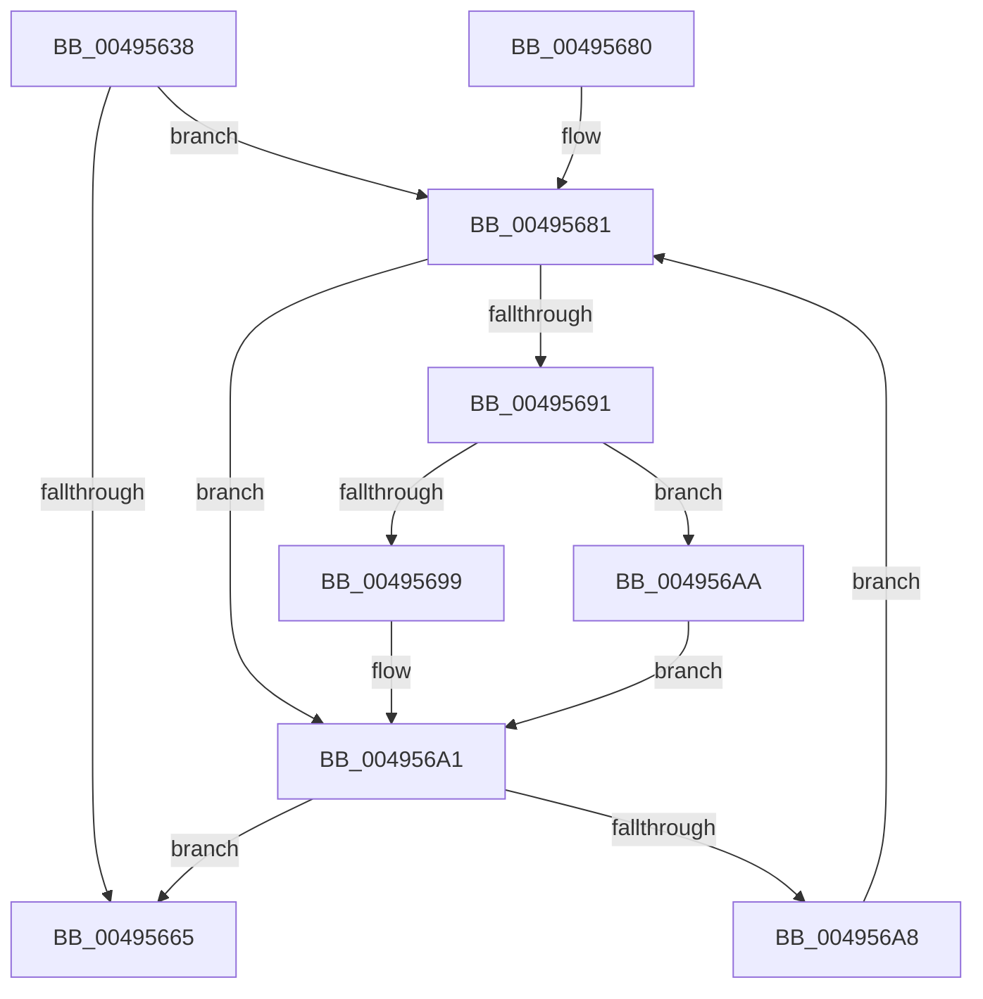

# MiPruneCachedStackList

- RVA: `0x00495638`–`0x004956C4` (길이 `140` bytes)
- VA: `0x0000000140495638`
- 실행 섹션: `.text`
- PDB 이름 있음: `예`; PDB Function 태그: `아니요`
- unwind 정보 RVA: `0x0009A1E4`
- 디코드: `42`개 명령, `140/140` bytes 표시
- 미해석 바이트: `0` (있으면 어셈블리에 `.byte`로 보존)

> 이 문서는 커널 이미지의 기계어와 PDB 기호를 분석해 생성했습니다. 4번과 5번은 함수 원형과 자료형을 바이너리 사용 방식에서 추정한 C 해석이며 원본 소스 복구 결과는 아닙니다.

## 1. Dependencies

- 직접 호출 지점: **4**; 고유 호출 대상: **4**
- 직접 호출자로 확인된 함수: **2**
- RIP 상대 이미지 참조: **0**

### Outgoing calls
- `0x00495684` → [ExpInterlockedPopEntrySList](../6B/ExpInterlockedPopEntrySList_function_006BA570.md) (function, `0x006BA570`)
- `0x0049569C` → [MiDeleteCachedKernelStack](../2D/MiDeleteCachedKernelStack_function_002D986C.md) (function, `0x002D986C`)
- `0x004956AE` → [MiDeleteCachedKernelShadowStack](MiDeleteCachedKernelShadowStack_function_004956CC.md) (function, `0x004956CC`)
- `0x004956BD` → [ExpInterlockedPushEntrySList](../6B/ExpInterlockedPushEntrySList_function_006BA5B0.md) (function, `0x006BA5B0`)

### Direct callers
- [MiAdjustCachedStackList](../2D/MiAdjustCachedStackList_function_002D8C10.md) at `0x002D8CC4`
- [sub_006DDD38](../6D/Unknown_function_006DDD38.md) at `0x006DDD3E`

### Static image references
- 디코드된 RIP-relative 메모리 참조가 없습니다.

## 2. Other-region calls and transfers

- 다른 실행 섹션으로 향하는 call: **0**
- 별도 외부 분기/꼬리 이동을 확인하지 못했습니다.

## 3. Assembly (complete function range)

```asm
00495638  48 8B C4                        mov rax, rsp
0049563B  48 89 58 08                     mov qword ptr [rax + 8], rbx
0049563F  48 89 68 10                     mov qword ptr [rax + 0x10], rbp
00495643  48 89 70 18                     mov qword ptr [rax + 0x18], rsi
00495647  48 89 78 20                     mov qword ptr [rax + 0x20], rdi
0049564B  41 56                           push r14
0049564D  48 83 EC 20                     sub rsp, 0x20
00495651  0F B7 02                        movzx eax, word ptr [rdx]
00495654  45 8B F1                        mov r14d, r9d
00495657  41 8B E8                        mov ebp, r8d
0049565A  48 8B FA                        mov rdi, rdx
0049565D  48 8B F1                        mov rsi, rcx
00495660  41 3B C0                        cmp eax, r8d
00495663  77 1C                           ja 0x140495681
00495665  48 8B 5C 24 30                  mov rbx, qword ptr [rsp + 0x30]
0049566A  48 8B 6C 24 38                  mov rbp, qword ptr [rsp + 0x38]
0049566F  48 8B 74 24 40                  mov rsi, qword ptr [rsp + 0x40]
00495674  48 8B 7C 24 48                  mov rdi, qword ptr [rsp + 0x48]
00495679  48 83 C4 20                     add rsp, 0x20
0049567D  41 5E                           pop r14
0049567F  C3                              ret
00495680  CC                              int3
00495681  48 8B CF                        mov rcx, rdi
00495684  E8 E7 4E 22 00                  call 0x1406ba570
00495689  48 8B D8                        mov rbx, rax
0049568C  48 85 C0                        test rax, rax
0049568F  74 10                           je 0x1404956a1
00495691  48 8B CE                        mov rcx, rsi
00495694  45 85 F6                        test r14d, r14d
00495697  75 11                           jne 0x1404956aa
00495699  48 8B D0                        mov rdx, rax
0049569C  E8 CB 41 E4 FF                  call 0x1402d986c
004956A1  0F B7 07                        movzx eax, word ptr [rdi]
004956A4  3B C5                           cmp eax, ebp
004956A6  76 BD                           jbe 0x140495665
004956A8  EB D7                           jmp 0x140495681
004956AA  48 8B 50 10                     mov rdx, qword ptr [rax + 0x10]
004956AE  E8 19 00 00 00                  call 0x1404956cc
004956B3  48 8D 8E C0 01 00 00            lea rcx, [rsi + 0x1c0]
004956BA  48 8B D3                        mov rdx, rbx
004956BD  E8 EE 4E 22 00                  call 0x1406ba5b0
004956C2  EB DD                           jmp 0x1404956a1
```

## 4. C-style interpretation (structured pseudocode)

```c
__int64 __fastcall MiPruneCachedStackList(__int64 a1, __int64 a2, int a3, int a4)
{
    __int64 result;
    __int64 v_rsp;
    unsigned __int64 v_stack_p10;
    unsigned __int64 v_stack_p18;
    unsigned __int64 v_stack_p20;
    unsigned __int64 v_stack_p8;

    *(unsigned __int64 *)(v_rsp + 8) = v_rbx;
    *(unsigned __int64 *)(v_rsp + 16) = v_rbp;
    *(unsigned __int64 *)(v_rsp + 24) = v_rsi;
    *(unsigned __int64 *)(v_rsp + 32) = v_rdi;
    v_rsp = (v_rsp) - (32);
    if (((unsigned int)(*(unsigned __int16 *)(a2))) > a3) goto loc_00495681;
loc_00495665:
    v_rsp = (v_rsp) + (32);
    return *(unsigned __int16 *)(a2);
loc_00495681:
    result = ExpInterlockedPopEntrySList(v_stack_p20, a2, a3, a4);
    if (result == 0) goto loc_004956A1;
    if ((unsigned int)((unsigned int)(a4)) != 0) goto loc_004956AA;
    result = MiDeleteCachedKernelStack(v_stack_p18, result, a3, a4);
loc_004956A1:
    if (((unsigned int)(*(unsigned __int16 *)(v_stack_p20))) <= ((unsigned int)(v_stack_p10))) goto loc_00495665;
    goto loc_00495681;
loc_004956AA:
    result = MiDeleteCachedKernelShadowStack(v_stack_p18, *(unsigned __int64 *)(*(unsigned __int16 *)(v_stack_p20) + 16), a3, a4);
    result = ExpInterlockedPushEntrySList(v_stack_p18 + 448, result, a3, a4);
    goto loc_004956A1;
}
```

## 5. (Beta) C Style

```c
int64_t MiPruneCachedStackList(void *Arg1, void *Arg2, int32_t Arg3, int32_t Arg4)
{
    uint8_t *arg1 = (uint8_t *)Arg1;
    uint8_t *arg2 = (uint8_t *)Arg2;

    int64_t result;
    int64_t local_rsp;
    uint64_t v_stack_p10;
    uint64_t v_stack_p18;
    uint64_t v_stack_p20;
    uint64_t v_stack_p8;

    *(uint64_t *)(local_rsp + 0x8) = local_rbx;
    *(uint64_t *)(local_rsp + 0x10) = local_rbp;
    *(uint64_t *)(local_rsp + 0x18) = local_rsi;
    *(uint64_t *)(local_rsp + 0x20) = local_rdi;
    local_rsp = (local_rsp) - (32);
    if (((uint32_t)(*(uint16_t *)(arg2))) > Arg3) goto loc_00495681;
loc_00495665:
    local_rsp = (local_rsp) + (32);
    return *(uint16_t *)(arg2);
loc_00495681:
    result = ExpInterlockedPopEntrySList(v_stack_p20, Arg2, Arg3, Arg4);
    if (result == 0) goto loc_004956A1;
    if ((uint32_t)((uint32_t)(Arg4)) != 0) goto loc_004956AA;
    result = MiDeleteCachedKernelStack(v_stack_p18, result, Arg3, Arg4);
loc_004956A1:
    if (((uint32_t)(*(uint16_t *)(v_stack_p20))) <= ((uint32_t)(v_stack_p10))) goto loc_00495665;
    goto loc_00495681;
loc_004956AA:
    result = MiDeleteCachedKernelShadowStack(v_stack_p18, *(uint64_t *)(*(uint16_t *)(v_stack_p20) + 0x10), Arg3, Arg4);
    result = ExpInterlockedPushEntrySList(v_stack_p18 + 448, result, Arg3, Arg4);
    goto loc_004956A1;
}
```

### 관측된 메모리 오프셋

구조체 형식이 확인되지 않은 접근은 인자 기준의 오프셋으로만 기록했습니다.

| 기준 인자 | 오프셋 표현 | 폭 (bit) | 접근 |
|---|---:|---:|---|
| `Arg1` | `+ 0x1C0` | `64` | `R` |
| `Arg2` | `+ 0x0` | `16` | `R` |

## 6. Execution-region graph

[열기: 2D/3D 그래프와 함수 탐색 컨트롤 패널](../../../control-panel.html?section=text&rva=0x00495638&view=graph)

- 2D 그래프는 위에서 아래로 흐르고, 3D 그래프는 빈 공간을 드래그해 회전합니다. Shift+드래그는 이동, 휠은 확대·축소, 함수 노드 선택은 대상 보고서 이동입니다.

### Static fallback


