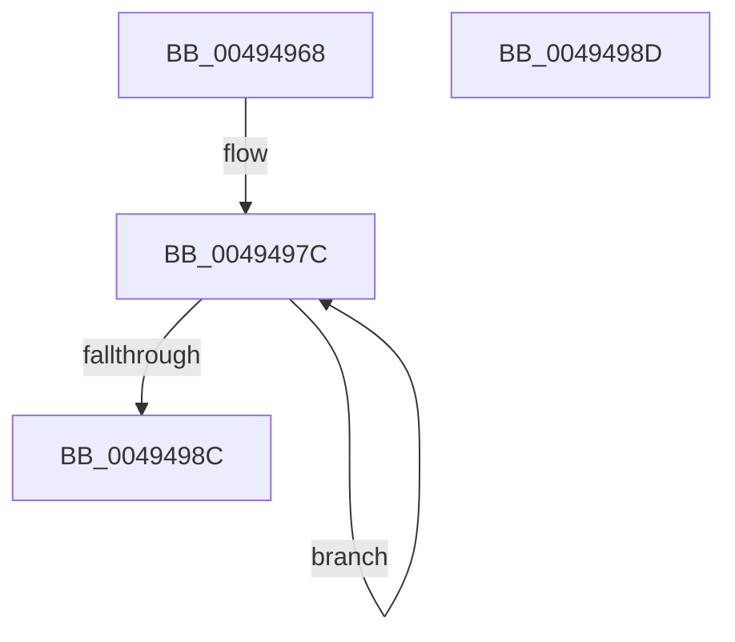

# MiReadProcessNumberOfLockedPages

- RVA: `0x00494968`–`0x0049498E` (길이 `38` bytes)
- VA: `0x0000000140494968`
- 실행 섹션: `.text`
- PDB 이름 있음: `예`; PDB Function 태그: `아니요`
- unwind 정보 RVA: `0x000DB714`
- 디코드: `11`개 명령, `38/38` bytes 표시
- 미해석 바이트: `0` (있으면 어셈블리에 `.byte`로 보존)

> 이 문서는 커널 이미지의 기계어와 PDB 기호를 분석해 생성했습니다. 4번과 5번은 함수 원형과 자료형을 바이너리 사용 방식에서 추정한 C 해석이며 원본 소스 복구 결과는 아닙니다.

## 1. Dependencies

- 직접 호출 지점: **0**; 고유 호출 대상: **0**
- 직접 호출자로 확인된 함수: **3**
- RIP 상대 이미지 참조: **0**

### Outgoing calls
- 직접 디코드된 call 명령이 없습니다.

### Direct callers
- [MiFreeMdlTracker](MiFreeMdlTracker_function_00494838.md) at `0x004948C0`
- [MmUpdateMdlTrackerForMdlSwitch](../67/MmUpdateMdlTrackerForMdlSwitch_function_00674298.md) at `0x00674344`
- [MmUpdateMdlTrackerForMdlSwitch](../67/MmUpdateMdlTrackerForMdlSwitch_function_00674298.md) at `0x006743D3`
- [MmDeleteProcessAddressSpace](../../page/AC/MmDeleteProcessAddressSpace_function_00AC804C.md) at `0x00AC8085`

### Static image references
- 디코드된 RIP-relative 메모리 참조가 없습니다.

## 2. Other-region calls and transfers

- 다른 실행 섹션으로 향하는 call: **0**
- 별도 외부 분기/꼬리 이동을 확인하지 못했습니다.

## 3. Assembly (complete function range)

```asm
00494968  48 8B 91 10 04 00 00            mov rdx, qword ptr [rcx + 0x410]
0049496F  48 81 C2 00 02 00 00            add rdx, 0x200
00494976  33 C0                           xor eax, eax
00494978  44 8D 40 04                     lea r8d, [rax + 4]
0049497C  48 8B 0A                        mov rcx, qword ptr [rdx]
0049497F  48 8D 52 40                     lea rdx, [rdx + 0x40]
00494983  48 03 C1                        add rax, rcx
00494986  49 83 E8 01                     sub r8, 1
0049498A  75 F0                           jne 0x14049497c
0049498C  C3                              ret
0049498D  CC                              int3
```

## 4. C-style interpretation (structured pseudocode)

```c
__int64 __fastcall MiReadProcessNumberOfLockedPages(__int64 a1)
{
    __int64 result;

    a2 = (*(unsigned __int64 *)(a1 + 1040)) + (512);
    result = 0;
loc_0049497C:
    result = (result) + (*(unsigned __int64 *)(a2));
    a3 = (result + 4) - (1);
    if (condition_is_not_equal) goto loc_0049497C;
    return result;
}
```

## 5. (Beta) C Style

```c
int64_t MiReadProcessNumberOfLockedPages(void *Arg1)
{
    uint8_t *arg1 = (uint8_t *)Arg1;

    int64_t result;

    a2 = (*(uint64_t *)(arg1 + 0x410)) + (512);
    result = 0;
loc_0049497C:
    result = (result) + (*(uint64_t *)(a2));
    a3 = (result + 4) - (1);
    if (condition_is_not_equal) goto loc_0049497C;
    return result;
}
```

### 관측된 메모리 오프셋

구조체 형식이 확인되지 않은 접근은 인자 기준의 오프셋으로만 기록했습니다.

| 기준 인자 | 오프셋 표현 | 폭 (bit) | 접근 |
|---|---:|---:|---|
| `Arg1` | `+ 0x410` | `64` | `R` |

## 6. Execution-region graph

[열기: 2D/3D 그래프와 함수 탐색 컨트롤 패널](../../../control-panel.html?section=text&rva=0x00494968&view=graph)

- 2D 그래프는 위에서 아래로 흐르고, 3D 그래프는 빈 공간을 드래그해 회전합니다. Shift+드래그는 이동, 휠은 확대·축소, 함수 노드 선택은 대상 보고서 이동입니다.

### Static fallback


