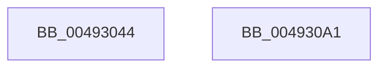

# MiReleaseImageSection

- RVA: `0x00493044`–`0x004930A2` (길이 `94` bytes)
- VA: `0x0000000140493044`
- 실행 섹션: `.text`
- PDB 이름 있음: `예`; PDB Function 태그: `아니요`
- unwind 정보 RVA: `0x0005C954`
- 디코드: `25`개 명령, `94/94` bytes 표시
- 미해석 바이트: `0` (있으면 어셈블리에 `.byte`로 보존)

> 이 문서는 커널 이미지의 기계어와 PDB 기호를 분석해 생성했습니다. 4번과 5번은 함수 원형과 자료형을 바이너리 사용 방식에서 추정한 C 해석이며 원본 소스 복구 결과는 아닙니다.

## 1. Dependencies

- 직접 호출 지점: **3**; 고유 호출 대상: **3**
- 직접 호출자로 확인된 함수: **1**
- RIP 상대 이미지 참조: **0**

### Outgoing calls
- `0x00493063` → [ExAcquireSpinLockExclusive](../24/ExAcquireSpinLockExclusive_function_00248690.md) (function, `0x00248690`)
- `0x0049307B` → [MiReleaseSpinLockExclusive](../24/MiReleaseSpinLockExclusive_function_002482C0.md) (function, `0x002482C0`)
- `0x00493084` → [KeAbPostRelease](../2E/KeAbPostRelease_function_002E1600.md) (function, `0x002E1600`)

### Direct callers
- [MiCreateNewSection](../../page/98/MiCreateNewSection_function_00985DB0.md) at `0x00986218`

### Static image references
- 디코드된 RIP-relative 메모리 참조가 없습니다.

## 2. Other-region calls and transfers

- 다른 실행 섹션으로 향하는 call: **0**
- 별도 외부 분기/꼬리 이동을 확인하지 못했습니다.

## 3. Assembly (complete function range)

```asm
00493044  48 89 5C 24 08                  mov qword ptr [rsp + 8], rbx
00493049  48 89 6C 24 10                  mov qword ptr [rsp + 0x10], rbp
0049304E  48 89 74 24 18                  mov qword ptr [rsp + 0x18], rsi
00493053  57                              push rdi
00493054  48 83 EC 20                     sub rsp, 0x20
00493058  48 8B 69 28                     mov rbp, qword ptr [rcx + 0x28]
0049305C  48 8B F2                        mov rsi, rdx
0049305F  48 8D 4A 48                     lea rcx, [rdx + 0x48]
00493063  E8 28 56 DB FF                  call 0x140248690
00493068  48 8B 5E 50                     mov rbx, qword ptr [rsi + 0x50]
0049306C  48 8D 4E 48                     lea rcx, [rsi + 0x48]
00493070  48 83 66 50 00                  and qword ptr [rsi + 0x50], 0
00493075  8A D0                           mov dl, al
00493077  83 66 38 FD                     and dword ptr [rsi + 0x38], 0xfffffffd
0049307B  E8 40 52 DB FF                  call 0x1402482c0
00493080  48 8D 4D 10                     lea rcx, [rbp + 0x10]
00493084  E8 77 E5 E4 FF                  call 0x1402e1600
00493089  48 8B 6C 24 38                  mov rbp, qword ptr [rsp + 0x38]
0049308E  48 8B C3                        mov rax, rbx
00493091  48 8B 5C 24 30                  mov rbx, qword ptr [rsp + 0x30]
00493096  48 8B 74 24 40                  mov rsi, qword ptr [rsp + 0x40]
0049309B  48 83 C4 20                     add rsp, 0x20
0049309F  5F                              pop rdi
004930A0  C3                              ret
004930A1  CC                              int3
```

## 4. C-style interpretation (structured pseudocode)

```c
__int64 __fastcall MiReleaseImageSection(__int64 a1, __int64 a2)
{
    __int64 result;
    __int64 v_rsp;
    unsigned __int64 v_stack_p10;
    unsigned __int64 v_stack_p18;
    unsigned __int64 v_stack_p8;

    v_stack_p8 = v_rbx;
    v_stack_p10 = v_rbp;
    v_stack_p18 = v_rsi;
    v_rsp = (v_rsp) - (32);
    result = ExAcquireSpinLockExclusive(a2 + 72, a2, a3, a4);
    result = MiReleaseSpinLockExclusive(a2 + 72, (unsigned __int8)(result), a3, a4);
    result = KeAbPostRelease(*(unsigned __int64 *)(a1 + 40) + 16, (unsigned __int8)(result), a3, a4);
    v_rsp = (v_rsp) + (32);
    return *(unsigned __int64 *)(a2 + 80);
}
```

## 5. (Beta) C Style

```c
int64_t MiReleaseImageSection(void *Arg1, void *Arg2)
{
    uint8_t *arg1 = (uint8_t *)Arg1;
    uint8_t *arg2 = (uint8_t *)Arg2;

    int64_t result;
    int64_t local_rsp;
    uint64_t v_stack_p10;
    uint64_t v_stack_p18;
    uint64_t v_stack_p8;

    v_stack_p8 = local_rbx;
    v_stack_p10 = local_rbp;
    v_stack_p18 = local_rsi;
    local_rsp = (local_rsp) - (32);
    result = ExAcquireSpinLockExclusive(Arg2 + 72, Arg2, a3, a4);
    result = MiReleaseSpinLockExclusive(Arg2 + 72, (uint8_t)(result), a3, a4);
    result = KeAbPostRelease(*(uint64_t *)(arg1 + 0x28) + 16, (uint8_t)(result), a3, a4);
    local_rsp = (local_rsp) + (32);
    return *(uint64_t *)(arg2 + 0x50);
}
```

### 관측된 메모리 오프셋

구조체 형식이 확인되지 않은 접근은 인자 기준의 오프셋으로만 기록했습니다.

| 기준 인자 | 오프셋 표현 | 폭 (bit) | 접근 |
|---|---:|---:|---|
| `Arg1` | `+ 0x28` | `64` | `R` |
| `Arg2` | `+ 0x38` | `32` | `R/W` |
| `Arg2` | `+ 0x48` | `64` | `R` |
| `Arg2` | `+ 0x50` | `64` | `R` |
| `Arg2` | `+ 0x50` | `64` | `R/W` |

## 6. Execution-region graph

[열기: 2D/3D 그래프와 함수 탐색 컨트롤 패널](../../../control-panel.html?section=text&rva=0x00493044&view=graph)

- 2D 그래프는 위에서 아래로 흐르고, 3D 그래프는 빈 공간을 드래그해 회전합니다. Shift+드래그는 이동, 휠은 확대·축소, 함수 노드 선택은 대상 보고서 이동입니다.

### Static fallback


