# MiReleaseLargePdeMappings

- RVA: `0x0049D0B0`–`0x0049D3E8` (길이 `824` bytes)
- VA: `0x000000014049D0B0`
- 실행 섹션: `.text`
- PDB 이름 있음: `예`; PDB Function 태그: `아니요`
- unwind 정보 RVA: `0x000B4EE0`
- 디코드: `194`개 명령, `824/824` bytes 표시
- 미해석 바이트: `0` (있으면 어셈블리에 `.byte`로 보존)

> 이 문서는 커널 이미지의 기계어와 PDB 기호를 분석해 생성했습니다. 4번과 5번은 함수 원형과 자료형을 바이너리 사용 방식에서 추정한 C 해석이며 원본 소스 복구 결과는 아닙니다.

## 1. Dependencies

- 직접 호출 지점: **14**; 고유 호출 대상: **13**
- 직접 호출자로 확인된 함수: **1**
- RIP 상대 이미지 참조: **4**

### Outgoing calls
- `0x0049D0F9` → [memset](../6C/memset_function_006C6C40.md) (function, `0x006C6C40`)
- `0x0049D154` → [MiInitializeTbFlushList](../29/MiInitializeTbFlushList_function_00294F00.md) (function, `0x00294F00`)
- `0x0049D16F` → [MiMakeDemandZeroPte](../33/MiMakeDemandZeroPte_function_00337A00.md) (function, `0x00337A00`)
- `0x0049D230` → [MiLockWorkingSetShared](../27/MiLockWorkingSetShared_function_0027CBF0.md) (function, `0x0027CBF0`)
- `0x0049D2A8` → [MiUnlockPageTable](../21/MiUnlockPageTable_function_00216EC0.md) (function, `0x00216EC0`)
- `0x0049D2B3` → [MiUnlockWorkingSetShared](../27/MiUnlockWorkingSetShared_function_0027D690.md) (function, `0x0027D690`)
- `0x0049D2D3` → [MiReturnSystemVa](../23/MiReturnSystemVa_function_002394C4.md) (function, `0x002394C4`)
- `0x0049D303` → [_security_check_cookie](../6A/_security_check_cookie_function_006AC640.md) (function, `0x006AC640`)
- `0x0049D33E` → [MiLockNestedPageTable](../23/MiLockNestedPageTable_function_0023E890.md) (function, `0x0023E890`)
- `0x0049D350` → [MiLockWorkingSetSharedAtDpc](../23/MiLockWorkingSetSharedAtDpc_function_00239574.md) (function, `0x00239574`)
- `0x0049D385` → [MiUnlockPageTable](../21/MiUnlockPageTable_function_00216EC0.md) (function, `0x00216EC0`)
- `0x0049D39C` → [MiInsertLargeTbFlushEntry](../37/MiInsertLargeTbFlushEntry_function_0037827C.md) (function, `0x0037827C`)
- `0x0049D3AE` → [MiFlushTbList](../31/MiFlushTbList_function_00311FC0.md) (function, `0x00311FC0`)
- `0x0049D3D7` → [MiTbFlushTimeStampMayNeedFlush](../45/MiTbFlushTimeStampMayNeedFlush_function_004584B8.md) (function, `0x004584B8`)

### Direct callers
- [sub_00238582](../23/Unknown_function_00238582.md) at `0x0023858B`

### Static image references
- `0x0049D0C7` → RVA `0x00E0A740` (`.data`; read)
- `0x0049D135` → RVA `0x00E38200` (`.data`; read)
- `0x0049D1A1` → RVA `0x00E2DC80` (`.data`; read)
- `0x0049D3CC` → RVA `0x00FCF080` (`CACHEALI`; read)

## 2. Other-region calls and transfers

- 다른 실행 섹션으로 향하는 call: **0**
- 별도 외부 분기/꼬리 이동을 확인하지 못했습니다.

## 3. Assembly (complete function range)

```asm
0049D0B0  48 89 5C 24 18                  mov qword ptr [rsp + 0x18], rbx
0049D0B5  55                              push rbp
0049D0B6  56                              push rsi
0049D0B7  57                              push rdi
0049D0B8  41 54                           push r12
0049D0BA  41 55                           push r13
0049D0BC  41 56                           push r14
0049D0BE  41 57                           push r15
0049D0C0  48 81 EC 60 01 00 00            sub rsp, 0x160
0049D0C7  48 8B 05 72 D6 96 00            mov rax, qword ptr [rip + 0x96d672]
0049D0CE  48 33 C4                        xor rax, rsp
0049D0D1  48 89 84 24 50 01 00 00         mov qword ptr [rsp + 0x150], rax
0049D0D9  44 89 44 24 34                  mov dword ptr [rsp + 0x34], r8d
0049D0DE  48 8B FA                        mov rdi, rdx
0049D0E1  48 89 54 24 58                  mov qword ptr [rsp + 0x58], rdx
0049D0E6  48 8B D9                        mov rbx, rcx
0049D0E9  33 D2                           xor edx, edx
0049D0EB  48 8D 8C 24 80 00 00 00         lea rcx, [rsp + 0x80]
0049D0F3  41 B8 C8 00 00 00               mov r8d, 0xc8
0049D0F9  E8 42 9B 22 00                  call 0x1406c6c40
0049D0FE  48 8B 73 20                     mov rsi, qword ptr [rbx + 0x20]
0049D102  48 B8 F8 FF FF FF 7F 00 00 00   movabs rax, 0x7ffffffff8
0049D10C  48 8B 3F                        mov rdi, qword ptr [rdi]
0049D10F  45 33 DB                        xor r11d, r11d
0049D112  48 C1 EE 09                     shr rsi, 9
0049D116  48 23 F0                        and rsi, rax
0049D119  48 C1 EF 10                     shr rdi, 0x10
0049D11D  48 BD 00 00 00 00 80 F6 FF FF   movabs rbp, 0xfffff68000000000
0049D127  48 8B C5                        mov rax, rbp
0049D12A  48 03 F0                        add rsi, rax
0049D12D  C7 44 24 20 01 00 00 00         mov dword ptr [rsp + 0x20], 1
0049D135  4C 8D 25 C4 B0 99 00            lea r12, [rip + 0x99b0c4]
0049D13C  48 89 74 24 68                  mov qword ptr [rsp + 0x68], rsi
0049D141  49 8B D4                        mov rdx, r12
0049D144  45 8D 4B 08                     lea r9d, [r11 + 8]
0049D148  45 8D 43 14                     lea r8d, [r11 + 0x14]
0049D14C  48 8D 8C 24 80 00 00 00         lea rcx, [rsp + 0x80]
0049D154  E8 A7 7D DF FF                  call 0x140294f00
0049D159  44 39 4B 2C                     cmp dword ptr [rbx + 0x2c], r9d
0049D15D  41 8D 43 0C                     lea eax, [r11 + 0xc]
0049D161  8D 48 FE                        lea ecx, [rax - 2]
0049D164  0F 45 C1                        cmovne eax, ecx
0049D167  41 8D 4B 10                     lea ecx, [r11 + 0x10]
0049D16B  89 44 24 38                     mov dword ptr [rsp + 0x38], eax
0049D16F  E8 8C A8 E9 FF                  call 0x140337a00
0049D174  48 8B D8                        mov rbx, rax
0049D177  44 0F 20 C2                     mov rdx, cr8
0049D17B  48 89 54 24 78                  mov qword ptr [rsp + 0x78], rdx
0049D180  48 8B CD                        mov rcx, rbp
0049D183  48 C1 E1 19                     shl rcx, 0x19
0049D187  48 89 4C 24 70                  mov qword ptr [rsp + 0x70], rcx
0049D18C  4C 8D 3C FE                     lea r15, [rsi + rdi*8]
0049D190  49 8B 3F                        mov rdi, qword ptr [r15]
0049D193  40 F6 C7 02                     test dil, 2
0049D197  0F 85 CF 01 00 00               jne 0x14049d36c
0049D19D  49 8B 77 08                     mov rsi, qword ptr [r15 + 8]
0049D1A1  48 8B 05 D8 0A 99 00            mov rax, qword ptr [rip + 0x990ad8]
0049D1A8  48 85 C0                        test rax, rax
0049D1AB  74 10                           je 0x14049d1bd
0049D1AD  40 F6 C6 10                     test sil, 0x10
0049D1B1  0F 85 AC 01 00 00               jne 0x14049d363
0049D1B7  48 F7 D0                        not rax
0049D1BA  48 23 F0                        and rsi, rax
0049D1BD  48 C1 EE 20                     shr rsi, 0x20
0049D1C1  48 85 FF                        test rdi, rdi
0049D1C4  0F 84 AC 01 00 00               je 0x14049d376
0049D1CA  48 8B 05 AF 0A 99 00            mov rax, qword ptr [rip + 0x990aaf]
0049D1D1  48 85 C0                        test rax, rax
0049D1D4  74 10                           je 0x14049d1e6
0049D1D6  40 F6 C7 10                     test dil, 0x10
0049D1DA  0F 85 7A 01 00 00               jne 0x14049d35a
0049D1E0  48 F7 D0                        not rax
0049D1E3  48 23 F8                        and rdi, rax
0049D1E6  48 C1 EF 19                     shr rdi, 0x19
0049D1EA  4C 03 DE                        add r11, rsi
0049D1ED  48 89 7C 24 40                  mov qword ptr [rsp + 0x40], rdi
0049D1F2  49 8B EF                        mov rbp, r15
0049D1F5  4C 89 5C 24 48                  mov qword ptr [rsp + 0x48], r11
0049D1FA  48 C1 E5 19                     shl rbp, 0x19
0049D1FE  48 8B C6                        mov rax, rsi
0049D201  48 2B E9                        sub rbp, rcx
0049D204  48 C1 E0 15                     shl rax, 0x15
0049D208  48 C1 FD 10                     sar rbp, 0x10
0049D20C  45 33 F6                        xor r14d, r14d
0049D20F  48 C1 E5 19                     shl rbp, 0x19
0049D213  48 2B E9                        sub rbp, rcx
0049D216  48 89 44 24 60                  mov qword ptr [rsp + 0x60], rax
0049D21B  48 C1 FD 10                     sar rbp, 0x10
0049D21F  49 8B CC                        mov rcx, r12
0049D222  48 89 6C 24 50                  mov qword ptr [rsp + 0x50], rbp
0049D227  80 FA 02                        cmp dl, 2
0049D22A  0F 84 18 01 00 00               je 0x14049d348
0049D230  E8 BB F9 DD FF                  call 0x14027cbf0
0049D235  44 8A E8                        mov r13b, al
0049D238  88 44 24 30                     mov byte ptr [rsp + 0x30], al
0049D23C  45 33 E4                        xor r12d, r12d
0049D23F  48 85 F6                        test rsi, rsi
0049D242  74 57                           je 0x14049d29b
0049D244  8B 6C 24 34                     mov ebp, dword ptr [rsp + 0x34]
0049D248  48 BF F8 FF FF FF 7F 00 00 00   movabs rdi, 0x7ffffffff8
0049D252  49 BD 00 00 00 00 80 F6 FF FF   movabs r13, 0xfffff68000000000
0049D25C  4D 85 F6                        test r14, r14
0049D25F  0F 84 BF 00 00 00               je 0x14049d324
0049D265  49 F7 C7 FF 0F 00 00            test r15, 0xfff
0049D26C  0F 84 09 01 00 00               je 0x14049d37b
0049D272  49 89 1F                        mov qword ptr [r15], rbx
0049D275  85 ED                           test ebp, ebp
0049D277  0F 85 0F 01 00 00               jne 0x14049d38c
0049D27D  41 FF C4                        inc r12d
0049D280  49 83 C7 08                     add r15, 8
0049D284  41 8B C4                        mov eax, r12d
0049D287  48 3B C6                        cmp rax, rsi
0049D28A  72 D0                           jb 0x14049d25c
0049D28C  48 8B 7C 24 40                  mov rdi, qword ptr [rsp + 0x40]
0049D291  48 8B 6C 24 50                  mov rbp, qword ptr [rsp + 0x50]
0049D296  44 8A 6C 24 30                  mov r13b, byte ptr [rsp + 0x30]
0049D29B  4C 8D 25 5E AF 99 00            lea r12, [rip + 0x99af5e]
0049D2A2  49 8B D6                        mov rdx, r14
0049D2A5  49 8B CC                        mov rcx, r12
0049D2A8  E8 13 9C D7 FF                  call 0x140216ec0
0049D2AD  41 8A D5                        mov dl, r13b
0049D2B0  49 8B CC                        mov rcx, r12
0049D2B3  E8 D8 03 DE FF                  call 0x14027d690
0049D2B8  83 7C 24 34 00                  cmp dword ptr [rsp + 0x34], 0
0049D2BD  0F 85 E3 00 00 00               jne 0x14049d3a6
0049D2C3  48 8B 54 24 60                  mov rdx, qword ptr [rsp + 0x60]
0049D2C8  48 8B CD                        mov rcx, rbp
0049D2CB  44 8B 44 24 38                  mov r8d, dword ptr [rsp + 0x38]
0049D2D0  48 03 D5                        add rdx, rbp
0049D2D3  E8 EC C1 D9 FF                  call 0x1402394c4
0049D2D8  4C 8B 5C 24 48                  mov r11, qword ptr [rsp + 0x48]
0049D2DD  48 8B 74 24 68                  mov rsi, qword ptr [rsp + 0x68]
0049D2E2  48 8B 4C 24 70                  mov rcx, qword ptr [rsp + 0x70]
0049D2E7  48 8B 54 24 78                  mov rdx, qword ptr [rsp + 0x78]
0049D2EC  48 85 FF                        test rdi, rdi
0049D2EF  0F 85 97 FE FF FF               jne 0x14049d18c
0049D2F5  49 8B C3                        mov rax, r11
0049D2F8  48 8B 8C 24 50 01 00 00         mov rcx, qword ptr [rsp + 0x150]
0049D300  48 33 CC                        xor rcx, rsp
0049D303  E8 38 F3 20 00                  call 0x1406ac640
0049D308  48 8B 9C 24 B0 01 00 00         mov rbx, qword ptr [rsp + 0x1b0]
0049D310  48 81 C4 60 01 00 00            add rsp, 0x160
0049D317  41 5F                           pop r15
0049D319  41 5E                           pop r14
0049D31B  41 5D                           pop r13
0049D31D  41 5C                           pop r12
0049D31F  5F                              pop rdi
0049D320  5E                              pop rsi
0049D321  5D                              pop rbp
0049D322  C3                              ret
0049D323  CC                              int3
0049D324  4D 8B F7                        mov r14, r15
0049D327  49 C1 EE 09                     shr r14, 9
0049D32B  4C 23 F7                        and r14, rdi
0049D32E  49 8B C5                        mov rax, r13
0049D331  4C 03 F0                        add r14, rax
0049D334  48 8D 0D C5 AE 99 00            lea rcx, [rip + 0x99aec5]
0049D33B  49 8B D6                        mov rdx, r14
0049D33E  E8 4D 15 DA FF                  call 0x14023e890
0049D343  E9 2A FF FF FF                  jmp 0x14049d272
0049D348  41 B5 11                        mov r13b, 0x11
0049D34B  44 88 6C 24 30                  mov byte ptr [rsp + 0x30], r13b
0049D350  E8 1F C2 D9 FF                  call 0x140239574
0049D355  E9 E2 FE FF FF                  jmp 0x14049d23c
0049D35A  48 83 E7 EF                     and rdi, 0xffffffffffffffef
0049D35E  E9 83 FE FF FF                  jmp 0x14049d1e6
0049D363  48 83 E6 EF                     and rsi, 0xffffffffffffffef
0049D367  E9 51 FE FF FF                  jmp 0x14049d1bd
0049D36C  BE 01 00 00 00                  mov esi, 1
0049D371  E9 4B FE FF FF                  jmp 0x14049d1c1
0049D376  E9 6F FE FF FF                  jmp 0x14049d1ea
0049D37B  49 8B D6                        mov rdx, r14
0049D37E  48 8D 0D 7B AE 99 00            lea rcx, [rip + 0x99ae7b]
0049D385  E8 36 9B D7 FF                  call 0x140216ec0
0049D38A  EB 98                           jmp 0x14049d324
0049D38C  4D 8B C7                        mov r8, r15
0049D38F  48 8D 8C 24 80 00 00 00         lea rcx, [rsp + 0x80]
0049D397  BA 01 00 00 00                  mov edx, 1
0049D39C  E8 DB AE ED FF                  call 0x14037827c
0049D3A1  E9 D7 FE FF FF                  jmp 0x14049d27d
0049D3A6  48 8D 8C 24 80 00 00 00         lea rcx, [rsp + 0x80]
0049D3AE  E8 0D 4C E7 FF                  call 0x140311fc0
0049D3B3  48 85 FF                        test rdi, rdi
0049D3B6  0F 84 07 FF FF FF               je 0x14049d2c3
0049D3BC  F0 83 0C 24 00                  lock or dword ptr [rsp], 0
0049D3C1  48 8B 44 24 58                  mov rax, qword ptr [rsp + 0x58]
0049D3C6  41 B8 FF FF 00 00               mov r8d, 0xffff
0049D3CC  8B 15 AE 1C B3 00               mov edx, dword ptr [rip + 0xb31cae]
0049D3D2  8B 00                           mov eax, dword ptr [rax]
0049D3D4  0F B7 C8                        movzx ecx, ax
0049D3D7  E8 DC B0 FB FF                  call 0x1404584b8
0049D3DC  0F B6 C0                        movzx eax, al
0049D3DF  89 44 24 34                     mov dword ptr [rsp + 0x34], eax
0049D3E3  E9 DB FE FF FF                  jmp 0x14049d2c3
```

## 4. C-style interpretation (structured pseudocode)

```c
__int64 __fastcall MiReleaseLargePdeMappings(__int64 a1, __int64 a2, int a3)
{
    __int64 result;
    __int64 v_r11;
    __int64 v_r12;
    __int64 v_r14;
    __int64 v_r15;
    __int64 v_rbp;
    __int64 v_rdi;
    __int64 v_rsi;
    __int64 v_rsp;
    unsigned __int64 v_stack_m118;
    unsigned __int64 v_stack_m120;
    unsigned __int64 v_stack_m128;
    unsigned __int64 v_stack_m130;
    unsigned __int64 v_stack_m138;
    unsigned __int64 v_stack_m140;
    unsigned __int64 v_stack_m148;
    unsigned __int64 v_stack_m150;
    unsigned __int64 v_stack_m158;
    unsigned int v_stack_m160;
    unsigned int v_stack_m164;
    unsigned __int8 v_stack_m168;
    unsigned int v_stack_m178;
    unsigned __int64 v_stack_m48;
    unsigned int v_stack_p0;
    unsigned __int64 v_stack_p18;
    unsigned __int8 v_stack_p30;
    unsigned int v_stack_p34;
    unsigned __int64 v_stack_p58;
    unsigned __int64 v_stack_p80;

    v_stack_p18 = v_rbx;
    v_rsp = (v_rsp) - (352);
    result = (*(unsigned __int64 *)(v_rip + 9885298)) ^ (v_rsp);
    v_stack_m48 = result;
    v_stack_m164 = a3;
    v_stack_m140 = a2;
    a2 = 0;
    result = memset(v_stack_m118, a2, 200, a4);
    v_r11 = 0;
    v_rsi = (*(unsigned __int64 *)(a1 + 32)) >> (9);
    v_rsi = (v_rsi) & (result);
    v_rdi = (*(unsigned __int64 *)(a2)) >> (16);
    v_rsi = (v_rsi) + (v_rbp);
    v_stack_m178 = 1;
    v_stack_m130 = v_rsi;
    result = MiInitializeTbFlushList(v_stack_m118, v_rip + 10072260, v_r11 + 20, v_r11 + 8);
    result = v_r11 + 12;
    if ((*(unsigned int *)(a1 + 44)) != ((unsigned int)(v_r11 + 8))) { result = (unsigned int)(v_r11 + 12 - 2); }
    v_stack_m160 = (unsigned int)(result);
    result = MiMakeDemandZeroPte(v_r11 + 16, v_rip + 10072260, v_r11 + 20, v_r11 + 8);
    v_stack_m120 = v_cr8;
    a1 = (v_rbp) << (25);
    v_stack_m128 = a1;
loc_0049D18C:
    if ((((unsigned __int8)(*(unsigned __int64 *)(v_rsi + v_rdi * 8))) & (2)) != 0) goto loc_0049D36C;
    if (*(unsigned __int64 *)(v_rip + 10029784) == 0) goto loc_0049D1BD;
    if ((((unsigned __int8)(*(unsigned __int64 *)(v_rsi + v_rdi * 8 + 8))) & (16)) != 0) goto loc_0049D363;
    result = ~(*(unsigned __int64 *)(v_rip + 10029784));
    v_rsi = (*(unsigned __int64 *)(v_rsi + v_rdi * 8 + 8)) & (result);
loc_0049D1BD:
    v_rsi = (v_rsi) >> (32);
loc_0049D1C1:
    if (*(unsigned __int64 *)(v_rsi + v_rdi * 8) == 0) goto loc_0049D376;
    if (*(unsigned __int64 *)(v_rip + 10029743) == 0) goto loc_0049D1E6;
    if ((((unsigned __int8)(*(unsigned __int64 *)(v_rsi + v_rdi * 8))) & (16)) != 0) goto loc_0049D35A;
    result = ~(*(unsigned __int64 *)(v_rip + 10029743));
    v_rdi = (*(unsigned __int64 *)(v_rsi + v_rdi * 8)) & (result);
loc_0049D1E6:
    v_rdi = (v_rdi) >> (25);
loc_0049D1EA:
    v_r11 = (v_r11) + (v_rsi);
    v_stack_m158 = v_rdi;
    v_stack_m150 = v_r11;
    v_rbp = (v_rsi + v_rdi * 8) << (25);
    v_rbp = (v_rbp) - (a1);
    result = (v_rsi) << (21);
    v_rbp = (v_rbp) >> (16);
    v_r14 = 0;
    v_rbp = (v_rbp) << (25);
    v_rbp = (v_rbp) - (a1);
    v_stack_m138 = result;
    v_rbp = (v_rbp) >> (16);
    v_stack_m148 = v_rbp;
    if (((unsigned __int8)(v_cr8)) == 2) goto loc_0049D348;
    result = MiLockWorkingSetShared(v_rip + 10072260, v_cr8, v_r11 + 20, v_r11 + 8);
    v_stack_m168 = (unsigned __int8)(result);
loc_0049D23C:
    v_r12 = 0;
    if (v_rsi == 0) goto loc_0049D29B;
loc_0049D25C:
    if (0 == 0) goto loc_0049D324;
    if (((v_rsi + v_rdi * 8) & (0xFFFULL)) == 0) goto loc_0049D37B;
loc_0049D272:
    *(unsigned __int64 *)(v_rsi + v_rdi * 8) = result;
    if ((unsigned int)((unsigned int)(v_stack_m164)) != 0) goto loc_0049D38C;
loc_0049D27D:
    v_r12 = (unsigned int)((v_r12) + 1);
    v_r15 = (v_rsi + v_rdi * 8) + (8);
    if (((unsigned int)((unsigned int)(v_r12))) < v_rsi) goto loc_0049D25C;
loc_0049D29B:
    result = MiUnlockPageTable(v_rip + 10071902, 0, v_r11 + 20, v_r11 + 8);
    result = MiUnlockWorkingSetShared(v_rip + 10071902, (unsigned __int8)(v_stack_m168), v_r11 + 20, v_r11 + 8);
    if (v_stack_m164 != 0) goto loc_0049D3A6;
loc_0049D2C3:
    a2 = (v_stack_m138) + (v_stack_m148);
    result = MiReturnSystemVa(v_stack_m148, a2, (unsigned int)(v_stack_m160), v_r11 + 8);
    if (v_stack_m158 != 0) goto loc_0049D18C;
    a1 = (v_stack_m48) ^ (v_rsp);
    result = _security_check_cookie(a1, v_stack_m120, (unsigned int)(v_stack_m160), v_r11 + 8);
    v_rsp = (v_rsp) + (352);
    return result;
loc_0049D324:
    v_r14 = (v_r15) >> (9);
    v_r14 = (v_r14) & (v_stack_m158);
    v_r14 = (v_r14) + (v_stack_m168);
    result = MiLockNestedPageTable(v_rip + 10071749, v_r14, (unsigned int)(v_stack_m160), v_r11 + 8);
    goto loc_0049D272;
loc_0049D348:
    v_stack_p30 = 17;
    result = MiLockWorkingSetSharedAtDpc(v_rip + 10071749, v_r14, (unsigned int)(v_stack_m160), v_r11 + 8);
    goto loc_0049D23C;
loc_0049D35A:
    v_rdi = (v_stack_m158) & (-17);
    goto loc_0049D1E6;
loc_0049D363:
    v_rsi = (v_stack_m130) & (-17);
    goto loc_0049D1BD;
loc_0049D36C:
    goto loc_0049D1C1;
loc_0049D376:
    goto loc_0049D1EA;
loc_0049D37B:
    result = MiUnlockPageTable(v_rip + 10071675, v_r14, (unsigned int)(v_stack_m160), v_r11 + 8);
    goto loc_0049D324;
loc_0049D38C:
    result = MiInsertLargeTbFlushEntry(v_stack_p80, 1, v_r15, v_r11 + 8);
    goto loc_0049D27D;
loc_0049D3A6:
    result = MiFlushTbList(v_stack_p80, 1, v_r15, v_r11 + 8);
    if (v_rdi == 0) goto loc_0049D2C3;
    result = MiTbFlushTimeStampMayNeedFlush((unsigned __int16)((unsigned int)(*(unsigned int *)(v_stack_p58))), (unsigned int)(*(unsigned int *)(v_rip + 11738286)), (unsigned int)(0xFFFFULL), v_r11 + 8);
    v_stack_p34 = (unsigned int)((unsigned __int8)(result));
    goto loc_0049D2C3;
}
```

## 5. (Beta) C Style

```c
int64_t MiReleaseLargePdeMappings(void *Arg1, void *Arg2, int32_t Arg3)
{
    uint8_t *arg1 = (uint8_t *)Arg1;
    uint8_t *arg2 = (uint8_t *)Arg2;

    int64_t result;
    int64_t local_r11;
    int64_t local_r12;
    int64_t local_r14;
    int64_t local_r15;
    int64_t local_rbp;
    int64_t local_rdi;
    int64_t local_rsi;
    int64_t local_rsp;
    uint64_t v_stack_m118;
    uint64_t v_stack_m120;
    uint64_t v_stack_m128;
    uint64_t v_stack_m130;
    uint64_t v_stack_m138;
    uint64_t v_stack_m140;
    uint64_t v_stack_m148;
    uint64_t v_stack_m150;
    uint64_t v_stack_m158;
    uint32_t v_stack_m160;
    uint32_t v_stack_m164;
    uint8_t v_stack_m168;
    uint32_t v_stack_m178;
    uint64_t v_stack_m48;
    uint32_t v_stack_p0;
    uint64_t v_stack_p18;
    uint8_t v_stack_p30;
    uint32_t v_stack_p34;
    uint64_t v_stack_p58;
    uint64_t v_stack_p80;

    v_stack_p18 = local_rbx;
    local_rsp = (local_rsp) - (352);
    result = (*(uint64_t *)(v_rip + 0x96D672)) ^ (local_rsp);
    v_stack_m48 = result;
    v_stack_m164 = Arg3;
    v_stack_m140 = Arg2;
    Arg2 = 0;
    result = memset(v_stack_m118, Arg2, 200, a4);
    local_r11 = 0;
    local_rsi = (*(uint64_t *)(arg1 + 0x20)) >> (9);
    local_rsi = (local_rsi) & (result);
    local_rdi = (*(uint64_t *)(arg2)) >> (16);
    local_rsi = (local_rsi) + (local_rbp);
    v_stack_m178 = 1;
    v_stack_m130 = local_rsi;
    result = MiInitializeTbFlushList(v_stack_m118, v_rip + 10072260, local_r11 + 20, local_r11 + 8);
    result = local_r11 + 12;
    if ((*(uint32_t *)(arg1 + 0x2C)) != ((uint32_t)(local_r11 + 8))) { result = (uint32_t)(local_r11 + 12 - 2); }
    v_stack_m160 = (uint32_t)(result);
    result = MiMakeDemandZeroPte(local_r11 + 16, v_rip + 10072260, local_r11 + 20, local_r11 + 8);
    v_stack_m120 = v_cr8;
    Arg1 = (local_rbp) << (25);
    v_stack_m128 = Arg1;
loc_0049D18C:
    if ((((uint8_t)(*(uint64_t *)(local_rsi + local_rdi * 8))) & (2)) != 0) goto loc_0049D36C;
    if (*(uint64_t *)(v_rip + 0x990AD8) == 0) goto loc_0049D1BD;
    if ((((uint8_t)(*(uint64_t *)(local_rsi + local_rdi * 8 + 0x8))) & (16)) != 0) goto loc_0049D363;
    result = ~(*(uint64_t *)(v_rip + 0x990AD8));
    local_rsi = (*(uint64_t *)(local_rsi + local_rdi * 8 + 0x8)) & (result);
loc_0049D1BD:
    local_rsi = (local_rsi) >> (32);
loc_0049D1C1:
    if (*(uint64_t *)(local_rsi + local_rdi * 8) == 0) goto loc_0049D376;
    if (*(uint64_t *)(v_rip + 0x990AAF) == 0) goto loc_0049D1E6;
    if ((((uint8_t)(*(uint64_t *)(local_rsi + local_rdi * 8))) & (16)) != 0) goto loc_0049D35A;
    result = ~(*(uint64_t *)(v_rip + 0x990AAF));
    local_rdi = (*(uint64_t *)(local_rsi + local_rdi * 8)) & (result);
loc_0049D1E6:
    local_rdi = (local_rdi) >> (25);
loc_0049D1EA:
    local_r11 = (local_r11) + (local_rsi);
    v_stack_m158 = local_rdi;
    v_stack_m150 = local_r11;
    local_rbp = (local_rsi + local_rdi * 8) << (25);
    local_rbp = (local_rbp) - (Arg1);
    result = (local_rsi) << (21);
    local_rbp = (local_rbp) >> (16);
    local_r14 = 0;
    local_rbp = (local_rbp) << (25);
    local_rbp = (local_rbp) - (Arg1);
    v_stack_m138 = result;
    local_rbp = (local_rbp) >> (16);
    v_stack_m148 = local_rbp;
    if (((uint8_t)(v_cr8)) == 2) goto loc_0049D348;
    result = MiLockWorkingSetShared(v_rip + 10072260, v_cr8, local_r11 + 20, local_r11 + 8);
    v_stack_m168 = (uint8_t)(result);
loc_0049D23C:
    local_r12 = 0;
    if (local_rsi == 0) goto loc_0049D29B;
loc_0049D25C:
    if (0 == 0) goto loc_0049D324;
    if (((local_rsi + local_rdi * 8) & (0xFFFULL)) == 0) goto loc_0049D37B;
loc_0049D272:
    *(uint64_t *)(local_rsi + local_rdi * 8) = result;
    if ((uint32_t)((uint32_t)(v_stack_m164)) != 0) goto loc_0049D38C;
loc_0049D27D:
    local_r12 = (uint32_t)((local_r12) + 1);
    local_r15 = (local_rsi + local_rdi * 8) + (8);
    if (((uint32_t)((uint32_t)(local_r12))) < local_rsi) goto loc_0049D25C;
loc_0049D29B:
    result = MiUnlockPageTable(v_rip + 10071902, 0, local_r11 + 20, local_r11 + 8);
    result = MiUnlockWorkingSetShared(v_rip + 10071902, (uint8_t)(v_stack_m168), local_r11 + 20, local_r11 + 8);
    if (v_stack_m164 != 0) goto loc_0049D3A6;
loc_0049D2C3:
    Arg2 = (v_stack_m138) + (v_stack_m148);
    result = MiReturnSystemVa(v_stack_m148, Arg2, (uint32_t)(v_stack_m160), local_r11 + 8);
    if (v_stack_m158 != 0) goto loc_0049D18C;
    Arg1 = (v_stack_m48) ^ (local_rsp);
    result = _security_check_cookie(Arg1, v_stack_m120, (uint32_t)(v_stack_m160), local_r11 + 8);
    local_rsp = (local_rsp) + (352);
    return result;
loc_0049D324:
    local_r14 = (local_r15) >> (9);
    local_r14 = (local_r14) & (v_stack_m158);
    local_r14 = (local_r14) + (v_stack_m168);
    result = MiLockNestedPageTable(v_rip + 10071749, local_r14, (uint32_t)(v_stack_m160), local_r11 + 8);
    goto loc_0049D272;
loc_0049D348:
    v_stack_p30 = 17;
    result = MiLockWorkingSetSharedAtDpc(v_rip + 10071749, local_r14, (uint32_t)(v_stack_m160), local_r11 + 8);
    goto loc_0049D23C;
loc_0049D35A:
    local_rdi = (v_stack_m158) & (-17);
    goto loc_0049D1E6;
loc_0049D363:
    local_rsi = (v_stack_m130) & (-17);
    goto loc_0049D1BD;
loc_0049D36C:
    goto loc_0049D1C1;
loc_0049D376:
    goto loc_0049D1EA;
loc_0049D37B:
    result = MiUnlockPageTable(v_rip + 10071675, local_r14, (uint32_t)(v_stack_m160), local_r11 + 8);
    goto loc_0049D324;
loc_0049D38C:
    result = MiInsertLargeTbFlushEntry(v_stack_p80, 1, local_r15, local_r11 + 8);
    goto loc_0049D27D;
loc_0049D3A6:
    result = MiFlushTbList(v_stack_p80, 1, local_r15, local_r11 + 8);
    if (local_rdi == 0) goto loc_0049D2C3;
    result = MiTbFlushTimeStampMayNeedFlush((uint16_t)((uint32_t)(*(uint32_t *)(v_stack_p58))), (uint32_t)(*(uint32_t *)(v_rip + 0xB31CAE)), (uint32_t)(0xFFFFULL), local_r11 + 8);
    v_stack_p34 = (uint32_t)((uint8_t)(result));
    goto loc_0049D2C3;
}
```

### 관측된 메모리 오프셋

구조체 형식이 확인되지 않은 접근은 인자 기준의 오프셋으로만 기록했습니다.

| 기준 인자 | 오프셋 표현 | 폭 (bit) | 접근 |
|---|---:|---:|---|
| `Arg1` | `+ 0x20` | `64` | `R` |
| `Arg1` | `+ 0x2C` | `32` | `R` |
| `Arg2` | `+ 0x0` | `64` | `R` |

## 6. Execution-region graph

[열기: 2D/3D 그래프와 함수 탐색 컨트롤 패널](../../../control-panel.html?section=text&rva=0x0049D0B0&view=graph)

- 2D 그래프는 위에서 아래로 흐르고, 3D 그래프는 빈 공간을 드래그해 회전합니다. Shift+드래그는 이동, 휠은 확대·축소, 함수 노드 선택은 대상 보고서 이동입니다.

### Static fallback

```mermaid
flowchart TD
  bb_0049D0B0[BB_0049D0B0]
  bb_0049D18C[BB_0049D18C]
  bb_0049D19D[BB_0049D19D]
  bb_0049D1AD[BB_0049D1AD]
  bb_0049D1B7[BB_0049D1B7]
  bb_0049D1BD[BB_0049D1BD]
  bb_0049D1C1[BB_0049D1C1]
  bb_0049D1CA[BB_0049D1CA]
  bb_0049D1D6[BB_0049D1D6]
  bb_0049D1E0[BB_0049D1E0]
  bb_0049D1E6[BB_0049D1E6]
  bb_0049D1EA[BB_0049D1EA]
  bb_0049D230[BB_0049D230]
  bb_0049D23C[BB_0049D23C]
  bb_0049D244[BB_0049D244]
  bb_0049D25C[BB_0049D25C]
  bb_0049D265[BB_0049D265]
  bb_0049D272[BB_0049D272]
  bb_0049D27D[BB_0049D27D]
  bb_0049D28C[BB_0049D28C]
  bb_0049D29B[BB_0049D29B]
  bb_0049D2C3[BB_0049D2C3]
  bb_0049D2F5[BB_0049D2F5]
  bb_0049D323[BB_0049D323]
  bb_0049D324[BB_0049D324]
  bb_0049D348[BB_0049D348]
  bb_0049D35A[BB_0049D35A]
  bb_0049D363[BB_0049D363]
  bb_0049D36C[BB_0049D36C]
  bb_0049D376[BB_0049D376]
  bb_0049D37B[BB_0049D37B]
  bb_0049D38C[BB_0049D38C]
  bb_0049D3A6[BB_0049D3A6]
  bb_0049D3BC[BB_0049D3BC]
  bb_0049D0B0 -->|flow| bb_0049D18C
  bb_0049D18C -->|branch| bb_0049D36C
  bb_0049D18C -->|fallthrough| bb_0049D19D
  bb_0049D19D -->|branch| bb_0049D1BD
  bb_0049D19D -->|fallthrough| bb_0049D1AD
  bb_0049D1AD -->|branch| bb_0049D363
  bb_0049D1AD -->|fallthrough| bb_0049D1B7
  bb_0049D1B7 -->|flow| bb_0049D1BD
  bb_0049D1BD -->|flow| bb_0049D1C1
  bb_0049D1C1 -->|branch| bb_0049D376
  bb_0049D1C1 -->|fallthrough| bb_0049D1CA
  bb_0049D1CA -->|branch| bb_0049D1E6
  bb_0049D1CA -->|fallthrough| bb_0049D1D6
  bb_0049D1D6 -->|branch| bb_0049D35A
  bb_0049D1D6 -->|fallthrough| bb_0049D1E0
  bb_0049D1E0 -->|flow| bb_0049D1E6
  bb_0049D1E6 -->|flow| bb_0049D1EA
  bb_0049D1EA -->|branch| bb_0049D348
  bb_0049D1EA -->|fallthrough| bb_0049D230
  bb_0049D230 -->|flow| bb_0049D23C
  bb_0049D23C -->|branch| bb_0049D29B
  bb_0049D23C -->|fallthrough| bb_0049D244
  bb_0049D244 -->|flow| bb_0049D25C
  bb_0049D25C -->|branch| bb_0049D324
  bb_0049D25C -->|fallthrough| bb_0049D265
  bb_0049D265 -->|branch| bb_0049D37B
  bb_0049D265 -->|fallthrough| bb_0049D272
  bb_0049D272 -->|branch| bb_0049D38C
  bb_0049D272 -->|fallthrough| bb_0049D27D
  bb_0049D27D -->|branch| bb_0049D25C
  bb_0049D27D -->|fallthrough| bb_0049D28C
  bb_0049D28C -->|flow| bb_0049D29B
  bb_0049D29B -->|branch| bb_0049D3A6
  bb_0049D29B -->|fallthrough| bb_0049D2C3
  bb_0049D2C3 -->|branch| bb_0049D18C
  bb_0049D2C3 -->|fallthrough| bb_0049D2F5
  bb_0049D323 -->|flow| bb_0049D324
  bb_0049D324 -->|branch| bb_0049D272
  bb_0049D348 -->|branch| bb_0049D23C
  bb_0049D35A -->|branch| bb_0049D1E6
  bb_0049D363 -->|branch| bb_0049D1BD
  bb_0049D36C -->|branch| bb_0049D1C1
  bb_0049D376 -->|branch| bb_0049D1EA
  bb_0049D37B -->|branch| bb_0049D324
  bb_0049D38C -->|branch| bb_0049D27D
  bb_0049D3A6 -->|branch| bb_0049D2C3
  bb_0049D3A6 -->|fallthrough| bb_0049D3BC
  bb_0049D3BC -->|branch| bb_0049D2C3
```


