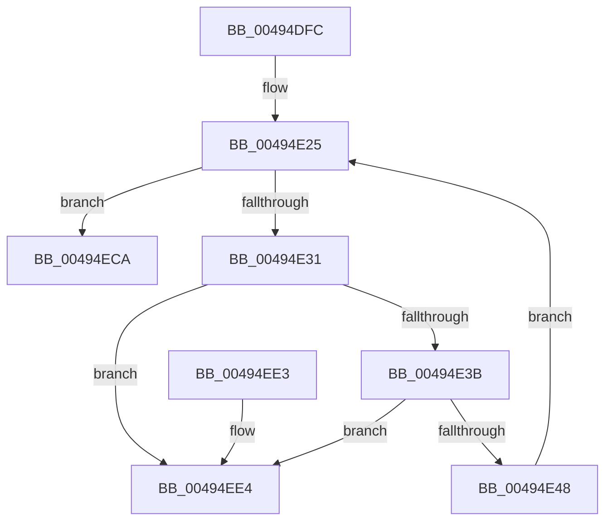

# MiReturnSystemCacheRegionsToKva

- RVA: `0x00494DFC`–`0x00494EEB` (길이 `239` bytes)
- VA: `0x0000000140494DFC`
- 실행 섹션: `.text`
- PDB 이름 있음: `예`; PDB Function 태그: `아니요`
- unwind 정보 RVA: `0x000B34FC`
- 디코드: `60`개 명령, `239/239` bytes 표시
- 미해석 바이트: `0` (있으면 어셈블리에 `.byte`로 보존)

> 이 문서는 커널 이미지의 기계어와 PDB 기호를 분석해 생성했습니다. 4번과 5번은 함수 원형과 자료형을 바이너리 사용 방식에서 추정한 C 해석이며 원본 소스 복구 결과는 아닙니다.

## 1. Dependencies

- 직접 호출 지점: **5**; 고유 호출 대상: **5**
- 직접 호출자로 확인된 함수: **2**
- RIP 상대 이미지 참조: **0**

### Outgoing calls
- `0x00494E7C` → [MiLockWorkingSetOptimal](../23/MiLockWorkingSetOptimal_function_00238FC0.md) (function, `0x00238FC0`)
- `0x00494E8A` → [MiSetSystemCacheReverseMap](../23/MiSetSystemCacheReverseMap_function_00238F58.md) (function, `0x00238F58`)
- `0x00494E9A` → [MiUnlockWorkingSetOptimal](../23/MiUnlockWorkingSetOptimal_function_00238DFC.md) (function, `0x00238DFC`)
- `0x00494EB6` → [MiReturnSystemVa](../23/MiReturnSystemVa_function_002394C4.md) (function, `0x002394C4`)
- `0x00494EC0` → [ExFreePoolWithTag](../../poolcode/B8/ExFreePoolWithTag_function_00B82870.md) (function, `0x00B82870`)

### Direct callers
- [MiReleaseSystemCacheView](../29/MiReleaseSystemCacheView_function_00294CE0.md) at `0x00294D94`
- [MiDeleteUnmappedSystemCacheViews](../67/MiDeleteUnmappedSystemCacheViews_function_0067C9A0.md) at `0x0067CA4A`

### Static image references
- 디코드된 RIP-relative 메모리 참조가 없습니다.

## 2. Other-region calls and transfers

- 다른 실행 섹션으로 향하는 call: **1**
  - `0x00494EC0` → [ExFreePoolWithTag](../../poolcode/B8/ExFreePoolWithTag_function_00B82870.md) (`.text` → `POOLCODE`)
- 별도 외부 분기/꼬리 이동을 확인하지 못했습니다.

## 3. Assembly (complete function range)

```asm
00494DFC  48 8B C4                        mov rax, rsp
00494DFF  48 89 58 10                     mov qword ptr [rax + 0x10], rbx
00494E03  48 89 68 18                     mov qword ptr [rax + 0x18], rbp
00494E07  48 89 70 20                     mov qword ptr [rax + 0x20], rsi
00494E0B  57                              push rdi
00494E0C  41 56                           push r14
00494E0E  41 57                           push r15
00494E10  48 83 EC 20                     sub rsp, 0x20
00494E14  4C 8B F2                        mov r14, rdx
00494E17  C6 40 08 00                     mov byte ptr [rax + 8], 0
00494E1B  48 8B E9                        mov rbp, rcx
00494E1E  4C 8D B9 80 49 00 00            lea r15, [rcx + 0x4980]
00494E25  49 8B 36                        mov rsi, qword ptr [r14]
00494E28  49 3B F6                        cmp rsi, r14
00494E2B  0F 84 99 00 00 00               je 0x140494eca
00494E31  4C 39 76 08                     cmp qword ptr [rsi + 8], r14
00494E35  0F 85 A9 00 00 00               jne 0x140494ee4
00494E3B  48 8B 06                        mov rax, qword ptr [rsi]
00494E3E  48 39 70 08                     cmp qword ptr [rax + 8], rsi
00494E42  0F 85 9C 00 00 00               jne 0x140494ee4
00494E48  49 89 06                        mov qword ptr [r14], rax
00494E4B  4C 89 70 08                     mov qword ptr [rax + 8], r14
00494E4F  48 B8 F8 FF FF FF 7F 00 00 00   movabs rax, 0x7ffffffff8
00494E59  48 8B 7E 10                     mov rdi, qword ptr [rsi + 0x10]
00494E5D  48 8B D7                        mov rdx, rdi
00494E60  48 C1 EA 09                     shr rdx, 9
00494E64  48 23 D0                        and rdx, rax
00494E67  48 B8 00 00 00 00 80 F6 FF FF   movabs rax, 0xfffff68000000000
00494E71  48 03 D0                        add rdx, rax
00494E74  4C 8D 44 24 40                  lea r8, [rsp + 0x40]
00494E79  49 8B CF                        mov rcx, r15
00494E7C  E8 3F 41 DA FF                  call 0x140238fc0
00494E81  45 33 C0                        xor r8d, r8d
00494E84  48 8B D7                        mov rdx, rdi
00494E87  48 8B D8                        mov rbx, rax
00494E8A  E8 C9 40 DA FF                  call 0x140238f58
00494E8F  44 8A 44 24 40                  mov r8b, byte ptr [rsp + 0x40]
00494E94  48 8B D3                        mov rdx, rbx
00494E97  49 8B CF                        mov rcx, r15
00494E9A  E8 5D 3F DA FF                  call 0x140238dfc
00494E9F  F0 FF 8D 78 09 00 00            lock dec dword ptr [rbp + 0x978]
00494EA6  48 8D 97 00 00 20 00            lea rdx, [rdi + 0x200000]
00494EAD  41 B8 07 00 00 00               mov r8d, 7
00494EB3  48 8B CF                        mov rcx, rdi
00494EB6  E8 09 46 DA FF                  call 0x1402394c4
00494EBB  33 D2                           xor edx, edx
00494EBD  48 8B CE                        mov rcx, rsi
00494EC0  E8 AB D9 6E 00                  call 0x140b82870
00494EC5  E9 5B FF FF FF                  jmp 0x140494e25
00494ECA  48 8B 5C 24 48                  mov rbx, qword ptr [rsp + 0x48]
00494ECF  48 8B 6C 24 50                  mov rbp, qword ptr [rsp + 0x50]
00494ED4  48 8B 74 24 58                  mov rsi, qword ptr [rsp + 0x58]
00494ED9  48 83 C4 20                     add rsp, 0x20
00494EDD  41 5F                           pop r15
00494EDF  41 5E                           pop r14
00494EE1  5F                              pop rdi
00494EE2  C3                              ret
00494EE3  CC                              int3
00494EE4  B9 03 00 00 00                  mov ecx, 3
00494EE9  CD 29                           int 0x29
```

## 4. C-style interpretation (structured pseudocode)

```c
__int64 __fastcall MiReturnSystemCacheRegionsToKva(__int64 a1, __int64 a2)
{
    __int64 result;
    __int64 v_rsp;
    unsigned __int64 v_stack_p10;
    unsigned __int64 v_stack_p18;
    unsigned __int64 v_stack_p20;
    unsigned __int64 v_stack_p8;

    *(unsigned __int64 *)(v_rsp + 16) = v_rbx;
    *(unsigned __int64 *)(v_rsp + 24) = v_rbp;
    *(unsigned __int64 *)(v_rsp + 32) = v_rsi;
    v_rsp = (v_rsp) - (32);
    *(unsigned __int8 *)(v_rsp + 8) = 0;
loc_00494E25:
    if ((*(unsigned __int64 *)(a2)) == a2) goto loc_00494ECA;
    if ((*(unsigned __int64 *)(*(unsigned __int64 *)(a2) + 8)) != a2) goto loc_00494EE4;
    if ((*(unsigned __int64 *)(*(unsigned __int64 *)(*(unsigned __int64 *)(a2)) + 8)) != (*(unsigned __int64 *)(a2))) goto loc_00494EE4;
    *(unsigned __int64 *)(a2) = *(unsigned __int64 *)(*(unsigned __int64 *)(a2));
    *(unsigned __int64 *)(*(unsigned __int64 *)(*(unsigned __int64 *)(a2)) + 8) = a2;
    a2 = (*(unsigned __int64 *)(*(unsigned __int64 *)(a2) + 16)) >> (9);
    a2 = (a2) & (*(unsigned __int64 *)(*(unsigned __int64 *)(a2)));
    a2 = (a2) + (*(unsigned __int64 *)(*(unsigned __int64 *)(a2)));
    result = MiLockWorkingSetOptimal(a1 + 18816, a2, v_stack_p8, a4);
    a3 = 0;
    result = MiSetSystemCacheReverseMap(a1 + 18816, *(unsigned __int64 *)(*(unsigned __int64 *)(a2) + 16), a3, a4);
    result = MiUnlockWorkingSetOptimal(a1 + 18816, result, v_stack_p8, a4);
    result = MiReturnSystemVa(*(unsigned __int64 *)(*(unsigned __int64 *)(a2) + 16), *(unsigned __int64 *)(*(unsigned __int64 *)(a2) + 16) + 2097152, 7, a4);
    a2 = 0;
    result = ExFreePoolWithTag(*(unsigned __int64 *)(a2), a2, 7, a4);
    goto loc_00494E25;
loc_00494ECA:
    v_rsp = (v_rsp) + (32);
    return result;
loc_00494EE4:
    return result;
}
```

## 5. (Beta) C Style

```c
int64_t MiReturnSystemCacheRegionsToKva(void *Arg1, void *Arg2)
{
    uint8_t *arg1 = (uint8_t *)Arg1;
    uint8_t *arg2 = (uint8_t *)Arg2;

    int64_t result;
    int64_t local_rsp;
    uint64_t v_stack_p10;
    uint64_t v_stack_p18;
    uint64_t v_stack_p20;
    uint64_t v_stack_p8;

    *(uint64_t *)(local_rsp + 0x10) = local_rbx;
    *(uint64_t *)(local_rsp + 0x18) = local_rbp;
    *(uint64_t *)(local_rsp + 0x20) = local_rsi;
    local_rsp = (local_rsp) - (32);
    *(uint8_t *)(local_rsp + 0x8) = 0;
loc_00494E25:
    if ((*(uint64_t *)(arg2)) == Arg2) goto loc_00494ECA;
    if ((*(uint64_t *)(*(uint64_t *)(arg2) + 0x8)) != Arg2) goto loc_00494EE4;
    if ((*(uint64_t *)(*(uint64_t *)(*(uint64_t *)(arg2)) + 0x8)) != (*(uint64_t *)(arg2))) goto loc_00494EE4;
    *(uint64_t *)(arg2) = *(uint64_t *)(*(uint64_t *)(arg2));
    *(void **)(*(uint64_t *)(*(uint64_t *)(arg2)) + 0x8) = Arg2;
    Arg2 = (*(uint64_t *)(*(uint64_t *)(arg2) + 0x10)) >> (9);
    Arg2 = (Arg2) & (*(uint64_t *)(*(uint64_t *)(arg2)));
    Arg2 = (Arg2) + (*(uint64_t *)(*(uint64_t *)(arg2)));
    result = MiLockWorkingSetOptimal(Arg1 + 18816, Arg2, v_stack_p8, a4);
    a3 = 0;
    result = MiSetSystemCacheReverseMap(Arg1 + 18816, *(uint64_t *)(*(uint64_t *)(arg2) + 0x10), a3, a4);
    result = MiUnlockWorkingSetOptimal(Arg1 + 18816, result, v_stack_p8, a4);
    result = MiReturnSystemVa(*(uint64_t *)(*(uint64_t *)(arg2) + 0x10), *(uint64_t *)(*(uint64_t *)(arg2) + 0x10) + 2097152, 7, a4);
    Arg2 = 0;
    result = ExFreePoolWithTag(*(uint64_t *)(arg2), Arg2, 7, a4);
    goto loc_00494E25;
loc_00494ECA:
    local_rsp = (local_rsp) + (32);
    return result;
loc_00494EE4:
    return result;
}
```

### 관측된 메모리 오프셋

구조체 형식이 확인되지 않은 접근은 인자 기준의 오프셋으로만 기록했습니다.

| 기준 인자 | 오프셋 표현 | 폭 (bit) | 접근 |
|---|---:|---:|---|
| `Arg1` | `+ 0x978` | `32` | `R/W` |
| `Arg1` | `+ 0x4980` | `64` | `R` |
| `Arg2` | `+ 0x0` | `64` | `R` |
| `Arg2` | `+ 0x0` | `64` | `W` |

## 6. Execution-region graph

[열기: 2D/3D 그래프와 함수 탐색 컨트롤 패널](../../../control-panel.html?section=text&rva=0x00494DFC&view=graph)

- 2D 그래프는 위에서 아래로 흐르고, 3D 그래프는 빈 공간을 드래그해 회전합니다. Shift+드래그는 이동, 휠은 확대·축소, 함수 노드 선택은 대상 보고서 이동입니다.

### Static fallback


