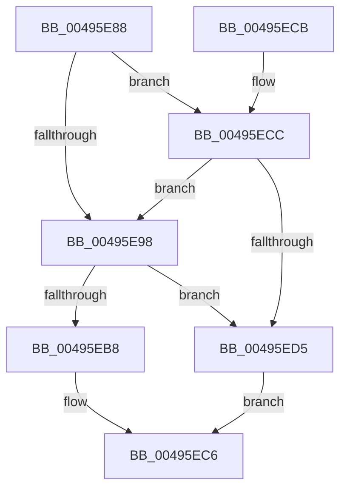

# MiSafeTryLockNestedPageAtDpc

- RVA: `0x00495E88`–`0x00495ED9` (길이 `81` bytes)
- VA: `0x0000000140495E88`
- 실행 섹션: `.text`
- PDB 이름 있음: `예`; PDB Function 태그: `아니요`
- unwind 정보 RVA: `0x00082A88`
- 디코드: `22`개 명령, `81/81` bytes 표시
- 미해석 바이트: `0` (있으면 어셈블리에 `.byte`로 보존)

> 이 문서는 커널 이미지의 기계어와 PDB 기호를 분석해 생성했습니다. 4번과 5번은 함수 원형과 자료형을 바이너리 사용 방식에서 추정한 C 해석이며 원본 소스 복구 결과는 아닙니다.

## 1. Dependencies

- 직접 호출 지점: **1**; 고유 호출 대상: **1**
- 직접 호출자로 확인된 함수: **1**
- RIP 상대 이미지 참조: **1**

### Outgoing calls
- `0x00495ECC` → [MiIsDecayPfn](../2B/MiIsDecayPfn_function_002B9240.md) (function, `0x002B9240`)

### Direct callers
- [sub_0031F9CC](../31/Unknown_function_0031F9CC.md) at `0x0031FA4B`

### Static image references
- `0x00495E8F` → RVA `0x00E2DCE0` (`.data`; read)

## 2. Other-region calls and transfers

- 다른 실행 섹션으로 향하는 call: **0**
- 별도 외부 분기/꼬리 이동을 확인하지 못했습니다.

## 3. Assembly (complete function range)

```asm
00495E88  48 83 EC 28                     sub rsp, 0x28
00495E8C  45 33 C0                        xor r8d, r8d
00495E8F  48 3B 0D 4A 7E 99 00            cmp rcx, qword ptr [rip + 0x997e4a]
00495E96  77 34                           ja 0x140495ecc
00495E98  48 8D 14 49                     lea rdx, [rcx + rcx*2]
00495E9C  48 C1 E2 04                     shl rdx, 4
00495EA0  48 B8 00 00 00 00 00 DE FF FF   movabs rax, 0xffffde0000000000
00495EAA  48 03 D0                        add rdx, rax
00495EAD  48 8B 42 28                     mov rax, qword ptr [rdx + 0x28]
00495EB1  48 0F BA E0 36                  bt rax, 0x36
00495EB6  73 1D                           jae 0x140495ed5
00495EB8  F0 48 0F BA 6A 18 3F            lock bts qword ptr [rdx + 0x18], 0x3f
00495EBF  41 0F 93 C0                     setae r8b
00495EC3  41 8B C0                        mov eax, r8d
00495EC6  48 83 C4 28                     add rsp, 0x28
00495ECA  C3                              ret
00495ECB  CC                              int3
00495ECC  E8 6F 33 E2 FF                  call 0x1402b9240
00495ED1  85 C0                           test eax, eax
00495ED3  75 C3                           jne 0x140495e98
00495ED5  33 C0                           xor eax, eax
00495ED7  EB ED                           jmp 0x140495ec6
```

## 4. C-style interpretation (structured pseudocode)

```c
__int64 __fastcall MiSafeTryLockNestedPageAtDpc(__int64 a1, __int64 a2, int a3)
{
    __int64 result;
    __int64 v_rsp;

    v_rsp = (v_rsp) - (40);
    a3 = 0;
    if (a1 > (*(unsigned __int64 *)(v_rip + 10059338))) goto loc_00495ECC;
loc_00495E98:
    a2 = (a1 + a1 * 2) << (4);
    a2 = (a2) + (result);
    if (condition_is_above_or_equal) goto loc_00495ED5;
    a3 = (condition_is_above_or_equal) ? 1 : 0;
loc_00495EC6:
    v_rsp = (v_rsp) + (40);
    return (unsigned int)(a3);
loc_00495ECC:
    result = MiIsDecayPfn(a1, a2, a3, a4);
    if ((unsigned int)(result) != 0) goto loc_00495E98;
loc_00495ED5:
    result = 0;
    goto loc_00495EC6;
}
```

## 5. (Beta) C Style

```c
int64_t MiSafeTryLockNestedPageAtDpc(int64_t Arg1, int64_t Arg2, int32_t Arg3)
{
    int64_t result;
    int64_t local_rsp;

    local_rsp = (local_rsp) - (40);
    Arg3 = 0;
    if (Arg1 > (*(uint64_t *)(v_rip + 0x997E4A))) goto loc_00495ECC;
loc_00495E98:
    Arg2 = (Arg1 + Arg1 * 2) << (4);
    Arg2 = (Arg2) + (result);
    if (condition_is_above_or_equal) goto loc_00495ED5;
    Arg3 = (condition_is_above_or_equal) ? 1 : 0;
loc_00495EC6:
    local_rsp = (local_rsp) + (40);
    return (uint32_t)(Arg3);
loc_00495ECC:
    result = MiIsDecayPfn(Arg1, Arg2, Arg3, a4);
    if ((uint32_t)(result) != 0) goto loc_00495E98;
loc_00495ED5:
    result = 0;
    goto loc_00495EC6;
}
```

## 6. Execution-region graph

[열기: 2D/3D 그래프와 함수 탐색 컨트롤 패널](../../../control-panel.html?section=text&rva=0x00495E88&view=graph)

- 2D 그래프는 위에서 아래로 흐르고, 3D 그래프는 빈 공간을 드래그해 회전합니다. Shift+드래그는 이동, 휠은 확대·축소, 함수 노드 선택은 대상 보고서 이동입니다.

### Static fallback


