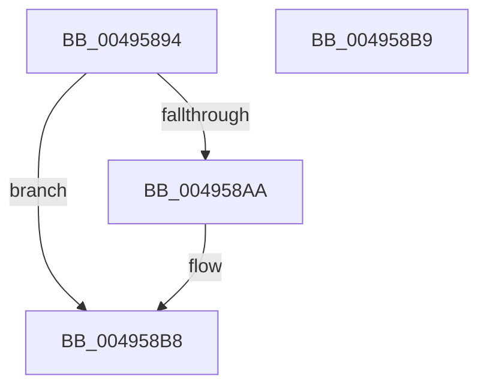

# MiScrubInterrupted

- RVA: `0x00495894`–`0x004958BA` (길이 `38` bytes)
- VA: `0x0000000140495894`
- 실행 섹션: `.text`
- PDB 이름 있음: `예`; PDB Function 태그: `아니요`
- unwind 정보 RVA: `0x000DB714`
- 디코드: `13`개 명령, `38/38` bytes 표시
- 미해석 바이트: `0` (있으면 어셈블리에 `.byte`로 보존)

> 이 문서는 커널 이미지의 기계어와 PDB 기호를 분석해 생성했습니다. 4번과 5번은 함수 원형과 자료형을 바이너리 사용 방식에서 추정한 C 해석이며 원본 소스 복구 결과는 아닙니다.

## 1. Dependencies

- 직접 호출 지점: **0**; 고유 호출 대상: **0**
- 직접 호출자로 확인된 함수: **5**
- RIP 상대 이미지 참조: **0**

### Outgoing calls
- 직접 디코드된 call 명령이 없습니다.

### Direct callers
- [MiScrubLargeMappedPage](../69/MiScrubLargeMappedPage_function_00693E2C.md) at `0x006941B4`
- [MiScrubLargePage](../69/MiScrubLargePage_function_006942E8.md) at `0x00694715`
- [MiScrubLargePageRegions](../../page/70/MiScrubLargePageRegions_function_007011B4.md) at `0x0070135F`
- [MiScrubActiveLargePage](../../page/80/MiScrubActiveLargePage_function_0080ED58.md) at `0x0080EDA3`
- [MiScrubNode](../../page/A4/MiScrubNode_function_00A46098.md) at `0x00A46195`
- [MiScrubNode](../../page/A4/MiScrubNode_function_00A46098.md) at `0x00A462BC`

### Static image references
- 디코드된 RIP-relative 메모리 참조가 없습니다.

## 2. Other-region calls and transfers

- 다른 실행 섹션으로 향하는 call: **0**
- 별도 외부 분기/꼬리 이동을 확인하지 못했습니다.

## 3. Assembly (complete function range)

```asm
00495894  48 8B 11                        mov rdx, qword ptr [rcx]
00495897  48 8B 42 38                     mov rax, qword ptr [rdx + 0x38]
0049589B  8B 88 A0 05 00 00               mov ecx, dword ptr [rax + 0x5a0]
004958A1  B8 01 00 00 00                  mov eax, 1
004958A6  84 C8                           test al, cl
004958A8  75 0E                           jne 0x1404958b8
004958AA  48 8B 42 20                     mov rax, qword ptr [rdx + 0x20]
004958AE  33 C9                           xor ecx, ecx
004958B0  39 48 04                        cmp dword ptr [rax + 4], ecx
004958B3  0F 95 C1                        setne cl
004958B6  8B C1                           mov eax, ecx
004958B8  C3                              ret
004958B9  CC                              int3
```

## 4. C-style interpretation (structured pseudocode)

```c
__int64 __fastcall MiScrubInterrupted(__int64 a1)
{
    __int64 result;

    result = 1;
    if (((1) & ((unsigned __int8)((unsigned int)(*(unsigned int *)(*(unsigned __int64 *)(*(unsigned __int64 *)(a1) + 56) + 1440))))) == 0) {
        result = *(unsigned __int64 *)(*(unsigned __int64 *)(a1) + 32);
        a1 = 0;
        a1 = ((*(unsigned int *)(result + 4)) != 0) ? 1 : 0;
        result = (unsigned int)(a1);
    }
    return result;
}
```

## 5. (Beta) C Style

```c
int64_t MiScrubInterrupted(void *Arg1)
{
    uint8_t *arg1 = (uint8_t *)Arg1;

    int64_t result;

    result = 1;
    if (((1) & ((uint8_t)((uint32_t)(*(uint32_t *)(*(uint64_t *)(*(uint64_t *)(arg1) + 0x38) + 0x5A0))))) == 0) {
        result = *(uint64_t *)(*(uint64_t *)(arg1) + 0x20);
        Arg1 = 0;
        Arg1 = ((*(uint32_t *)(result + 0x4)) != 0) ? 1 : 0;
        result = (uint32_t)(Arg1);
    }
    return result;
}
```

### 관측된 메모리 오프셋

구조체 형식이 확인되지 않은 접근은 인자 기준의 오프셋으로만 기록했습니다.

| 기준 인자 | 오프셋 표현 | 폭 (bit) | 접근 |
|---|---:|---:|---|
| `Arg1` | `+ 0x0` | `64` | `R` |

## 6. Execution-region graph

[열기: 2D/3D 그래프와 함수 탐색 컨트롤 패널](../../../control-panel.html?section=text&rva=0x00495894&view=graph)

- 2D 그래프는 위에서 아래로 흐르고, 3D 그래프는 빈 공간을 드래그해 회전합니다. Shift+드래그는 이동, 휠은 확대·축소, 함수 노드 선택은 대상 보고서 이동입니다.

### Static fallback


