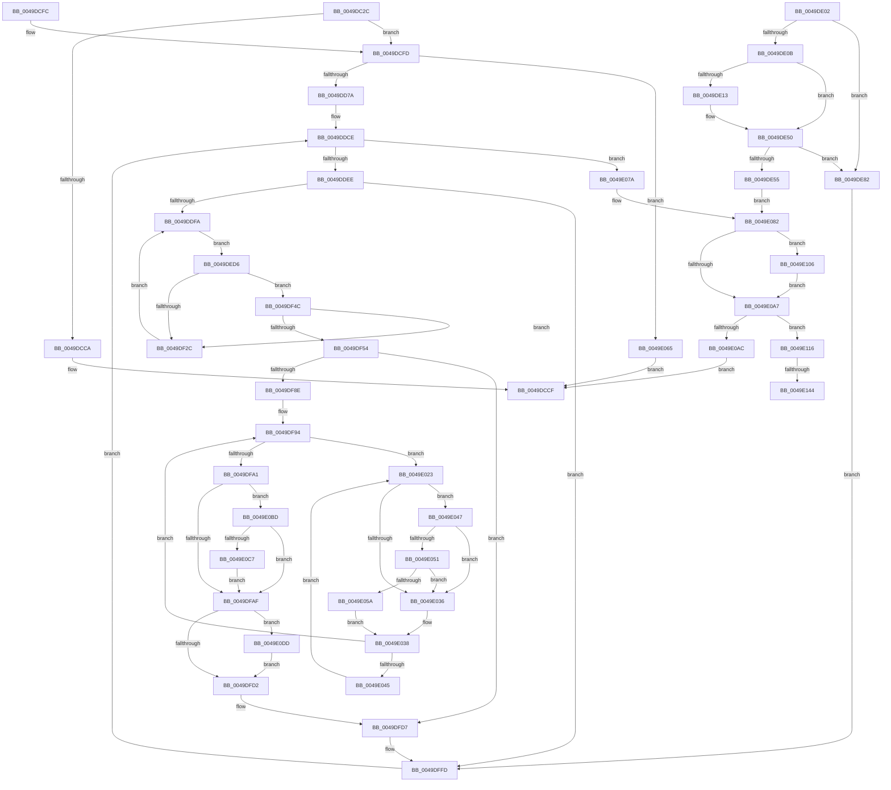

# MiSetPagesModified

- RVA: `0x0049DC2C`–`0x0049E158` (길이 `1,324` bytes)
- VA: `0x000000014049DC2C`
- 실행 섹션: `.text`
- PDB 이름 있음: `예`; PDB Function 태그: `예`
- unwind 정보 RVA: `0x000B5008`
- 디코드: `303`개 명령, `1,324/1,324` bytes 표시
- 미해석 바이트: `0` (있으면 어셈블리에 `.byte`로 보존)

> 이 문서는 커널 이미지의 기계어와 PDB 기호를 분석해 생성했습니다. 4번과 5번은 함수 원형과 자료형을 바이너리 사용 방식에서 추정한 C 해석이며 원본 소스 복구 결과는 아닙니다.

## 1. Dependencies

- 직접 호출 지점: **26**; 고유 호출 대상: **23**
- 직접 호출자로 확인된 함수: **1**
- RIP 상대 이미지 참조: **5**

### Outgoing calls
- `0x0049DC70` → [memset](../6C/memset_function_006C6C40.md) (function, `0x006C6C40`)
- `0x0049DCC1` → [MiChargeCommit](../28/MiChargeCommit_function_00286EB0.md) (function, `0x00286EB0`)
- `0x0049DCDA` → [_security_check_cookie](../6A/_security_check_cookie_function_006AC640.md) (function, `0x006AC640`)
- `0x0049DD2E` → [MiGetEffectivePagePriorityThread](../36/MiGetEffectivePagePriorityThread_function_003626E0.md) (function, `0x003626E0`)
- `0x0049DD56` → [MiPrefetchControlArea](../../page/93/MiPrefetchControlArea_function_0093E830.md) (function, `0x0093E830`)
- `0x0049DD6B` → [MiMapImageInSystemSpace](../../page/94/MiMapImageInSystemSpace_function_00941DD8.md) (function, `0x00941DD8`)
- `0x0049DE23` → [MiReferenceControlAreaFileWithTag](../34/MiReferenceControlAreaFileWithTag_function_00348390.md) (function, `0x00348390`)
- `0x0049DE4B` → [ObFastDereferenceObjectDeferDelete](../23/ObFastDereferenceObjectDeferDelete_function_002378C0.md) (function, `0x002378C0`)
- `0x0049DED9` → [MiLockWorkingSetShared](../27/MiLockWorkingSetShared_function_0027CBF0.md) (function, `0x0027CBF0`)
- `0x0049DEF6` → [MiLockLowestValidPageTableEx](../28/MiLockLowestValidPageTableEx_function_00280D10.md) (function, `0x00280D10`)
- `0x0049DF32` → [MiUnlockPageTable](../21/MiUnlockPageTable_function_00216EC0.md) (function, `0x00216EC0`)
- `0x0049DF3D` → [MiUnlockWorkingSetShared](../27/MiUnlockWorkingSetShared_function_0027D690.md) (function, `0x0027D690`)
- `0x0049DFB5` → [MiSetPfnModified](../36/MiSetPfnModified_function_00362960.md) (function, `0x00362960`)
- `0x0049DFE2` → [MiUnlockPageTable](../21/MiUnlockPageTable_function_00216EC0.md) (function, `0x00216EC0`)
- `0x0049DFEE` → [MiUnlockWorkingSetShared](../27/MiUnlockWorkingSetShared_function_0027D690.md) (function, `0x0027D690`)
- `0x0049E051` → [KiCheckVpBackingLongSpinWaitHypercall](../30/KiCheckVpBackingLongSpinWaitHypercall_function_0030F490.md) (function, `0x0030F490`)
- `0x0049E05E` → [HvlNotifyLongSpinWait](../30/HvlNotifyLongSpinWait_function_0030F460.md) (function, `0x0030F460`)
- `0x0049E06E` → [MiReturnCommit](../24/MiReturnCommit_function_00248410.md) (function, `0x00248410`)
- `0x0049E08A` → [MiUnmapImageInSystemSpace](../../page/94/MiUnmapImageInSystemSpace_function_0094206C.md) (function, `0x0094206C`)
- `0x0049E094` → [MiGetCommittedPages](../32/MiGetCommittedPages_function_00325CE0.md) (function, `0x00325CE0`)
- `0x0049E0B1` → [MiDeleteFileExtents](../../page/A2/MiDeleteFileExtents_function_00A27004.md) (function, `0x00A27004`)
- `0x0049E0D0` → [MiCapturePfnPageFileInfoInline](../22/MiCapturePfnPageFileInfoInline_function_0022F650.md) (function, `0x0022F650`)
- `0x0049E0FC` → [MiReleasePageFileInfo](../28/MiReleasePageFileInfo_function_00283FD0.md) (function, `0x00283FD0`)
- `0x0049E10F` → [MiReturnCommit](../24/MiReturnCommit_function_00248410.md) (function, `0x00248410`)
- `0x0049E130` → [KeAbPreAcquire](../21/KeAbPreAcquire_function_00210230.md) (function, `0x00210230`)
- `0x0049E14D` → [ExfAcquirePushLockExclusiveEx](../20/ExfAcquirePushLockExclusiveEx_function_0020FC90.md) (function, `0x0020FC90`)

### Direct callers
- [sub_00B2AF8E](../../page/B2/Unknown_function_00B2AF8E.md) at `0x00B2AFA1`

### Static image references
- `0x0049DC46` → RVA `0x00E0A740` (`.data`; read)
- `0x0049DC84` → RVA `0x00E30088` (`.data`; read)
- `0x0049DD4C` → RVA `0x00010880` (`.rdata`; read)
- `0x0049E02E` → RVA `0x00FC52AC` (`ALMOSTRO`; reference)
- `0x0049E047` → RVA `0x00FC6AB8` (`ALMOSTRO`; read)

## 2. Other-region calls and transfers

- 다른 실행 섹션으로 향하는 call: **4**
  - `0x0049DD56` → [MiPrefetchControlArea](../../page/93/MiPrefetchControlArea_function_0093E830.md) (`.text` → `PAGE`)
  - `0x0049DD6B` → [MiMapImageInSystemSpace](../../page/94/MiMapImageInSystemSpace_function_00941DD8.md) (`.text` → `PAGE`)
  - `0x0049E08A` → [MiUnmapImageInSystemSpace](../../page/94/MiUnmapImageInSystemSpace_function_0094206C.md) (`.text` → `PAGE`)
  - `0x0049E0B1` → [MiDeleteFileExtents](../../page/A2/MiDeleteFileExtents_function_00A27004.md) (`.text` → `PAGE`)
- call이 아닌 외부 분기/꼬리 이동: **2**
  - `0x0049E13E` → [sub_006F810A](../6F/Unknown_function_006F810A.md) (`tail-transfer`)
  - `0x0049E153` → [sub_006F810A](../6F/Unknown_function_006F810A.md) (`tail-transfer`)

## 3. Assembly (complete function range)

```asm
0049DC2C  48 89 5C 24 18                  mov qword ptr [rsp + 0x18], rbx
0049DC31  48 89 74 24 20                  mov qword ptr [rsp + 0x20], rsi
0049DC36  57                              push rdi
0049DC37  41 54                           push r12
0049DC39  41 55                           push r13
0049DC3B  41 56                           push r14
0049DC3D  41 57                           push r15
0049DC3F  48 81 EC 30 01 00 00            sub rsp, 0x130
0049DC46  48 8B 05 F3 CA 96 00            mov rax, qword ptr [rip + 0x96caf3]
0049DC4D  48 33 C4                        xor rax, rsp
0049DC50  48 89 84 24 20 01 00 00         mov qword ptr [rsp + 0x120], rax
0049DC58  8B DA                           mov ebx, edx
0049DC5A  48 8B F9                        mov rdi, rcx
0049DC5D  48 89 4C 24 40                  mov qword ptr [rsp + 0x40], rcx
0049DC62  33 D2                           xor edx, edx
0049DC64  44 8D 42 50                     lea r8d, [rdx + 0x50]
0049DC68  48 8D 8C 24 D0 00 00 00         lea rcx, [rsp + 0xd0]
0049DC70  E8 CB 8F 22 00                  call 0x1406c6c40
0049DC75  0F B7 47 3C                     movzx eax, word ptr [rdi + 0x3c]
0049DC79  B9 FF 03 00 00                  mov ecx, 0x3ff
0049DC7E  66 23 C1                        and ax, cx
0049DC81  0F B7 C8                        movzx ecx, ax
0049DC84  48 8B 05 FD 23 99 00            mov rax, qword ptr [rip + 0x9923fd]
0049DC8B  48 8B 34 C8                     mov rsi, qword ptr [rax + rcx*8]
0049DC8F  48 89 B4 24 A8 00 00 00         mov qword ptr [rsp + 0xa8], rsi
0049DC97  48 89 B4 24 88 00 00 00         mov qword ptr [rsp + 0x88], rsi
0049DC9F  48 8B 07                        mov rax, qword ptr [rdi]
0049DCA2  48 89 44 24 68                  mov qword ptr [rsp + 0x68], rax
0049DCA7  48 89 44 24 78                  mov qword ptr [rsp + 0x78], rax
0049DCAC  44 8B 60 08                     mov r12d, dword ptr [rax + 8]
0049DCB0  4C 89 A4 24 80 00 00 00         mov qword ptr [rsp + 0x80], r12
0049DCB8  45 33 C0                        xor r8d, r8d
0049DCBB  41 8B D4                        mov edx, r12d
0049DCBE  48 8B CE                        mov rcx, rsi
0049DCC1  E8 EA 91 DE FF                  call 0x140286eb0
0049DCC6  85 C0                           test eax, eax
0049DCC8  75 33                           jne 0x14049dcfd
0049DCCA  B8 2D 01 00 C0                  mov eax, 0xc000012d
0049DCCF  48 8B 8C 24 20 01 00 00         mov rcx, qword ptr [rsp + 0x120]
0049DCD7  48 33 CC                        xor rcx, rsp
0049DCDA  E8 61 E9 20 00                  call 0x1406ac640
0049DCDF  4C 8D 9C 24 30 01 00 00         lea r11, [rsp + 0x130]
0049DCE7  49 8B 5B 40                     mov rbx, qword ptr [r11 + 0x40]
0049DCEB  49 8B 73 48                     mov rsi, qword ptr [r11 + 0x48]
0049DCEF  49 8B E3                        mov rsp, r11
0049DCF2  41 5F                           pop r15
0049DCF4  41 5E                           pop r14
0049DCF6  41 5D                           pop r13
0049DCF8  41 5C                           pop r12
0049DCFA  5F                              pop rdi
0049DCFB  C3                              ret
0049DCFC  CC                              int3
0049DCFD  48 8B 87 88 00 00 00            mov rax, qword ptr [rdi + 0x88]
0049DD04  48 89 44 24 58                  mov qword ptr [rsp + 0x58], rax
0049DD09  48 89 84 24 90 00 00 00         mov qword ptr [rsp + 0x90], rax
0049DD11  4A 8D 04 E0                     lea rax, [rax + r12*8]
0049DD15  48 89 84 24 B0 00 00 00         mov qword ptr [rsp + 0xb0], rax
0049DD1D  65 4C 8B 2C 25 88 01 00 00      mov r13, qword ptr gs:[0x188]
0049DD26  4C 89 6C 24 70                  mov qword ptr [rsp + 0x70], r13
0049DD2B  49 8B CD                        mov rcx, r13
0049DD2E  E8 AD 49 EC FF                  call 0x1403626e0
0049DD33  B9 05 00 00 00                  mov ecx, 5
0049DD38  3B C1                           cmp eax, ecx
0049DD3A  0F 47 C1                        cmova eax, ecx
0049DD3D  89 5C 24 28                     mov dword ptr [rsp + 0x28], ebx
0049DD41  83 64 24 20 00                  and dword ptr [rsp + 0x20], 0
0049DD46  44 8B C8                        mov r9d, eax
0049DD49  45 33 C0                        xor r8d, r8d
0049DD4C  48 8B 15 2D 2B B7 FF            mov rdx, qword ptr [rip - 0x48d4d3]
0049DD53  48 8B CF                        mov rcx, rdi
0049DD56  E8 D5 0A 4A 00                  call 0x14093e830
0049DD5B  4C 8D 84 24 D0 00 00 00         lea r8, [rsp + 0xd0]
0049DD63  BA 03 00 00 00                  mov edx, 3
0049DD68  48 8B CF                        mov rcx, rdi
0049DD6B  E8 68 40 4A 00                  call 0x140941dd8
0049DD70  8B D8                           mov ebx, eax
0049DD72  85 C0                           test eax, eax
0049DD74  0F 88 EB 02 00 00               js 0x14049e065
0049DD7A  48 8B 9C 24 E8 00 00 00         mov rbx, qword ptr [rsp + 0xe8]
0049DD82  48 89 5C 24 48                  mov qword ptr [rsp + 0x48], rbx
0049DD87  48 8B 94 24 D0 00 00 00         mov rdx, qword ptr [rsp + 0xd0]
0049DD8F  48 89 54 24 60                  mov qword ptr [rsp + 0x60], rdx
0049DD94  48 8B FA                        mov rdi, rdx
0049DD97  48 C1 EF 09                     shr rdi, 9
0049DD9B  49 B9 F8 FF FF FF 7F 00 00 00   movabs r9, 0x7ffffffff8
0049DDA5  49 23 F9                        and rdi, r9
0049DDA8  49 B8 00 00 00 00 80 F6 FF FF   movabs r8, 0xfffff68000000000
0049DDB2  49 8B C0                        mov rax, r8
0049DDB5  48 03 F8                        add rdi, rax
0049DDB8  45 33 FF                        xor r15d, r15d
0049DDBB  4C 89 7C 24 50                  mov qword ptr [rsp + 0x50], r15
0049DDC0  44 21 7C 24 38                  and dword ptr [rsp + 0x38], r15d
0049DDC5  45 8D 77 01                     lea r14d, [r15 + 1]
0049DDC9  48 8B 4C 24 58                  mov rcx, qword ptr [rsp + 0x58]
0049DDCE  48 89 94 24 A0 00 00 00         mov qword ptr [rsp + 0xa0], rdx
0049DDD6  48 89 BC 24 98 00 00 00         mov qword ptr [rsp + 0x98], rdi
0049DDDE  33 F6                           xor esi, esi
0049DDE0  48 3B 8C 24 B0 00 00 00         cmp rcx, qword ptr [rsp + 0xb0]
0049DDE8  0F 83 8C 02 00 00               jae 0x14049e07a
0049DDEE  48 8B 01                        mov rax, qword ptr [rcx]
0049DDF1  48 85 C0                        test rax, rax
0049DDF4  0F 84 03 02 00 00               je 0x14049dffd
0049DDFA  48 8B 02                        mov rax, qword ptr [rdx]
0049DDFD  E9 D4 00 00 00                  jmp 0x14049ded6
0049DE02  8B F0                           mov esi, eax
0049DE04  3D 05 00 00 C0                  cmp eax, 0xc0000005
0049DE09  74 77                           je 0x14049de82
0049DE0B  8B 5C 24 38                     mov ebx, dword ptr [rsp + 0x38]
0049DE0F  85 DB                           test ebx, ebx
0049DE11  75 3D                           jne 0x14049de50
0049DE13  45 33 C0                        xor r8d, r8d
0049DE16  BA 4D 6D 53 63                  mov edx, 0x63536d4d
0049DE1B  48 8B 7C 24 40                  mov rdi, qword ptr [rsp + 0x40]
0049DE20  48 8B CF                        mov rcx, rdi
0049DE23  E8 68 A5 EA FF                  call 0x140348390
0049DE28  48 8B 48 08                     mov rcx, qword ptr [rax + 8]
0049DE2C  8A 51 34                        mov dl, byte ptr [rcx + 0x34]
0049DE2F  80 E2 10                        and dl, 0x10
0049DE32  F6 DA                           neg dl
0049DE34  1B DB                           sbb ebx, ebx
0049DE36  F7 DB                           neg ebx
0049DE38  FF C3                           inc ebx
0049DE3A  89 5C 24 38                     mov dword ptr [rsp + 0x38], ebx
0049DE3E  48 8D 4F 40                     lea rcx, [rdi + 0x40]
0049DE42  41 B8 4D 6D 53 63               mov r8d, 0x63536d4d
0049DE48  48 8B D0                        mov rdx, rax
0049DE4B  E8 70 9A D9 FF                  call 0x1402378c0
0049DE50  83 FB 02                        cmp ebx, 2
0049DE53  75 2D                           jne 0x14049de82
0049DE55  44 8D 73 FF                     lea r14d, [rbx - 1]
0049DE59  4C 8B 6C 24 70                  mov r13, qword ptr [rsp + 0x70]
0049DE5E  4C 8B 7C 24 50                  mov r15, qword ptr [rsp + 0x50]
0049DE63  48 8B 44 24 78                  mov rax, qword ptr [rsp + 0x78]
0049DE68  48 89 44 24 68                  mov qword ptr [rsp + 0x68], rax
0049DE6D  4C 8B A4 24 80 00 00 00         mov r12, qword ptr [rsp + 0x80]
0049DE75  48 8B BC 24 88 00 00 00         mov rdi, qword ptr [rsp + 0x88]
0049DE7D  E9 00 02 00 00                  jmp 0x14049e082
0049DE82  41 BE 01 00 00 00               mov r14d, 1
0049DE88  48 8B 5C 24 48                  mov rbx, qword ptr [rsp + 0x48]
0049DE8D  48 8B 94 24 A0 00 00 00         mov rdx, qword ptr [rsp + 0xa0]
0049DE95  4C 8B 6C 24 70                  mov r13, qword ptr [rsp + 0x70]
0049DE9A  48 8B BC 24 98 00 00 00         mov rdi, qword ptr [rsp + 0x98]
0049DEA2  4C 8B 7C 24 50                  mov r15, qword ptr [rsp + 0x50]
0049DEA7  48 8B 44 24 78                  mov rax, qword ptr [rsp + 0x78]
0049DEAC  48 89 44 24 68                  mov qword ptr [rsp + 0x68], rax
0049DEB1  48 8B 8C 24 90 00 00 00         mov rcx, qword ptr [rsp + 0x90]
0049DEB9  4C 8B A4 24 80 00 00 00         mov r12, qword ptr [rsp + 0x80]
0049DEC1  48 8B 84 24 88 00 00 00         mov rax, qword ptr [rsp + 0x88]
0049DEC9  48 89 84 24 A8 00 00 00         mov qword ptr [rsp + 0xa8], rax
0049DED1  E9 27 01 00 00                  jmp 0x14049dffd
0049DED6  48 8B CB                        mov rcx, rbx
0049DED9  E8 12 ED DD FF                  call 0x14027cbf0
0049DEDE  40 8A F0                        mov sil, al
0049DEE1  88 44 24 30                     mov byte ptr [rsp + 0x30], al
0049DEE5  45 33 C9                        xor r9d, r9d
0049DEE8  4C 8D 84 24 C0 00 00 00         lea r8, [rsp + 0xc0]
0049DEF0  48 8B D7                        mov rdx, rdi
0049DEF3  48 8B CB                        mov rcx, rbx
0049DEF6  E8 15 2E DE FF                  call 0x140280d10
0049DEFB  48 89 84 24 B8 00 00 00         mov qword ptr [rsp + 0xb8], rax
0049DF03  48 8B D7                        mov rdx, rdi
0049DF06  48 C1 EA 09                     shr rdx, 9
0049DF0A  48 B9 F8 FF FF FF 7F 00 00 00   movabs rcx, 0x7ffffffff8
0049DF14  48 23 D1                        and rdx, rcx
0049DF17  48 B9 00 00 00 00 80 F6 FF FF   movabs rcx, 0xfffff68000000000
0049DF21  48 8B C9                        mov rcx, rcx
0049DF24  48 03 D1                        add rdx, rcx
0049DF27  48 3B C2                        cmp rax, rdx
0049DF2A  74 20                           je 0x14049df4c
0049DF2C  48 8B D0                        mov rdx, rax
0049DF2F  48 8B CB                        mov rcx, rbx
0049DF32  E8 89 8F D7 FF                  call 0x140216ec0
0049DF37  40 8A D6                        mov dl, sil
0049DF3A  48 8B CB                        mov rcx, rbx
0049DF3D  E8 4E F7 DD FF                  call 0x14027d690
0049DF42  48 8B 54 24 60                  mov rdx, qword ptr [rsp + 0x60]
0049DF47  E9 AE FE FF FF                  jmp 0x14049ddfa
0049DF4C  48 8B 0F                        mov rcx, qword ptr [rdi]
0049DF4F  41 84 CE                        test r14b, cl
0049DF52  74 D8                           je 0x14049df2c
0049DF54  4D 03 FE                        add r15, r14
0049DF57  4C 89 7C 24 50                  mov qword ptr [rsp + 0x50], r15
0049DF5C  48 8B 07                        mov rax, qword ptr [rdi]
0049DF5F  48 C1 E8 0C                     shr rax, 0xc
0049DF63  48 B9 FF FF FF FF FF 00 00 00   movabs rcx, 0xffffffffff
0049DF6D  48 23 C1                        and rax, rcx
0049DF70  48 8D 34 40                     lea rsi, [rax + rax*2]
0049DF74  48 C1 E6 04                     shl rsi, 4
0049DF78  48 B8 00 00 00 00 00 DE FF FF   movabs rax, 0xffffde0000000000
0049DF82  48 03 F0                        add rsi, rax
0049DF85  48 8B 46 28                     mov rax, qword ptr [rsi + 0x28]
0049DF89  48 85 C0                        test rax, rax
0049DF8C  79 49                           jns 0x14049dfd7
0049DF8E  33 DB                           xor ebx, ebx
0049DF90  21 5C 24 34                     and dword ptr [rsp + 0x34], ebx
0049DF94  F0 48 0F BA 6E 18 3F            lock bts qword ptr [rsi + 0x18], 0x3f
0049DF9B  0F 82 82 00 00 00               jb 0x14049e023
0049DFA1  8B 46 10                        mov eax, dword ptr [rsi + 0x10]
0049DFA4  48 0F BA E0 0A                  bt rax, 0xa
0049DFA9  0F 83 0E 01 00 00               jae 0x14049e0bd
0049DFAF  41 8B D6                        mov edx, r14d
0049DFB2  48 8B CE                        mov rcx, rsi
0049DFB5  E8 A6 49 EC FF                  call 0x140362960
0049DFBA  48 B8 FF FF FF FF FF FF FF 7F   movabs rax, 0x7fffffffffffffff
0049DFC4  F0 48 21 46 18                  lock and qword ptr [rsi + 0x18], rax
0049DFC9  48 85 DB                        test rbx, rbx
0049DFCC  0F 85 0B 01 00 00               jne 0x14049e0dd
0049DFD2  48 8B 5C 24 48                  mov rbx, qword ptr [rsp + 0x48]
0049DFD7  48 8B 94 24 B8 00 00 00         mov rdx, qword ptr [rsp + 0xb8]
0049DFDF  48 8B CB                        mov rcx, rbx
0049DFE2  E8 D9 8E D7 FF                  call 0x140216ec0
0049DFE7  8A 54 24 30                     mov dl, byte ptr [rsp + 0x30]
0049DFEB  48 8B CB                        mov rcx, rbx
0049DFEE  E8 9D F6 DD FF                  call 0x14027d690
0049DFF3  48 8B 4C 24 58                  mov rcx, qword ptr [rsp + 0x58]
0049DFF8  48 8B 54 24 60                  mov rdx, qword ptr [rsp + 0x60]
0049DFFD  48 83 C1 08                     add rcx, 8
0049E001  48 89 4C 24 58                  mov qword ptr [rsp + 0x58], rcx
0049E006  48 89 8C 24 90 00 00 00         mov qword ptr [rsp + 0x90], rcx
0049E00E  48 83 C7 08                     add rdi, 8
0049E012  48 81 C2 00 10 00 00            add rdx, 0x1000
0049E019  48 89 54 24 60                  mov qword ptr [rsp + 0x60], rdx
0049E01E  E9 AB FD FF FF                  jmp 0x14049ddce
0049E023  8B 4C 24 34                     mov ecx, dword ptr [rsp + 0x34]
0049E027  41 03 CE                        add ecx, r14d
0049E02A  89 4C 24 34                     mov dword ptr [rsp + 0x34], ecx
0049E02E  85 0D 78 72 B2 00               test dword ptr [rip + 0xb27278], ecx
0049E034  74 11                           je 0x14049e047
0049E036  F3 90                           pause
0049E038  48 8B 46 18                     mov rax, qword ptr [rsi + 0x18]
0049E03C  48 85 C0                        test rax, rax
0049E03F  0F 89 4F FF FF FF               jns 0x14049df94
0049E045  EB DC                           jmp 0x14049e023
0049E047  8B 05 6B 8A B2 00               mov eax, dword ptr [rip + 0xb28a6b]
0049E04D  A8 40                           test al, 0x40
0049E04F  74 E5                           je 0x14049e036
0049E051  E8 3A 14 E7 FF                  call 0x14030f490
0049E056  84 C0                           test al, al
0049E058  74 DC                           je 0x14049e036
0049E05A  8B 4C 24 34                     mov ecx, dword ptr [rsp + 0x34]
0049E05E  E8 FD 13 E7 FF                  call 0x14030f460
0049E063  EB D3                           jmp 0x14049e038
0049E065  45 33 C0                        xor r8d, r8d
0049E068  49 8B D4                        mov rdx, r12
0049E06B  48 8B CE                        mov rcx, rsi
0049E06E  E8 9D A3 DA FF                  call 0x140248410
0049E073  8B C3                           mov eax, ebx
0049E075  E9 55 FC FF FF                  jmp 0x14049dccf
0049E07A  48 8B BC 24 A8 00 00 00         mov rdi, qword ptr [rsp + 0xa8]
0049E082  48 8D 8C 24 D0 00 00 00         lea rcx, [rsp + 0xd0]
0049E08A  E8 DD 3F 4A 00                  call 0x14094206c
0049E08F  48 8B 4C 24 40                  mov rcx, qword ptr [rsp + 0x40]
0049E094  E8 47 7C E8 FF                  call 0x140325ce0
0049E099  48 8B D8                        mov rbx, rax
0049E09C  48 8B C8                        mov rcx, rax
0049E09F  49 2B CF                        sub rcx, r15
0049E0A2  4C 03 E1                        add r12, rcx
0049E0A5  75 5F                           jne 0x14049e106
0049E0A7  4C 2B FB                        sub r15, rbx
0049E0AA  75 6A                           jne 0x14049e116
0049E0AC  48 8B 4C 24 40                  mov rcx, qword ptr [rsp + 0x40]
0049E0B1  E8 4E 8F 58 00                  call 0x140a27004
0049E0B6  8B C6                           mov eax, esi
0049E0B8  E9 12 FC FF FF                  jmp 0x14049dccf
0049E0BD  F6 46 22 08                     test byte ptr [rsi + 0x22], 8
0049E0C1  0F 85 E8 FE FF FF               jne 0x14049dfaf
0049E0C7  45 33 C0                        xor r8d, r8d
0049E0CA  41 8B D6                        mov edx, r14d
0049E0CD  48 8B CE                        mov rcx, rsi
0049E0D0  E8 7B 15 D9 FF                  call 0x14022f650
0049E0D5  48 8B D8                        mov rbx, rax
0049E0D8  E9 D2 FE FF FF                  jmp 0x14049dfaf
0049E0DD  48 8B 4E 28                     mov rcx, qword ptr [rsi + 0x28]
0049E0E1  48 C1 E9 2B                     shr rcx, 0x2b
0049E0E5  81 E1 FF 03 00 00               and ecx, 0x3ff
0049E0EB  45 8B C6                        mov r8d, r14d
0049E0EE  48 8B D3                        mov rdx, rbx
0049E0F1  48 8B 05 90 1F 99 00            mov rax, qword ptr [rip + 0x991f90]
0049E0F8  48 8B 0C C8                     mov rcx, qword ptr [rax + rcx*8]
0049E0FC  E8 CF 5E DE FF                  call 0x140283fd0
0049E101  E9 CC FE FF FF                  jmp 0x14049dfd2
0049E106  45 33 C0                        xor r8d, r8d
0049E109  49 8B D4                        mov rdx, r12
0049E10C  48 8B CF                        mov rcx, rdi
0049E10F  E8 FC A2 DA FF                  call 0x140248410
0049E114  EB 91                           jmp 0x14049e0a7
0049E116  66 45 29 B5 E6 01 00 00         sub word ptr [r13 + 0x1e6], r14w
0049E11E  90                              nop
0049E11F  48 8B 5C 24 68                  mov rbx, qword ptr [rsp + 0x68]
0049E124  48 83 C3 28                     add rbx, 0x28
0049E128  45 33 C0                        xor r8d, r8d
0049E12B  33 D2                           xor edx, edx
0049E12D  48 8B CB                        mov rcx, rbx
0049E130  E8 FB 20 D7 FF                  call 0x140210230
0049E135  48 8B F8                        mov rdi, rax
0049E138  F0 48 0F BA 2B 00               lock bts qword ptr [rbx], 0
0049E13E  0F 83 C6 9F 25 00               jae 0x1406f810a
0049E144  4C 8B C3                        mov r8, rbx
0049E147  48 8B D0                        mov rdx, rax
0049E14A  48 8B CB                        mov rcx, rbx
0049E14D  E8 3E 1B D7 FF                  call 0x14020fc90
0049E152  90                              nop
0049E153  E9 B2 9F 25 00                  jmp 0x1406f810a
```

## 4. C-style interpretation (structured pseudocode)

```c
__int64 __fastcall MiSetPagesModified(__int64 a1, int a2)
{
    __int64 result;
    __int64 v_r12;
    __int64 v_r15;
    __int64 v_rbx;
    __int64 v_rdi;
    __int64 v_rsi;
    __int64 v_rsp;
    unsigned __int8 v_stack_m100;
    unsigned int v_stack_m108;
    unsigned int v_stack_m110;
    unsigned __int64 v_stack_m118;
    unsigned __int64 v_stack_m28;
    unsigned __int64 v_stack_m38;
    unsigned __int64 v_stack_m48;
    unsigned __int64 v_stack_m60;
    unsigned __int64 v_stack_m70;
    unsigned __int64 v_stack_m78;
    unsigned __int64 v_stack_m80;
    unsigned __int64 v_stack_m88;
    unsigned __int64 v_stack_m90;
    unsigned __int64 v_stack_m98;
    unsigned __int64 v_stack_mA0;
    unsigned __int64 v_stack_mA8;
    unsigned __int64 v_stack_mB0;
    unsigned __int64 v_stack_mB8;
    unsigned __int64 v_stack_mC0;
    unsigned __int64 v_stack_mC8;
    unsigned __int64 v_stack_mD0;
    unsigned __int64 v_stack_mD8;
    unsigned __int64 v_stack_mE0;
    unsigned __int64 v_stack_mE8;
    unsigned __int64 v_stack_mF0;
    unsigned int v_stack_mF8;
    unsigned int v_stack_mFC;
    unsigned __int64 v_stack_p18;
    unsigned __int64 v_stack_p20;

    v_stack_p18 = v_rbx;
    v_stack_p20 = v_rsi;
    v_rsp = (v_rsp) - (304);
    result = (*(unsigned __int64 *)(v_rip + 9882355)) ^ (v_rsp);
    v_stack_m38 = result;
    v_stack_m118 = a1;
    a2 = 0;
    result = memset(v_stack_m88, a2, a2 + 80, a4);
    result = (unsigned __int16)((*(unsigned __int16 *)(a1 + 60)) & ((unsigned __int16)((unsigned int)(0x3FFULL))));
    v_stack_mB0 = *(unsigned __int64 *)(*(unsigned __int64 *)(v_rip + 10036221) + (unsigned __int16)(result) * 8);
    v_stack_mD0 = *(unsigned __int64 *)(*(unsigned __int64 *)(v_rip + 10036221) + (unsigned __int16)(result) * 8);
    v_stack_mF0 = *(unsigned __int64 *)(a1);
    v_stack_mE0 = *(unsigned __int64 *)(a1);
    v_stack_mD8 = (unsigned int)(*(unsigned int *)(*(unsigned __int64 *)(a1) + 8));
    a3 = 0;
    result = MiChargeCommit(*(unsigned __int64 *)(*(unsigned __int64 *)(v_rip + 10036221) + (unsigned __int16)(result) * 8), (unsigned int)((unsigned int)((unsigned int)(*(unsigned int *)(*(unsigned __int64 *)(a1) + 8)))), a3, a4);
    if ((unsigned int)(result) != 0) goto loc_0049DCFD;
loc_0049DCCF:
    a1 = (v_stack_m38) ^ (v_rsp);
    result = _security_check_cookie(a1, (unsigned int)((unsigned int)((unsigned int)(*(unsigned int *)(*(unsigned __int64 *)(a1) + 8)))), a3, a4);
    return result;
loc_0049DCFD:
    v_stack_mD8 = *(unsigned __int64 *)(a1 + 136);
    v_stack_mA0 = *(unsigned __int64 *)(a1 + 136);
    v_stack_m80 = *(unsigned __int64 *)(a1 + 136) + (unsigned int)(*(unsigned int *)(*(unsigned __int64 *)(a1) + 8)) * 8;
    v_stack_mC0 = *(unsigned __int64 *)(gs_base + (0 + 392));
    result = MiGetEffectivePagePriorityThread(*(unsigned __int64 *)(gs_base + (0 + 392)), (unsigned int)((unsigned int)((unsigned int)(*(unsigned int *)(*(unsigned __int64 *)(a1) + 8)))), a3, a4);
    if (((unsigned int)(result)) > 5) { result = 5; }
    v_stack_m108 = (unsigned int)(*(unsigned __int64 *)(v_stack_m28 + 64));
    a3 = 0;
    result = MiPrefetchControlArea(a1, *(unsigned __int64 *)(v_rip - 4773075), a3, (unsigned int)((unsigned int)(result)));
    result = MiMapImageInSystemSpace(a1, 3, v_stack_m60, (unsigned int)((unsigned int)(result)));
    if (sign_flag) goto loc_0049E065;
    v_stack_mE8 = v_stack_m48;
    v_stack_mD0 = v_stack_m60;
    v_rdi = (v_stack_m60) >> (9);
    v_rdi = (v_rdi) & ((unsigned int)((unsigned int)(result)));
    v_rdi = (v_rdi) + (v_stack_m60);
    v_r15 = 0;
    v_stack_mE0 = 0;
loc_0049DDCE:
    v_stack_m90 = v_stack_m60;
    v_stack_m98 = v_rdi;
    v_rsi = 0;
    if (v_stack_mD8 >= v_stack_m80) goto loc_0049E07A;
    if (*(unsigned __int64 *)(v_stack_mD8) == 0) goto loc_0049DFFD;
loc_0049DDFA:
    goto loc_0049DED6;
loc_0049DED6:
    result = MiLockWorkingSetShared(v_stack_m48, v_stack_m60, v_stack_m60, (unsigned int)((unsigned int)(result)));
    v_stack_m100 = (unsigned __int8)(result);
    a4 = 0;
    result = MiLockLowestValidPageTableEx(v_stack_m48, v_rdi, v_stack_m70, a4);
    v_stack_m78 = result;
    a2 = (v_rdi) >> (9);
    a2 = (a2) & (v_stack_m48);
    a2 = (a2) + (v_stack_m48);
    if (result == a2) goto loc_0049DF4C;
loc_0049DF2C:
    result = MiUnlockPageTable(v_stack_m48, result, v_stack_m70, a4);
    result = MiUnlockWorkingSetShared(v_stack_m48, (unsigned __int8)((unsigned __int8)(result)), v_stack_m70, a4);
    goto loc_0049DDFA;
loc_0049DF4C:
    if ((((unsigned __int8)(v_r15 + 1)) & ((unsigned __int8)(*(unsigned __int64 *)(v_rdi)))) == 0) goto loc_0049DF2C;
    v_r15 = (v_r15) + (v_r15 + 1);
    v_stack_mE0 = v_r15;
    result = (*(unsigned __int64 *)(v_rdi)) >> (12);
    result = (result) & (*(unsigned __int64 *)(v_rdi));
    v_rsi = (result + result * 2) << (4);
    v_rsi = (v_rsi) + (result);
    if (!sign_flag) goto loc_0049DFD7;
    v_rbx = 0;
loc_0049DF94:
    if (condition_is_below) goto loc_0049E023;
    if (condition_is_above_or_equal) goto loc_0049E0BD;
loc_0049DFAF:
    result = MiSetPfnModified(v_rsi, (unsigned int)((unsigned int)(v_r15 + 1)), v_stack_m70, a4);
    if (0 != 0) goto loc_0049E0DD;
loc_0049DFD2:
loc_0049DFD7:
    result = MiUnlockPageTable(v_stack_mE8, v_stack_m78, v_stack_m70, a4);
    result = MiUnlockWorkingSetShared(v_stack_mE8, v_stack_m100, v_stack_m70, a4);
loc_0049DFFD:
    a1 = (v_stack_mD8) + (8);
    v_stack_mD8 = a1;
    v_stack_mA0 = a1;
    v_rdi = (v_rdi) + (8);
    a2 = (v_stack_mD0) + (0x1000ULL);
    v_stack_mD0 = a2;
    goto loc_0049DDCE;
loc_0049E023:
    a1 = (unsigned int)(((unsigned int)(v_stack_mFC)) + ((unsigned int)(v_r15 + 1)));
    v_stack_mFC = (unsigned int)(a1);
    if (((*(unsigned int *)(v_rip + 11694712)) & ((unsigned int)(a1))) == 0) goto loc_0049E047;
loc_0049E036:
loc_0049E038:
    if (!sign_flag) goto loc_0049DF94;
    goto loc_0049E023;
loc_0049E047:
    if ((((unsigned __int8)((unsigned int)(*(unsigned int *)(v_rip + 11700843)))) & (64)) == 0) goto loc_0049E036;
    result = KiCheckVpBackingLongSpinWaitHypercall(a1, a2, v_stack_m70, a4);
    if ((unsigned __int8)(result) == 0) goto loc_0049E036;
    result = HvlNotifyLongSpinWait((unsigned int)(v_stack_mFC), a2, v_stack_m70, a4);
    goto loc_0049E038;
loc_0049E065:
    a3 = 0;
    result = MiReturnCommit(v_rsi, (unsigned int)(*(unsigned int *)(*(unsigned __int64 *)(a1) + 8)), a3, a4);
    goto loc_0049DCCF;
loc_0049E07A:
loc_0049E082:
    result = MiUnmapImageInSystemSpace(v_stack_m60, (unsigned int)(*(unsigned int *)(*(unsigned __int64 *)(a1) + 8)), a3, a4);
    result = MiGetCommittedPages(v_stack_mF0, (unsigned int)(*(unsigned int *)(*(unsigned __int64 *)(a1) + 8)), a3, a4);
    a1 = (result) - (v_r15);
    v_r12 = ((unsigned int)(*(unsigned int *)(*(unsigned __int64 *)(a1) + 8))) + (a1);
    if (condition_is_not_equal) goto loc_0049E106;
loc_0049E0A7:
    v_r15 = (v_r15) - (result);
    if (condition_is_not_equal) goto loc_0049E116;
    result = MiDeleteFileExtents(v_stack_mF0, (unsigned int)(*(unsigned int *)(*(unsigned __int64 *)(a1) + 8)), a3, a4);
    goto loc_0049DCCF;
loc_0049E0BD:
    if (((*(unsigned __int8 *)(v_rsi + 34)) & (8)) != 0) goto loc_0049DFAF;
    a3 = 0;
    result = MiCapturePfnPageFileInfoInline(v_rsi, (unsigned int)((unsigned int)(v_r15 + 1)), a3, a4);
    goto loc_0049DFAF;
loc_0049E0DD:
    a1 = (*(unsigned __int64 *)(v_rsi + 40)) >> (43);
    a1 = (unsigned int)((a1) & (0x3FFULL));
    result = MiReleasePageFileInfo(*(unsigned __int64 *)(*(unsigned __int64 *)(v_rip + 10035088) + a1 * 8), result, (unsigned int)((unsigned int)(v_r15 + 1)), a4);
    goto loc_0049DFD2;
loc_0049E106:
    a3 = 0;
    result = MiReturnCommit(v_stack_m88, v_r12, a3, a4);
    goto loc_0049E0A7;
loc_0049E116:
    v_rbx = (v_stack_mC8) + (40);
    a3 = 0;
    a2 = 0;
    result = KeAbPreAcquire(v_rbx, a2, a3, a4);
    result = ExfAcquirePushLockExclusiveEx(v_rbx, result, v_rbx, a4);
}
```

## 5. (Beta) C Style

```c
int64_t MiSetPagesModified(void *Arg1, int32_t Arg2)
{
    uint8_t *arg1 = (uint8_t *)Arg1;

    int64_t result;
    int64_t local_r12;
    int64_t local_r15;
    int64_t local_rbx;
    int64_t local_rdi;
    int64_t local_rsi;
    int64_t local_rsp;
    uint8_t v_stack_m100;
    uint32_t v_stack_m108;
    uint32_t v_stack_m110;
    uint64_t v_stack_m118;
    uint64_t v_stack_m28;
    uint64_t v_stack_m38;
    uint64_t v_stack_m48;
    uint64_t v_stack_m60;
    uint64_t v_stack_m70;
    uint64_t v_stack_m78;
    uint64_t v_stack_m80;
    uint64_t v_stack_m88;
    uint64_t v_stack_m90;
    uint64_t v_stack_m98;
    uint64_t v_stack_mA0;
    uint64_t v_stack_mA8;
    uint64_t v_stack_mB0;
    uint64_t v_stack_mB8;
    uint64_t v_stack_mC0;
    uint64_t v_stack_mC8;
    uint64_t v_stack_mD0;
    uint64_t v_stack_mD8;
    uint64_t v_stack_mE0;
    uint64_t v_stack_mE8;
    uint64_t v_stack_mF0;
    uint32_t v_stack_mF8;
    uint32_t v_stack_mFC;
    uint64_t v_stack_p18;
    uint64_t v_stack_p20;

    v_stack_p18 = local_rbx;
    v_stack_p20 = local_rsi;
    local_rsp = (local_rsp) - (304);
    result = (*(uint64_t *)(v_rip + 0x96CAF3)) ^ (local_rsp);
    v_stack_m38 = result;
    v_stack_m118 = Arg1;
    Arg2 = 0;
    result = memset(v_stack_m88, Arg2, Arg2 + 80, a4);
    result = (uint16_t)((*(uint16_t *)(arg1 + 0x3C)) & ((uint16_t)((uint32_t)(0x3FFULL))));
    v_stack_mB0 = *(uint64_t *)(*(uint64_t *)(v_rip + 0x9923FD) + (uint16_t)(result) * 8);
    v_stack_mD0 = *(uint64_t *)(*(uint64_t *)(v_rip + 0x9923FD) + (uint16_t)(result) * 8);
    v_stack_mF0 = *(uint64_t *)(arg1);
    v_stack_mE0 = *(uint64_t *)(arg1);
    v_stack_mD8 = (uint32_t)(*(uint32_t *)(*(uint64_t *)(arg1) + 0x8));
    a3 = 0;
    result = MiChargeCommit(*(uint64_t *)(*(uint64_t *)(v_rip + 0x9923FD) + (uint16_t)(result) * 8), (uint32_t)((uint32_t)((uint32_t)(*(uint32_t *)(*(uint64_t *)(arg1) + 0x8)))), a3, a4);
    if ((uint32_t)(result) != 0) goto loc_0049DCFD;
loc_0049DCCF:
    Arg1 = (v_stack_m38) ^ (local_rsp);
    result = _security_check_cookie(Arg1, (uint32_t)((uint32_t)((uint32_t)(*(uint32_t *)(*(uint64_t *)(arg1) + 0x8)))), a3, a4);
    return result;
loc_0049DCFD:
    v_stack_mD8 = *(uint64_t *)(arg1 + 0x88);
    v_stack_mA0 = *(uint64_t *)(arg1 + 0x88);
    v_stack_m80 = *(uint64_t *)(arg1 + 0x88) + (uint32_t)(*(uint32_t *)(*(uint64_t *)(arg1) + 0x8)) * 8;
    v_stack_mC0 = *(uint64_t *)(gs_base + (0 + 0x188));
    result = MiGetEffectivePagePriorityThread(*(uint64_t *)(gs_base + (0 + 0x188)), (uint32_t)((uint32_t)((uint32_t)(*(uint32_t *)(*(uint64_t *)(arg1) + 0x8)))), a3, a4);
    if (((uint32_t)(result)) > 5) { result = 5; }
    v_stack_m108 = (uint32_t)(*(uint64_t *)(v_stack_m28 + 0x40));
    a3 = 0;
    result = MiPrefetchControlArea(Arg1, *(uint64_t *)(v_rip - 0x48D4D3), a3, (uint32_t)((uint32_t)(result)));
    result = MiMapImageInSystemSpace(Arg1, 3, v_stack_m60, (uint32_t)((uint32_t)(result)));
    if (sign_flag) goto loc_0049E065;
    v_stack_mE8 = v_stack_m48;
    v_stack_mD0 = v_stack_m60;
    local_rdi = (v_stack_m60) >> (9);
    local_rdi = (local_rdi) & ((uint32_t)((uint32_t)(result)));
    local_rdi = (local_rdi) + (v_stack_m60);
    local_r15 = 0;
    v_stack_mE0 = 0;
loc_0049DDCE:
    v_stack_m90 = v_stack_m60;
    v_stack_m98 = local_rdi;
    local_rsi = 0;
    if (v_stack_mD8 >= v_stack_m80) goto loc_0049E07A;
    if (*(uint64_t *)(v_stack_mD8) == 0) goto loc_0049DFFD;
loc_0049DDFA:
    goto loc_0049DED6;
loc_0049DED6:
    result = MiLockWorkingSetShared(v_stack_m48, v_stack_m60, v_stack_m60, (uint32_t)((uint32_t)(result)));
    v_stack_m100 = (uint8_t)(result);
    a4 = 0;
    result = MiLockLowestValidPageTableEx(v_stack_m48, local_rdi, v_stack_m70, a4);
    v_stack_m78 = result;
    Arg2 = (local_rdi) >> (9);
    Arg2 = (Arg2) & (v_stack_m48);
    Arg2 = (Arg2) + (v_stack_m48);
    if (result == Arg2) goto loc_0049DF4C;
loc_0049DF2C:
    result = MiUnlockPageTable(v_stack_m48, result, v_stack_m70, a4);
    result = MiUnlockWorkingSetShared(v_stack_m48, (uint8_t)((uint8_t)(result)), v_stack_m70, a4);
    goto loc_0049DDFA;
loc_0049DF4C:
    if ((((uint8_t)(local_r15 + 1)) & ((uint8_t)(*(uint64_t *)(local_rdi)))) == 0) goto loc_0049DF2C;
    local_r15 = (local_r15) + (local_r15 + 1);
    v_stack_mE0 = local_r15;
    result = (*(uint64_t *)(local_rdi)) >> (12);
    result = (result) & (*(uint64_t *)(local_rdi));
    local_rsi = (result + result * 2) << (4);
    local_rsi = (local_rsi) + (result);
    if (!sign_flag) goto loc_0049DFD7;
    local_rbx = 0;
loc_0049DF94:
    if (condition_is_below) goto loc_0049E023;
    if (condition_is_above_or_equal) goto loc_0049E0BD;
loc_0049DFAF:
    result = MiSetPfnModified(local_rsi, (uint32_t)((uint32_t)(local_r15 + 1)), v_stack_m70, a4);
    if (0 != 0) goto loc_0049E0DD;
loc_0049DFD2:
loc_0049DFD7:
    result = MiUnlockPageTable(v_stack_mE8, v_stack_m78, v_stack_m70, a4);
    result = MiUnlockWorkingSetShared(v_stack_mE8, v_stack_m100, v_stack_m70, a4);
loc_0049DFFD:
    Arg1 = (v_stack_mD8) + (8);
    v_stack_mD8 = Arg1;
    v_stack_mA0 = Arg1;
    local_rdi = (local_rdi) + (8);
    Arg2 = (v_stack_mD0) + (0x1000ULL);
    v_stack_mD0 = Arg2;
    goto loc_0049DDCE;
loc_0049E023:
    Arg1 = (uint32_t)(((uint32_t)(v_stack_mFC)) + ((uint32_t)(local_r15 + 1)));
    v_stack_mFC = (uint32_t)(Arg1);
    if (((*(uint32_t *)(v_rip + 0xB27278)) & ((uint32_t)(Arg1))) == 0) goto loc_0049E047;
loc_0049E036:
loc_0049E038:
    if (!sign_flag) goto loc_0049DF94;
    goto loc_0049E023;
loc_0049E047:
    if ((((uint8_t)((uint32_t)(*(uint32_t *)(v_rip + 0xB28A6B)))) & (64)) == 0) goto loc_0049E036;
    result = KiCheckVpBackingLongSpinWaitHypercall(Arg1, Arg2, v_stack_m70, a4);
    if ((uint8_t)(result) == 0) goto loc_0049E036;
    result = HvlNotifyLongSpinWait((uint32_t)(v_stack_mFC), Arg2, v_stack_m70, a4);
    goto loc_0049E038;
loc_0049E065:
    a3 = 0;
    result = MiReturnCommit(local_rsi, (uint32_t)(*(uint32_t *)(*(uint64_t *)(arg1) + 0x8)), a3, a4);
    goto loc_0049DCCF;
loc_0049E07A:
loc_0049E082:
    result = MiUnmapImageInSystemSpace(v_stack_m60, (uint32_t)(*(uint32_t *)(*(uint64_t *)(arg1) + 0x8)), a3, a4);
    result = MiGetCommittedPages(v_stack_mF0, (uint32_t)(*(uint32_t *)(*(uint64_t *)(arg1) + 0x8)), a3, a4);
    Arg1 = (result) - (local_r15);
    local_r12 = ((uint32_t)(*(uint32_t *)(*(uint64_t *)(arg1) + 0x8))) + (Arg1);
    if (condition_is_not_equal) goto loc_0049E106;
loc_0049E0A7:
    local_r15 = (local_r15) - (result);
    if (condition_is_not_equal) goto loc_0049E116;
    result = MiDeleteFileExtents(v_stack_mF0, (uint32_t)(*(uint32_t *)(*(uint64_t *)(arg1) + 0x8)), a3, a4);
    goto loc_0049DCCF;
loc_0049E0BD:
    if (((*(uint8_t *)(local_rsi + 0x22)) & (8)) != 0) goto loc_0049DFAF;
    a3 = 0;
    result = MiCapturePfnPageFileInfoInline(local_rsi, (uint32_t)((uint32_t)(local_r15 + 1)), a3, a4);
    goto loc_0049DFAF;
loc_0049E0DD:
    Arg1 = (*(uint64_t *)(local_rsi + 0x28)) >> (43);
    Arg1 = (uint32_t)((Arg1) & (0x3FFULL));
    result = MiReleasePageFileInfo(*(uint64_t *)(*(uint64_t *)(v_rip + 0x991F90) + arg1 * 8), result, (uint32_t)((uint32_t)(local_r15 + 1)), a4);
    goto loc_0049DFD2;
loc_0049E106:
    a3 = 0;
    result = MiReturnCommit(v_stack_m88, local_r12, a3, a4);
    goto loc_0049E0A7;
loc_0049E116:
    local_rbx = (v_stack_mC8) + (40);
    a3 = 0;
    Arg2 = 0;
    result = KeAbPreAcquire(local_rbx, Arg2, a3, a4);
    result = ExfAcquirePushLockExclusiveEx(local_rbx, result, local_rbx, a4);
}
```

### 관측된 메모리 오프셋

구조체 형식이 확인되지 않은 접근은 인자 기준의 오프셋으로만 기록했습니다.

| 기준 인자 | 오프셋 표현 | 폭 (bit) | 접근 |
|---|---:|---:|---|
| `Arg1` | `+ 0x0` | `64` | `R` |
| `Arg1` | `+ 0x3C` | `16` | `R` |
| `Arg1` | `+ 0x88` | `64` | `R` |

## 6. Execution-region graph

[열기: 2D/3D 그래프와 함수 탐색 컨트롤 패널](../../../control-panel.html?section=text&rva=0x0049DC2C&view=graph)

- 2D 그래프는 위에서 아래로 흐르고, 3D 그래프는 빈 공간을 드래그해 회전합니다. Shift+드래그는 이동, 휠은 확대·축소, 함수 노드 선택은 대상 보고서 이동입니다.

### Static fallback


