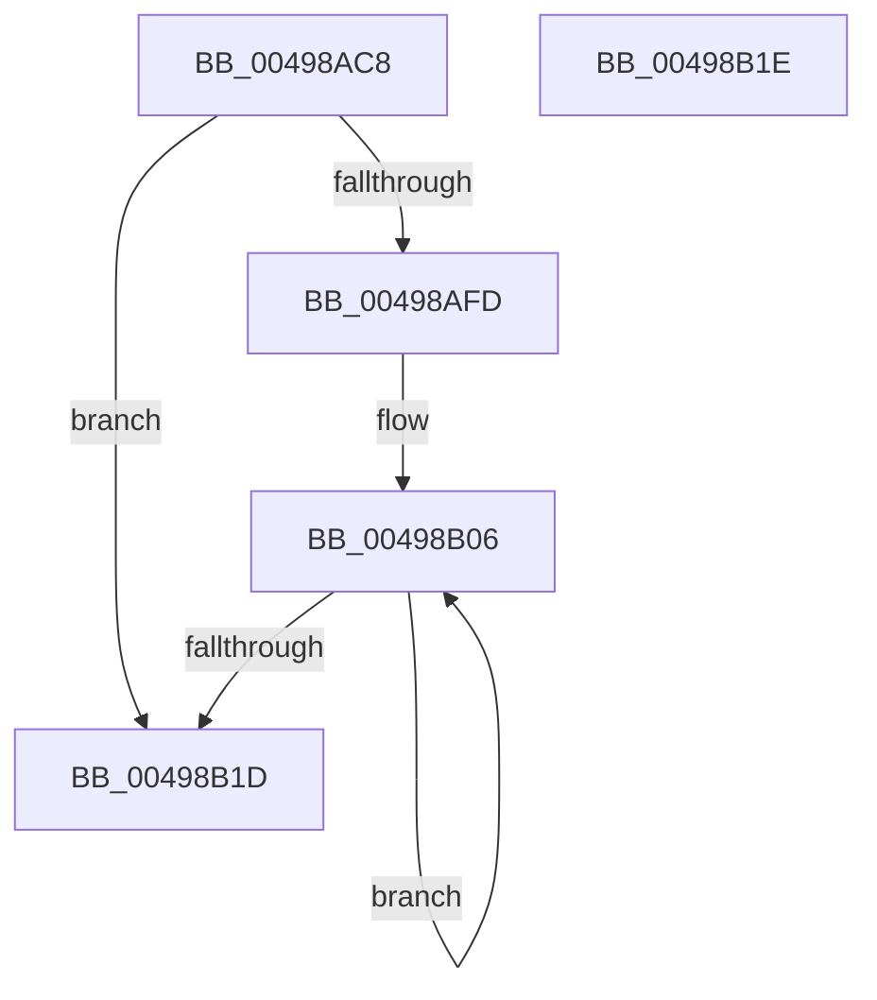

# MiSetSlabTypeIdentifiers

- RVA: `0x00498AC8`–`0x00498B1F` (길이 `87` bytes)
- VA: `0x0000000140498AC8`
- 실행 섹션: `.text`
- PDB 이름 있음: `예`; PDB Function 태그: `아니요`
- unwind 정보 RVA: `0x000DB714`
- 디코드: `27`개 명령, `87/87` bytes 표시
- 미해석 바이트: `0` (있으면 어셈블리에 `.byte`로 보존)

> 이 문서는 커널 이미지의 기계어와 PDB 기호를 분석해 생성했습니다. 4번과 5번은 함수 원형과 자료형을 바이너리 사용 방식에서 추정한 C 해석이며 원본 소스 복구 결과는 아닙니다.

## 1. Dependencies

- 직접 호출 지점: **0**; 고유 호출 대상: **0**
- 직접 호출자로 확인된 함수: **4**
- RIP 상대 이미지 참조: **1**

### Outgoing calls
- 직접 디코드된 call 명령이 없습니다.

### Direct callers
- [MiCreateSlabEntry](../37/MiCreateSlabEntry_function_00374DEC.md) at `0x003750B5`
- [MiChangeSlabEntryIdentity](../68/MiChangeSlabEntryIdentity_function_0068CE30.md) at `0x0068CEEB`
- [MiCreateBootSlabEntries](../../init/C6/MiCreateBootSlabEntries_function_00C69A50.md) at `0x00C69BEB`
- [MmUpdateSlabRangeType](../../init/C6/MmUpdateSlabRangeType_function_00C6A10C.md) at `0x00C6A255`

### Static image references
- `0x00498ADE` → RVA `0x00E3D240` (`.data`; read)

## 2. Other-region calls and transfers

- 다른 실행 섹션으로 향하는 call: **0**
- 별도 외부 분기/꼬리 이동을 확인하지 못했습니다.

## 3. Assembly (complete function range)

```asm
00498AC8  45 33 D2                        xor r10d, r10d
00498ACB  41 8D 40 01                     lea eax, [r8 + 1]
00498ACF  41 83 F8 09                     cmp r8d, 9
00498AD3  45 8A D9                        mov r11b, r9b
00498AD6  44 0F 45 D0                     cmovne r10d, eax
00498ADA  48 8D 42 FF                     lea rax, [rdx - 1]
00498ADE  48 8B 15 5B 47 9A 00            mov rdx, qword ptr [rip + 0x9a475b]
00498AE5  48 03 C1                        add rax, rcx
00498AE8  48 C1 E8 09                     shr rax, 9
00498AEC  48 C1 E9 09                     shr rcx, 9
00498AF0  4C 8D 0C 42                     lea r9, [rdx + rax*2]
00498AF4  4C 8D 04 4A                     lea r8, [rdx + rcx*2]
00498AF8  4D 3B C1                        cmp r8, r9
00498AFB  77 20                           ja 0x140498b1d
00498AFD  F7 5C 24 28                     neg dword ptr [rsp + 0x28]
00498B01  1A C9                           sbb cl, cl
00498B03  80 E1 80                        and cl, 0x80
00498B06  41 8A C3                        mov al, r11b
00498B09  45 88 10                        mov byte ptr [r8], r10b
00498B0C  24 7F                           and al, 0x7f
00498B0E  0A C1                           or al, cl
00498B10  41 88 40 01                     mov byte ptr [r8 + 1], al
00498B14  49 83 C0 02                     add r8, 2
00498B18  4D 3B C1                        cmp r8, r9
00498B1B  76 E9                           jbe 0x140498b06
00498B1D  C3                              ret
00498B1E  CC                              int3
```

## 4. C-style interpretation (structured pseudocode)

```c
__int64 __fastcall MiSetSlabTypeIdentifiers(__int64 a1, __int64 a2, __int64 a3, unsigned __int8 a4, unsigned int a5)
{
    __int64 result;
    __int64 v_r10;

    v_r10 = 0;
    if (((unsigned int)(a3)) != 9) { v_r10 = (unsigned int)(a3 + 1); }
    result = (a2 - 1) + (a1);
    result = (result) >> (9);
    a1 = (a1) >> (9);
    if ((*(unsigned __int64 *)(v_rip + 10110811) + a1 * 2) > (*(unsigned __int64 *)(v_rip + 10110811) + result * 2)) goto loc_00498B1D;
    a1 = (unsigned __int8)((a1) & (128));
loc_00498B06:
    *(unsigned __int8 *)(*(unsigned __int64 *)(v_rip + 10110811) + a1 * 2) = (unsigned __int8)(v_r10);
    result = (unsigned __int8)((a4) & (127));
    result = (unsigned __int8)((result) | ((unsigned __int8)(a1)));
    *(unsigned __int8 *)(*(unsigned __int64 *)(v_rip + 10110811) + a1 * 2 + 1) = (unsigned __int8)(result);
    a3 = (*(unsigned __int64 *)(v_rip + 10110811) + a1 * 2) + (2);
    if (a3 <= (*(unsigned __int64 *)(v_rip + 10110811) + result * 2)) goto loc_00498B06;
loc_00498B1D:
    return result;
}
```

## 5. (Beta) C Style

```c
int64_t MiSetSlabTypeIdentifiers(int64_t Arg1, void *Arg2, void *Arg3, uint8_t Arg4, uint32_t Arg5)
{
    uint8_t *arg2 = (uint8_t *)Arg2;
    uint8_t *arg3 = (uint8_t *)Arg3;

    int64_t result;
    int64_t local_r10;

    local_r10 = 0;
    if (((uint32_t)(Arg3)) != 9) { local_r10 = (uint32_t)(Arg3 + 1); }
    result = (Arg2 - 1) + (Arg1);
    result = (result) >> (9);
    Arg1 = (Arg1) >> (9);
    if ((*(uint64_t *)(v_rip + 0x9A475B) + Arg1 * 2) > (*(uint64_t *)(v_rip + 0x9A475B) + result * 2)) goto loc_00498B1D;
    Arg1 = (uint8_t)((Arg1) & (128));
loc_00498B06:
    *(uint8_t *)(*(uint64_t *)(v_rip + 0x9A475B) + Arg1 * 2) = (uint8_t)(local_r10);
    result = (uint8_t)((Arg4) & (127));
    result = (uint8_t)((result) | ((uint8_t)(Arg1)));
    *(uint8_t *)(*(uint64_t *)(v_rip + 0x9A475B) + Arg1 * 2 + 0x1) = (uint8_t)(result);
    Arg3 = (*(uint64_t *)(v_rip + 0x9A475B) + Arg1 * 2) + (2);
    if (Arg3 <= (*(uint64_t *)(v_rip + 0x9A475B) + result * 2)) goto loc_00498B06;
loc_00498B1D:
    return result;
}
```

### 관측된 메모리 오프셋

구조체 형식이 확인되지 않은 접근은 인자 기준의 오프셋으로만 기록했습니다.

| 기준 인자 | 오프셋 표현 | 폭 (bit) | 접근 |
|---|---:|---:|---|
| `Arg2` | `- 0x1` | `64` | `R` |
| `Arg3` | `+ 0x1` | `32` | `R` |

## 6. Execution-region graph

[열기: 2D/3D 그래프와 함수 탐색 컨트롤 패널](../../../control-panel.html?section=text&rva=0x00498AC8&view=graph)

- 2D 그래프는 위에서 아래로 흐르고, 3D 그래프는 빈 공간을 드래그해 회전합니다. Shift+드래그는 이동, 휠은 확대·축소, 함수 노드 선택은 대상 보고서 이동입니다.

### Static fallback


