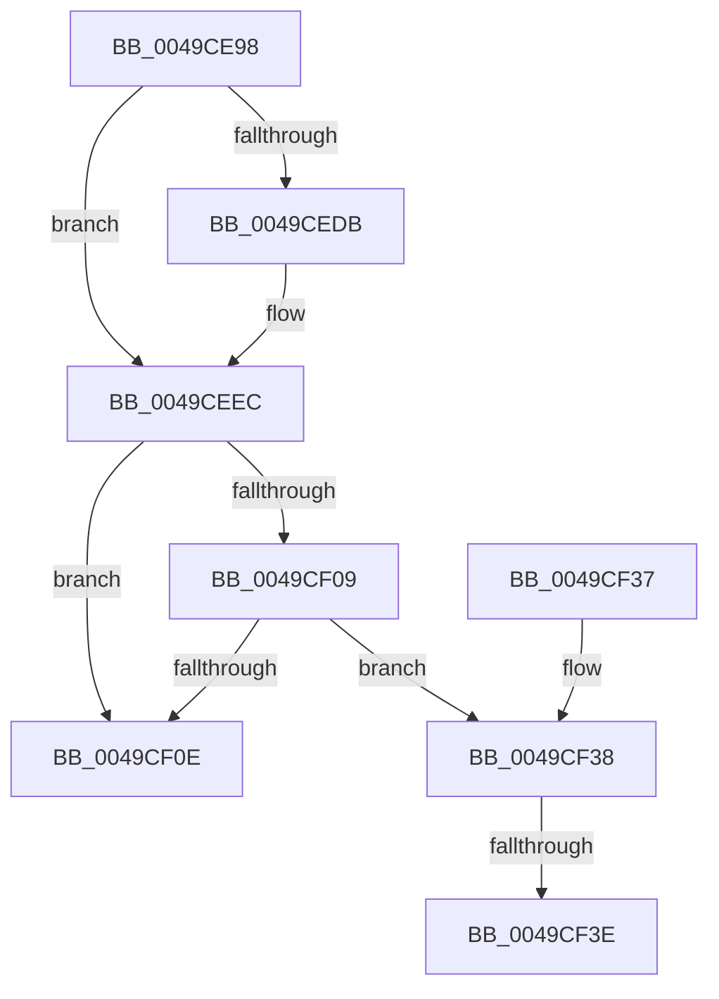

# MiSetSubsectionBase

- RVA: `0x0049CE98`–`0x0049CF47` (길이 `175` bytes)
- VA: `0x000000014049CE98`
- 실행 섹션: `.text`
- PDB 이름 있음: `예`; PDB Function 태그: `예`
- unwind 정보 RVA: `0x000B4E10`
- 디코드: `54`개 명령, `175/175` bytes 표시
- 미해석 바이트: `0` (있으면 어셈블리에 `.byte`로 보존)

> 이 문서는 커널 이미지의 기계어와 PDB 기호를 분석해 생성했습니다. 4번과 5번은 함수 원형과 자료형을 바이너리 사용 방식에서 추정한 C 해석이며 원본 소스 복구 결과는 아닙니다.

## 1. Dependencies

- 직접 호출 지점: **3**; 고유 호출 대상: **3**
- 직접 호출자로 확인된 함수: **2**
- RIP 상대 이미지 참조: **0**

### Outgoing calls
- `0x0049CEC9` → [ExAcquireSpinLockExclusive](../24/ExAcquireSpinLockExclusive_function_00248690.md) (function, `0x00248690`)
- `0x0049CEE3` → [MiIncrementSubsectionViewCount](../24/MiIncrementSubsectionViewCount_function_00249440.md) (function, `0x00249440`)
- `0x0049CF15` → [MiReleaseSpinLockExclusive](../24/MiReleaseSpinLockExclusive_function_002482C0.md) (function, `0x002482C0`)

### Direct callers
- [MiExtendSection](../../page/98/MiExtendSection_function_00982FDC.md) at `0x00983324`
- [MiAllocateFileExtents](../../page/AB/MiAllocateFileExtents_function_00ABDF54.md) at `0x00ABE405`

### Static image references
- 디코드된 RIP-relative 메모리 참조가 없습니다.

## 2. Other-region calls and transfers

- 다른 실행 섹션으로 향하는 call: **0**
- call이 아닌 외부 분기/꼬리 이동: **2**
  - `0x0049CF38` → [sub_006F8044](../6F/Unknown_function_006F8044.md) (`tail-transfer`)
  - `0x0049CF42` → [sub_006F8044 + 0xC](../6F/Unknown_function_006F8044.md) (`tail-transfer`)

## 3. Assembly (complete function range)

```asm
0049CE98  48 89 5C 24 08                  mov qword ptr [rsp + 8], rbx
0049CE9D  48 89 6C 24 10                  mov qword ptr [rsp + 0x10], rbp
0049CEA2  48 89 74 24 18                  mov qword ptr [rsp + 0x18], rsi
0049CEA7  57                              push rdi
0049CEA8  41 54                           push r12
0049CEAA  41 55                           push r13
0049CEAC  41 56                           push r14
0049CEAE  41 57                           push r15
0049CEB0  48 83 EC 20                     sub rsp, 0x20
0049CEB4  48 8B 19                        mov rbx, qword ptr [rcx]
0049CEB7  48 8B F9                        mov rdi, rcx
0049CEBA  4D 8B F9                        mov r15, r9
0049CEBD  41 8B F0                        mov esi, r8d
0049CEC0  4C 8B EA                        mov r13, rdx
0049CEC3  33 ED                           xor ebp, ebp
0049CEC5  48 8D 4B 48                     lea rcx, [rbx + 0x48]
0049CEC9  E8 C2 B7 DA FF                  call 0x140248690
0049CECE  44 8B 53 38                     mov r10d, dword ptr [rbx + 0x38]
0049CED2  44 8A E0                        mov r12b, al
0049CED5  41 F6 C2 20                     test r10b, 0x20
0049CED9  75 11                           jne 0x14049ceec
0049CEDB  33 D2                           xor edx, edx
0049CEDD  48 8B CF                        mov rcx, rdi
0049CEE0  48 8B EF                        mov rbp, rdi
0049CEE3  E8 58 C5 DA FF                  call 0x140249440
0049CEE8  4C 89 7F 70                     mov qword ptr [rdi + 0x70], r15
0049CEEC  8B 4F 20                        mov ecx, dword ptr [rdi + 0x20]
0049CEEF  83 C9 01                        or ecx, 1
0049CEF2  89 4F 20                        mov dword ptr [rdi + 0x20], ecx
0049CEF5  8B 47 30                        mov eax, dword ptr [rdi + 0x30]
0049CEF8  25 FF FF FF 3F                  and eax, 0x3fffffff
0049CEFD  4C 89 6F 08                     mov qword ptr [rdi + 8], r13
0049CF01  89 47 30                        mov dword ptr [rdi + 0x30], eax
0049CF04  48 85 ED                        test rbp, rbp
0049CF07  74 05                           je 0x14049cf0e
0049CF09  83 FE 01                        cmp esi, 1
0049CF0C  76 2A                           jbe 0x14049cf38
0049CF0E  41 8A D4                        mov dl, r12b
0049CF11  48 8D 4B 48                     lea rcx, [rbx + 0x48]
0049CF15  E8 A6 B3 DA FF                  call 0x1402482c0
0049CF1A  48 8B 5C 24 50                  mov rbx, qword ptr [rsp + 0x50]
0049CF1F  48 8B 6C 24 58                  mov rbp, qword ptr [rsp + 0x58]
0049CF24  48 8B 74 24 60                  mov rsi, qword ptr [rsp + 0x60]
0049CF29  48 83 C4 20                     add rsp, 0x20
0049CF2D  41 5F                           pop r15
0049CF2F  41 5E                           pop r14
0049CF31  41 5D                           pop r13
0049CF33  41 5C                           pop r12
0049CF35  5F                              pop rdi
0049CF36  C3                              ret
0049CF37  CC                              int3
0049CF38  0F 85 06 B1 25 00               jne 0x1406f8044
0049CF3E  0F BA E8 1E                     bts eax, 0x1e
0049CF42  E9 09 B1 25 00                  jmp 0x1406f8050
```

## 4. C-style interpretation (structured pseudocode)

```c
__int64 __fastcall MiSetSubsectionBase(__int64 a1, __int64 a2, int a3, __int64 a4)
{
    __int64 result;
    __int64 v_rbp;
    __int64 v_rsp;
    unsigned __int64 v_stack_p10;
    unsigned __int64 v_stack_p18;
    unsigned __int64 v_stack_p8;

    v_stack_p8 = v_rbx;
    v_stack_p10 = v_rbp;
    v_stack_p18 = v_rsi;
    v_rsp = (v_rsp) - (32);
    v_rbp = 0;
    result = ExAcquireSpinLockExclusive(*(unsigned __int64 *)(a1) + 72, a2, a3, a4);
    if ((((unsigned __int8)((unsigned int)(*(unsigned int *)(*(unsigned __int64 *)(a1) + 56)))) & (32)) == 0) {
        a2 = 0;
        a1 = a1;
        v_rbp = a1;
        result = MiIncrementSubsectionViewCount(a1, a2, a3, a4);
        *(unsigned __int64 *)(a1 + 112) = a4;
    }
    a1 = (unsigned int)(((unsigned int)(*(unsigned int *)(a1 + 32))) | (1));
    *(unsigned int *)(a1 + 32) = (unsigned int)(a1);
    result = (unsigned int)(((unsigned int)(*(unsigned int *)(a1 + 48))) & (0x3FFFFFFFULL));
    *(unsigned __int64 *)(a1 + 8) = 0;
    *(unsigned int *)(a1 + 48) = (unsigned int)(result);
    if (v_rbp == 0) goto loc_0049CF0E;
    if (((unsigned int)((unsigned int)(a3))) <= 1) goto loc_0049CF38;
loc_0049CF0E:
    result = MiReleaseSpinLockExclusive(*(unsigned __int64 *)(a1) + 72, (unsigned __int8)((unsigned __int8)(result)), a3, a4);
    v_rsp = (v_rsp) + (32);
    return result;
loc_0049CF38:
}
```

## 5. (Beta) C Style

```c
int64_t MiSetSubsectionBase(void *Arg1, int64_t Arg2, int32_t Arg3, int64_t Arg4)
{
    uint8_t *arg1 = (uint8_t *)Arg1;

    int64_t result;
    int64_t local_rbp;
    int64_t local_rsp;
    uint64_t v_stack_p10;
    uint64_t v_stack_p18;
    uint64_t v_stack_p8;

    v_stack_p8 = local_rbx;
    v_stack_p10 = local_rbp;
    v_stack_p18 = local_rsi;
    local_rsp = (local_rsp) - (32);
    local_rbp = 0;
    result = ExAcquireSpinLockExclusive(*(uint64_t *)(arg1) + 72, Arg2, Arg3, Arg4);
    if ((((uint8_t)((uint32_t)(*(uint32_t *)(*(uint64_t *)(arg1) + 0x38)))) & (32)) == 0) {
        Arg2 = 0;
        Arg1 = Arg1;
        local_rbp = Arg1;
        result = MiIncrementSubsectionViewCount(Arg1, Arg2, Arg3, Arg4);
        *(uint64_t *)(arg1 + 0x70) = Arg4;
    }
    Arg1 = (uint32_t)(((uint32_t)(*(uint32_t *)(arg1 + 0x20))) | (1));
    *(uint32_t *)(arg1 + 0x20) = (uint32_t)(Arg1);
    result = (uint32_t)(((uint32_t)(*(uint32_t *)(arg1 + 0x30))) & (0x3FFFFFFFULL));
    *(uint64_t *)(arg1 + 0x8) = 0;
    *(uint32_t *)(arg1 + 0x30) = (uint32_t)(result);
    if (local_rbp == 0) goto loc_0049CF0E;
    if (((uint32_t)((uint32_t)(Arg3))) <= 1) goto loc_0049CF38;
loc_0049CF0E:
    result = MiReleaseSpinLockExclusive(*(uint64_t *)(arg1) + 72, (uint8_t)((uint8_t)(result)), Arg3, Arg4);
    local_rsp = (local_rsp) + (32);
    return result;
loc_0049CF38:
}
```

### 관측된 메모리 오프셋

구조체 형식이 확인되지 않은 접근은 인자 기준의 오프셋으로만 기록했습니다.

| 기준 인자 | 오프셋 표현 | 폭 (bit) | 접근 |
|---|---:|---:|---|
| `Arg1` | `+ 0x0` | `64` | `R` |
| `Arg1` | `+ 0x8` | `64` | `W` |
| `Arg1` | `+ 0x20` | `32` | `R` |
| `Arg1` | `+ 0x20` | `32` | `W` |
| `Arg1` | `+ 0x30` | `32` | `R` |
| `Arg1` | `+ 0x30` | `32` | `W` |
| `Arg1` | `+ 0x70` | `64` | `W` |

## 6. Execution-region graph

[열기: 2D/3D 그래프와 함수 탐색 컨트롤 패널](../../../control-panel.html?section=text&rva=0x0049CE98&view=graph)

- 2D 그래프는 위에서 아래로 흐르고, 3D 그래프는 빈 공간을 드래그해 회전합니다. Shift+드래그는 이동, 휠은 확대·축소, 함수 노드 선택은 대상 보고서 이동입니다.

### Static fallback


