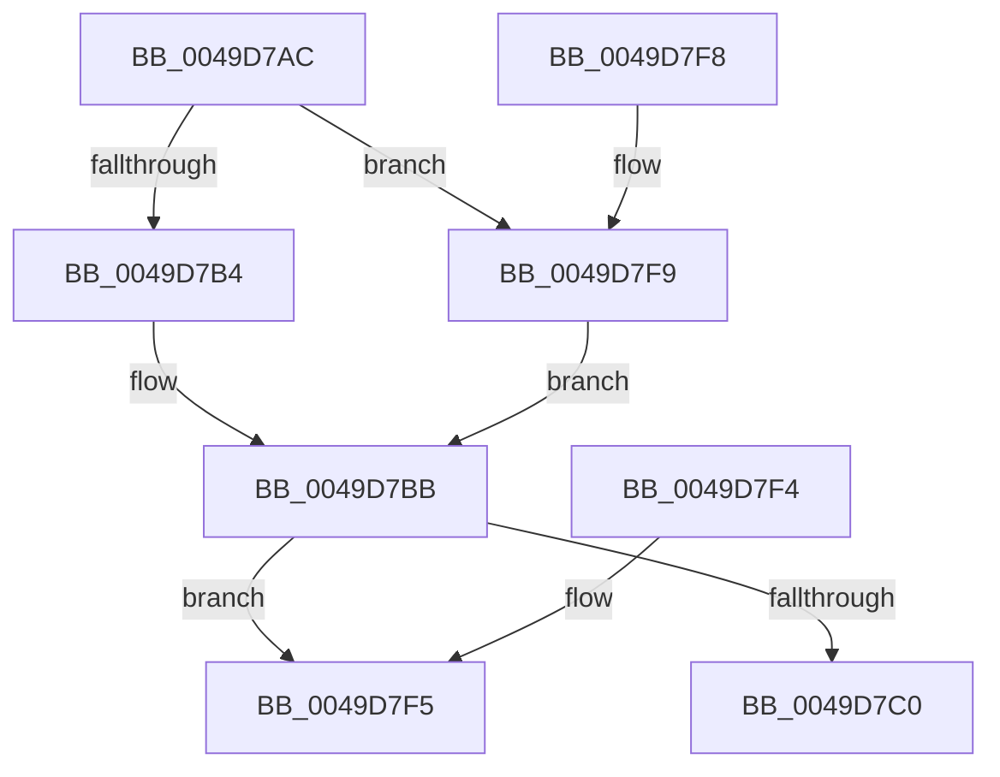

# MiShouldTrimUnusedSegments

- RVA: `0x0049D7AC`–`0x0049D809` (길이 `93` bytes)
- VA: `0x000000014049D7AC`
- 실행 섹션: `.text`
- PDB 이름 있음: `예`; PDB Function 태그: `아니요`
- unwind 정보 RVA: `0x000DB714`
- 디코드: `26`개 명령, `93/93` bytes 표시
- 미해석 바이트: `0` (있으면 어셈블리에 `.byte`로 보존)

> 이 문서는 커널 이미지의 기계어와 PDB 기호를 분석해 생성했습니다. 4번과 5번은 함수 원형과 자료형을 바이너리 사용 방식에서 추정한 C 해석이며 원본 소스 복구 결과는 아닙니다.

## 1. Dependencies

- 직접 호출 지점: **0**; 고유 호출 대상: **0**
- 직접 호출자로 확인된 함수: **4**
- RIP 상대 이미지 참조: **2**

### Outgoing calls
- 직접 디코드된 call 명령이 없습니다.

### Direct callers
- [MiCheckControlArea](../28/MiCheckControlArea_function_002861B0.md) at `0x002864B2`
- [MiFreeExcessSegments](../32/MiFreeExcessSegments_function_00327F50.md) at `0x00327F7E`
- [MiComputeUnusedSegmentReduction](../46/MiComputeUnusedSegmentReduction_function_00464E58.md) at `0x00464F19`
- [sub_006F2C92](../6F/Unknown_function_006F2C92.md) at `0x006F2CC7`
- [sub_006F2C92](../6F/Unknown_function_006F2C92.md) at `0x006F2CF7`

### Static image references
- `0x0049D7F9` → RVA `0x00E2CD18` (`.data`; read)
- `0x0049D800` → RVA `0x00E38D00` (`.data`; read)

## 2. Other-region calls and transfers

- 다른 실행 섹션으로 향하는 call: **0**
- 별도 외부 분기/꼬리 이동을 확인하지 못했습니다.

## 3. Assembly (complete function range)

```asm
0049D7AC  45 33 C9                        xor r9d, r9d
0049D7AF  48 85 C9                        test rcx, rcx
0049D7B2  74 45                           je 0x14049d7f9
0049D7B4  4C 8B 81 38 08 00 00            mov r8, qword ptr [rcx + 0x838]
0049D7BB  4D 85 C0                        test r8, r8
0049D7BE  74 35                           je 0x14049d7f5
0049D7C0  48 8B 89 98 4C 00 00            mov rcx, qword ptr [rcx + 0x4c98]
0049D7C7  48 B8 15 AE 47 E1 7A 14 AE 47   movabs rax, 0x47ae147ae147ae15
0049D7D1  48 F7 E1                        mul rcx
0049D7D4  49 C1 E8 0C                     shr r8, 0xc
0049D7D8  48 2B CA                        sub rcx, rdx
0049D7DB  48 D1 E9                        shr rcx, 1
0049D7DE  48 03 CA                        add rcx, rdx
0049D7E1  48 C1 E9 06                     shr rcx, 6
0049D7E5  48 8D 0C 49                     lea rcx, [rcx + rcx*2]
0049D7E9  4C 3B C1                        cmp r8, rcx
0049D7EC  41 0F 97 C1                     seta r9b
0049D7F0  41 8B C1                        mov eax, r9d
0049D7F3  C3                              ret
0049D7F4  CC                              int3
0049D7F5  33 C0                           xor eax, eax
0049D7F7  C3                              ret
0049D7F8  CC                              int3
0049D7F9  4C 8B 05 18 F5 98 00            mov r8, qword ptr [rip + 0x98f518]
0049D800  48 8D 0D F9 B4 99 00            lea rcx, [rip + 0x99b4f9]
0049D807  EB B2                           jmp 0x14049d7bb
```

## 4. C-style interpretation (structured pseudocode)

```c
__int64 __fastcall MiShouldTrimUnusedSegments(__int64 a1, __int64 a2, __int64 a3, int a4)
{
    __int64 result;

    a4 = 0;
    if (a1 == 0) goto loc_0049D7F9;
loc_0049D7BB:
    if (*(unsigned __int64 *)(a1 + 2104) == 0) goto loc_0049D7F5;
    a3 = (*(unsigned __int64 *)(a1 + 2104)) >> (12);
    a1 = (*(unsigned __int64 *)(a1 + 19608)) - (a2);
    a1 = (a1) >> (1);
    a1 = (a1) + (a2);
    a1 = (a1) >> (6);
    a4 = (a3 > (a1 + a1 * 2)) ? 1 : 0;
    return (unsigned int)(a4);
loc_0049D7F5:
    result = 0;
    return result;
loc_0049D7F9:
    goto loc_0049D7BB;
}
```

## 5. (Beta) C Style

```c
int64_t MiShouldTrimUnusedSegments(int64_t Arg1, int64_t Arg2, int64_t Arg3, int32_t Arg4)
{
    int64_t result;

    Arg4 = 0;
    if (Arg1 == 0) goto loc_0049D7F9;
loc_0049D7BB:
    if (*(uint64_t *)(Arg1 + 0x838) == 0) goto loc_0049D7F5;
    Arg3 = (*(uint64_t *)(Arg1 + 0x838)) >> (12);
    Arg1 = (*(uint64_t *)(Arg1 + 0x4C98)) - (Arg2);
    Arg1 = (Arg1) >> (1);
    Arg1 = (Arg1) + (Arg2);
    Arg1 = (Arg1) >> (6);
    Arg4 = (Arg3 > (Arg1 + Arg1 * 2)) ? 1 : 0;
    return (uint32_t)(Arg4);
loc_0049D7F5:
    result = 0;
    return result;
loc_0049D7F9:
    goto loc_0049D7BB;
}
```

## 6. Execution-region graph

[열기: 2D/3D 그래프와 함수 탐색 컨트롤 패널](../../../control-panel.html?section=text&rva=0x0049D7AC&view=graph)

- 2D 그래프는 위에서 아래로 흐르고, 3D 그래프는 빈 공간을 드래그해 회전합니다. Shift+드래그는 이동, 휠은 확대·축소, 함수 노드 선택은 대상 보고서 이동입니다.

### Static fallback


