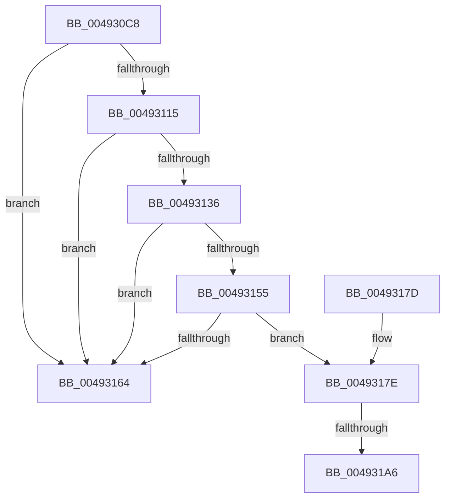

# MiSimpleAging

- RVA: `0x004930C8`–`0x004931B7` (길이 `239` bytes)
- VA: `0x00000001404930C8`
- 실행 섹션: `.text`
- PDB 이름 있음: `예`; PDB Function 태그: `예`
- unwind 정보 RVA: `0x000B30A0`
- 디코드: `61`개 명령, `239/239` bytes 표시
- 미해석 바이트: `0` (있으면 어셈블리에 `.byte`로 보존)

> 이 문서는 커널 이미지의 기계어와 PDB 기호를 분석해 생성했습니다. 4번과 5번은 함수 원형과 자료형을 바이너리 사용 방식에서 추정한 C 해석이며 원본 소스 복구 결과는 아닙니다.

## 1. Dependencies

- 직접 호출 지점: **2**; 고유 호출 대상: **1**
- 직접 호출자로 확인된 함수: **1**
- RIP 상대 이미지 참조: **0**

### Outgoing calls
- `0x004930F4` → [memset](../6C/memset_function_006C6C40.md) (function, `0x006C6C40`)
- `0x00493106` → [memset](../6C/memset_function_006C6C40.md) (function, `0x006C6C40`)

### Direct callers
- [MiReduceWs](../27/MiReduceWs_function_0027E908.md) at `0x0027E975`

### Static image references
- 디코드된 RIP-relative 메모리 참조가 없습니다.

## 2. Other-region calls and transfers

- 다른 실행 섹션으로 향하는 call: **0**
- call이 아닌 외부 분기/꼬리 이동: **2**
  - `0x004931A0` → [sub_006F7146](../6F/Unknown_function_006F7146.md) (`tail-transfer`)
  - `0x004931B2` → [sub_006F7146 + 0x19](../6F/Unknown_function_006F7146.md) (`tail-transfer`)

## 3. Assembly (complete function range)

```asm
004930C8  48 8B C4                        mov rax, rsp
004930CB  48 89 58 08                     mov qword ptr [rax + 8], rbx
004930CF  48 89 70 10                     mov qword ptr [rax + 0x10], rsi
004930D3  48 89 78 18                     mov qword ptr [rax + 0x18], rdi
004930D7  55                              push rbp
004930D8  48 8D 68 C8                     lea rbp, [rax - 0x38]
004930DC  48 81 EC 30 01 00 00            sub rsp, 0x130
004930E3  40 8A FA                        mov dil, dl
004930E6  48 8B D9                        mov rbx, rcx
004930E9  33 D2                           xor edx, edx
004930EB  48 8D 4C 24 20                  lea rcx, [rsp + 0x20]
004930F0  44 8D 42 50                     lea r8d, [rdx + 0x50]
004930F4  E8 47 3B 23 00                  call 0x1406c6c40
004930F9  33 D2                           xor edx, edx
004930FB  48 8D 4C 24 70                  lea rcx, [rsp + 0x70]
00493100  41 B8 C0 00 00 00               mov r8d, 0xc0
00493106  E8 35 3B 23 00                  call 0x1406c6c40
0049310B  8B 83 B8 00 00 00               mov eax, dword ptr [rbx + 0xb8]
00493111  A8 40                           test al, 0x40
00493113  74 4F                           je 0x140493164
00493115  4C 8B 83 90 00 00 00            mov r8, qword ptr [rbx + 0x90]
0049311C  48 BE CD CC CC CC CC CC CC CC   movabs rsi, 0xcccccccccccccccd
00493126  48 8B C6                        mov rax, rsi
00493129  48 F7 63 78                     mul qword ptr [rbx + 0x78]
0049312D  48 83 E2 FC                     and rdx, 0xfffffffffffffffc
00493131  4C 3B C2                        cmp r8, rdx
00493134  72 2E                           jb 0x140493164
00493136  4C 8B 4B 28                     mov r9, qword ptr [rbx + 0x28]
0049313A  48 8B C6                        mov rax, rsi
0049313D  4C 8B 5B 10                     mov r11, qword ptr [rbx + 0x10]
00493141  49 F7 E0                        mul r8
00493144  4D 8B 53 20                     mov r10, qword ptr [r11 + 0x20]
00493148  48 83 E2 FC                     and rdx, 0xfffffffffffffffc
0049314C  4B 8D 0C 0A                     lea rcx, [r10 + r9]
00493150  48 3B CA                        cmp rcx, rdx
00493153  72 0F                           jb 0x140493164
00493155  4D 2B C2                        sub r8, r10
00493158  4D 2B C1                        sub r8, r9
0049315B  49 81 F8 00 04 00 00            cmp r8, 0x400
00493162  72 1A                           jb 0x14049317e
00493164  4C 8D 9C 24 30 01 00 00         lea r11, [rsp + 0x130]
0049316C  49 8B 5B 10                     mov rbx, qword ptr [r11 + 0x10]
00493170  49 8B 73 18                     mov rsi, qword ptr [r11 + 0x18]
00493174  49 8B 7B 20                     mov rdi, qword ptr [r11 + 0x20]
00493178  49 8B E3                        mov rsp, r11
0049317B  5D                              pop rbp
0049317C  C3                              ret
0049317D  CC                              int3
0049317E  49 C1 E9 05                     shr r9, 5
00493182  B8 08 00 00 00                  mov eax, 8
00493187  4C 3B C8                        cmp r9, rax
0049318A  BA 01 00 00 00                  mov edx, 1
0049318F  4C 0F 42 C8                     cmovb r9, rax
00493193  8B 83 B8 00 00 00               mov eax, dword ptr [rbx + 0xb8]
00493199  4C 89 4C 24 50                  mov qword ptr [rsp + 0x50], r9
0049319E  A8 0F                           test al, 0xf
004931A0  0F 85 A0 3F 26 00               jne 0x1406f7146
004931A6  33 C9                           xor ecx, ecx
004931A8  48 39 8B 70 02 00 00            cmp qword ptr [rbx + 0x270], rcx
004931AF  0F 95 C1                        setne cl
004931B2  E9 A8 3F 26 00                  jmp 0x1406f715f
```

## 4. C-style interpretation (structured pseudocode)

```c
__int64 __fastcall MiSimpleAging(__int64 a1, int a2)
{
    __int64 result;
    __int64 v_rsp;
    unsigned __int64 v_stack_m118;
    unsigned __int64 v_stack_m8;
    unsigned __int64 v_stack_mC8;
    unsigned __int64 v_stack_mE0;

    *(unsigned __int64 *)(v_rsp + 8) = v_rbx;
    *(unsigned __int64 *)(v_rsp + 16) = v_rsi;
    *(unsigned __int64 *)(v_rsp + 24) = v_rdi;
    v_rsp = (v_rsp) - (304);
    a2 = 0;
    result = memset(v_stack_m118, a2, a2 + 80, a4);
    a2 = 0;
    result = memset(v_stack_mC8, a2, 192, a4);
    if ((((unsigned __int8)((unsigned int)(*(unsigned int *)(a1 + 184)))) & (64)) == 0) goto loc_00493164;
    a2 = (a2) & (-4);
    if ((*(unsigned __int64 *)(a1 + 144)) < a2) goto loc_00493164;
    a2 = (a2) & (-4);
    if ((*(unsigned __int64 *)(*(unsigned __int64 *)(a1 + 16) + 32) + *(unsigned __int64 *)(a1 + 40) * 1) < a2) goto loc_00493164;
    a3 = (*(unsigned __int64 *)(a1 + 144)) - (*(unsigned __int64 *)(*(unsigned __int64 *)(a1 + 16) + 32));
    a3 = (a3) - (*(unsigned __int64 *)(a1 + 40));
    if (a3 < 0x400ULL) goto loc_0049317E;
loc_00493164:
    return v_rsi;
loc_0049317E:
    a4 = (*(unsigned __int64 *)(a1 + 40)) >> (5);
    if (a4 < 8) { a4 = 8; }
    v_stack_mE0 = a4;
    a1 = 0;
    a1 = ((*(unsigned __int64 *)(*(unsigned __int64 *)(v_stack_m8 + 16) + 624)) != 0) ? 1 : 0;
}
```

## 5. (Beta) C Style

```c
int64_t MiSimpleAging(void *Arg1, int32_t Arg2)
{
    uint8_t *arg1 = (uint8_t *)Arg1;

    int64_t result;
    int64_t local_rsp;
    uint64_t v_stack_m118;
    uint64_t v_stack_m8;
    uint64_t v_stack_mC8;
    uint64_t v_stack_mE0;

    *(uint64_t *)(local_rsp + 0x8) = local_rbx;
    *(uint64_t *)(local_rsp + 0x10) = local_rsi;
    *(uint64_t *)(local_rsp + 0x18) = local_rdi;
    local_rsp = (local_rsp) - (304);
    Arg2 = 0;
    result = memset(v_stack_m118, Arg2, Arg2 + 80, a4);
    Arg2 = 0;
    result = memset(v_stack_mC8, Arg2, 192, a4);
    if ((((uint8_t)((uint32_t)(*(uint32_t *)(arg1 + 0xB8)))) & (64)) == 0) goto loc_00493164;
    Arg2 = (Arg2) & (-4);
    if ((*(uint64_t *)(arg1 + 0x90)) < Arg2) goto loc_00493164;
    Arg2 = (Arg2) & (-4);
    if ((*(uint64_t *)(*(uint64_t *)(arg1 + 0x10) + 0x20) + *(uint64_t *)(arg1 + 0x28) * 1) < Arg2) goto loc_00493164;
    a3 = (*(uint64_t *)(arg1 + 0x90)) - (*(uint64_t *)(*(uint64_t *)(arg1 + 0x10) + 0x20));
    a3 = (a3) - (*(uint64_t *)(arg1 + 0x28));
    if (a3 < 0x400ULL) goto loc_0049317E;
loc_00493164:
    return local_rsi;
loc_0049317E:
    a4 = (*(uint64_t *)(arg1 + 0x28)) >> (5);
    if (a4 < 8) { a4 = 8; }
    v_stack_mE0 = a4;
    Arg1 = 0;
    Arg1 = ((*(uint64_t *)(*(uint64_t *)(v_stack_m8 + 0x10) + 0x270)) != 0) ? 1 : 0;
}
```

### 관측된 메모리 오프셋

구조체 형식이 확인되지 않은 접근은 인자 기준의 오프셋으로만 기록했습니다.

| 기준 인자 | 오프셋 표현 | 폭 (bit) | 접근 |
|---|---:|---:|---|
| `Arg1` | `+ 0x10` | `64` | `R` |
| `Arg1` | `+ 0x28` | `64` | `R` |
| `Arg1` | `+ 0x78` | `64` | `R` |
| `Arg1` | `+ 0x90` | `64` | `R` |
| `Arg1` | `+ 0xB8` | `32` | `R` |
| `Arg1` | `+ 0x270` | `64` | `R` |

## 6. Execution-region graph

[열기: 2D/3D 그래프와 함수 탐색 컨트롤 패널](../../../control-panel.html?section=text&rva=0x004930C8&view=graph)

- 2D 그래프는 위에서 아래로 흐르고, 3D 그래프는 빈 공간을 드래그해 회전합니다. Shift+드래그는 이동, 휠은 확대·축소, 함수 노드 선택은 대상 보고서 이동입니다.

### Static fallback


