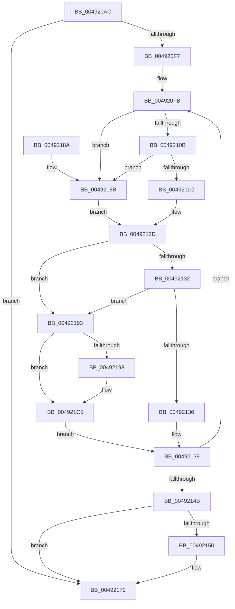

# MiStoreUpdatePagefileHash

- RVA: `0x004920AC`–`0x004921D8` (길이 `300` bytes)
- VA: `0x00000001404920AC`
- 실행 섹션: `.text`
- PDB 이름 있음: `예`; PDB Function 태그: `아니요`
- unwind 정보 RVA: `0x000B2F04`
- 디코드: `91`개 명령, `300/300` bytes 표시
- 미해석 바이트: `0` (있으면 어셈블리에 `.byte`로 보존)

> 이 문서는 커널 이미지의 기계어와 PDB 기호를 분석해 생성했습니다. 4번과 5번은 함수 원형과 자료형을 바이너리 사용 방식에서 추정한 C 해석이며 원본 소스 복구 결과는 아닙니다.

## 1. Dependencies

- 직접 호출 지점: **3**; 고유 호출 대상: **2**
- 직접 호출자로 확인된 함수: **1**
- RIP 상대 이미지 참조: **1**

### Outgoing calls
- `0x00492126` → [MiGetPagingFileOffset](../36/MiGetPagingFileOffset_function_0036F530.md) (function, `0x0036F530`)
- `0x0049216D` → [MiMapPageFileHash](MiMapPageFileHash_function_004921E0.md) (function, `0x004921E0`)
- `0x004921B5` → [MiMapPageFileHash](MiMapPageFileHash_function_004921E0.md) (function, `0x004921E0`)

### Direct callers
- [MiStoreWriteModifiedPages](../2B/MiStoreWriteModifiedPages_function_002B46C4.md) at `0x002B53A4`

### Static image references
- `0x004920FB` → RVA `0x00E37478` (`.data`; read)

## 2. Other-region calls and transfers

- 다른 실행 섹션으로 향하는 call: **0**
- 별도 외부 분기/꼬리 이동을 확인하지 못했습니다.

## 3. Assembly (complete function range)

```asm
004920AC  48 89 5C 24 18                  mov qword ptr [rsp + 0x18], rbx
004920B1  48 89 54 24 10                  mov qword ptr [rsp + 0x10], rdx
004920B6  48 89 4C 24 08                  mov qword ptr [rsp + 8], rcx
004920BB  55                              push rbp
004920BC  56                              push rsi
004920BD  57                              push rdi
004920BE  41 54                           push r12
004920C0  41 55                           push r13
004920C2  41 56                           push r14
004920C4  41 57                           push r15
004920C6  48 83 EC 30                     sub rsp, 0x30
004920CA  48 8B 42 38                     mov rax, qword ptr [rdx + 0x38]
004920CE  45 33 D2                        xor r10d, r10d
004920D1  4D 8B E8                        mov r13, r8
004920D4  48 89 44 24 70                  mov qword ptr [rsp + 0x70], rax
004920D9  45 8B E1                        mov r12d, r9d
004920DC  41 B8 10 00 00 00               mov r8d, 0x10
004920E2  41 8B F8                        mov edi, r8d
004920E5  45 8B CA                        mov r9d, r10d
004920E8  45 8B DA                        mov r11d, r10d
004920EB  41 8B DA                        mov ebx, r10d
004920EE  4D 8D 7D 30                     lea r15, [r13 + 0x30]
004920F2  45 85 E4                        test r12d, r12d
004920F5  74 7B                           je 0x140492172
004920F7  45 8D 70 50                     lea r14d, [r8 + 0x50]
004920FB  48 8B 05 76 53 9A 00            mov rax, qword ptr [rip + 0x9a5376]
00492102  49 39 07                        cmp qword ptr [r15], rax
00492105  0F 84 80 00 00 00               je 0x14049218b
0049210B  48 8B 4A 48                     mov rcx, qword ptr [rdx + 0x48]
0049210F  49 8B 0C 0E                     mov rcx, qword ptr [r14 + rcx]
00492113  8A C1                           mov al, cl
00492115  C0 E8 02                        shr al, 2
00492118  A8 01                           test al, 1
0049211A  74 6F                           je 0x14049218b
0049211C  48 8B F1                        mov rsi, rcx
0049211F  48 C1 EE 0C                     shr rsi, 0xc
00492123  83 E6 0F                        and esi, 0xf
00492126  E8 05 D4 ED FF                  call 0x14036f530
0049212B  8B E8                           mov ebp, eax
0049212D  41 3B EB                        cmp ebp, r11d
00492130  75 61                           jne 0x140492193
00492132  3B FE                           cmp edi, esi
00492134  75 5D                           jne 0x140492193
00492136  41 FF C2                        inc r10d
00492139  FF C3                           inc ebx
0049213B  49 83 C6 08                     add r14, 8
0049213F  49 83 C7 08                     add r15, 8
00492143  41 FF C3                        inc r11d
00492146  41 3B DC                        cmp ebx, r12d
00492149  72 B0                           jb 0x1404920fb
0049214B  41 3B F8                        cmp edi, r8d
0049214E  74 22                           je 0x140492172
00492150  48 8B 44 24 70                  mov rax, qword ptr [rsp + 0x70]
00492155  41 2B DA                        sub ebx, r10d
00492158  8B CF                           mov ecx, edi
0049215A  49 8B D5                        mov rdx, r13
0049215D  44 8B C3                        mov r8d, ebx
00492160  44 89 54 24 20                  mov dword ptr [rsp + 0x20], r10d
00492165  48 8B 8C C8 60 48 00 00         mov rcx, qword ptr [rax + rcx*8 + 0x4860]
0049216D  E8 6E 00 00 00                  call 0x1404921e0
00492172  48 8B 9C 24 80 00 00 00         mov rbx, qword ptr [rsp + 0x80]
0049217A  48 83 C4 30                     add rsp, 0x30
0049217E  41 5F                           pop r15
00492180  41 5E                           pop r14
00492182  41 5D                           pop r13
00492184  41 5C                           pop r12
00492186  5F                              pop rdi
00492187  5E                              pop rsi
00492188  5D                              pop rbp
00492189  C3                              ret
0049218A  CC                              int3
0049218B  41 8B EB                        mov ebp, r11d
0049218E  41 8B F0                        mov esi, r8d
00492191  EB 9A                           jmp 0x14049212d
00492193  41 3B F8                        cmp edi, r8d
00492196  74 2D                           je 0x1404921c5
00492198  48 8B 44 24 70                  mov rax, qword ptr [rsp + 0x70]
0049219D  44 8B C3                        mov r8d, ebx
004921A0  8B CF                           mov ecx, edi
004921A2  45 2B C2                        sub r8d, r10d
004921A5  49 8B D5                        mov rdx, r13
004921A8  44 89 54 24 20                  mov dword ptr [rsp + 0x20], r10d
004921AD  48 8B 8C C8 60 48 00 00         mov rcx, qword ptr [rax + rcx*8 + 0x4860]
004921B5  E8 26 00 00 00                  call 0x1404921e0
004921BA  48 8B 54 24 78                  mov rdx, qword ptr [rsp + 0x78]
004921BF  41 B8 10 00 00 00               mov r8d, 0x10
004921C5  8B FE                           mov edi, esi
004921C7  44 8B CD                        mov r9d, ebp
004921CA  44 8B DD                        mov r11d, ebp
004921CD  41 BA 01 00 00 00               mov r10d, 1
004921D3  E9 61 FF FF FF                  jmp 0x140492139
```

## 4. C-style interpretation (structured pseudocode)

```c
__int64 __fastcall MiStoreUpdatePagefileHash(__int64 a1, __int64 a2, __int64 a3, int a4)
{
    __int64 result;
    __int64 v_r10;
    __int64 v_r11;
    __int64 v_r14;
    __int64 v_r15;
    __int64 v_rbx;
    __int64 v_rsi;
    __int64 v_rsp;
    unsigned int v_stack_m48;
    unsigned __int64 v_stack_p10;
    unsigned __int64 v_stack_p18;
    unsigned int v_stack_p20;
    unsigned __int64 v_stack_p70;
    unsigned __int64 v_stack_p78;
    unsigned __int64 v_stack_p8;

    v_stack_p18 = v_rbx;
    v_stack_p10 = a2;
    v_stack_p8 = a1;
    v_rsp = (v_rsp) - (48);
    v_r10 = 0;
    v_stack_p8 = *(unsigned __int64 *)(a2 + 56);
    if ((unsigned int)((unsigned int)(a4)) == 0) goto loc_00492172;
loc_004920FB:
    if ((*(unsigned __int64 *)(a3 + 48)) == (*(unsigned __int64 *)(v_rip + 10113910))) goto loc_0049218B;
    result = (unsigned __int8)(((unsigned __int8)(*(unsigned __int64 *)(16 + 80 + *(unsigned __int64 *)(a2 + 72) * 1))) >> (2));
    if ((((unsigned __int8)(result)) & (1)) == 0) goto loc_0049218B;
    v_rsi = (*(unsigned __int64 *)(16 + 80 + *(unsigned __int64 *)(a2 + 72) * 1)) >> (12);
    v_rsi = (unsigned int)((v_rsi) & (15));
    result = MiGetPagingFileOffset(*(unsigned __int64 *)(16 + 80 + *(unsigned __int64 *)(a2 + 72) * 1), a2, 16, 0);
loc_0049212D:
    if (((unsigned int)((unsigned int)((unsigned int)(result)))) != 0) goto loc_00492193;
    if (16 != ((unsigned int)(v_rsi))) goto loc_00492193;
    v_r10 = (unsigned int)((v_r10) + 1);
loc_00492139:
    v_rbx = (unsigned int)((0) + 1);
    v_r14 = (16 + 80) + (8);
    v_r15 = (a3 + 48) + (8);
    v_r11 = (unsigned int)((0) + 1);
    if (((unsigned int)(v_rbx)) < ((unsigned int)((unsigned int)(a4)))) goto loc_004920FB;
    if (16 != 16) {
        result = v_stack_p8;
        v_rbx = (unsigned int)((v_rbx) - ((unsigned int)(v_r10)));
        a1 = 16;
        a2 = a3;
        a3 = (unsigned int)(v_rbx);
        v_stack_m48 = (unsigned int)(v_r10);
        a1 = *(unsigned __int64 *)(result + a1 * 8 + 18528);
        result = MiMapPageFileHash(a1, a2, a3, 0);
    }
    v_rsp = (v_rsp) + (48);
    return result;
loc_0049218B:
    goto loc_0049212D;
loc_00492193:
    if (16 != ((unsigned int)(a3))) {
        result = v_stack_p70;
        a3 = (unsigned int)(v_stack_p18);
        a1 = 16;
        a3 = (unsigned int)((a3) - ((unsigned int)(v_r10)));
        a2 = a3;
        v_stack_p20 = (unsigned int)(v_r10);
        a1 = *(unsigned __int64 *)(result + a1 * 8 + 18528);
        result = MiMapPageFileHash(a1, a2, a3, 0);
        a2 = v_stack_p78;
        a3 = 16;
    }
    goto loc_00492139;
}
```

## 5. (Beta) C Style

```c
int64_t MiStoreUpdatePagefileHash(int64_t Arg1, void *Arg2, void *Arg3, int32_t Arg4)
{
    uint8_t *arg2 = (uint8_t *)Arg2;
    uint8_t *arg3 = (uint8_t *)Arg3;

    int64_t result;
    int64_t local_r10;
    int64_t local_r11;
    int64_t local_r14;
    int64_t local_r15;
    int64_t local_rbx;
    int64_t local_rsi;
    int64_t local_rsp;
    uint32_t v_stack_m48;
    uint64_t v_stack_p10;
    uint64_t v_stack_p18;
    uint32_t v_stack_p20;
    uint64_t v_stack_p70;
    uint64_t v_stack_p78;
    uint64_t v_stack_p8;

    v_stack_p18 = local_rbx;
    v_stack_p10 = Arg2;
    v_stack_p8 = Arg1;
    local_rsp = (local_rsp) - (48);
    local_r10 = 0;
    v_stack_p8 = *(uint64_t *)(arg2 + 0x38);
    if ((uint32_t)((uint32_t)(Arg4)) == 0) goto loc_00492172;
loc_004920FB:
    if ((*(uint64_t *)(arg3 + 0x30)) == (*(uint64_t *)(v_rip + 0x9A5376))) goto loc_0049218B;
    result = (uint8_t)(((uint8_t)(*(uint64_t *)(16 + 0x50 + *(uint64_t *)(arg2 + 0x48) * 1))) >> (2));
    if ((((uint8_t)(result)) & (1)) == 0) goto loc_0049218B;
    local_rsi = (*(uint64_t *)(16 + 0x50 + *(uint64_t *)(arg2 + 0x48) * 1)) >> (12);
    local_rsi = (uint32_t)((local_rsi) & (15));
    result = MiGetPagingFileOffset(*(uint64_t *)(16 + 0x50 + *(uint64_t *)(arg2 + 0x48) * 1), Arg2, 16, 0);
loc_0049212D:
    if (((uint32_t)((uint32_t)((uint32_t)(result)))) != 0) goto loc_00492193;
    if (16 != ((uint32_t)(local_rsi))) goto loc_00492193;
    local_r10 = (uint32_t)((local_r10) + 1);
loc_00492139:
    local_rbx = (uint32_t)((0) + 1);
    local_r14 = (16 + 80) + (8);
    local_r15 = (Arg3 + 48) + (8);
    local_r11 = (uint32_t)((0) + 1);
    if (((uint32_t)(local_rbx)) < ((uint32_t)((uint32_t)(Arg4)))) goto loc_004920FB;
    if (16 != 16) {
        result = v_stack_p8;
        local_rbx = (uint32_t)((local_rbx) - ((uint32_t)(local_r10)));
        Arg1 = 16;
        Arg2 = Arg3;
        Arg3 = (uint32_t)(local_rbx);
        v_stack_m48 = (uint32_t)(local_r10);
        Arg1 = *(uint64_t *)(result + Arg1 * 8 + 0x4860);
        result = MiMapPageFileHash(Arg1, Arg2, Arg3, 0);
    }
    local_rsp = (local_rsp) + (48);
    return result;
loc_0049218B:
    goto loc_0049212D;
loc_00492193:
    if (16 != ((uint32_t)(Arg3))) {
        result = v_stack_p70;
        Arg3 = (uint32_t)(v_stack_p18);
        Arg1 = 16;
        Arg3 = (uint32_t)((Arg3) - ((uint32_t)(local_r10)));
        Arg2 = Arg3;
        v_stack_p20 = (uint32_t)(local_r10);
        Arg1 = *(uint64_t *)(result + Arg1 * 8 + 0x4860);
        result = MiMapPageFileHash(Arg1, Arg2, Arg3, 0);
        Arg2 = v_stack_p78;
        Arg3 = 16;
    }
    goto loc_00492139;
}
```

### 관측된 메모리 오프셋

구조체 형식이 확인되지 않은 접근은 인자 기준의 오프셋으로만 기록했습니다.

| 기준 인자 | 오프셋 표현 | 폭 (bit) | 접근 |
|---|---:|---:|---|
| `Arg2` | `+ 0x38` | `64` | `R` |
| `Arg3` | `+ 0x0` | `64` | `R` |
| `Arg3` | `+ 0x30` | `64` | `R` |

## 6. Execution-region graph

[열기: 2D/3D 그래프와 함수 탐색 컨트롤 패널](../../../control-panel.html?section=text&rva=0x004920AC&view=graph)

- 2D 그래프는 위에서 아래로 흐르고, 3D 그래프는 빈 공간을 드래그해 회전합니다. Shift+드래그는 이동, 휠은 확대·축소, 함수 노드 선택은 대상 보고서 이동입니다.

### Static fallback


