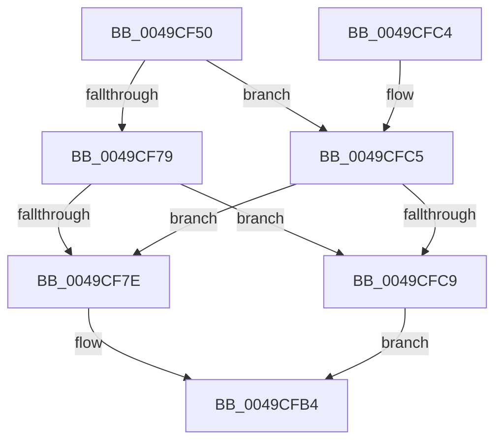

# MiUpdateOldPagesVpabCallback

- RVA: `0x0049CF50`–`0x0049CFCD` (길이 `125` bytes)
- VA: `0x000000014049CF50`
- 실행 섹션: `.text`
- PDB 이름 있음: `예`; PDB Function 태그: `아니요`
- unwind 정보 RVA: `0x000AC984`
- 디코드: `35`개 명령, `125/125` bytes 표시
- 미해석 바이트: `0` (있으면 어셈블리에 `.byte`로 보존)

> 이 문서는 커널 이미지의 기계어와 PDB 기호를 분석해 생성했습니다. 4번과 5번은 함수 원형과 자료형을 바이너리 사용 방식에서 추정한 C 해석이며 원본 소스 복구 결과는 아닙니다.

## 1. Dependencies

- 직접 호출 지점: **2**; 고유 호출 대상: **2**
- 직접 호출자로 확인된 함수: **0**
- RIP 상대 이미지 참조: **0**

### Outgoing calls
- `0x0049CF6C` → [MI_READ_PTE_LOCK_FREE](../28/MI_READ_PTE_LOCK_FREE_function_002828A0.md) (function, `0x002828A0`)
- `0x0049CFAF` → [MiUpdateOldPteWorker](MiUpdateOldPteWorker_function_0049CFD4.md) (function, `0x0049CFD4`)

### Direct callers
- 이 함수 시작 RVA로 연결되는 직접 call은 확인되지 않았습니다. 간접 호출은 완전히 역산할 수 없습니다.

### Static image references
- 디코드된 RIP-relative 메모리 참조가 없습니다.

## 2. Other-region calls and transfers

- 다른 실행 섹션으로 향하는 call: **0**
- 별도 외부 분기/꼬리 이동을 확인하지 못했습니다.

## 3. Assembly (complete function range)

```asm
0049CF50  48 89 5C 24 08                  mov qword ptr [rsp + 8], rbx
0049CF55  48 89 74 24 10                  mov qword ptr [rsp + 0x10], rsi
0049CF5A  57                              push rdi
0049CF5B  48 83 EC 20                     sub rsp, 0x20
0049CF5F  48 8B 71 20                     mov rsi, qword ptr [rcx + 0x20]
0049CF63  49 8B F8                        mov rdi, r8
0049CF66  49 8B C8                        mov rcx, r8
0049CF69  48 8B DA                        mov rbx, rdx
0049CF6C  E8 2F 59 DE FF                  call 0x1402828a0
0049CF71  48 8B 0B                        mov rcx, qword ptr [rbx]
0049CF74  F6 C1 02                        test cl, 2
0049CF77  75 4C                           jne 0x14049cfc5
0049CF79  F6 C1 01                        test cl, 1
0049CF7C  75 4B                           jne 0x14049cfc9
0049CF7E  48 C1 E8 0C                     shr rax, 0xc
0049CF82  48 B9 FF FF FF FF FF 00 00 00   movabs rcx, 0xffffffffff
0049CF8C  48 23 C1                        and rax, rcx
0049CF8F  4C 8D 04 40                     lea r8, [rax + rax*2]
0049CF93  49 C1 E0 04                     shl r8, 4
0049CF97  48 B8 00 00 00 00 00 DE FF FF   movabs rax, 0xffffde0000000000
0049CFA1  4C 8B 4C 24 50                  mov r9, qword ptr [rsp + 0x50]
0049CFA6  4C 03 C0                        add r8, rax
0049CFA9  48 8B D7                        mov rdx, rdi
0049CFAC  48 8B CE                        mov rcx, rsi
0049CFAF  E8 20 00 00 00                  call 0x14049cfd4
0049CFB4  48 8B 5C 24 30                  mov rbx, qword ptr [rsp + 0x30]
0049CFB9  48 8B 74 24 38                  mov rsi, qword ptr [rsp + 0x38]
0049CFBE  48 83 C4 20                     add rsp, 0x20
0049CFC2  5F                              pop rdi
0049CFC3  C3                              ret
0049CFC4  CC                              int3
0049CFC5  A8 20                           test al, 0x20
0049CFC7  74 B5                           je 0x14049cf7e
0049CFC9  33 C0                           xor eax, eax
0049CFCB  EB E7                           jmp 0x14049cfb4
```

## 4. C-style interpretation (structured pseudocode)

```c
__int64 __fastcall MiUpdateOldPagesVpabCallback(__int64 a1, __int64 a2, __int64 a3, __int64 a4, __int64 a5)
{
    __int64 result;
    __int64 v_rsp;
    unsigned __int64 v_stack_p10;
    unsigned __int64 v_stack_p8;

    v_stack_p8 = v_rbx;
    v_stack_p10 = v_rsi;
    v_rsp = (v_rsp) - (32);
    result = MI_READ_PTE_LOCK_FREE(a3, a2, a3, a4);
    if ((((unsigned __int8)(*(unsigned __int64 *)(a2))) & (2)) != 0) goto loc_0049CFC5;
    if ((((unsigned __int8)(*(unsigned __int64 *)(a2))) & (1)) != 0) goto loc_0049CFC9;
loc_0049CF7E:
    result = (result) >> (12);
    result = (result) & (*(unsigned __int64 *)(a2));
    a3 = (result + result * 2) << (4);
    a3 = (a3) + (result);
    result = MiUpdateOldPteWorker(*(unsigned __int64 *)(a1 + 32), a3, a3, a5);
loc_0049CFB4:
    v_rsp = (v_rsp) + (32);
    return result;
loc_0049CFC5:
    if ((((unsigned __int8)(result)) & (32)) == 0) goto loc_0049CF7E;
loc_0049CFC9:
    result = 0;
    goto loc_0049CFB4;
}
```

## 5. (Beta) C Style

```c
int64_t MiUpdateOldPagesVpabCallback(void *Arg1, void *Arg2, int64_t Arg3, int64_t Arg4, int64_t Arg5)
{
    uint8_t *arg1 = (uint8_t *)Arg1;
    uint8_t *arg2 = (uint8_t *)Arg2;

    int64_t result;
    int64_t local_rsp;
    uint64_t v_stack_p10;
    uint64_t v_stack_p8;

    v_stack_p8 = local_rbx;
    v_stack_p10 = local_rsi;
    local_rsp = (local_rsp) - (32);
    result = MI_READ_PTE_LOCK_FREE(Arg3, Arg2, Arg3, Arg4);
    if ((((uint8_t)(*(uint64_t *)(arg2))) & (2)) != 0) goto loc_0049CFC5;
    if ((((uint8_t)(*(uint64_t *)(arg2))) & (1)) != 0) goto loc_0049CFC9;
loc_0049CF7E:
    result = (result) >> (12);
    result = (result) & (*(uint64_t *)(arg2));
    Arg3 = (result + result * 2) << (4);
    Arg3 = (Arg3) + (result);
    result = MiUpdateOldPteWorker(*(uint64_t *)(arg1 + 0x20), Arg3, Arg3, Arg5);
loc_0049CFB4:
    local_rsp = (local_rsp) + (32);
    return result;
loc_0049CFC5:
    if ((((uint8_t)(result)) & (32)) == 0) goto loc_0049CF7E;
loc_0049CFC9:
    result = 0;
    goto loc_0049CFB4;
}
```

### 관측된 메모리 오프셋

구조체 형식이 확인되지 않은 접근은 인자 기준의 오프셋으로만 기록했습니다.

| 기준 인자 | 오프셋 표현 | 폭 (bit) | 접근 |
|---|---:|---:|---|
| `Arg1` | `+ 0x20` | `64` | `R` |
| `Arg2` | `+ 0x0` | `64` | `R` |

## 6. Execution-region graph

[열기: 2D/3D 그래프와 함수 탐색 컨트롤 패널](../../../control-panel.html?section=text&rva=0x0049CF50&view=graph)

- 2D 그래프는 위에서 아래로 흐르고, 3D 그래프는 빈 공간을 드래그해 회전합니다. Shift+드래그는 이동, 휠은 확대·축소, 함수 노드 선택은 대상 보고서 이동입니다.

### Static fallback


