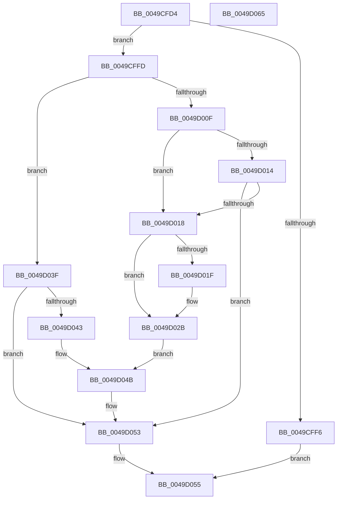

# MiUpdateOldPteWorker

- RVA: `0x0049CFD4`–`0x0049D066` (길이 `146` bytes)
- VA: `0x000000014049CFD4`
- 실행 섹션: `.text`
- PDB 이름 있음: `예`; PDB Function 태그: `아니요`
- unwind 정보 RVA: `0x00060BC4`
- 디코드: `46`개 명령, `146/146` bytes 표시
- 미해석 바이트: `0` (있으면 어셈블리에 `.byte`로 보존)

> 이 문서는 커널 이미지의 기계어와 PDB 기호를 분석해 생성했습니다. 4번과 5번은 함수 원형과 자료형을 바이너리 사용 방식에서 추정한 C 해석이며 원본 소스 복구 결과는 아닙니다.

## 1. Dependencies

- 직접 호출 지점: **4**; 고유 호출 대상: **4**
- 직접 호출자로 확인된 함수: **2**
- RIP 상대 이미지 참조: **0**

### Outgoing calls
- `0x0049D000` → [MiGetPfnPriority](../32/MiGetPfnPriority_function_003226F0.md) (function, `0x003226F0`)
- `0x0049D026` → [MiAcquirePrcbAgeTrimLists](../29/MiAcquirePrcbAgeTrimLists_function_002918B0.md) (function, `0x002918B0`)
- `0x0049D038` → [MiEmptyWorkingSetHelper](../24/MiEmptyWorkingSetHelper_function_00240C00.md) (function, `0x00240C00`)
- `0x0049D046` → [MiLockSetPfnPriority](../29/MiLockSetPfnPriority_function_00294E10.md) (function, `0x00294E10`)

### Direct callers
- [MiUpdateOldPagesVpabCallback](MiUpdateOldPagesVpabCallback_function_0049CF50.md) at `0x0049CFAF`
- [MiUpdateOldPte](../4E/MiUpdateOldPte_function_004EDD20.md) at `0x004EDEBD`

### Static image references
- 디코드된 RIP-relative 메모리 참조가 없습니다.

## 2. Other-region calls and transfers

- 다른 실행 섹션으로 향하는 call: **0**
- 별도 외부 분기/꼬리 이동을 확인하지 못했습니다.

## 3. Assembly (complete function range)

```asm
0049CFD4  48 89 5C 24 08                  mov qword ptr [rsp + 8], rbx
0049CFD9  48 89 74 24 10                  mov qword ptr [rsp + 0x10], rsi
0049CFDE  57                              push rdi
0049CFDF  48 83 EC 20                     sub rsp, 0x20
0049CFE3  49 83 79 20 00                  cmp qword ptr [r9 + 0x20], 0
0049CFE8  49 8B D9                        mov rbx, r9
0049CFEB  4D 8B D0                        mov r10, r8
0049CFEE  48 8B F2                        mov rsi, rdx
0049CFF1  48 8B F9                        mov rdi, rcx
0049CFF4  75 07                           jne 0x14049cffd
0049CFF6  B8 01 00 00 00                  mov eax, 1
0049CFFB  EB 58                           jmp 0x14049d055
0049CFFD  49 8B CA                        mov rcx, r10
0049D000  E8 EB 56 E8 FF                  call 0x1403226f0
0049D005  8B 0B                           mov ecx, dword ptr [rbx]
0049D007  8B 53 04                        mov edx, dword ptr [rbx + 4]
0049D00A  F6 C1 02                        test cl, 2
0049D00D  74 30                           je 0x14049d03f
0049D00F  83 FA 08                        cmp edx, 8
0049D012  74 04                           je 0x14049d018
0049D014  3B C2                           cmp eax, edx
0049D016  75 3B                           jne 0x14049d053
0049D018  48 83 7B 38 00                  cmp qword ptr [rbx + 0x38], 0
0049D01D  75 0C                           jne 0x14049d02b
0049D01F  48 8D 53 30                     lea rdx, [rbx + 0x30]
0049D023  48 8B CF                        mov rcx, rdi
0049D026  E8 85 48 DF FF                  call 0x1402918b0
0049D02B  4C 8B 43 38                     mov r8, qword ptr [rbx + 0x38]
0049D02F  45 33 C9                        xor r9d, r9d
0049D032  48 8B D6                        mov rdx, rsi
0049D035  48 8B CF                        mov rcx, rdi
0049D038  E8 C3 3B DA FF                  call 0x140240c00
0049D03D  EB 0C                           jmp 0x14049d04b
0049D03F  3B C2                           cmp eax, edx
0049D041  76 10                           jbe 0x14049d053
0049D043  49 8B CA                        mov rcx, r10
0049D046  E8 C5 7D DF FF                  call 0x140294e10
0049D04B  48 FF 4B 20                     dec qword ptr [rbx + 0x20]
0049D04F  48 FF 43 28                     inc qword ptr [rbx + 0x28]
0049D053  33 C0                           xor eax, eax
0049D055  48 8B 5C 24 30                  mov rbx, qword ptr [rsp + 0x30]
0049D05A  48 8B 74 24 38                  mov rsi, qword ptr [rsp + 0x38]
0049D05F  48 83 C4 20                     add rsp, 0x20
0049D063  5F                              pop rdi
0049D064  C3                              ret
0049D065  CC                              int3
```

## 4. C-style interpretation (structured pseudocode)

```c
__int64 __fastcall MiUpdateOldPteWorker(__int64 a1, __int64 a2, __int64 a3, __int64 a4)
{
    __int64 result;
    __int64 v_rsp;
    unsigned __int64 v_stack_p10;
    unsigned __int64 v_stack_p8;

    v_stack_p8 = v_rbx;
    v_stack_p10 = v_rsi;
    v_rsp = (v_rsp) - (32);
    if ((*(unsigned __int64 *)(a4 + 32)) != 0) goto loc_0049CFFD;
    goto loc_0049D055;
loc_0049CFFD:
    result = MiGetPfnPriority(a3, a2, a3, a4);
    if ((((unsigned __int8)((unsigned int)(*(unsigned int *)(a4)))) & (2)) == 0) goto loc_0049D03F;
    if (((unsigned int)((unsigned int)(*(unsigned int *)(a4 + 4)))) == 8) goto loc_0049D018;
    if (((unsigned int)(result)) != ((unsigned int)((unsigned int)(*(unsigned int *)(a4 + 4))))) goto loc_0049D053;
loc_0049D018:
    if ((*(unsigned __int64 *)(a4 + 56)) == 0) {
        a2 = a4 + 48;
        a1 = a1;
        result = MiAcquirePrcbAgeTrimLists(a1, a2, a3, a4);
    }
    a4 = 0;
    result = MiEmptyWorkingSetHelper(a1, a2, *(unsigned __int64 *)(a4 + 56), a4);
    goto loc_0049D04B;
loc_0049D03F:
    if (((unsigned int)(result)) <= ((unsigned int)(a2))) goto loc_0049D053;
    result = MiLockSetPfnPriority(a3, a2, *(unsigned __int64 *)(a4 + 56), a4);
loc_0049D04B:
loc_0049D053:
    result = 0;
loc_0049D055:
    v_rsp = (v_rsp) + (32);
    return result;
}
```

## 5. (Beta) C Style

```c
int64_t MiUpdateOldPteWorker(int64_t Arg1, int64_t Arg2, int64_t Arg3, void *Arg4)
{
    uint8_t *arg4 = (uint8_t *)Arg4;

    int64_t result;
    int64_t local_rsp;
    uint64_t v_stack_p10;
    uint64_t v_stack_p8;

    v_stack_p8 = local_rbx;
    v_stack_p10 = local_rsi;
    local_rsp = (local_rsp) - (32);
    if ((*(uint64_t *)(arg4 + 0x20)) != 0) goto loc_0049CFFD;
    goto loc_0049D055;
loc_0049CFFD:
    result = MiGetPfnPriority(Arg3, Arg2, Arg3, Arg4);
    if ((((uint8_t)((uint32_t)(*(uint32_t *)(arg4)))) & (2)) == 0) goto loc_0049D03F;
    if (((uint32_t)((uint32_t)(*(uint32_t *)(arg4 + 0x4)))) == 8) goto loc_0049D018;
    if (((uint32_t)(result)) != ((uint32_t)((uint32_t)(*(uint32_t *)(arg4 + 0x4))))) goto loc_0049D053;
loc_0049D018:
    if ((*(uint64_t *)(arg4 + 0x38)) == 0) {
        Arg2 = Arg4 + 48;
        Arg1 = Arg1;
        result = MiAcquirePrcbAgeTrimLists(Arg1, Arg2, Arg3, Arg4);
    }
    Arg4 = 0;
    result = MiEmptyWorkingSetHelper(Arg1, Arg2, *(uint64_t *)(arg4 + 0x38), Arg4);
    goto loc_0049D04B;
loc_0049D03F:
    if (((uint32_t)(result)) <= ((uint32_t)(Arg2))) goto loc_0049D053;
    result = MiLockSetPfnPriority(Arg3, Arg2, *(uint64_t *)(arg4 + 0x38), Arg4);
loc_0049D04B:
loc_0049D053:
    result = 0;
loc_0049D055:
    local_rsp = (local_rsp) + (32);
    return result;
}
```

### 관측된 메모리 오프셋

구조체 형식이 확인되지 않은 접근은 인자 기준의 오프셋으로만 기록했습니다.

| 기준 인자 | 오프셋 표현 | 폭 (bit) | 접근 |
|---|---:|---:|---|
| `Arg4` | `+ 0x0` | `32` | `R` |
| `Arg4` | `+ 0x4` | `32` | `R` |
| `Arg4` | `+ 0x20` | `64` | `R` |
| `Arg4` | `+ 0x20` | `64` | `R/W` |
| `Arg4` | `+ 0x28` | `64` | `R/W` |
| `Arg4` | `+ 0x30` | `64` | `R` |
| `Arg4` | `+ 0x38` | `64` | `R` |

## 6. Execution-region graph

[열기: 2D/3D 그래프와 함수 탐색 컨트롤 패널](../../../control-panel.html?section=text&rva=0x0049CFD4&view=graph)

- 2D 그래프는 위에서 아래로 흐르고, 3D 그래프는 빈 공간을 드래그해 회전합니다. Shift+드래그는 이동, 휠은 확대·축소, 함수 노드 선택은 대상 보고서 이동입니다.

### Static fallback


