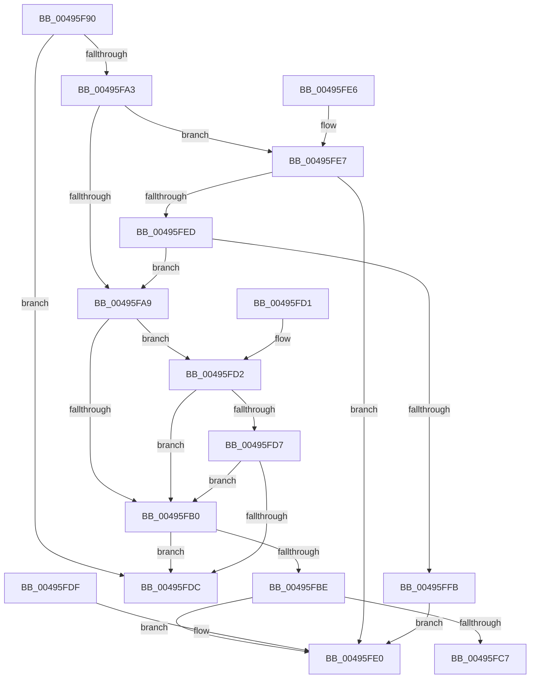

# MiVadShouldBeForked

- RVA: `0x00495F90`–`0x00495FFD` (길이 `109` bytes)
- VA: `0x0000000140495F90`
- 실행 섹션: `.text`
- PDB 이름 있음: `예`; PDB Function 태그: `아니요`
- unwind 정보 RVA: `0x000DB714`
- 디코드: `39`개 명령, `109/109` bytes 표시
- 미해석 바이트: `0` (있으면 어셈블리에 `.byte`로 보존)

> 이 문서는 커널 이미지의 기계어와 PDB 기호를 분석해 생성했습니다. 4번과 5번은 함수 원형과 자료형을 바이너리 사용 방식에서 추정한 C 해석이며 원본 소스 복구 결과는 아닙니다.

## 1. Dependencies

- 직접 호출 지점: **0**; 고유 호출 대상: **0**
- 직접 호출자로 확인된 함수: **1**
- RIP 상대 이미지 참조: **0**

### Outgoing calls
- 직접 디코드된 call 명령이 없습니다.

### Direct callers
- [MiAllocateChildVads](../../page/97/MiAllocateChildVads_function_0097E380.md) at `0x0097E433`

### Static image references
- 디코드된 RIP-relative 메모리 참조가 없습니다.

## 2. Other-region calls and transfers

- 다른 실행 섹션으로 향하는 call: **0**
- 별도 외부 분기/꼬리 이동을 확인하지 못했습니다.

## 3. Assembly (complete function range)

```asm
00495F90  8B 51 30                        mov edx, dword ptr [rcx + 0x30]
00495F93  41 B8 00 00 A0 00               mov r8d, 0xa00000
00495F99  8B C2                           mov eax, edx
00495F9B  41 23 C0                        and eax, r8d
00495F9E  41 3B C0                        cmp eax, r8d
00495FA1  74 39                           je 0x140495fdc
00495FA3  0F BA E2 15                     bt edx, 0x15
00495FA7  72 3E                           jb 0x140495fe7
00495FA9  8B C2                           mov eax, edx
00495FAB  83 E0 70                        and eax, 0x70
00495FAE  75 22                           jne 0x140495fd2
00495FB0  81 E2 00 00 20 0C               and edx, 0xc200000
00495FB6  81 FA 00 00 20 08               cmp edx, 0x8200000
00495FBC  74 1E                           je 0x140495fdc
00495FBE  8B 41 30                        mov eax, dword ptr [rcx + 0x30]
00495FC1  0F BA E0 15                     bt eax, 0x15
00495FC5  72 19                           jb 0x140495fe0
00495FC7  8B 41 40                        mov eax, dword ptr [rcx + 0x40]
00495FCA  C1 E8 02                        shr eax, 2
00495FCD  83 E0 01                        and eax, 1
00495FD0  C3                              ret
00495FD1  CC                              int3
00495FD2  83 F8 20                        cmp eax, 0x20
00495FD5  74 D9                           je 0x140495fb0
00495FD7  83 F8 50                        cmp eax, 0x50
00495FDA  74 D4                           je 0x140495fb0
00495FDC  33 C0                           xor eax, eax
00495FDE  C3                              ret
00495FDF  CC                              int3
00495FE0  B8 01 00 00 00                  mov eax, 1
00495FE5  C3                              ret
00495FE6  CC                              int3
00495FE7  0F BA E2 17                     bt edx, 0x17
00495FEB  72 F3                           jb 0x140495fe0
00495FED  8B C2                           mov eax, edx
00495FEF  25 00 00 18 00                  and eax, 0x180000
00495FF4  3D 00 00 10 00                  cmp eax, 0x100000
00495FF9  72 AE                           jb 0x140495fa9
00495FFB  EB E3                           jmp 0x140495fe0
```

## 4. C-style interpretation (structured pseudocode)

```c
__int64 __fastcall MiVadShouldBeForked(__int64 a1)
{
    __int64 result;

    result = (unsigned int)(((unsigned int)((unsigned int)((unsigned int)(*(unsigned int *)(a1 + 48))))) & ((unsigned int)((unsigned int)(0xA00000ULL))));
    if (((unsigned int)(result)) == ((unsigned int)((unsigned int)(0xA00000ULL)))) goto loc_00495FDC;
    if (((unsigned int)(result)) < ((unsigned int)((unsigned int)(0xA00000ULL)))) goto loc_00495FE7;
loc_00495FA9:
    result = (unsigned int)(((unsigned int)((unsigned int)((unsigned int)(*(unsigned int *)(a1 + 48))))) & (112));
    if (condition_is_not_equal) goto loc_00495FD2;
loc_00495FB0:
    a2 = (unsigned int)(((unsigned int)(*(unsigned int *)(a1 + 48))) & (0xC200000ULL));
    if (((unsigned int)(a2)) == 0x8200000ULL) goto loc_00495FDC;
    if (((unsigned int)(a2)) < 0x8200000ULL) goto loc_00495FE0;
    result = (unsigned int)(((unsigned int)(*(unsigned int *)(a1 + 64))) >> (2));
    result = (unsigned int)((result) & (1));
    return result;
loc_00495FD2:
    if (((unsigned int)(result)) == 32) goto loc_00495FB0;
    if (((unsigned int)(result)) == 80) goto loc_00495FB0;
loc_00495FDC:
    result = 0;
    return result;
loc_00495FE0:
    return 1;
loc_00495FE7:
    if (condition_is_below) goto loc_00495FE0;
    result = (unsigned int)(((unsigned int)((unsigned int)(a2))) & (0x180000ULL));
    if (((unsigned int)(result)) < 0x100000ULL) goto loc_00495FA9;
    goto loc_00495FE0;
}
```

## 5. (Beta) C Style

```c
int64_t MiVadShouldBeForked(void *Arg1)
{
    uint8_t *arg1 = (uint8_t *)Arg1;

    int64_t result;

    result = (uint32_t)(((uint32_t)((uint32_t)((uint32_t)(*(uint32_t *)(arg1 + 0x30))))) & ((uint32_t)((uint32_t)(0xA00000ULL))));
    if (((uint32_t)(result)) == ((uint32_t)((uint32_t)(0xA00000ULL)))) goto loc_00495FDC;
    if (((uint32_t)(result)) < ((uint32_t)((uint32_t)(0xA00000ULL)))) goto loc_00495FE7;
loc_00495FA9:
    result = (uint32_t)(((uint32_t)((uint32_t)((uint32_t)(*(uint32_t *)(arg1 + 0x30))))) & (112));
    if (condition_is_not_equal) goto loc_00495FD2;
loc_00495FB0:
    a2 = (uint32_t)(((uint32_t)(*(uint32_t *)(arg1 + 0x30))) & (0xC200000ULL));
    if (((uint32_t)(a2)) == 0x8200000ULL) goto loc_00495FDC;
    if (((uint32_t)(a2)) < 0x8200000ULL) goto loc_00495FE0;
    result = (uint32_t)(((uint32_t)(*(uint32_t *)(arg1 + 0x40))) >> (2));
    result = (uint32_t)((result) & (1));
    return result;
loc_00495FD2:
    if (((uint32_t)(result)) == 32) goto loc_00495FB0;
    if (((uint32_t)(result)) == 80) goto loc_00495FB0;
loc_00495FDC:
    result = 0;
    return result;
loc_00495FE0:
    return 1;
loc_00495FE7:
    if (condition_is_below) goto loc_00495FE0;
    result = (uint32_t)(((uint32_t)((uint32_t)(a2))) & (0x180000ULL));
    if (((uint32_t)(result)) < 0x100000ULL) goto loc_00495FA9;
    goto loc_00495FE0;
}
```

### 관측된 메모리 오프셋

구조체 형식이 확인되지 않은 접근은 인자 기준의 오프셋으로만 기록했습니다.

| 기준 인자 | 오프셋 표현 | 폭 (bit) | 접근 |
|---|---:|---:|---|
| `Arg1` | `+ 0x30` | `32` | `R` |
| `Arg1` | `+ 0x40` | `32` | `R` |

## 6. Execution-region graph

[열기: 2D/3D 그래프와 함수 탐색 컨트롤 패널](../../../control-panel.html?section=text&rva=0x00495F90&view=graph)

- 2D 그래프는 위에서 아래로 흐르고, 3D 그래프는 빈 공간을 드래그해 회전합니다. Shift+드래그는 이동, 휠은 확대·축소, 함수 노드 선택은 대상 보고서 이동입니다.

### Static fallback


