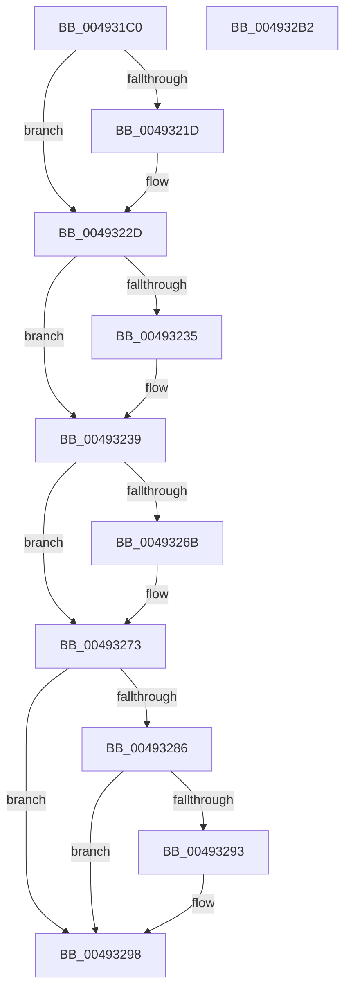

# MmCheckProcessShadow

- RVA: `0x004931C0`–`0x004932B3` (길이 `243` bytes)
- VA: `0x00000001404931C0`
- 실행 섹션: `.text`
- PDB 이름 있음: `예`; PDB Function 태그: `아니요`
- unwind 정보 RVA: `0x00083688`
- 디코드: `68`개 명령, `243/243` bytes 표시
- 미해석 바이트: `0` (있으면 어셈블리에 `.byte`로 보존)

> 이 문서는 커널 이미지의 기계어와 PDB 기호를 분석해 생성했습니다. 4번과 5번은 함수 원형과 자료형을 바이너리 사용 방식에서 추정한 C 해석이며 원본 소스 복구 결과는 아닙니다.

## 1. Dependencies

- 직접 호출 지점: **8**; 고유 호출 대상: **8**
- 직접 호출자로 확인된 함수: **0**
- RIP 상대 이미지 참조: **1**

### Outgoing calls
- `0x00493204` → [KeAbPreAcquire](../21/KeAbPreAcquire_function_00210230.md) (function, `0x00210230`)
- `0x00493228` → [ExfAcquirePushLockSharedEx](../21/ExfAcquirePushLockSharedEx_function_0021044C.md) (function, `0x0021044C`)
- `0x0049323C` → [MiLockWorkingSetShared](../27/MiLockWorkingSetShared_function_0027CBF0.md) (function, `0x0027CBF0`)
- `0x0049324B` → [MiCheckProcessShadow](../27/MiCheckProcessShadow_function_0027E4C0.md) (function, `0x0027E4C0`)
- `0x00493258` → [MiUnlockWorkingSetShared](../27/MiUnlockWorkingSetShared_function_0027D690.md) (function, `0x0027D690`)
- `0x0049326E` → [ExfReleasePushLockShared](../26/ExfReleasePushLockShared_function_00263440.md) (function, `0x00263440`)
- `0x00493276` → [KeAbPostRelease](../2E/KeAbPostRelease_function_002E1600.md) (function, `0x002E1600`)
- `0x00493293` → [KiCheckForKernelApcDelivery](../2E/KiCheckForKernelApcDelivery_function_002E2C80.md) (function, `0x002E2C80`)

### Direct callers
- 이 함수 시작 RVA로 연결되는 직접 call은 확인되지 않았습니다. 간접 호출은 완전히 역산할 수 없습니다.

### Static image references
- `0x004931DF` → RVA `0x00E2EE70` (`.data`; read)

## 2. Other-region calls and transfers

- 다른 실행 섹션으로 향하는 call: **0**
- 별도 외부 분기/꼬리 이동을 확인하지 못했습니다.

## 3. Assembly (complete function range)

```asm
004931C0  48 89 5C 24 10                  mov qword ptr [rsp + 0x10], rbx
004931C5  48 89 6C 24 18                  mov qword ptr [rsp + 0x18], rbp
004931CA  56                              push rsi
004931CB  57                              push rdi
004931CC  41 54                           push r12
004931CE  41 56                           push r14
004931D0  41 57                           push r15
004931D2  48 83 EC 20                     sub rsp, 0x20
004931D6  65 48 8B 3C 25 88 01 00 00      mov rdi, qword ptr gs:[0x188]
004931DF  4C 8D 35 8A BC 99 00            lea r14, [rip + 0x99bc8a]
004931E6  45 33 C0                        xor r8d, r8d
004931E9  33 D2                           xor edx, edx
004931EB  49 8B CE                        mov rcx, r14
004931EE  48 8B B7 B8 00 00 00            mov rsi, qword ptr [rdi + 0xb8]
004931F5  66 FF 8F E6 01 00 00            dec word ptr [rdi + 0x1e6]
004931FC  48 81 C6 00 04 00 00            add rsi, 0x400
00493203  90                              nop
00493204  E8 27 D0 D7 FF                  call 0x140210230
00493209  48 8B D8                        mov rbx, rax
0049320C  33 C0                           xor eax, eax
0049320E  44 8D 60 11                     lea r12d, [rax + 0x11]
00493212  F0 4C 0F B1 25 55 BC 99 00      lock cmpxchg qword ptr [rip + 0x99bc55], r12
0049321B  74 10                           je 0x14049322d
0049321D  4D 8B CE                        mov r9, r14
00493220  4C 8B C3                        mov r8, rbx
00493223  33 D2                           xor edx, edx
00493225  49 8B CE                        mov rcx, r14
00493228  E8 1F D2 D7 FF                  call 0x14021044c
0049322D  45 33 FF                        xor r15d, r15d
00493230  48 85 DB                        test rbx, rbx
00493233  74 04                           je 0x140493239
00493235  C6 43 0A 01                     mov byte ptr [rbx + 0xa], 1
00493239  48 8B CE                        mov rcx, rsi
0049323C  E8 AF 99 DE FF                  call 0x14027cbf0
00493241  BA 1D 00 00 00                  mov edx, 0x1d
00493246  48 8B CE                        mov rcx, rsi
00493249  8A D8                           mov bl, al
0049324B  E8 70 B2 DE FF                  call 0x14027e4c0
00493250  8A D3                           mov dl, bl
00493252  48 8B CE                        mov rcx, rsi
00493255  48 8B E8                        mov rbp, rax
00493258  E8 33 A4 DE FF                  call 0x14027d690
0049325D  49 8B C4                        mov rax, r12
00493260  F0 4C 0F B1 3D 07 BC 99 00      lock cmpxchg qword ptr [rip + 0x99bc07], r15
00493269  74 08                           je 0x140493273
0049326B  49 8B CE                        mov rcx, r14
0049326E  E8 CD 01 DD FF                  call 0x140263440
00493273  49 8B CE                        mov rcx, r14
00493276  E8 85 E3 E4 FF                  call 0x1402e1600
0049327B  90                              nop
0049327C  66 83 87 E6 01 00 00 01         add word ptr [rdi + 0x1e6], 1
00493284  75 12                           jne 0x140493298
00493286  48 8D 87 98 00 00 00            lea rax, [rdi + 0x98]
0049328D  90                              nop
0049328E  48 39 00                        cmp qword ptr [rax], rax
00493291  74 05                           je 0x140493298
00493293  E8 E8 F9 E4 FF                  call 0x1402e2c80
00493298  48 8B 5C 24 58                  mov rbx, qword ptr [rsp + 0x58]
0049329D  48 8B C5                        mov rax, rbp
004932A0  48 8B 6C 24 60                  mov rbp, qword ptr [rsp + 0x60]
004932A5  48 83 C4 20                     add rsp, 0x20
004932A9  41 5F                           pop r15
004932AB  41 5E                           pop r14
004932AD  41 5C                           pop r12
004932AF  5F                              pop rdi
004932B0  5E                              pop rsi
004932B1  C3                              ret
004932B2  CC                              int3
```

## 4. C-style interpretation (structured pseudocode)

```c
__int64 __fastcall MmCheckProcessShadow(__int64 a1, int a2, int a3)
{
    __int64 result;
    __int64 v_r15;
    __int64 v_rsi;
    __int64 v_rsp;
    unsigned __int64 v_stack_p10;
    unsigned __int64 v_stack_p18;

    v_stack_p10 = v_rbx;
    v_stack_p18 = v_rbp;
    v_rsp = (v_rsp) - (32);
    a3 = 0;
    a2 = 0;
    v_rsi = (*(unsigned __int64 *)(*(unsigned __int64 *)(gs_base + (0 + 392)) + 184)) + (0x400ULL);
    result = KeAbPreAcquire(v_rip + 10075274, a2, a3, a4);
    result = 0;
    if (!(condition_is_equal)) {
        a4 = v_rip + 10075274;
        a3 = 0;
        a2 = 0;
        a1 = v_rip + 10075274;
        result = ExfAcquirePushLockSharedEx(a1, a2, a3, a4);
    }
    v_r15 = 0;
    if (result != 0) {
        *(unsigned __int8 *)(result + 10) = 1;
    }
    result = MiLockWorkingSetShared(v_rsi, a2, a3, a4);
    result = MiCheckProcessShadow(v_rsi, 29, a3, a4);
    result = MiUnlockWorkingSetShared(v_rsi, (unsigned __int8)((unsigned __int8)(result)), a3, a4);
    result = result + 17;
    if (result != 0) {
        a1 = v_rip + 10075274;
        result = ExfReleasePushLockShared(a1, (unsigned __int8)((unsigned __int8)(result)), a3, a4);
    }
    result = KeAbPostRelease(v_rip + 10075274, (unsigned __int8)((unsigned __int8)(result)), a3, a4);
    if (result != 0) goto loc_00493298;
    result = *(unsigned __int64 *)(gs_base + (0 + 392)) + 152;
    if ((*(unsigned __int64 *)(*(unsigned __int64 *)(gs_base + (0 + 392)) + 152)) != (*(unsigned __int64 *)(gs_base + (0 + 392)) + 152)) {
        result = KiCheckForKernelApcDelivery(v_rip + 10075274, (unsigned __int8)((unsigned __int8)(result)), a3, a4);
    }
    v_rsp = (v_rsp) + (32);
    return result;
}
```

## 5. (Beta) C Style

```c
int64_t MmCheckProcessShadow(int64_t Arg1, int32_t Arg2, int32_t Arg3)
{
    int64_t result;
    int64_t local_r15;
    int64_t local_rsi;
    int64_t local_rsp;
    uint64_t v_stack_p10;
    uint64_t v_stack_p18;

    v_stack_p10 = local_rbx;
    v_stack_p18 = local_rbp;
    local_rsp = (local_rsp) - (32);
    Arg3 = 0;
    Arg2 = 0;
    local_rsi = (*(uint64_t *)(*(uint64_t *)(gs_base + (0 + 0x188)) + 0xB8)) + (0x400ULL);
    result = KeAbPreAcquire(v_rip + 10075274, Arg2, Arg3, a4);
    result = 0;
    if (!(condition_is_equal)) {
        a4 = v_rip + 10075274;
        Arg3 = 0;
        Arg2 = 0;
        Arg1 = v_rip + 10075274;
        result = ExfAcquirePushLockSharedEx(Arg1, Arg2, Arg3, a4);
    }
    local_r15 = 0;
    if (result != 0) {
        *(uint8_t *)(result + 0xA) = 1;
    }
    result = MiLockWorkingSetShared(local_rsi, Arg2, Arg3, a4);
    result = MiCheckProcessShadow(local_rsi, 29, Arg3, a4);
    result = MiUnlockWorkingSetShared(local_rsi, (uint8_t)((uint8_t)(result)), Arg3, a4);
    result = result + 17;
    if (result != 0) {
        Arg1 = v_rip + 10075274;
        result = ExfReleasePushLockShared(Arg1, (uint8_t)((uint8_t)(result)), Arg3, a4);
    }
    result = KeAbPostRelease(v_rip + 10075274, (uint8_t)((uint8_t)(result)), Arg3, a4);
    if (result != 0) goto loc_00493298;
    result = *(uint64_t *)(gs_base + (0 + 0x188)) + 152;
    if ((*(uint64_t *)(*(uint64_t *)(gs_base + (0 + 0x188)) + 0x98)) != (*(uint64_t *)(gs_base + (0 + 0x188)) + 152)) {
        result = KiCheckForKernelApcDelivery(v_rip + 10075274, (uint8_t)((uint8_t)(result)), Arg3, a4);
    }
    local_rsp = (local_rsp) + (32);
    return result;
}
```

## 6. Execution-region graph

[열기: 2D/3D 그래프와 함수 탐색 컨트롤 패널](../../../control-panel.html?section=text&rva=0x004931C0&view=graph)

- 2D 그래프는 위에서 아래로 흐르고, 3D 그래프는 빈 공간을 드래그해 회전합니다. Shift+드래그는 이동, 휠은 확대·축소, 함수 노드 선택은 대상 보고서 이동입니다.

### Static fallback


