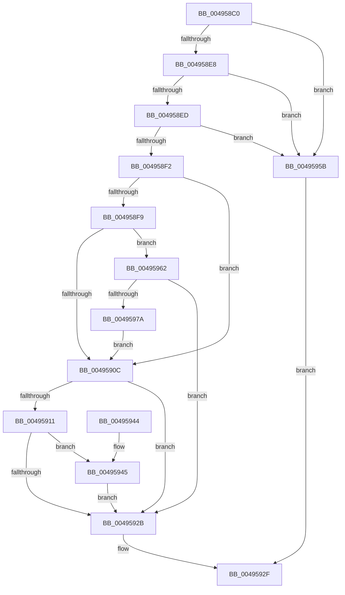

# MmIsFileSectionActive

- RVA: `0x004958C0`–`0x0049597C` (길이 `188` bytes)
- VA: `0x00000001404958C0`
- 실행 섹션: `.text`
- PDB 이름 있음: `예`; PDB Function 태그: `아니요`
- unwind 정보 RVA: `0x0006FB28`
- 디코드: `59`개 명령, `188/188` bytes 표시
- 미해석 바이트: `0` (있으면 어셈블리에 `.byte`로 보존)

> 이 문서는 커널 이미지의 기계어와 PDB 기호를 분석해 생성했습니다. 4번과 5번은 함수 원형과 자료형을 바이너리 사용 방식에서 추정한 C 해석이며 원본 소스 복구 결과는 아닙니다.

## 1. Dependencies

- 직접 호출 지점: **6**; 고유 호출 대상: **3**
- 직접 호출자로 확인된 함수: **0**
- RIP 상대 이미지 참조: **0**

### Outgoing calls
- `0x004958FF` → [MiLockSectionControlArea](../2B/MiLockSectionControlArea_function_002BC930.md) (function, `0x002BC930`)
- `0x0049591E` → [MiLockSectionControlArea](../2B/MiLockSectionControlArea_function_002BC930.md) (function, `0x002BC930`)
- `0x00495945` → [MiIsSectionActive](MiIsSectionActive_function_00495984.md) (function, `0x00495984`)
- `0x00495954` → [MiReleaseSpinLockExclusive](../24/MiReleaseSpinLockExclusive_function_002482C0.md) (function, `0x002482C0`)
- `0x00495962` → [MiIsSectionActive](MiIsSectionActive_function_00495984.md) (function, `0x00495984`)
- `0x00495971` → [MiReleaseSpinLockExclusive](../24/MiReleaseSpinLockExclusive_function_002482C0.md) (function, `0x002482C0`)

### Direct callers
- 이 함수 시작 RVA로 연결되는 직접 call은 확인되지 않았습니다. 간접 호출은 완전히 역산할 수 없습니다.

### Static image references
- 디코드된 RIP-relative 메모리 참조가 없습니다.

## 2. Other-region calls and transfers

- 다른 실행 섹션으로 향하는 call: **0**
- 별도 외부 분기/꼬리 이동을 확인하지 못했습니다.

## 3. Assembly (complete function range)

```asm
004958C0  48 8B C4                        mov rax, rsp
004958C3  48 89 58 08                     mov qword ptr [rax + 8], rbx
004958C7  48 89 68 18                     mov qword ptr [rax + 0x18], rbp
004958CB  48 89 70 20                     mov qword ptr [rax + 0x20], rsi
004958CF  57                              push rdi
004958D0  48 83 EC 20                     sub rsp, 0x20
004958D4  C6 40 10 00                     mov byte ptr [rax + 0x10], 0
004958D8  49 8B F0                        mov rsi, r8
004958DB  8B DA                           mov ebx, edx
004958DD  48 8B E9                        mov rbp, rcx
004958E0  F7 C2 F8 FF FF FF               test edx, 0xfffffff8
004958E6  75 73                           jne 0x14049595b
004958E8  F6 C3 03                        test bl, 3
004958EB  74 6E                           je 0x14049595b
004958ED  F6 C3 04                        test bl, 4
004958F0  74 69                           je 0x14049595b
004958F2  33 FF                           xor edi, edi
004958F4  F6 C3 01                        test bl, 1
004958F7  74 13                           je 0x14049590c
004958F9  4C 8D 40 10                     lea r8, [rax + 0x10]
004958FD  33 D2                           xor edx, edx
004958FF  E8 2C 70 E2 FF                  call 0x1402bc930
00495904  48 8B C8                        mov rcx, rax
00495907  48 85 C0                        test rax, rax
0049590A  75 56                           jne 0x140495962
0049590C  F6 C3 02                        test bl, 2
0049590F  74 1A                           je 0x14049592b
00495911  4C 8D 44 24 38                  lea r8, [rsp + 0x38]
00495916  BA 01 00 00 00                  mov edx, 1
0049591B  48 8B CD                        mov rcx, rbp
0049591E  E8 0D 70 E2 FF                  call 0x1402bc930
00495923  48 8B C8                        mov rcx, rax
00495926  48 85 C0                        test rax, rax
00495929  75 1A                           jne 0x140495945
0049592B  89 3E                           mov dword ptr [rsi], edi
0049592D  33 C0                           xor eax, eax
0049592F  48 8B 5C 24 30                  mov rbx, qword ptr [rsp + 0x30]
00495934  48 8B 6C 24 40                  mov rbp, qword ptr [rsp + 0x40]
00495939  48 8B 74 24 48                  mov rsi, qword ptr [rsp + 0x48]
0049593E  48 83 C4 20                     add rsp, 0x20
00495942  5F                              pop rdi
00495943  C3                              ret
00495944  CC                              int3
00495945  E8 3A 00 00 00                  call 0x140495984
0049594A  8A 54 24 38                     mov dl, byte ptr [rsp + 0x38]
0049594E  48 83 C1 48                     add rcx, 0x48
00495952  8B F8                           mov edi, eax
00495954  E8 67 29 DB FF                  call 0x1402482c0
00495959  EB D0                           jmp 0x14049592b
0049595B  B8 0D 00 00 C0                  mov eax, 0xc000000d
00495960  EB CD                           jmp 0x14049592f
00495962  E8 1D 00 00 00                  call 0x140495984
00495967  8A 54 24 38                     mov dl, byte ptr [rsp + 0x38]
0049596B  48 83 C1 48                     add rcx, 0x48
0049596F  8B F8                           mov edi, eax
00495971  E8 4A 29 DB FF                  call 0x1402482c0
00495976  85 FF                           test edi, edi
00495978  75 B1                           jne 0x14049592b
0049597A  EB 90                           jmp 0x14049590c
```

## 4. C-style interpretation (structured pseudocode)

```c
__int64 __fastcall MmIsFileSectionActive(__int64 a1, int a2, __int64 a3)
{
    __int64 result;
    __int64 v_rdi;
    __int64 v_rsp;
    unsigned __int64 v_stack_p10;
    unsigned __int64 v_stack_p18;
    unsigned __int64 v_stack_p20;
    unsigned __int8 v_stack_p38;
    unsigned __int64 v_stack_p8;

    *(unsigned __int64 *)(v_rsp + 8) = v_rbx;
    *(unsigned __int64 *)(v_rsp + 24) = v_rbp;
    *(unsigned __int64 *)(v_rsp + 32) = v_rsi;
    v_rsp = (v_rsp) - (32);
    *(unsigned __int8 *)(v_rsp + 16) = 0;
    if (((a2) & (0xFFFFFFF8ULL)) != 0) goto loc_0049595B;
    if ((((unsigned __int8)((unsigned int)(a2))) & (3)) == 0) goto loc_0049595B;
    if ((((unsigned __int8)((unsigned int)(a2))) & (4)) == 0) goto loc_0049595B;
    v_rdi = 0;
    if ((((unsigned __int8)((unsigned int)(a2))) & (1)) == 0) goto loc_0049590C;
    a2 = 0;
    result = MiLockSectionControlArea(a1, a2, v_rsp + 16, a4);
    if (result != 0) goto loc_00495962;
loc_0049590C:
    if ((((unsigned __int8)((unsigned int)(a2))) & (2)) == 0) goto loc_0049592B;
    result = MiLockSectionControlArea(a1, 1, v_stack_p10, a4);
    if (result != 0) goto loc_00495945;
loc_0049592B:
    *(unsigned int *)(a3) = 0;
    result = 0;
loc_0049592F:
    v_rsp = (v_rsp) + (32);
    return result;
loc_00495945:
    result = MiIsSectionActive(result, 1, v_stack_p10, a4);
    a1 = (result) + (72);
    result = MiReleaseSpinLockExclusive(a1, v_stack_p38, v_stack_p10, a4);
    goto loc_0049592B;
loc_0049595B:
    goto loc_0049592F;
loc_00495962:
    result = MiIsSectionActive(a1, v_stack_p38, v_stack_p10, a4);
    a1 = (a1) + (72);
    result = MiReleaseSpinLockExclusive(a1, v_stack_p38, v_stack_p10, a4);
    if ((unsigned int)((unsigned int)((unsigned int)(result))) != 0) goto loc_0049592B;
    goto loc_0049590C;
}
```

## 5. (Beta) C Style

```c
int64_t MmIsFileSectionActive(int64_t Arg1, int32_t Arg2, void *Arg3)
{
    uint8_t *arg3 = (uint8_t *)Arg3;

    int64_t result;
    int64_t local_rdi;
    int64_t local_rsp;
    uint64_t v_stack_p10;
    uint64_t v_stack_p18;
    uint64_t v_stack_p20;
    uint8_t v_stack_p38;
    uint64_t v_stack_p8;

    *(uint64_t *)(local_rsp + 0x8) = local_rbx;
    *(uint64_t *)(local_rsp + 0x18) = local_rbp;
    *(uint64_t *)(local_rsp + 0x20) = local_rsi;
    local_rsp = (local_rsp) - (32);
    *(uint8_t *)(local_rsp + 0x10) = 0;
    if (((Arg2) & (0xFFFFFFF8ULL)) != 0) goto loc_0049595B;
    if ((((uint8_t)((uint32_t)(Arg2))) & (3)) == 0) goto loc_0049595B;
    if ((((uint8_t)((uint32_t)(Arg2))) & (4)) == 0) goto loc_0049595B;
    local_rdi = 0;
    if ((((uint8_t)((uint32_t)(Arg2))) & (1)) == 0) goto loc_0049590C;
    Arg2 = 0;
    result = MiLockSectionControlArea(Arg1, Arg2, local_rsp + 16, a4);
    if (result != 0) goto loc_00495962;
loc_0049590C:
    if ((((uint8_t)((uint32_t)(Arg2))) & (2)) == 0) goto loc_0049592B;
    result = MiLockSectionControlArea(Arg1, 1, v_stack_p10, a4);
    if (result != 0) goto loc_00495945;
loc_0049592B:
    *(uint32_t *)(arg3) = 0;
    result = 0;
loc_0049592F:
    local_rsp = (local_rsp) + (32);
    return result;
loc_00495945:
    result = MiIsSectionActive(result, 1, v_stack_p10, a4);
    Arg1 = (result) + (72);
    result = MiReleaseSpinLockExclusive(Arg1, v_stack_p38, v_stack_p10, a4);
    goto loc_0049592B;
loc_0049595B:
    goto loc_0049592F;
loc_00495962:
    result = MiIsSectionActive(Arg1, v_stack_p38, v_stack_p10, a4);
    Arg1 = (Arg1) + (72);
    result = MiReleaseSpinLockExclusive(Arg1, v_stack_p38, v_stack_p10, a4);
    if ((uint32_t)((uint32_t)((uint32_t)(result))) != 0) goto loc_0049592B;
    goto loc_0049590C;
}
```

### 관측된 메모리 오프셋

구조체 형식이 확인되지 않은 접근은 인자 기준의 오프셋으로만 기록했습니다.

| 기준 인자 | 오프셋 표현 | 폭 (bit) | 접근 |
|---|---:|---:|---|
| `Arg3` | `+ 0x0` | `32` | `W` |

## 6. Execution-region graph

[열기: 2D/3D 그래프와 함수 탐색 컨트롤 패널](../../../control-panel.html?section=text&rva=0x004958C0&view=graph)

- 2D 그래프는 위에서 아래로 흐르고, 3D 그래프는 빈 공간을 드래그해 회전합니다. Shift+드래그는 이동, 휠은 확대·축소, 함수 노드 선택은 대상 보고서 이동입니다.

### Static fallback


