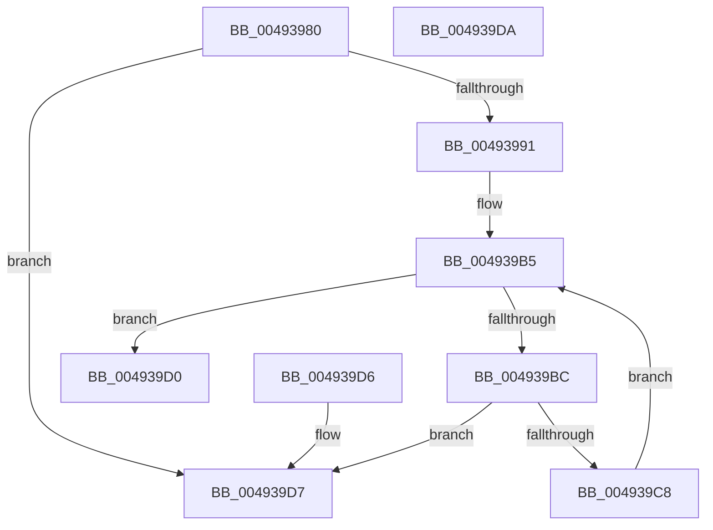

# MmMdlPagesAreZero

- RVA: `0x00493980`–`0x004939DB` (길이 `91` bytes)
- VA: `0x0000000140493980`
- 실행 섹션: `.text`
- PDB 이름 있음: `예`; PDB Function 태그: `아니요`
- unwind 정보 RVA: `0x000DB714`
- 디코드: `29`개 명령, `91/91` bytes 표시
- 미해석 바이트: `0` (있으면 어셈블리에 `.byte`로 보존)

> 이 문서는 커널 이미지의 기계어와 PDB 기호를 분석해 생성했습니다. 4번과 5번은 함수 원형과 자료형을 바이너리 사용 방식에서 추정한 C 해석이며 원본 소스 복구 결과는 아닙니다.

## 1. Dependencies

- 직접 호출 지점: **0**; 고유 호출 대상: **0**
- 직접 호출자로 확인된 함수: **0**
- RIP 상대 이미지 참조: **1**

### Outgoing calls
- 직접 디코드된 call 명령이 없습니다.

### Direct callers
- 이 함수 시작 RVA로 연결되는 직접 call은 확인되지 않았습니다. 간접 호출은 완전히 역산할 수 없습니다.

### Static image references
- `0x004939BC` → RVA `0x00E37440` (`.data`; read)

## 2. Other-region calls and transfers

- 다른 실행 섹션으로 향하는 call: **0**
- 별도 외부 분기/꼬리 이동을 확인하지 못했습니다.

## 3. Assembly (complete function range)

```asm
00493980  0F B7 41 0A                     movzx eax, word ptr [rcx + 0xa]
00493984  BA 02 40 00 00                  mov edx, 0x4002
00493989  66 23 C2                        and ax, dx
0049398C  66 3B C2                        cmp ax, dx
0049398F  75 46                           jne 0x1404939d7
00493991  8B 51 2C                        mov edx, dword ptr [rcx + 0x2c]
00493994  03 51 20                        add edx, dword ptr [rcx + 0x20]
00493997  44 8B 41 28                     mov r8d, dword ptr [rcx + 0x28]
0049399B  81 E2 FF 0F 00 00               and edx, 0xfff
004939A1  49 81 C0 FF 0F 00 00            add r8, 0xfff
004939A8  48 83 C1 30                     add rcx, 0x30
004939AC  4C 03 C2                        add r8, rdx
004939AF  49 C1 E8 0C                     shr r8, 0xc
004939B3  33 D2                           xor edx, edx
004939B5  8B C2                           mov eax, edx
004939B7  49 3B C0                        cmp rax, r8
004939BA  73 14                           jae 0x1404939d0
004939BC  48 8B 05 7D 3A 9A 00            mov rax, qword ptr [rip + 0x9a3a7d]
004939C3  48 39 01                        cmp qword ptr [rcx], rax
004939C6  75 0F                           jne 0x1404939d7
004939C8  FF C2                           inc edx
004939CA  48 83 C1 08                     add rcx, 8
004939CE  EB E5                           jmp 0x1404939b5
004939D0  B8 01 00 00 00                  mov eax, 1
004939D5  C3                              ret
004939D6  CC                              int3
004939D7  33 C0                           xor eax, eax
004939D9  C3                              ret
004939DA  CC                              int3
```

## 4. C-style interpretation (structured pseudocode)

```c
__int64 __fastcall MmMdlPagesAreZero(__int64 a1)
{
    __int64 result;

    result = (unsigned __int16)((*(unsigned __int16 *)(a1 + 10)) & ((unsigned __int16)((unsigned int)(0x4002ULL))));
    if (((unsigned __int16)(result)) != ((unsigned __int16)((unsigned int)(0x4002ULL)))) goto loc_004939D7;
    a2 = (unsigned int)(((unsigned int)(*(unsigned int *)(a1 + 44))) + (*(unsigned int *)(a1 + 32)));
    a2 = (unsigned int)((a2) & (0xFFFULL));
    a3 = ((unsigned int)(*(unsigned int *)(a1 + 40))) + (0xFFFULL);
    a1 = (a1) + (48);
    a3 = (a3) + (a2);
    a3 = (a3) >> (12);
    a2 = 0;
loc_004939B5:
    if (0 >= a3) goto loc_004939D0;
    if ((*(unsigned __int64 *)(a1)) != (*(unsigned __int64 *)(v_rip + 10107517))) goto loc_004939D7;
    a2 = (unsigned int)((a2) + 1);
    a1 = (a1) + (8);
    goto loc_004939B5;
loc_004939D0:
    return 1;
loc_004939D7:
    result = 0;
    return result;
}
```

## 5. (Beta) C Style

```c
int64_t MmMdlPagesAreZero(void *Arg1)
{
    uint8_t *arg1 = (uint8_t *)Arg1;

    int64_t result;

    result = (uint16_t)((*(uint16_t *)(arg1 + 0xA)) & ((uint16_t)((uint32_t)(0x4002ULL))));
    if (((uint16_t)(result)) != ((uint16_t)((uint32_t)(0x4002ULL)))) goto loc_004939D7;
    a2 = (uint32_t)(((uint32_t)(*(uint32_t *)(arg1 + 0x2C))) + (*(uint32_t *)(arg1 + 0x20)));
    a2 = (uint32_t)((a2) & (0xFFFULL));
    a3 = ((uint32_t)(*(uint32_t *)(arg1 + 0x28))) + (0xFFFULL);
    Arg1 = (Arg1) + (48);
    a3 = (a3) + (a2);
    a3 = (a3) >> (12);
    a2 = 0;
loc_004939B5:
    if (0 >= a3) goto loc_004939D0;
    if ((*(uint64_t *)(arg1)) != (*(uint64_t *)(v_rip + 0x9A3A7D))) goto loc_004939D7;
    a2 = (uint32_t)((a2) + 1);
    Arg1 = (Arg1) + (8);
    goto loc_004939B5;
loc_004939D0:
    return 1;
loc_004939D7:
    result = 0;
    return result;
}
```

### 관측된 메모리 오프셋

구조체 형식이 확인되지 않은 접근은 인자 기준의 오프셋으로만 기록했습니다.

| 기준 인자 | 오프셋 표현 | 폭 (bit) | 접근 |
|---|---:|---:|---|
| `Arg1` | `+ 0x0` | `64` | `R` |
| `Arg1` | `+ 0xA` | `16` | `R` |
| `Arg1` | `+ 0x20` | `32` | `R` |
| `Arg1` | `+ 0x28` | `32` | `R` |
| `Arg1` | `+ 0x2C` | `32` | `R` |

## 6. Execution-region graph

[열기: 2D/3D 그래프와 함수 탐색 컨트롤 패널](../../../control-panel.html?section=text&rva=0x00493980&view=graph)

- 2D 그래프는 위에서 아래로 흐르고, 3D 그래프는 빈 공간을 드래그해 회전합니다. Shift+드래그는 이동, 휠은 확대·축소, 함수 노드 선택은 대상 보고서 이동입니다.

### Static fallback


