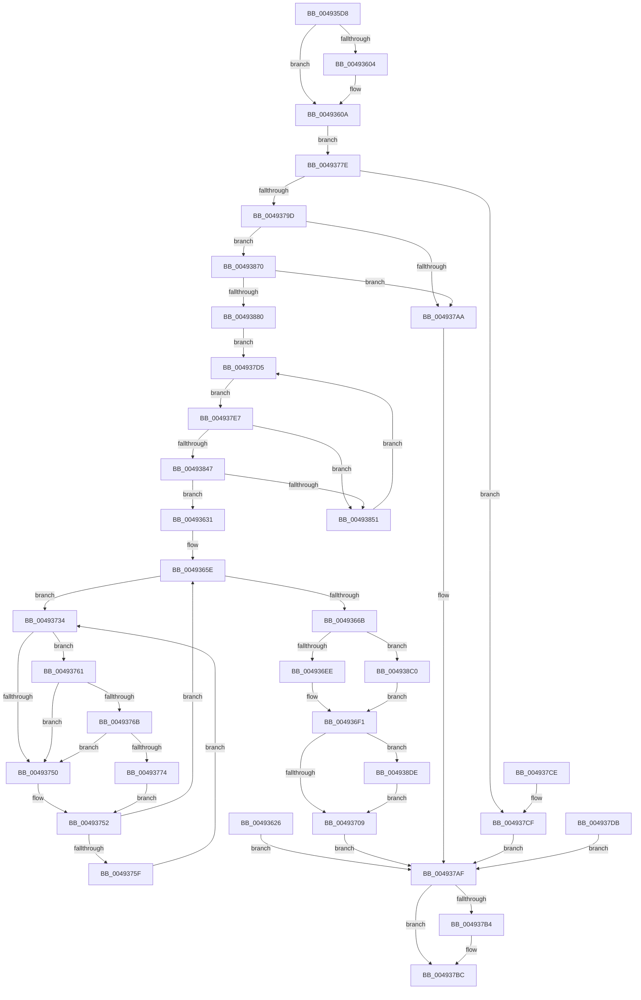

# MmUpdateUserShadowStackValue

- RVA: `0x004935D8`–`0x004938F1` (길이 `793` bytes)
- VA: `0x00000001404935D8`
- 실행 섹션: `.text`
- PDB 이름 있음: `예`; PDB Function 태그: `아니요`
- unwind 정보 RVA: `0x000B3104`
- 디코드: `191`개 명령, `793/793` bytes 표시
- 미해석 바이트: `0` (있으면 어셈블리에 `.byte`로 보존)

> 이 문서는 커널 이미지의 기계어와 PDB 기호를 분석해 생성했습니다. 4번과 5번은 함수 원형과 자료형을 바이너리 사용 방식에서 추정한 C 해석이며 원본 소스 복구 결과는 아닙니다.

## 1. Dependencies

- 직접 호출 지점: **15**; 고유 호출 대상: **13**
- 직접 호출자로 확인된 함수: **1**
- RIP 상대 이미지 참조: **4**

### Outgoing calls
- `0x00493604` → [ExRaiseDatatypeMisalignment](../../page/89/ExRaiseDatatypeMisalignment_function_00899FD0.md) (function, `0x00899FD0`)
- `0x00493676` → [MiMapPageInHyperSpaceWorker](../33/MiMapPageInHyperSpaceWorker_function_00332B10.md) (function, `0x00332B10`)
- `0x004936E0` → [MiCaptureDirtyBitToPfn](../37/MiCaptureDirtyBitToPfn_function_00370DD0.md) (function, `0x00370DD0`)
- `0x00493711` → [MiUnlockPageTable](../21/MiUnlockPageTable_function_00216EC0.md) (function, `0x00216EC0`)
- `0x00493720` → [MiUnlockWorkingSetShared](../27/MiUnlockWorkingSetShared_function_0027D690.md) (function, `0x0027D690`)
- `0x0049376B` → [KiCheckVpBackingLongSpinWaitHypercall](../30/KiCheckVpBackingLongSpinWaitHypercall_function_0030F490.md) (function, `0x0030F490`)
- `0x00493777` → [HvlNotifyLongSpinWait](../30/HvlNotifyLongSpinWait_function_0030F460.md) (function, `0x0030F460`)
- `0x00493788` → [MiObtainReferencedVadEx](../31/MiObtainReferencedVadEx_function_00316690.md) (function, `0x00316690`)
- `0x004937B7` → [MiUnlockAndDereferenceVad](../31/MiUnlockAndDereferenceVad_function_00316E60.md) (function, `0x00316E60`)
- `0x004937EA` → [MiLockWorkingSetShared](../27/MiLockWorkingSetShared_function_0027CBF0.md) (function, `0x0027CBF0`)
- `0x00493804` → [MiLockLowestValidPageTableEx](../28/MiLockLowestValidPageTableEx_function_00280D10.md) (function, `0x00280D10`)
- `0x00493816` → [MI_READ_PTE_LOCK_FREE](../28/MI_READ_PTE_LOCK_FREE_function_002828A0.md) (function, `0x002828A0`)
- `0x00493857` → [MiUnlockPageTable](../21/MiUnlockPageTable_function_00216EC0.md) (function, `0x00216EC0`)
- `0x00493866` → [MiUnlockWorkingSetShared](../27/MiUnlockWorkingSetShared_function_0027D690.md) (function, `0x0027D690`)
- `0x004938E7` → [MiReleasePageFileInfo](../28/MiReleasePageFileInfo_function_00283FD0.md) (function, `0x00283FD0`)

### Direct callers
- [PspFreeUserFiberShadowStack](../../page/87/PspFreeUserFiberShadowStack_function_0087F9A0.md) at `0x0087FA1F`

### Static image references
- `0x004936CE` → RVA `0x00010880` (`.rdata`; read)
- `0x00493747` → RVA `0x00FC52AC` (`ALMOSTRO`; reference)
- `0x00493761` → RVA `0x00FC6AB8` (`ALMOSTRO`; read)
- `0x004938CE` → RVA `0x00E30088` (`.data`; read)

## 2. Other-region calls and transfers

- 다른 실행 섹션으로 향하는 call: **1**
  - `0x00493604` → [ExRaiseDatatypeMisalignment](../../page/89/ExRaiseDatatypeMisalignment_function_00899FD0.md) (`.text` → `PAGE`)
- 별도 외부 분기/꼬리 이동을 확인하지 못했습니다.

## 3. Assembly (complete function range)

```asm
004935D8  48 8B C4                        mov rax, rsp
004935DB  4C 89 40 18                     mov qword ptr [rax + 0x18], r8
004935DF  48 89 50 10                     mov qword ptr [rax + 0x10], rdx
004935E3  53                              push rbx
004935E4  56                              push rsi
004935E5  57                              push rdi
004935E6  41 54                           push r12
004935E8  41 55                           push r13
004935EA  41 56                           push r14
004935EC  41 57                           push r15
004935EE  48 83 EC 40                     sub rsp, 0x40
004935F2  4C 8B F1                        mov r14, rcx
004935F5  33 DB                           xor ebx, ebx
004935F7  89 58 A8                        mov dword ptr [rax - 0x58], ebx
004935FA  48 89 58 B0                     mov qword ptr [rax - 0x50], rbx
004935FE  41 F6 C6 07                     test r14b, 7
00493602  74 06                           je 0x14049360a
00493604  E8 C7 69 40 00                  call 0x140899fd0
00493609  CC                              int3
0049360A  49 8B C6                        mov rax, r14
0049360D  48 B9 00 00 FF FF FF 7F 00 00   movabs rcx, 0x7fffffff0000
00493617  4C 3B F1                        cmp r14, rcx
0049361A  48 0F 43 C1                     cmovae rax, rcx
0049361E  90                              nop
0049361F  8A 00                           mov al, byte ptr [rax]
00493621  E9 58 01 00 00                  jmp 0x14049377e
00493626  8B F8                           mov edi, eax
00493628  33 DB                           xor ebx, ebx
0049362A  8B F3                           mov esi, ebx
0049362C  E9 7E 01 00 00                  jmp 0x1404937af
00493631  49 C1 EF 0C                     shr r15, 0xc
00493635  48 B8 FF FF FF FF FF 00 00 00   movabs rax, 0xffffffffff
0049363F  4C 23 F8                        and r15, rax
00493642  4B 8D 3C 7F                     lea rdi, [r15 + r15*2]
00493646  48 C1 E7 04                     shl rdi, 4
0049364A  48 B8 00 00 00 00 00 DE FF FF   movabs rax, 0xffffde0000000000
00493654  48 03 F8                        add rdi, rax
00493657  89 9C 24 98 00 00 00            mov dword ptr [rsp + 0x98], ebx
0049365E  F0 48 0F BA 6F 18 3F            lock bts qword ptr [rdi + 0x18], 0x3f
00493665  0F 82 C9 00 00 00               jb 0x140493734
0049366B  33 D2                           xor edx, edx
0049366D  41 B8 00 00 00 80               mov r8d, 0x80000000
00493673  49 8B CF                        mov rcx, r15
00493676  E8 95 F4 E9 FF                  call 0x140332b10
0049367B  41 81 E6 FF 0F 00 00            and r14d, 0xfff
00493682  49 8D 14 06                     lea rdx, [r14 + rax]
00493686  48 8B 84 24 88 00 00 00         mov rax, qword ptr [rsp + 0x88]
0049368E  F0 48 0F B1 1A                  lock cmpxchg qword ptr [rdx], rbx
00493693  44 8B F3                        mov r14d, ebx
00493696  41 0F 94 C6                     sete r14b
0049369A  48 C1 EA 09                     shr rdx, 9
0049369E  48 B8 F8 FF FF FF 7F 00 00 00   movabs rax, 0x7ffffffff8
004936A8  48 23 D0                        and rdx, rax
004936AB  48 B8 00 00 00 00 80 F6 FF FF   movabs rax, 0xfffff68000000000
004936B5  48 8B C0                        mov rax, rax
004936B8  48 03 D0                        add rdx, rax
004936BB  65 48 8B 04 25 20 00 00 00      mov rax, qword ptr gs:[0x20]
004936C4  48 8B 88 38 88 00 00            mov rcx, qword ptr [rax + 0x8838]
004936CB  48 89 19                        mov qword ptr [rcx], rbx
004936CE  48 8B 05 AB D1 B7 FF            mov rax, qword ptr [rip - 0x482e55]
004936D5  48 89 44 24 38                  mov qword ptr [rsp + 0x38], rax
004936DA  48 89 02                        mov qword ptr [rdx], rax
004936DD  48 8B CF                        mov rcx, rdi
004936E0  E8 EB D6 ED FF                  call 0x140370dd0
004936E5  48 85 C0                        test rax, rax
004936E8  0F 85 D2 01 00 00               jne 0x1404938c0
004936EE  48 8B CB                        mov rcx, rbx
004936F1  48 BA FF FF FF FF FF FF FF 7F   movabs rdx, 0x7fffffffffffffff
004936FB  F0 48 21 57 18                  lock and qword ptr [rdi + 0x18], rdx
00493700  48 85 C0                        test rax, rax
00493703  0F 85 D5 01 00 00               jne 0x1404938de
00493709  48 8B 54 24 30                  mov rdx, qword ptr [rsp + 0x30]
0049370E  49 8B CD                        mov rcx, r13
00493711  E8 AA 37 D8 FF                  call 0x140216ec0
00493716  8A 94 24 90 00 00 00            mov dl, byte ptr [rsp + 0x90]
0049371D  49 8B CD                        mov rcx, r13
00493720  E8 6B 9F DE FF                  call 0x14027d690
00493725  41 F7 DE                        neg r14d
00493728  1B FF                           sbb edi, edi
0049372A  F7 D7                           not edi
0049372C  81 E7 72 02 00 C0               and edi, 0xc0000272
00493732  EB 7B                           jmp 0x1404937af
00493734  44 8B A4 24 98 00 00 00         mov r12d, dword ptr [rsp + 0x98]
0049373C  41 FF C4                        inc r12d
0049373F  44 89 A4 24 98 00 00 00         mov dword ptr [rsp + 0x98], r12d
00493747  44 85 25 5E 1B B3 00            test dword ptr [rip + 0xb31b5e], r12d
0049374E  74 11                           je 0x140493761
00493750  F3 90                           pause
00493752  48 8B 47 18                     mov rax, qword ptr [rdi + 0x18]
00493756  48 85 C0                        test rax, rax
00493759  0F 89 FF FE FF FF               jns 0x14049365e
0049375F  EB D3                           jmp 0x140493734
00493761  8B 05 51 33 B3 00               mov eax, dword ptr [rip + 0xb33351]
00493767  A8 40                           test al, 0x40
00493769  74 E5                           je 0x140493750
0049376B  E8 20 BD E7 FF                  call 0x14030f490
00493770  84 C0                           test al, al
00493772  74 DC                           je 0x140493750
00493774  41 8B CC                        mov ecx, r12d
00493777  E8 E4 BC E7 FF                  call 0x14030f460
0049377C  EB D4                           jmp 0x140493752
0049377E  4C 8D 44 24 20                  lea r8, [rsp + 0x20]
00493783  33 D2                           xor edx, edx
00493785  49 8B CE                        mov rcx, r14
00493788  E8 03 2F E8 FF                  call 0x140316690
0049378D  48 8B F0                        mov rsi, rax
00493790  48 89 84 24 98 00 00 00         mov qword ptr [rsp + 0x98], rax
00493798  48 85 C0                        test rax, rax
0049379B  74 32                           je 0x1404937cf
0049379D  8B 40 30                        mov eax, dword ptr [rax + 0x30]
004937A0  0F BA E0 15                     bt eax, 0x15
004937A4  0F 82 C6 00 00 00               jb 0x140493870
004937AA  BF 18 00 00 C0                  mov edi, 0xc0000018
004937AF  48 85 F6                        test rsi, rsi
004937B2  74 08                           je 0x1404937bc
004937B4  48 8B CE                        mov rcx, rsi
004937B7  E8 A4 36 E8 FF                  call 0x140316e60
004937BC  8B C7                           mov eax, edi
004937BE  48 83 C4 40                     add rsp, 0x40
004937C2  41 5F                           pop r15
004937C4  41 5E                           pop r14
004937C6  41 5D                           pop r13
004937C8  41 5C                           pop r12
004937CA  5F                              pop rdi
004937CB  5E                              pop rsi
004937CC  5B                              pop rbx
004937CD  C3                              ret
004937CE  CC                              int3
004937CF  8B 7C 24 20                     mov edi, dword ptr [rsp + 0x20]
004937D3  EB DA                           jmp 0x1404937af
004937D5  90                              nop
004937D6  41 8A 06                        mov al, byte ptr [r14]
004937D9  EB 0C                           jmp 0x1404937e7
004937DB  8B F8                           mov edi, eax
004937DD  48 8B B4 24 98 00 00 00         mov rsi, qword ptr [rsp + 0x98]
004937E5  EB C8                           jmp 0x1404937af
004937E7  49 8B CD                        mov rcx, r13
004937EA  E8 01 94 DE FF                  call 0x14027cbf0
004937EF  88 84 24 90 00 00 00            mov byte ptr [rsp + 0x90], al
004937F6  45 33 C9                        xor r9d, r9d
004937F9  4C 8D 44 24 28                  lea r8, [rsp + 0x28]
004937FE  48 8B D7                        mov rdx, rdi
00493801  49 8B CD                        mov rcx, r13
00493804  E8 07 D5 DE FF                  call 0x140280d10
00493809  4C 8B E0                        mov r12, rax
0049380C  48 89 44 24 30                  mov qword ptr [rsp + 0x30], rax
00493811  48 8B 4C 24 28                  mov rcx, qword ptr [rsp + 0x28]
00493816  E8 85 F0 DE FF                  call 0x1402828a0
0049381B  4C 8B F8                        mov r15, rax
0049381E  48 8B D7                        mov rdx, rdi
00493821  48 C1 EA 09                     shr rdx, 9
00493825  48 B8 F8 FF FF FF 7F 00 00 00   movabs rax, 0x7ffffffff8
0049382F  48 23 D0                        and rdx, rax
00493832  48 B8 00 00 00 00 80 F6 FF FF   movabs rax, 0xfffff68000000000
0049383C  48 8B C8                        mov rcx, rax
0049383F  48 03 D1                        add rdx, rcx
00493842  4C 3B E2                        cmp r12, rdx
00493845  75 0A                           jne 0x140493851
00493847  41 F6 C7 01                     test r15b, 1
0049384B  0F 85 E0 FD FF FF               jne 0x140493631
00493851  49 8B D4                        mov rdx, r12
00493854  49 8B CD                        mov rcx, r13
00493857  E8 64 36 D8 FF                  call 0x140216ec0
0049385C  8A 94 24 90 00 00 00            mov dl, byte ptr [rsp + 0x90]
00493863  49 8B CD                        mov rcx, r13
00493866  E8 25 9E DE FF                  call 0x14027d690
0049386B  E9 65 FF FF FF                  jmp 0x1404937d5
00493870  25 00 00 00 14                  and eax, 0x14000000
00493875  3D 00 00 00 10                  cmp eax, 0x10000000
0049387A  0F 85 2A FF FF FF               jne 0x1404937aa
00493880  65 48 8B 04 25 88 01 00 00      mov rax, qword ptr gs:[0x188]
00493889  4C 8B A8 B8 00 00 00            mov r13, qword ptr [rax + 0xb8]
00493890  49 81 C5 00 04 00 00            add r13, 0x400
00493897  49 8B FE                        mov rdi, r14
0049389A  48 C1 EF 09                     shr rdi, 9
0049389E  48 B8 F8 FF FF FF 7F 00 00 00   movabs rax, 0x7ffffffff8
004938A8  48 23 F8                        and rdi, rax
004938AB  48 B8 00 00 00 00 80 F6 FF FF   movabs rax, 0xfffff68000000000
004938B5  48 8B C0                        mov rax, rax
004938B8  48 03 F8                        add rdi, rax
004938BB  E9 15 FF FF FF                  jmp 0x1404937d5
004938C0  48 8B 4F 28                     mov rcx, qword ptr [rdi + 0x28]
004938C4  48 C1 E9 2B                     shr rcx, 0x2b
004938C8  81 E1 FF 03 00 00               and ecx, 0x3ff
004938CE  48 8B 15 B3 C7 99 00            mov rdx, qword ptr [rip + 0x99c7b3]
004938D5  48 8B 0C CA                     mov rcx, qword ptr [rdx + rcx*8]
004938D9  E9 13 FE FF FF                  jmp 0x1404936f1
004938DE  41 B8 01 00 00 00               mov r8d, 1
004938E4  48 8B D0                        mov rdx, rax
004938E7  E8 E4 06 DF FF                  call 0x140283fd0
004938EC  E9 18 FE FF FF                  jmp 0x140493709
```

## 4. C-style interpretation (structured pseudocode)

```c
__int64 __fastcall MmUpdateUserShadowStackValue(__int64 a1, __int64 a2, __int64 a3, int a4)
{
    __int64 result;
    __int64 v_r12;
    __int64 v_r13;
    __int64 v_r14;
    __int64 v_r15;
    __int64 v_rbx;
    __int64 v_rdi;
    __int64 v_rsp;
    unsigned __int64 v_stack_m40;
    unsigned __int64 v_stack_m48;
    unsigned __int64 v_stack_m58;
    unsigned __int64 v_stack_p10;
    unsigned __int8 v_stack_p18;
    unsigned int v_stack_p20;
    unsigned __int64 v_stack_p28;
    unsigned __int64 v_stack_p30;
    unsigned __int8 v_stack_p90;
    unsigned __int64 v_stack_p98;

    *(unsigned __int64 *)(v_rsp + 24) = a3;
    *(unsigned __int64 *)(v_rsp + 16) = a2;
    v_rsp = (v_rsp) - (64);
    v_rbx = 0;
    *(unsigned int *)(v_rsp - 88) = 0;
    *(unsigned __int64 *)(v_rsp - 80) = 0;
    result = v_rsp;
    if ((((unsigned __int8)(a1)) & (7)) != 0) {
        result = ExRaiseDatatypeMisalignment(a1, a2, a3, a4);
    }
    if (a1 >= a1) { a1 = a1; }
    goto loc_0049377E;
loc_00493631:
    v_r15 = (v_r15) >> (12);
    v_r15 = (v_r15) & (*(unsigned __int8 *)(a1));
    v_rdi = (v_r15 + v_r15 * 2) << (4);
    v_rdi = (v_rdi) + (*(unsigned __int8 *)(a1));
    v_stack_p20 = 0;
loc_0049365E:
    if (condition_is_below) goto loc_00493734;
    a2 = 0;
    result = MiMapPageInHyperSpaceWorker(v_r15, a2, (unsigned int)(0x80000000ULL), a4);
    v_r14 = (unsigned int)((a1) & (0xFFFULL));
    v_r14 = (condition_is_equal) ? 1 : 0;
    a2 = (v_r14 + result * 1) >> (9);
    a2 = (a2) & (v_stack_p10);
    a2 = (a2) + (v_stack_p10);
    *(unsigned __int64 *)(*(unsigned __int64 *)(*(unsigned __int64 *)(gs_base + (0 + 32)) + 34872)) = 0;
    v_stack_m40 = *(unsigned __int64 *)(v_rip - 4730453);
    *(unsigned __int64 *)(a2) = *(unsigned __int64 *)(v_rip - 4730453);
    result = MiCaptureDirtyBitToPfn(v_rdi, a2, (unsigned int)(0x80000000ULL), a4);
    if (result != 0) goto loc_004938C0;
loc_004936F1:
    if (result != 0) goto loc_004938DE;
loc_00493709:
    result = MiUnlockPageTable(v_r13, v_stack_m48, (unsigned int)(0x80000000ULL), a4);
    result = MiUnlockWorkingSetShared(v_r13, v_stack_p18, (unsigned int)(0x80000000ULL), a4);
    v_r14 = (unsigned int)(-(v_r14));
    v_rdi = (unsigned int)(~(v_rdi));
    v_rdi = (unsigned int)((v_rdi) & (0xC0000272ULL));
    goto loc_004937AF;
loc_00493734:
    v_r12 = (unsigned int)(((unsigned int)(v_stack_p20)) + 1);
    v_stack_p20 = (unsigned int)(v_r12);
    if (((*(unsigned int *)(v_rip + 11737950)) & ((unsigned int)(v_r12))) == 0) goto loc_00493761;
loc_00493750:
loc_00493752:
    if (!sign_flag) goto loc_0049365E;
    goto loc_00493734;
loc_00493761:
    if ((((unsigned __int8)((unsigned int)(*(unsigned int *)(v_rip + 11744081)))) & (64)) == 0) goto loc_00493750;
    result = KiCheckVpBackingLongSpinWaitHypercall(v_r13, v_stack_p18, (unsigned int)(0x80000000ULL), a4);
    if ((unsigned __int8)(result) == 0) goto loc_00493750;
    result = HvlNotifyLongSpinWait((unsigned int)((unsigned int)(v_r12)), v_stack_p18, (unsigned int)(0x80000000ULL), a4);
    goto loc_00493752;
loc_0049377E:
    a2 = 0;
    result = MiObtainReferencedVadEx(v_r14, a2, v_stack_m58, a4);
    v_stack_p20 = result;
    if (result == 0) goto loc_004937CF;
    if (condition_is_below) goto loc_00493870;
loc_004937AA:
loc_004937AF:
    result = (unsigned int)(*(unsigned int *)(result + 48));
    if (result != 0) {
        a1 = result;
        result = MiUnlockAndDereferenceVad(a1, a2, v_stack_m58, a4);
    }
    v_rsp = (v_rsp) + (64);
    return (unsigned int)((unsigned int)((unsigned int)(0xC0000018ULL)));
loc_004937CF:
    goto loc_004937AF;
loc_004937D5:
    goto loc_004937E7;
loc_004937E7:
    result = MiLockWorkingSetShared(v_r13, a2, v_stack_m58, a4);
    v_stack_p90 = (unsigned __int8)(result);
    a4 = 0;
    result = MiLockLowestValidPageTableEx(v_r13, (unsigned int)(v_stack_p20), v_stack_p28, a4);
    v_stack_p30 = result;
    result = MI_READ_PTE_LOCK_FREE(v_stack_p28, (unsigned int)(v_stack_p20), v_stack_p28, a4);
    a2 = ((unsigned int)(v_stack_p20)) >> (9);
    a2 = (a2) & (result);
    a2 = (a2) + (result);
    if (result != a2) goto loc_00493851;
    if ((((unsigned __int8)(result)) & (1)) != 0) goto loc_00493631;
loc_00493851:
    result = MiUnlockPageTable(v_r13, result, v_stack_p28, a4);
    result = MiUnlockWorkingSetShared(v_r13, v_stack_p90, v_stack_p28, a4);
    goto loc_004937D5;
loc_00493870:
    result = (unsigned int)((result) & (0x14000000ULL));
    if (((unsigned int)(result)) != 0x10000000ULL) goto loc_004937AA;
    v_r13 = (*(unsigned __int64 *)(*(unsigned __int64 *)(gs_base + (0 + 392)) + 184)) + (0x400ULL);
    v_rdi = (v_r14) >> (9);
    v_rdi = (v_rdi) & (*(unsigned __int64 *)(gs_base + (0 + 392)));
    v_rdi = (v_rdi) + (*(unsigned __int64 *)(gs_base + (0 + 392)));
    goto loc_004937D5;
loc_004938C0:
    a1 = (*(unsigned __int64 *)(v_rdi + 40)) >> (43);
    a1 = (unsigned int)((a1) & (0x3FFULL));
    goto loc_004936F1;
loc_004938DE:
    result = MiReleasePageFileInfo(*(unsigned __int64 *)(*(unsigned __int64 *)(v_rip + 10078131) + a1 * 8), *(unsigned __int64 *)(gs_base + (0 + 392)), 1, a4);
    goto loc_00493709;
}
```

## 5. (Beta) C Style

```c
int64_t MmUpdateUserShadowStackValue(int64_t Arg1, int64_t Arg2, int64_t Arg3, int32_t Arg4)
{
    int64_t result;
    int64_t local_r12;
    int64_t local_r13;
    int64_t local_r14;
    int64_t local_r15;
    int64_t local_rbx;
    int64_t local_rdi;
    int64_t local_rsp;
    uint64_t v_stack_m40;
    uint64_t v_stack_m48;
    uint64_t v_stack_m58;
    uint64_t v_stack_p10;
    uint8_t v_stack_p18;
    uint32_t v_stack_p20;
    uint64_t v_stack_p28;
    uint64_t v_stack_p30;
    uint8_t v_stack_p90;
    uint64_t v_stack_p98;

    *(uint64_t *)(local_rsp + 0x18) = Arg3;
    *(uint64_t *)(local_rsp + 0x10) = Arg2;
    local_rsp = (local_rsp) - (64);
    local_rbx = 0;
    *(uint32_t *)(local_rsp - 0x58) = 0;
    *(uint64_t *)(local_rsp - 0x50) = 0;
    result = local_rsp;
    if ((((uint8_t)(Arg1)) & (7)) != 0) {
        result = ExRaiseDatatypeMisalignment(Arg1, Arg2, Arg3, Arg4);
    }
    if (Arg1 >= Arg1) { Arg1 = Arg1; }
    goto loc_0049377E;
loc_00493631:
    local_r15 = (local_r15) >> (12);
    local_r15 = (local_r15) & (*(uint8_t *)(Arg1));
    local_rdi = (local_r15 + local_r15 * 2) << (4);
    local_rdi = (local_rdi) + (*(uint8_t *)(Arg1));
    v_stack_p20 = 0;
loc_0049365E:
    if (condition_is_below) goto loc_00493734;
    Arg2 = 0;
    result = MiMapPageInHyperSpaceWorker(local_r15, Arg2, (uint32_t)(0x80000000ULL), Arg4);
    local_r14 = (uint32_t)((Arg1) & (0xFFFULL));
    local_r14 = (condition_is_equal) ? 1 : 0;
    Arg2 = (local_r14 + result * 1) >> (9);
    Arg2 = (Arg2) & (v_stack_p10);
    Arg2 = (Arg2) + (v_stack_p10);
    *(uint64_t *)(*(uint64_t *)(*(uint64_t *)(gs_base + (0 + 0x20)) + 0x8838)) = 0;
    v_stack_m40 = *(uint64_t *)(v_rip - 0x482E55);
    *(uint64_t *)(Arg2) = *(uint64_t *)(v_rip - 0x482E55);
    result = MiCaptureDirtyBitToPfn(local_rdi, Arg2, (uint32_t)(0x80000000ULL), Arg4);
    if (result != 0) goto loc_004938C0;
loc_004936F1:
    if (result != 0) goto loc_004938DE;
loc_00493709:
    result = MiUnlockPageTable(local_r13, v_stack_m48, (uint32_t)(0x80000000ULL), Arg4);
    result = MiUnlockWorkingSetShared(local_r13, v_stack_p18, (uint32_t)(0x80000000ULL), Arg4);
    local_r14 = (uint32_t)(-(local_r14));
    local_rdi = (uint32_t)(~(local_rdi));
    local_rdi = (uint32_t)((local_rdi) & (0xC0000272ULL));
    goto loc_004937AF;
loc_00493734:
    local_r12 = (uint32_t)(((uint32_t)(v_stack_p20)) + 1);
    v_stack_p20 = (uint32_t)(local_r12);
    if (((*(uint32_t *)(v_rip + 0xB31B5E)) & ((uint32_t)(local_r12))) == 0) goto loc_00493761;
loc_00493750:
loc_00493752:
    if (!sign_flag) goto loc_0049365E;
    goto loc_00493734;
loc_00493761:
    if ((((uint8_t)((uint32_t)(*(uint32_t *)(v_rip + 0xB33351)))) & (64)) == 0) goto loc_00493750;
    result = KiCheckVpBackingLongSpinWaitHypercall(local_r13, v_stack_p18, (uint32_t)(0x80000000ULL), Arg4);
    if ((uint8_t)(result) == 0) goto loc_00493750;
    result = HvlNotifyLongSpinWait((uint32_t)((uint32_t)(local_r12)), v_stack_p18, (uint32_t)(0x80000000ULL), Arg4);
    goto loc_00493752;
loc_0049377E:
    Arg2 = 0;
    result = MiObtainReferencedVadEx(local_r14, Arg2, v_stack_m58, Arg4);
    v_stack_p20 = result;
    if (result == 0) goto loc_004937CF;
    if (condition_is_below) goto loc_00493870;
loc_004937AA:
loc_004937AF:
    result = (uint32_t)(*(uint32_t *)(result + 0x30));
    if (result != 0) {
        Arg1 = result;
        result = MiUnlockAndDereferenceVad(Arg1, Arg2, v_stack_m58, Arg4);
    }
    local_rsp = (local_rsp) + (64);
    return (uint32_t)((uint32_t)((uint32_t)(0xC0000018ULL)));
loc_004937CF:
    goto loc_004937AF;
loc_004937D5:
    goto loc_004937E7;
loc_004937E7:
    result = MiLockWorkingSetShared(local_r13, Arg2, v_stack_m58, Arg4);
    v_stack_p90 = (uint8_t)(result);
    Arg4 = 0;
    result = MiLockLowestValidPageTableEx(local_r13, (uint32_t)(v_stack_p20), v_stack_p28, Arg4);
    v_stack_p30 = result;
    result = MI_READ_PTE_LOCK_FREE(v_stack_p28, (uint32_t)(v_stack_p20), v_stack_p28, Arg4);
    Arg2 = ((uint32_t)(v_stack_p20)) >> (9);
    Arg2 = (Arg2) & (result);
    Arg2 = (Arg2) + (result);
    if (result != Arg2) goto loc_00493851;
    if ((((uint8_t)(result)) & (1)) != 0) goto loc_00493631;
loc_00493851:
    result = MiUnlockPageTable(local_r13, result, v_stack_p28, Arg4);
    result = MiUnlockWorkingSetShared(local_r13, v_stack_p90, v_stack_p28, Arg4);
    goto loc_004937D5;
loc_00493870:
    result = (uint32_t)((result) & (0x14000000ULL));
    if (((uint32_t)(result)) != 0x10000000ULL) goto loc_004937AA;
    local_r13 = (*(uint64_t *)(*(uint64_t *)(gs_base + (0 + 0x188)) + 0xB8)) + (0x400ULL);
    local_rdi = (local_r14) >> (9);
    local_rdi = (local_rdi) & (*(uint64_t *)(gs_base + (0 + 0x188)));
    local_rdi = (local_rdi) + (*(uint64_t *)(gs_base + (0 + 0x188)));
    goto loc_004937D5;
loc_004938C0:
    Arg1 = (*(uint64_t *)(local_rdi + 0x28)) >> (43);
    Arg1 = (uint32_t)((Arg1) & (0x3FFULL));
    goto loc_004936F1;
loc_004938DE:
    result = MiReleasePageFileInfo(*(uint64_t *)(*(uint64_t *)(v_rip + 0x99C7B3) + Arg1 * 8), *(uint64_t *)(gs_base + (0 + 0x188)), 1, Arg4);
    goto loc_00493709;
}
```

## 6. Execution-region graph

[열기: 2D/3D 그래프와 함수 탐색 컨트롤 패널](../../../control-panel.html?section=text&rva=0x004935D8&view=graph)

- 2D 그래프는 위에서 아래로 흐르고, 3D 그래프는 빈 공간을 드래그해 회전합니다. Shift+드래그는 이동, 휠은 확대·축소, 함수 노드 선택은 대상 보고서 이동입니다.

### Static fallback


