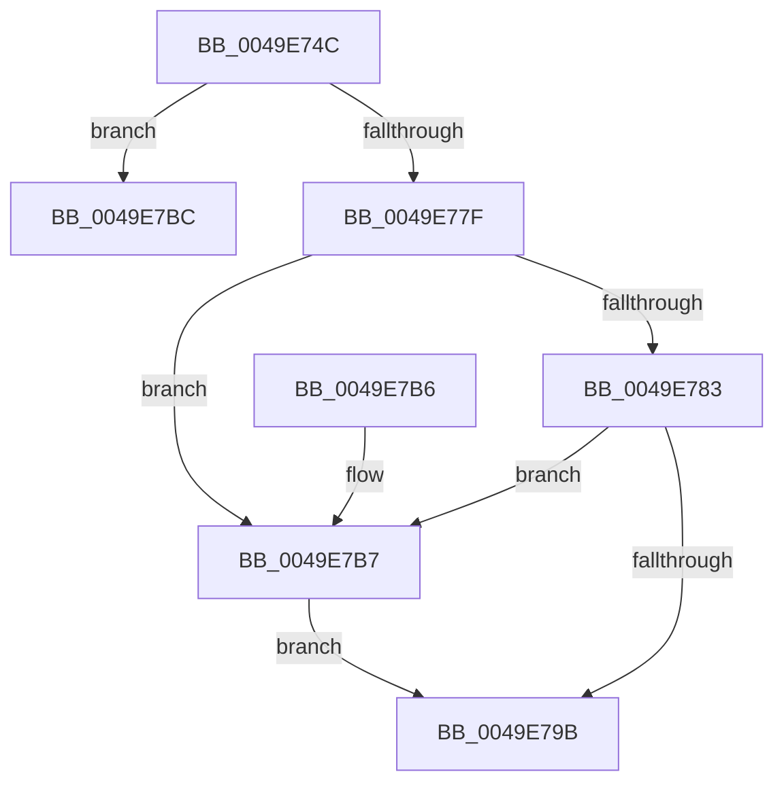

# MmZeroPageWrite

- RVA: `0x0049E74C`–`0x0049E7C3` (길이 `119` bytes)
- VA: `0x000000014049E74C`
- 실행 섹션: `.text`
- PDB 이름 있음: `예`; PDB Function 태그: `예`
- unwind 정보 RVA: `0x000AD2A0`
- 디코드: `38`개 명령, `119/119` bytes 표시
- 미해석 바이트: `0` (있으면 어셈블리에 `.byte`로 보존)

> 이 문서는 커널 이미지의 기계어와 PDB 기호를 분석해 생성했습니다. 4번과 5번은 함수 원형과 자료형을 바이너리 사용 방식에서 추정한 C 해석이며 원본 소스 복구 결과는 아닙니다.

## 1. Dependencies

- 직접 호출 지점: **1**; 고유 호출 대상: **1**
- 직접 호출자로 확인된 함수: **2**
- RIP 상대 이미지 참조: **0**

### Outgoing calls
- `0x0049E78F` → [MiZeroPageWrite](../29/MiZeroPageWrite_function_0029F280.md) (function, `0x0029F280`)

### Direct callers
- [MiZeroPageFile](../67/MiZeroPageFile_function_00671180.md) at `0x006712E2`
- [PopZeroHiberFile](../../page/75/PopZeroHiberFile_function_0075E47C.md) at `0x0075E500`

### Static image references
- 디코드된 RIP-relative 메모리 참조가 없습니다.

## 2. Other-region calls and transfers

- 다른 실행 섹션으로 향하는 call: **0**
- call이 아닌 외부 분기/꼬리 이동: **1**
  - `0x0049E7BE` → [sub_006F82EA](../6F/Unknown_function_006F82EA.md) (`tail-transfer`)

## 3. Assembly (complete function range)

```asm
0049E74C  48 8B C4                        mov rax, rsp
0049E74F  48 89 58 08                     mov qword ptr [rax + 8], rbx
0049E753  48 89 68 10                     mov qword ptr [rax + 0x10], rbp
0049E757  48 89 70 18                     mov qword ptr [rax + 0x18], rsi
0049E75B  48 89 78 20                     mov qword ptr [rax + 0x20], rdi
0049E75F  41 56                           push r14
0049E761  48 83 EC 20                     sub rsp, 0x20
0049E765  49 8B 18                        mov rbx, qword ptr [r8]
0049E768  41 8B F1                        mov esi, r9d
0049E76B  48 8B EA                        mov rbp, rdx
0049E76E  4C 8B F1                        mov r14, rcx
0049E771  45 33 D2                        xor r10d, r10d
0049E774  48 8B C3                        mov rax, rbx
0049E777  48 C1 E8 20                     shr rax, 0x20
0049E77B  85 C0                           test eax, eax
0049E77D  75 3D                           jne 0x14049e7bc
0049E77F  85 DB                           test ebx, ebx
0049E781  74 34                           je 0x14049e7b7
0049E783  44 8B CE                        mov r9d, esi
0049E786  44 8B C3                        mov r8d, ebx
0049E789  48 8B D5                        mov rdx, rbp
0049E78C  49 8B CE                        mov rcx, r14
0049E78F  E8 EC 0A E0 FF                  call 0x14029f280
0049E794  44 8B D0                        mov r10d, eax
0049E797  85 C0                           test eax, eax
0049E799  79 1C                           jns 0x14049e7b7
0049E79B  48 8B 5C 24 30                  mov rbx, qword ptr [rsp + 0x30]
0049E7A0  48 8B 6C 24 38                  mov rbp, qword ptr [rsp + 0x38]
0049E7A5  48 8B 74 24 40                  mov rsi, qword ptr [rsp + 0x40]
0049E7AA  48 8B 7C 24 48                  mov rdi, qword ptr [rsp + 0x48]
0049E7AF  48 83 C4 20                     add rsp, 0x20
0049E7B3  41 5E                           pop r14
0049E7B5  C3                              ret
0049E7B6  CC                              int3
0049E7B7  41 8B C2                        mov eax, r10d
0049E7BA  EB DF                           jmp 0x14049e79b
0049E7BC  33 FF                           xor edi, edi
0049E7BE  E9 27 9B 25 00                  jmp 0x1406f82ea
```

## 4. C-style interpretation (structured pseudocode)

```c
__int64 __fastcall MmZeroPageWrite(__int64 a1, __int64 a2, __int64 a3, int a4)
{
    __int64 result;
    __int64 v_r10;
    __int64 v_rdi;
    __int64 v_rsp;
    unsigned __int64 v_stack_p10;
    unsigned __int64 v_stack_p18;
    unsigned __int64 v_stack_p20;
    unsigned __int64 v_stack_p8;

    *(unsigned __int64 *)(v_rsp + 8) = v_rbx;
    *(unsigned __int64 *)(v_rsp + 16) = v_rbp;
    *(unsigned __int64 *)(v_rsp + 24) = v_rsi;
    *(unsigned __int64 *)(v_rsp + 32) = v_rdi;
    v_rsp = (v_rsp) - (32);
    v_r10 = 0;
    result = (*(unsigned __int64 *)(a3)) >> (32);
    if ((unsigned int)(result) != 0) goto loc_0049E7BC;
    if ((unsigned int)(*(unsigned __int64 *)(a3)) == 0) goto loc_0049E7B7;
    result = MiZeroPageWrite(a1, a2, (unsigned int)((unsigned int)(*(unsigned __int64 *)(a3))), (unsigned int)((unsigned int)((unsigned int)(a4))));
    if (!sign_flag) goto loc_0049E7B7;
loc_0049E79B:
    v_rsp = (v_rsp) + (32);
    return result;
loc_0049E7B7:
    goto loc_0049E79B;
loc_0049E7BC:
    v_rdi = 0;
}
```

## 5. (Beta) C Style

```c
int64_t MmZeroPageWrite(int64_t Arg1, int64_t Arg2, void *Arg3, int32_t Arg4)
{
    uint8_t *arg3 = (uint8_t *)Arg3;

    int64_t result;
    int64_t local_r10;
    int64_t local_rdi;
    int64_t local_rsp;
    uint64_t v_stack_p10;
    uint64_t v_stack_p18;
    uint64_t v_stack_p20;
    uint64_t v_stack_p8;

    *(uint64_t *)(local_rsp + 0x8) = local_rbx;
    *(uint64_t *)(local_rsp + 0x10) = local_rbp;
    *(uint64_t *)(local_rsp + 0x18) = local_rsi;
    *(uint64_t *)(local_rsp + 0x20) = local_rdi;
    local_rsp = (local_rsp) - (32);
    local_r10 = 0;
    result = (*(uint64_t *)(arg3)) >> (32);
    if ((uint32_t)(result) != 0) goto loc_0049E7BC;
    if ((uint32_t)(*(uint64_t *)(arg3)) == 0) goto loc_0049E7B7;
    result = MiZeroPageWrite(Arg1, Arg2, (uint32_t)((uint32_t)(*(uint64_t *)(arg3))), (uint32_t)((uint32_t)((uint32_t)(Arg4))));
    if (!sign_flag) goto loc_0049E7B7;
loc_0049E79B:
    local_rsp = (local_rsp) + (32);
    return result;
loc_0049E7B7:
    goto loc_0049E79B;
loc_0049E7BC:
    local_rdi = 0;
}
```

### 관측된 메모리 오프셋

구조체 형식이 확인되지 않은 접근은 인자 기준의 오프셋으로만 기록했습니다.

| 기준 인자 | 오프셋 표현 | 폭 (bit) | 접근 |
|---|---:|---:|---|
| `Arg3` | `+ 0x0` | `64` | `R` |

## 6. Execution-region graph

[열기: 2D/3D 그래프와 함수 탐색 컨트롤 패널](../../../control-panel.html?section=text&rva=0x0049E74C&view=graph)

- 2D 그래프는 위에서 아래로 흐르고, 3D 그래프는 빈 공간을 드래그해 회전합니다. Shift+드래그는 이동, 휠은 확대·축소, 함수 노드 선택은 대상 보고서 이동입니다.

### Static fallback


