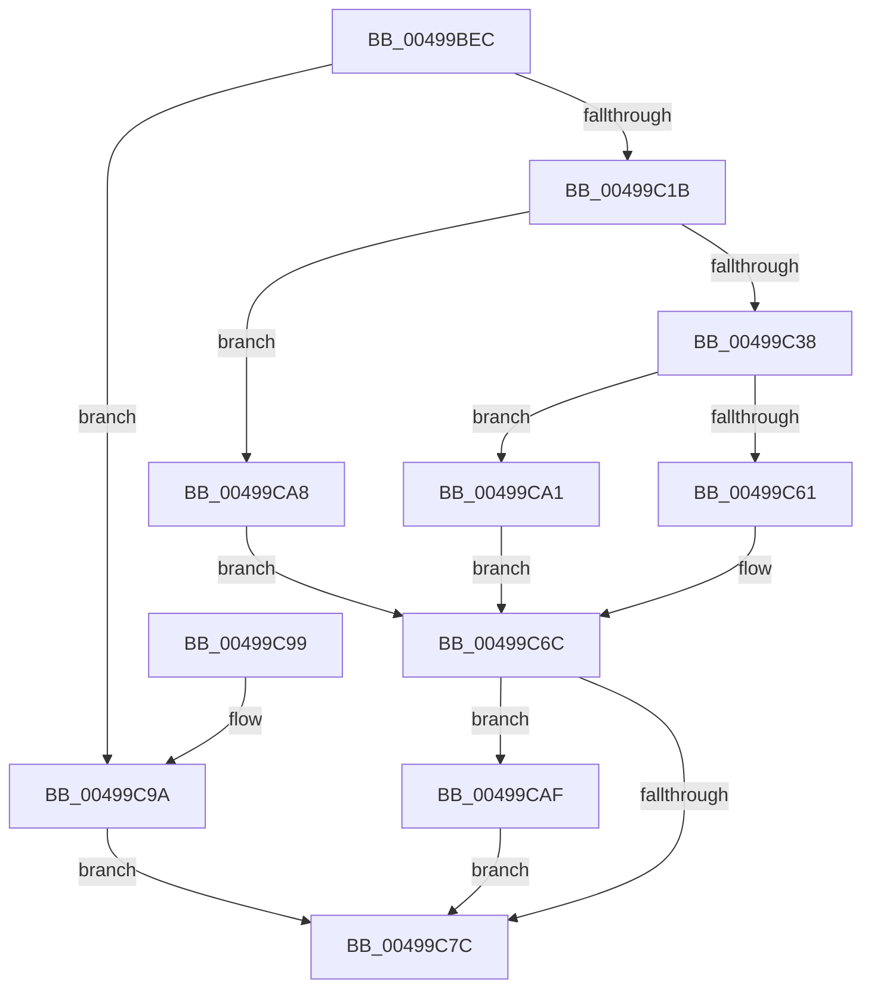

# PfSnStartTraceTimer

- RVA: `0x00499BEC`–`0x00499CB9` (길이 `205` bytes)
- VA: `0x0000000140499BEC`
- 실행 섹션: `.text`
- PDB 이름 있음: `예`; PDB Function 태그: `아니요`
- unwind 정보 RVA: `0x000B45D4`
- 디코드: `55`개 명령, `205/205` bytes 표시
- 미해석 바이트: `0` (있으면 어셈블리에 `.byte`로 보존)

> 이 문서는 커널 이미지의 기계어와 PDB 기호를 분석해 생성했습니다. 4번과 5번은 함수 원형과 자료형을 바이너리 사용 방식에서 추정한 C 해석이며 원본 소스 복구 결과는 아닙니다.

## 1. Dependencies

- 직접 호출 지점: **5**; 고유 호출 대상: **5**
- 직접 호출자로 확인된 함수: **1**
- RIP 상대 이미지 참조: **0**

### Outgoing calls
- `0x00499C12` → [ExAcquireRundownProtection](../21/ExAcquireRundownProtection_function_00216620.md) (function, `0x00216620`)
- `0x00499C25` → [KeAcquireSpinLockRaiseToDpc](../20/KeAcquireSpinLockRaiseToDpc_function_00208470.md) (function, `0x00208470`)
- `0x00499C58` → [KiSetTimerEx](../23/KiSetTimerEx_function_00232CB0.md) (function, `0x00232CB0`)
- `0x00499C72` → [KeReleaseSpinLock](../39/KeReleaseSpinLock_function_00392BA0.md) (function, `0x00392BA0`)
- `0x00499CB2` → [ExReleaseRundownProtection](../34/ExReleaseRundownProtection_function_00349E80.md) (function, `0x00349E80`)

### Direct callers
- [PfSnBeginScenario](../../page/95/PfSnBeginScenario_function_0095EFC0.md) at `0x0095F0DC`

### Static image references
- 디코드된 RIP-relative 메모리 참조가 없습니다.

## 2. Other-region calls and transfers

- 다른 실행 섹션으로 향하는 call: **0**
- 별도 외부 분기/꼬리 이동을 확인하지 못했습니다.

## 3. Assembly (complete function range)

```asm
00499BEC  48 8B C4                        mov rax, rsp
00499BEF  48 89 58 08                     mov qword ptr [rax + 8], rbx
00499BF3  48 89 68 10                     mov qword ptr [rax + 0x10], rbp
00499BF7  48 89 70 18                     mov qword ptr [rax + 0x18], rsi
00499BFB  48 89 78 20                     mov qword ptr [rax + 0x20], rdi
00499BFF  41 56                           push r14
00499C01  48 83 EC 30                     sub rsp, 0x30
00499C05  48 8D B1 68 01 00 00            lea rsi, [rcx + 0x168]
00499C0C  48 8B D9                        mov rbx, rcx
00499C0F  48 8B CE                        mov rcx, rsi
00499C12  E8 09 CA D7 FF                  call 0x140216620
00499C17  84 C0                           test al, al
00499C19  74 7F                           je 0x140499c9a
00499C1B  48 8D AB 10 01 00 00            lea rbp, [rbx + 0x110]
00499C22  48 8B CD                        mov rcx, rbp
00499C25  E8 46 E8 D6 FF                  call 0x140208470
00499C2A  8B 8B 18 01 00 00               mov ecx, dword ptr [rbx + 0x118]
00499C30  44 8A F0                        mov r14b, al
00499C33  F6 C1 02                        test cl, 2
00499C36  75 70                           jne 0x140499ca8
00499C38  48 8B 93 C8 00 00 00            mov rdx, qword ptr [rbx + 0xc8]
00499C3F  4C 8D 83 D0 00 00 00            lea r8, [rbx + 0xd0]
00499C46  4C 89 44 24 20                  mov qword ptr [rsp + 0x20], r8
00499C4B  48 8D 8B 88 00 00 00            lea rcx, [rbx + 0x88]
00499C52  45 33 C0                        xor r8d, r8d
00499C55  45 33 C9                        xor r9d, r9d
00499C58  E8 53 90 D9 FF                  call 0x140232cb0
00499C5D  84 C0                           test al, al
00499C5F  75 40                           jne 0x140499ca1
00499C61  83 8B 18 01 00 00 01            or dword ptr [rbx + 0x118], 1
00499C68  33 DB                           xor ebx, ebx
00499C6A  33 FF                           xor edi, edi
00499C6C  41 8A D6                        mov dl, r14b
00499C6F  48 8B CD                        mov rcx, rbp
00499C72  E8 29 8F EF FF                  call 0x140392ba0
00499C77  48 85 DB                        test rbx, rbx
00499C7A  75 33                           jne 0x140499caf
00499C7C  48 8B 5C 24 40                  mov rbx, qword ptr [rsp + 0x40]
00499C81  8B C7                           mov eax, edi
00499C83  48 8B 7C 24 58                  mov rdi, qword ptr [rsp + 0x58]
00499C88  48 8B 6C 24 48                  mov rbp, qword ptr [rsp + 0x48]
00499C8D  48 8B 74 24 50                  mov rsi, qword ptr [rsp + 0x50]
00499C92  48 83 C4 30                     add rsp, 0x30
00499C96  41 5E                           pop r14
00499C98  C3                              ret
00499C99  CC                              int3
00499C9A  BF 89 01 00 C0                  mov edi, 0xc0000189
00499C9F  EB DB                           jmp 0x140499c7c
00499CA1  BF E5 00 00 C0                  mov edi, 0xc00000e5
00499CA6  EB C4                           jmp 0x140499c6c
00499CA8  BF 89 01 00 C0                  mov edi, 0xc0000189
00499CAD  EB BD                           jmp 0x140499c6c
00499CAF  48 8B CE                        mov rcx, rsi
00499CB2  E8 C9 01 EB FF                  call 0x140349e80
00499CB7  EB C3                           jmp 0x140499c7c
```

## 4. C-style interpretation (structured pseudocode)

```c
__int64 __fastcall PfSnStartTraceTimer(__int64 a1, __int64 a2, __int64 a3, int a4)
{
    __int64 result;
    __int64 v_rbx;
    __int64 v_rdi;
    __int64 v_rsp;
    unsigned __int64 v_stack_m18;
    unsigned __int64 v_stack_p10;
    unsigned __int64 v_stack_p18;
    unsigned __int64 v_stack_p20;
    unsigned __int64 v_stack_p8;

    *(unsigned __int64 *)(v_rsp + 8) = v_rbx;
    *(unsigned __int64 *)(v_rsp + 16) = v_rbp;
    *(unsigned __int64 *)(v_rsp + 24) = v_rsi;
    *(unsigned __int64 *)(v_rsp + 32) = v_rdi;
    v_rsp = (v_rsp) - (48);
    result = ExAcquireRundownProtection(a1 + 360, a2, a3, a4);
    if ((unsigned __int8)(result) == 0) goto loc_00499C9A;
    result = KeAcquireSpinLockRaiseToDpc(a1 + 272, a2, a3, a4);
    if ((((unsigned __int8)((unsigned int)(*(unsigned int *)(a1 + 280)))) & (2)) != 0) goto loc_00499CA8;
    v_stack_m18 = a1 + 208;
    a3 = 0;
    a4 = 0;
    result = KiSetTimerEx(a1 + 136, *(unsigned __int64 *)(a1 + 200), a3, a4);
    if ((unsigned __int8)(result) != 0) goto loc_00499CA1;
    v_rbx = 0;
    v_rdi = 0;
loc_00499C6C:
    result = KeReleaseSpinLock(a1 + 272, (unsigned __int8)((unsigned __int8)(result)), a3, a4);
    if (0 != 0) goto loc_00499CAF;
loc_00499C7C:
    v_rsp = (v_rsp) + (48);
    return 0;
loc_00499C9A:
    goto loc_00499C7C;
loc_00499CA1:
    goto loc_00499C6C;
loc_00499CA8:
    goto loc_00499C6C;
loc_00499CAF:
    result = ExReleaseRundownProtection(v_stack_p18, (unsigned __int8)((unsigned __int8)(result)), a3, a4);
    goto loc_00499C7C;
}
```

## 5. (Beta) C Style

```c
int64_t PfSnStartTraceTimer(void *Arg1, int64_t Arg2, int64_t Arg3, int32_t Arg4)
{
    uint8_t *arg1 = (uint8_t *)Arg1;

    int64_t result;
    int64_t local_rbx;
    int64_t local_rdi;
    int64_t local_rsp;
    uint64_t v_stack_m18;
    uint64_t v_stack_p10;
    uint64_t v_stack_p18;
    uint64_t v_stack_p20;
    uint64_t v_stack_p8;

    *(uint64_t *)(local_rsp + 0x8) = local_rbx;
    *(uint64_t *)(local_rsp + 0x10) = local_rbp;
    *(uint64_t *)(local_rsp + 0x18) = local_rsi;
    *(uint64_t *)(local_rsp + 0x20) = local_rdi;
    local_rsp = (local_rsp) - (48);
    result = ExAcquireRundownProtection(Arg1 + 360, Arg2, Arg3, Arg4);
    if ((uint8_t)(result) == 0) goto loc_00499C9A;
    result = KeAcquireSpinLockRaiseToDpc(Arg1 + 272, Arg2, Arg3, Arg4);
    if ((((uint8_t)((uint32_t)(*(uint32_t *)(arg1 + 0x118)))) & (2)) != 0) goto loc_00499CA8;
    v_stack_m18 = Arg1 + 208;
    Arg3 = 0;
    Arg4 = 0;
    result = KiSetTimerEx(Arg1 + 136, *(uint64_t *)(arg1 + 0xC8), Arg3, Arg4);
    if ((uint8_t)(result) != 0) goto loc_00499CA1;
    local_rbx = 0;
    local_rdi = 0;
loc_00499C6C:
    result = KeReleaseSpinLock(Arg1 + 272, (uint8_t)((uint8_t)(result)), Arg3, Arg4);
    if (0 != 0) goto loc_00499CAF;
loc_00499C7C:
    local_rsp = (local_rsp) + (48);
    return 0;
loc_00499C9A:
    goto loc_00499C7C;
loc_00499CA1:
    goto loc_00499C6C;
loc_00499CA8:
    goto loc_00499C6C;
loc_00499CAF:
    result = ExReleaseRundownProtection(v_stack_p18, (uint8_t)((uint8_t)(result)), Arg3, Arg4);
    goto loc_00499C7C;
}
```

### 관측된 메모리 오프셋

구조체 형식이 확인되지 않은 접근은 인자 기준의 오프셋으로만 기록했습니다.

| 기준 인자 | 오프셋 표현 | 폭 (bit) | 접근 |
|---|---:|---:|---|
| `Arg1` | `+ 0x88` | `64` | `R` |
| `Arg1` | `+ 0xC8` | `64` | `R` |
| `Arg1` | `+ 0xD0` | `64` | `R` |
| `Arg1` | `+ 0x110` | `64` | `R` |
| `Arg1` | `+ 0x118` | `32` | `R` |
| `Arg1` | `+ 0x118` | `32` | `R/W` |
| `Arg1` | `+ 0x168` | `64` | `R` |

## 6. Execution-region graph

[열기: 2D/3D 그래프와 함수 탐색 컨트롤 패널](../../../control-panel.html?section=text&rva=0x00499BEC&view=graph)

- 2D 그래프는 위에서 아래로 흐르고, 3D 그래프는 빈 공간을 드래그해 회전합니다. Shift+드래그는 이동, 휠은 확대·축소, 함수 노드 선택은 대상 보고서 이동입니다.

### Static fallback


