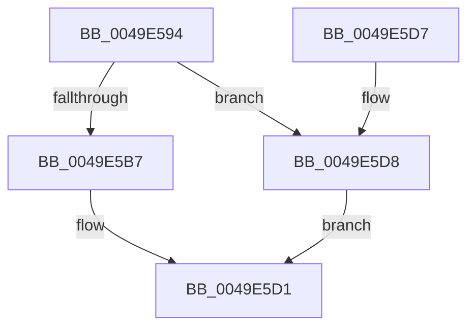

# PfSnTraceBufferAllocate

- RVA: `0x0049E594`–`0x0049E5DA` (길이 `70` bytes)
- VA: `0x000000014049E594`
- 실행 섹션: `.text`
- PDB 이름 있음: `예`; PDB Function 태그: `아니요`
- unwind 정보 RVA: `0x0008AD5C`
- 디코드: `20`개 명령, `70/70` bytes 표시
- 미해석 바이트: `0` (있으면 어셈블리에 `.byte`로 보존)

> 이 문서는 커널 이미지의 기계어와 PDB 기호를 분석해 생성했습니다. 4번과 5번은 함수 원형과 자료형을 바이너리 사용 방식에서 추정한 C 해석이며 원본 소스 복구 결과는 아닙니다.

## 1. Dependencies

- 직접 호출 지점: **2**; 고유 호출 대상: **2**
- 직접 호출자로 확인된 함수: **2**
- RIP 상대 이미지 참조: **0**

### Outgoing calls
- `0x0049E5AA` → [ExAllocatePool2](../../poolcode/B8/ExAllocatePool2_function_00B820F0.md) (function, `0x00B820F0`)
- `0x0049E5C2` → [memset](../6C/memset_function_006C6C40.md) (function, `0x006C6C40`)

### Direct callers
- [PfSnTraceGetLogEntry](../34/PfSnTraceGetLogEntry_function_003437A0.md) at `0x00343830`
- [PfSnBeginTrace](../../page/96/PfSnBeginTrace_function_00960DE8.md) at `0x00960F92`

### Static image references
- 디코드된 RIP-relative 메모리 참조가 없습니다.

## 2. Other-region calls and transfers

- 다른 실행 섹션으로 향하는 call: **1**
  - `0x0049E5AA` → [ExAllocatePool2](../../poolcode/B8/ExAllocatePool2_function_00B820F0.md) (`.text` → `POOLCODE`)
- 별도 외부 분기/꼬리 이동을 확인하지 못했습니다.

## 3. Assembly (complete function range)

```asm
0049E594  40 53                           push rbx
0049E596  48 83 EC 20                     sub rsp, 0x20
0049E59A  BA 00 10 01 00                  mov edx, 0x11000
0049E59F  B9 40 00 00 00                  mov ecx, 0x40
0049E5A4  41 B8 43 63 50 42               mov r8d, 0x42506343
0049E5AA  E8 41 3B 6E 00                  call 0x140b820f0
0049E5AF  48 8B D8                        mov rbx, rax
0049E5B2  48 85 C0                        test rax, rax
0049E5B5  74 21                           je 0x14049e5d8
0049E5B7  33 D2                           xor edx, edx
0049E5B9  41 B8 00 10 01 00               mov r8d, 0x11000
0049E5BF  48 8B C8                        mov rcx, rax
0049E5C2  E8 79 86 22 00                  call 0x1406c6c40
0049E5C7  48 8B C3                        mov rax, rbx
0049E5CA  C7 43 14 FE 10 00 00            mov dword ptr [rbx + 0x14], 0x10fe
0049E5D1  48 83 C4 20                     add rsp, 0x20
0049E5D5  5B                              pop rbx
0049E5D6  C3                              ret
0049E5D7  CC                              int3
0049E5D8  EB F7                           jmp 0x14049e5d1
```

## 4. C-style interpretation (structured pseudocode)

```c
__int64 __fastcall PfSnTraceBufferAllocate(void)
{
    __int64 result;
    __int64 v_rsp;

    v_rsp = (v_rsp) - (32);
    result = ExAllocatePool2(64, (unsigned int)(0x11000ULL), (unsigned int)(0x42506343ULL), a4);
    if (result == 0) goto loc_0049E5D8;
    a2 = 0;
    result = memset(result, a2, (unsigned int)(0x11000ULL), a4);
    *(unsigned int *)(result + 20) = 0x10FEULL;
loc_0049E5D1:
    v_rsp = (v_rsp) + (32);
    return result;
loc_0049E5D8:
    goto loc_0049E5D1;
}
```

## 5. (Beta) C Style

```c
void PfSnTraceBufferAllocate(void)
{
    int64_t result;
    int64_t local_rsp;

    local_rsp = (local_rsp) - (32);
    result = ExAllocatePool2(64, (uint32_t)(0x11000ULL), (uint32_t)(0x42506343ULL), a4);
    if (result == 0) goto loc_0049E5D8;
    a2 = 0;
    result = memset(result, a2, (uint32_t)(0x11000ULL), a4);
    *(uint32_t *)(result + 0x14) = 0x10FEULL;
loc_0049E5D1:
    local_rsp = (local_rsp) + (32);
    return result;
loc_0049E5D8:
    goto loc_0049E5D1;
}
```

## 6. Execution-region graph

[열기: 2D/3D 그래프와 함수 탐색 컨트롤 패널](../../../control-panel.html?section=text&rva=0x0049E594&view=graph)

- 2D 그래프는 위에서 아래로 흐르고, 3D 그래프는 빈 공간을 드래그해 회전합니다. Shift+드래그는 이동, 휠은 확대·축소, 함수 노드 선택은 대상 보고서 이동입니다.

### Static fallback


